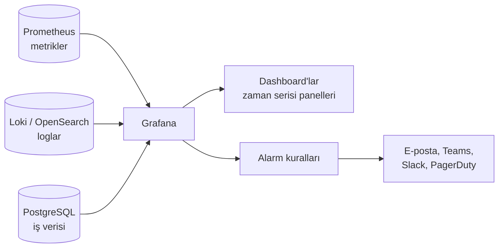

# 12.3 Grafana: BI'dan Farkı

## Nedir?
**Grafana**, zaman serisi verilerini görselleştirmek ve izlemek için kullanılan açık kaynak dashboard ve **gözlemlenebilirlik (observability)** platformudur. Prometheus, Loki, PostgreSQL, Elasticsearch, InfluxDB gibi onlarca veri kaynağına bağlanır, panolar ve **alarm** kuralları tanımlamayı sağlar.

## Hangi problemi çözer?
- Sistemlerin (sunucu, Kubernetes, uygulama, veritabanı, ETL işleri) **anlık durumunu** izlemek
- Bir metrik eşiği aşınca (CPU %90, ETL 2 saattir bitmedi, API hata oranı %5) **otomatik uyarı** göndermek
- Farklı kaynaklardaki metrikleri ve logları aynı ekranda, aynı zaman ekseninde görmek

## Nasıl çalışır?



- Grafana veriyi **kendisi saklamaz**; her panel açıldığında veya yenilendiğinde kaynağa sorgu gönderir (PromQL, SQL, LogQL).
- **Zaman ekseni merkezdedir:** Her panel bir zaman aralığına göre çizilir; sağ üstteki zaman seçici tüm panoyu birlikte değiştirir.
- **Değişkenler (variables):** Panonun üstündeki açılır listeler (`$namespace`, `$segment`) ile aynı pano farklı filtrelerle kullanılır.

**Grafana ile BI araçlarının farkı**
| Özellik | Grafana | BI araçları (Power BI, Tableau) |
|---|---|---|
| Ana amaç | Operasyonel izleme, gözlemlenebilirlik | İş analizi ve raporlama |
| Veri tipi | Zaman serisi, metrik, log | İş verisi, boyutlu modeller |
| Zaman çözünürlüğü | Saniye–dakika | Gün–ay |
| Veri modeli | Yok; her panel kendi sorgusu | Semantik model, ilişkiler, hesaplama dili |
| Etkileşim | Zaman aralığı, değişkenler | Drill-down, çapraz filtreleme, slicer |
| Alarm | Yerleşik ve güçlü | Sınırlı (veri uyarıları) |
| Kullanıcı | DevOps, SRE, veri mühendisi, platform ekibi | İş birimleri, yönetim, analist |
| Rapor çıktısı | Pano paylaşımı, sınırlı PDF | Sayfalanmış rapor, Excel, abonelik |
| Lisans | Açık kaynak (AGPL) + Grafana Cloud/Enterprise | Çoğunlukla ticari |

Kısaca: **"Sistem sağlıklı mı, şu an ne oluyor?"** → Grafana. **"İş nasıl gidiyor, neden?"** → BI aracı.

## Mini örnek
**PostgreSQL kaynağıyla ETL izleme paneli** (Grafana'da SQL sorgusu):
```sql
-- Her ETL işinin son 30 gündeki süresi (zaman serisi paneli)
SELECT
  baslangic AS "time",
  is_adi    AS metric,
  EXTRACT(EPOCH FROM (bitis - baslangic)) / 60 AS sure_dk
FROM etl_calisma_log
WHERE $__timeFilter(baslangic)            -- Grafana'nın zaman seçicisine bağlanır
ORDER BY 1;
```

```sql
-- Son yükleme ne zaman? (Stat paneli; 1 günden eskiyse kırmızı)
SELECT is_adi, MAX(bitis) AS son_basarili
FROM etl_calisma_log
WHERE durum = 'BASARILI'
GROUP BY is_adi;
```

**Prometheus kaynağıyla Kubernetes izleme** (PromQL):
```promql
# Namespace'teki pod'ların CPU kullanımı
sum by (pod) (rate(container_cpu_usage_seconds_total{namespace="$namespace"}[5m]))

# API'nin 5xx hata oranı
sum(rate(http_requests_total{status=~"5.."}[5m])) / sum(rate(http_requests_total[5m]))
```

Alarm örneği (kavramsal): "`etl_calisma_log` içinde `bddk_kredi` işi bugün 09:00'a kadar `BASARILI` olmadıysa Teams kanalına mesaj gönder."

Yerelde denemek:
```bash
docker run -d -p 3000:3000 --name grafana grafana/grafana-oss
# http://localhost:3000  (ilk giriş admin/admin, değiştirmeniz istenir)
```

## Nerede kullanılır?
- Kubernetes/OpenShift cluster ve uygulama izleme (OpenShift'in izleme yığını Prometheus tabanlıdır)
- ETL işlerinin süre, başarı ve veri güncelliği takibi
- API'lerin gecikme ve hata oranları
- Modellerin canlı ortamda izlenmesi (skor dağılımı, istek sayısı, drift göstergeleri — Bölüm 13)
- Zaman serisi niteliğindeki iş metrikleri (dakikalık işlem hacmi, anlık kart onay oranı)

## Benzerleri ve farkları
- **Kibana / OpenSearch Dashboards:** Log analizi odaklı; Elasticsearch/OpenSearch ekosistemi.
- **Datadog, New Relic, Dynatrace:** Ticari, uçtan uca gözlemlenebilirlik platformları.
- **Superset:** SQL odaklı BI; Grafana'ya benzer şekilde açık kaynaktır ama iş analitiğine yöneliktir ([12.2](02-bi-araclari.md)).
- **Gözlemlenebilirlik ayrıntıları:** Log, metrik, trace kavramları ve Prometheus için Bölüm 14.

## İlgili sayfalar
- [12.2 BI araçları](02-bi-araclari.md)
- [12.4 Dashboard tasarımı](04-dashboard-tasarimi.md)
