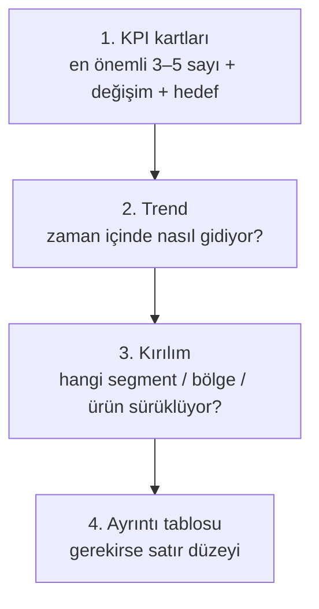

# 12.4 Dashboard Tasarım Prensipleri

## Nedir?
Bir dashboard'un, kullanıcının **sorusunu birkaç saniye içinde cevaplayacak** şekilde düzenlenmesini sağlayan ilkeler. Konu süsleme değil, **iletişimdir**: Doğru metriği, doğru grafikle, doğru sırada göstermek.

## Hangi problemi çözer?
Kötü tasarlanmış dashboard'larda:
- Kullanıcı neye bakacağını bilemez (30 grafik, hepsi aynı büyüklükte).
- Yanlış grafik türü yanlış sonuç çıkarttırır (sıfırdan başlamayan çubuk grafik, 12 dilimli pasta).
- Rakamın iyi mi kötü mü olduğu anlaşılmaz (karşılaştırma yok).
- Kimse kullanmaz, herkes yine Excel ister.

## Nasıl çalışır?

### 1. Önce soru ve kullanıcı
- **Kim kullanacak?** Yönetim (özet, bir bakışta), analist (ayrıntı, filtre), operasyon (anlık durum, alarm).
- **Hangi karar verilecek?** Her panel bir soruya cevap vermeli. Cevapladığı soru yoksa kaldırılmalı.
- **Ne sıklıkla?** Günlük izleme mi, aylık değerlendirme mi?

### 2. Bilgi hiyerarşisi: yukarıdan aşağıya, özetten ayrıntıya

Göz soldan sağa, yukarıdan aşağıya tarar (F/Z deseni). En önemli bilgi sol üste.

### 3. Doğru grafik türü
| Amaç | Uygun grafik | Kaçının |
|---|---|---|
| Zaman içindeki değişim | Çizgi grafik | Çok kategorili çubuklar |
| Kategorileri karşılaştırma | Yatay çubuk (sıralı) | Pasta (5'ten fazla dilim), 3B grafikler |
| Parça–bütün (az kategori) | Yığılmış çubuk, 2–4 dilimli pasta/halka | 10 dilimli pasta |
| Tek sayı ve hedef | KPI kartı + değişim oku, bullet chart | Gösterge (gauge) kadranları (çok yer kaplar) |
| İki değişken ilişkisi | Saçılım (scatter) | |
| Dağılım | Histogram, kutu grafiği (box plot) | |
| Bölgesel | Harita (gerçekten coğrafya önemliyse) | Her şeyi haritaya koymak |
| Çok boyutlu tablo | Koşullu biçimlendirmeli tablo, ısı haritası | |

### 4. Bağlam olmadan sayı anlamsızdır
Her önemli sayının yanında en az bir karşılaştırma bulunmalı:
- Önceki döneme göre (MoM, YoY)
- Hedefe/bütçeye göre
- Sektöre veya karşılaştırma grubuna göre (ör. BDDK sektör verisi)

```
Kredi Bakiyesi          ← kötü: sadece sayı
1,25 milyar TL

Kredi Bakiyesi          ← iyi: değişim + hedef
1,25 milyar TL
▲ %3,2 aylık | ▲ %41 yıllık | Hedefin %96'sı
```

### 5. Görsel sadelik
- **Veri-mürekkep oranı:** Izgara çizgileri, gölgeler, 3B efektler, gereksiz çerçeveler kaldırılmalı.
- **Renk az ve anlamlı kullanılmalı:** Gri tonları + vurgu için tek renk. Kırmızı/yeşil sadece iyi/kötü anlamında; renk körlüğü için ek olarak ok/işaret.
- **Tutarlılık:** Aynı segment her grafikte aynı renk; aynı sayı formatı (milyon TL, bir ondalık).
- **Eksenler:** Çubuk grafikler sıfırdan başlamalı; çizgi grafikte sıfırdan başlamak şart değildir ama ölçek açıkça belirtilmelidir.
- **Etiketler:** Başlık, grafiğin ne gösterdiğini değil **ne söylediğini** anlatabilir: "KOBİ büyümesi üç aydır yavaşlıyor".
- **Birim ve kaynak:** Her panelde birim (bin TL, %), dipnotta veri kaynağı ve güncelleme zamanı.

### 6. Performans ve güven
- Dashboard 3–5 saniyede açılmalı; ağır hesaplamalar veri katmanında önceden yapılmalı (gold tablolar, [9.13](../09-veri-depolama/13-medallion.md)).
- "Son güncelleme: 13.10.2026 08:15" bilgisi görünür olmalı.
- Metrik tanımları (tooltip veya bilgi sayfası) erişilebilir olmalı.

## Mini örnek
Aylık kredi dashboard'u için düzen taslağı:
```
┌─────────────────────────────────────────────────────────────────────┐
│ Kredi Portföyü — Eylül 2026          [Dönem ▼] [Segment ▼] [Bölge ▼]│
├──────────────┬──────────────┬──────────────┬────────────────────────┤
│ Toplam Kredi │ YoY Büyüme   │ NPL Oranı    │ Sektör Payı            │
│ 1,25 mlr TL  │ %41 ▲        │ %2,1 ▼       │ %3,4 ▲ 0,1 puan        │
├──────────────┴──────────────┴──────────────┴────────────────────────┤
│ Aylık bakiye trendi (çizgi): Banka vs Sektör (BDDK)                 │
├───────────────────────────────────┬─────────────────────────────────┤
│ Segment bazında YoY (yatay çubuk, │ Bölge × Ürün ısı haritası       │
│ büyükten küçüğe sıralı)           │                                 │
├───────────────────────────────────┴─────────────────────────────────┤
│ Ayrıntı tablosu (koşullu biçimlendirme)     Kaynak: DWH, BDDK       │
│                                             Güncelleme: 13.10 08:15  │
└─────────────────────────────────────────────────────────────────────┘
```

Python ile hızlıca sade bir grafik:
```python
import plotly.express as px

fig = px.line(aylik, x="donem", y="bakiye", color="segment",
              title="KOBİ büyümesi son üç ayda yavaşladı")
fig.update_layout(template="simple_white", yaxis_title="Bakiye (milyon TL)", legend_title=None)
fig.update_traces(line=dict(width=2))
fig.show()
```

## Nerede kullanılır?
- BI araçlarında (Power BI, Tableau, Superset) yönetim panoları
- Streamlit/Dash uygulamaları ([12.5](05-streamlit.md))
- Grafana izleme panoları (operasyonel panolarda da aynı ilkeler: önce durum, sonra ayrıntı)
- Sunum ve raporlardaki grafikler

## Benzerleri ve farkları
- **Dashboard ile rapor:** Dashboard izleme ve keşif içindir; ayrıntılı açıklama ve yorum gereken durumlar için yazılı rapor/sunum daha uygundur.
- **Keşif (exploratory) ile açıklayıcı (explanatory) görselleştirme:** Analistin kendi keşfi için yaptığı grafikler hızlı ve çok sayıdadır; yönetime sunulan grafikler az, sade ve mesaj odaklıdır.
- **Kaynaklar:** Stephen Few (*Information Dashboard Design*), Edward Tufte (*The Visual Display of Quantitative Information*), Cole Nussbaumer Knaflic (*Storytelling with Data*).

## İlgili sayfalar
- [12.1 BI nedir](01-bi-nedir.md)
- [12.5 Streamlit](05-streamlit.md)
