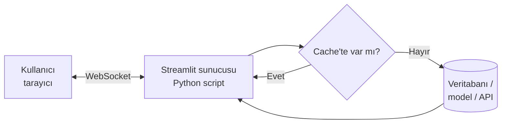

# 12.5 Streamlit ve Hazır BI Araçları Karşılaştırması

## Nedir?
**Streamlit**, sadece Python yazarak etkileşimli web uygulamaları ve dashboard'lar oluşturmayı sağlayan açık kaynak kütüphanedir. HTML, CSS veya JavaScript bilmeye gerek yoktur; bir Python script'i yukarıdan aşağıya çalışır ve ekranı oluşturur.

Benzerleri: **Plotly Dash**, **Panel**, **Shiny for Python**, **Gradio** (ML demoları).

## Hangi problemi çözer?
Hazır BI araçlarının zorlandığı durumlar:
- **Model ve hesaplama içeren uygulamalar:** "Faiz oranını değiştirirsem karlılık nasıl değişir?" gibi senaryo (what-if) ve simülasyonlar, kullanıcı girdisine göre ML modeli çalıştırmak.
- **Özel iş akışları:** Dosya yükle → doğrula → işle → sonucu indir.
- **Python ekosistemi:** pandas, scikit-learn, statsmodels, LLM kütüphaneleri doğrudan kullanılır.
- **Hızlı prototip:** Bir analiz notebook'unu birkaç saat içinde paylaşılabilir bir uygulamaya çevirmek.
- **Lisans:** Ek BI lisansı gerekmez.

## Nasıl çalışır?
- Script, her kullanıcı etkileşiminde (buton, kaydırıcı, seçim) **baştan sona yeniden çalışır**.
- Bu yüzden ağır işlemler **önbelleğe** alınır:
  - `@st.cache_data`: Veri (DataFrame, sorgu sonucu)
  - `@st.cache_resource`: Paylaşılan kaynaklar (veritabanı bağlantısı, ML modeli)
- `st.session_state`: Yeniden çalışmalar arasında kullanıcıya özel durum saklar.
- Tarayıcıyla sunucu arasında **WebSocket** bağlantısı vardır; proxy arkasında bunun ayarlanması gerekir ([8.4](../08-nginx/04-reverse-proxy.md)).



## Mini örnek
`app.py`:
```python
import pandas as pd
import plotly.express as px
import streamlit as st
from sqlalchemy import create_engine

st.set_page_config(page_title="Kredi Paneli", layout="wide")

@st.cache_resource
def baglanti():
    return create_engine(st.secrets["db_url"])          # şifre koda değil secrets'a

@st.cache_data(ttl=3600)
def veri_yukle() -> pd.DataFrame:
    return pd.read_sql("SELECT donem, segment, bakiye, yoy FROM gold.kredi_metrik", baglanti())

df = veri_yukle()

# Kenar çubuğu filtreleri
segmentler = st.sidebar.multiselect("Segment", sorted(df["segment"].unique()), default=["KOBİ"])
filtre = df[df["segment"].isin(segmentler)]
son = filtre[filtre["donem"] == filtre["donem"].max()]

# KPI kartları
k1, k2 = st.columns(2)
k1.metric("Toplam bakiye (mlr TL)", f"{son['bakiye'].sum() / 1e9:,.2f}")
k2.metric("Ortalama YoY", f"%{son['yoy'].mean() * 100:,.1f}")

# Trend
st.plotly_chart(px.line(filtre, x="donem", y="bakiye", color="segment"), use_container_width=True)

# Senaryo analizi (BI aracında zor olan kısım)
st.subheader("Senaryo: büyüme varsayımı")
buyume = st.slider("Aylık büyüme varsayımı (%)", -2.0, 5.0, 1.5, 0.1)
tahmin = son["bakiye"].sum() * (1 + buyume / 100) ** 12
st.write(f"12 ay sonra tahmini bakiye: **{tahmin / 1e9:,.2f} milyar TL**")

st.download_button("CSV indir", filtre.to_csv(index=False).encode("utf-8"), "kredi.csv")
```

```bash
pip install streamlit plotly sqlalchemy psycopg2-binary
streamlit run app.py                 # http://localhost:8501
```

Canlı ortama alma: Dockerfile ([4.2](../04-docker/02-dockerfile.md)) → OpenShift/Kubernetes Deployment + Service + Route/Ingress ([5.4](../05-kubernetes/04-deployment.md)); birden çok kopyada oturum için sticky session ([8.9](../08-nginx/09-ingress-controller.md)).

## Nerede kullanılır?
- Model sonuçlarını iş birimlerine sunan uygulamalar (skor açıklamaları, senaryo analizleri)
- Fiyatlama ve projeksiyon araçları (parametre gir → hesapla → sonuç gör)
- Veri kalitesi ve ETL izleme ekranları
- Analiz prototipleri ve iç araçlar
- LLM tabanlı sohbet arayüzleri (`st.chat_input`, `st.chat_message`)

## Benzerleri ve farkları
| Özellik | Hazır BI araçları (Power BI, Tableau, Superset) | Streamlit / Dash |
|---|---|---|
| Geliştirme | Sürükle-bırak, az kod | Python kodu |
| Kimin için? | İş analisti, geniş kullanıcı kitlesi | Veri bilimci, Python bilen analist |
| Standart raporlama | Çok güçlü | Elle geliştirmek gerekir |
| Self-servis keşif | Güçlü (kullanıcı kendi grafiğini kurar) | Sınırlı (geliştiricinin sunduğu kadar) |
| Özel mantık, ML, simülasyon | Sınırlı | Çok güçlü |
| Kullanıcı girdisi ve iş akışı | Zayıf | Güçlü |
| Yetki, abonelik, e-posta raporu | Hazır | Ayrıca kurulmalı (LDAP/SSO, zamanlama) |
| Performans (çok kullanıcı) | Optimize edilmiş | Uygulama tasarımına bağlı; her etkileşim script'i çalıştırır |
| Bakım | Platform ekibi | Kodu yazan ekip (Git, CI/CD, testler) |
| Lisans | Çoğunlukla ticari | Açık kaynak |

**Ne zaman hangisi?**
- **Hazır BI:** Standart KPI raporları, çok sayıda kullanıcı, self-servis analiz, kurumsal yetki ve abonelik ihtiyacı.
- **Streamlit/Dash:** Hesaplama, model, senaryo, kullanıcı girdisi ve özel iş akışı içeren analitik uygulamalar.
- Pratikte ikisi bir arada kullanılır: Standart raporlar BI aracında, ileri analitik uygulamalar Streamlit'te; ikisi de aynı **gold** tablolardan beslenir.

**Streamlit ile Dash farkı:** Streamlit'te script her etkileşimde yeniden çalışır (çok basit model); Dash'te açık **callback**'ler tanımlanır (daha fazla kod ama karmaşık uygulamalarda daha fazla kontrol ve performans).

## İlgili sayfalar
- [12.2 BI araçları](02-bi-araclari.md)
- [12.4 Dashboard tasarımı](04-dashboard-tasarimi.md)
- [8.4 Reverse proxy (WebSocket)](../08-nginx/04-reverse-proxy.md)
