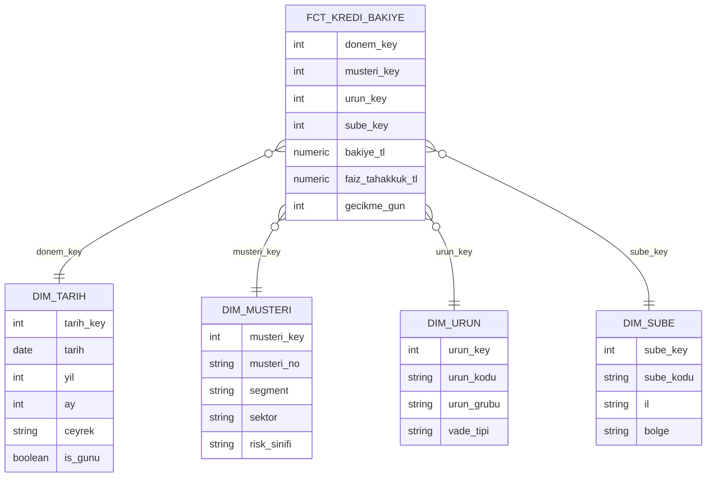

# 12.6 Boyutsal Modelleme: Fact, Dimension, Star ve Snowflake Şema

## Nedir?
**Boyutsal modelleme (dimensional modeling)**, analitik veriyi iş kullanıcılarının sorduğu sorulara göre düzenleme yöntemidir. Ralph Kimball tarafından yaygınlaştırılmıştır ve veri ambarlarının ve BI raporlarının en yaygın modelleme biçimidir. Veri iki tür tabloya ayrılır:

- **Fact (olgu) tablosu:** Ölçülen olaylar ve sayısal değerler. "Ne oldu, ne kadar?" Örnek: kredi bakiyesi, işlem tutarı, işlem adedi.
- **Dimension (boyut) tablosu:** Olguları anlamlandıran bağlam. "Kim, ne, nerede, ne zaman?" Örnek: müşteri, ürün, şube, tarih.

**Star (yıldız) şema:** Ortada bir fact tablosu, etrafında ona doğrudan bağlı dimension tabloları. **Snowflake (kar tanesi) şema:** Dimension tabloları alt tablolara normalize edilmiştir (şube → il → bölge).

## Hangi problemi çözer?
- Operasyonel sistemlerin (OLTP) normalize edilmiş, yüzlerce tablolu yapısı analiz için karmaşıktır; tek bir rapor için 15 tablo join'lemek gerekir ([9.1](../09-veri-depolama/01-oltp-olap.md)).
- Aynı kavramın (müşteri segmenti, şube bölgesi) her raporda farklı hesaplanması
- BI araçlarında yavaş ve yanlış sonuç veren sorgular
- İş kullanıcısının "şube, segment ve ay kırılımında kredi bakiyesi" gibi soruları kendi başına sorabilmesi (self-servis)

## Nasıl çalışır?

**Star şema örneği: aylık kredi bakiyesi**


**Modelleme adımları (Kimball'un dört adımı)**
| Adım | Soru | Örnek |
|---|---|---|
| 1. **İş sürecini seç** | Hangi süreci ölçüyoruz? | Kredi kullandırım ve bakiye takibi |
| 2. **Granülerliği (grain) belirle** | Fact tablosunda **bir satır neyi** temsil ediyor? | "Bir kredi hesabının bir ay sonundaki durumu" |
| 3. **Boyutları belirle** | Hangi kırılımlarla analiz edilecek? | Tarih, müşteri, ürün, şube, para birimi |
| 4. **Ölçüleri (measure) belirle** | Hangi sayılar toplanacak? | Bakiye, tahakkuk eden faiz, gecikme günü |

**Granülerlik en kritik karardır.** Farklı granülerlikteki veriyi aynı fact tablosuna koymak (bazı satırlar günlük, bazıları aylık) toplamların yanlış çıkmasına yol açar.

**Fact tablosu türleri**
| Tür | Bir satır | Örnek |
|---|---|---|
| **Transaction (işlem) fact** | Tek bir olay | Her kart işlemi, her havale |
| **Periodic snapshot (dönemsel görüntü)** | Bir varlığın belirli aralıklardaki durumu | Her kredinin ay sonu bakiyesi, her hesabın gün sonu bakiyesi |
| **Accumulating snapshot (biriken görüntü)** | Bir sürecin aşamaları; aşama tamamlandıkça güncellenir | Kredi başvurusu: başvuru, değerlendirme, onay, kullandırım tarihleri |
| **Factless fact** | Ölçü içermeyen olay veya kapsam | Kampanyaya dahil edilen müşteriler; şube ziyaretleri |

**Ölçü türleri**
| Tür | Toplanabilir mi? | Örnek | Dikkat |
|---|---|---|---|
| **Additive (toplanabilir)** | Tüm boyutlarda | İşlem tutarı, işlem adedi | |
| **Semi-additive (yarı toplanabilir)** | Bazı boyutlarda; **zamanda toplanamaz** | Bakiye, stok | Ocak + Şubat bakiyesini toplamak anlamsızdır; dönem sonu veya ortalama alınır |
| **Non-additive (toplanamaz)** | Hiçbir boyutta | Oran, yüzde, faiz oranı | Pay ve paydayı ayrı saklayıp raporda bölün (NPL oranı = takipteki / toplam) |

**Dimension tasarımı**
- **Surrogate key (vekil anahtar):** Ambar içinde üretilen anlamsız tamsayı anahtar (`musteri_key`). Kaynak sistemin anahtarı (`musteri_no`) ayrı sütunda tutulur. Böylece kaynak sistem değişse veya geçmiş tutulsa da model bozulmaz ([12.7](07-scd-data-vault.md)).
- **Tarih boyutu:** Her gün için bir satır; yıl, ay, çeyrek, iş günü, resmî tatil, ay sonu mu gibi alanlar. Takvim mantığını her sorguda yeniden yazmaktan kurtarır.
- **Conformed (uyumlu) dimension:** Birden çok fact tablosunun **aynı** müşteri, ürün, tarih boyutunu paylaşması. Kredi ve mevduat raporlarının aynı müşteri segment tanımıyla birleştirilebilmesini sağlar; kurum genelinde tutarlılığın anahtarıdır.
- **Junk dimension:** Az değerli bayrakları (kanal, işlem tipi, otomatik mi) tek küçük boyutta toplamak.
- **Degenerate dimension:** Boyut tablosu olmayan ama fact'te tutulan tanımlayıcı (işlem numarası, dekont no).
- **Role-playing dimension:** Aynı boyutun farklı rollerle kullanılması (tarih boyutu: kullandırım tarihi, vade tarihi, kapanış tarihi).

**Star mı, snowflake mı?**
| | Star | Snowflake |
|---|---|---|
| Dimension yapısı | Denormalize, geniş tek tablo | Normalize, alt tablolar |
| Sorgu | Daha az join, daha hızlı, BI dostu | Daha çok join |
| Depolama ve bakım | Tekrar eden değerler (il adı her şubede) | Daha az tekrar, hiyerarşi bakımı kolay |
| Öneri | Varsayılan tercih | Çok büyük ve sık değişen hiyerarşilerde |

**Bus matrix (kurumsal plan)**: Satırlarda iş süreçleri (fact'ler), sütunlarda ortak boyutlar. Hangi boyutun hangi süreçte kullanıldığını ve ortak (conformed) boyutları gösterir.
| İş süreci | Tarih | Müşteri | Ürün | Şube | Kanal | Para birimi |
|---|---|---|---|---|---|---|
| Kredi bakiye (aylık) | ✔ | ✔ | ✔ | ✔ | | ✔ |
| Mevduat bakiye (günlük) | ✔ | ✔ | ✔ | ✔ | | ✔ |
| Kart işlemleri | ✔ | ✔ | ✔ | | ✔ | ✔ |
| Kredi başvuruları | ✔ | ✔ | ✔ | ✔ | ✔ | |

## Mini örnek
**Tablolar**
```sql
CREATE TABLE dwh.dim_tarih (
    tarih_key   int PRIMARY KEY,           -- 20260930
    tarih       date NOT NULL UNIQUE,
    yil         int, ay int, ceyrek text,
    ay_sonu_mu  boolean, is_gunu boolean
);

CREATE TABLE dwh.dim_musteri (
    musteri_key bigserial PRIMARY KEY,     -- surrogate key
    musteri_no  text NOT NULL,             -- kaynak anahtar
    segment     text, sektor text, risk_sinifi text
);

CREATE TABLE dwh.fct_kredi_bakiye (       -- grain: kredi hesabı × ay sonu
    donem_key        int    NOT NULL REFERENCES dwh.dim_tarih,
    musteri_key      bigint NOT NULL REFERENCES dwh.dim_musteri,
    urun_key         int    NOT NULL,
    sube_key         int    NOT NULL,
    kredi_no         text   NOT NULL,      -- degenerate dimension
    bakiye_tl        numeric(18,2),        -- semi-additive
    faiz_tahakkuk_tl numeric(18,2),        -- additive (dönem içi)
    gecikme_gun      int,
    PRIMARY KEY (donem_key, kredi_no)
);
```

**Tarih boyutunu doldurmak**
```sql
INSERT INTO dwh.dim_tarih
SELECT to_char(d, 'YYYYMMDD')::int, d::date, extract(year FROM d)::int, extract(month FROM d)::int,
       'Q' || extract(quarter FROM d),
       d::date = (date_trunc('month', d) + interval '1 month - 1 day')::date,
       extract(isodow FROM d) < 6                         -- resmî tatiller ayrıca işaretlenmeli
FROM generate_series(DATE '2015-01-01', DATE '2035-12-31', interval '1 day') AS d;
```

**Tipik analitik sorgu**
```sql
SELECT t.yil, t.ay, m.segment, s.bolge,
       SUM(f.bakiye_tl)                                    AS bakiye_tl,
       SUM(f.bakiye_tl) FILTER (WHERE f.gecikme_gun > 90) AS takipteki_tl
FROM dwh.fct_kredi_bakiye f
JOIN dwh.dim_tarih   t ON t.tarih_key   = f.donem_key
JOIN dwh.dim_musteri m ON m.musteri_key = f.musteri_key
JOIN dwh.dim_sube    s ON s.sube_key    = f.sube_key
WHERE t.yil = 2026
GROUP BY 1, 2, 3, 4;
```
Bakiye yarı toplanabilir olduğu için bu sorgu **ay kırılımında** doğrudur; yıl toplamı için `SUM` yerine yıl sonu ayı veya ortalama bakiye kullanılmalıdır.

**dbt ile katmanlar**
```
models/
├── staging/          # stg_core__kredi_hesap.sql      — kaynak tablo başına temizlik
├── intermediate/     # int_kredi_aylik.sql            — iş kuralları, birleştirmeler
└── marts/
    ├── dim_musteri.sql
    ├── dim_urun.sql
    └── fct_kredi_bakiye.sql                           — star şema, BI'a açılan katman
```
Medallion mimarisindeki **gold** katmanı genellikle bu boyutsal modeldir ([9.13](../09-veri-depolama/13-medallion.md)).

## Nerede kullanılır?
- Veri ambarlarının raporlama katmanı (data mart'lar)
- BI araçlarının veri modelleri: Power BI'da tablolar arası ilişkiler star şemaya göre kurulduğunda en iyi çalışır
- Düzenleyici ve yönetim raporlarının ortak kaynağı (conformed boyutlarla tutarlı rakamlar)
- Feature üretimi: müşteri boyutu ve fact'ler, model özniteliklerinin kaynağıdır ([13.5](../13-mlops/05-feature-kavrami.md))

## Benzerleri ve farkları
- **Normalize OLTP modeli (3NF):** Tekrarsız, yazma odaklı; analiz için karmaşık ([9.2](../09-veri-depolama/02-iliskisel-sql-acid.md)).
- **OBT (One Big Table, tek büyük tablo):** Tüm boyut alanları fact'e eklenmiş, join gerektirmeyen geniş tablo; sütun bazlı motorlarda (BigQuery, ClickHouse, DuckDB) hızlıdır ama boyut değişikliklerinde tüm tabloyu yeniden yazmak gerekir. Çoğu zaman star şemadan **türetilen** bir yayın katmanı olarak kullanılır.
- **Data Vault ve Inmon yaklaşımı:** Entegrasyon ve geçmiş takibi odaklı modelleme yöntemleri ([12.7](07-scd-data-vault.md)).
- **Semantik katman:** Ölçülerin (KPI) hesaplanma kuralını boyutsal modelin üzerinde tek yerde tanımlar ([12.1](01-bi-nedir.md)).

## İlgili sayfalar
- [12.7 SCD, Data Vault ve modelleme yaklaşımları](07-scd-data-vault.md)
- [9.12 Warehouse, lake, lakehouse](../09-veri-depolama/12-warehouse-lake-lakehouse.md)
- [11.4 dbt](../11-veri-akisi/04-dbt.md)
- [12.4 Dashboard tasarımı](04-dashboard-tasarimi.md)
