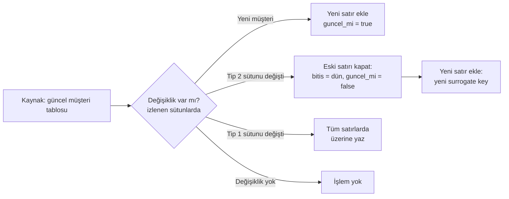
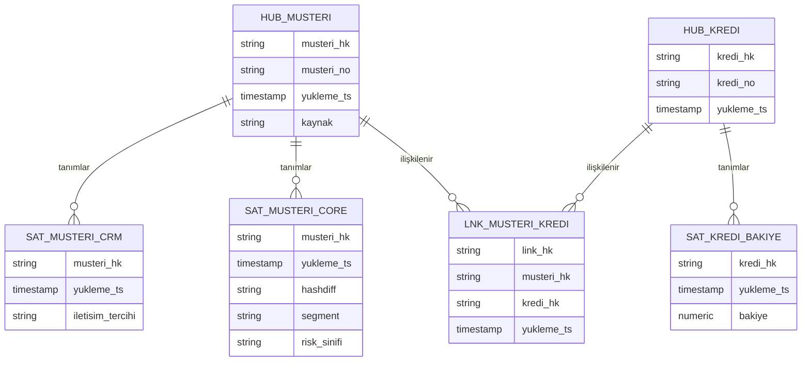

# 12.7 SCD, Data Vault ve Modelleme Yaklaşımları

## Nedir?
- **SCD (Slowly Changing Dimension, yavaş değişen boyut):** Boyut tablosundaki bir özelliğin zamanla değişmesi (müşterinin segmenti KOBİ'den Ticari'ye geçti, şube başka bölgeye bağlandı) durumunda **geçmişin nasıl saklanacağını** belirleyen tekniklerdir.
- **Data Vault:** Kaynak sistemlerden gelen veriyi **değiştirmeden, tüm geçmişiyle ve denetlenebilir biçimde** entegre etmek için hub, link ve satellite tablolarından oluşan modelleme yöntemi.
- **Modelleme yaklaşımları:** Veri ambarının katmanlarının nasıl kurulacağına dair ana okullar: **Kimball** (boyutsal, [12.6](06-boyutsal-modelleme.md)), **Inmon** (merkezi normalize kurumsal ambar), **Data Vault** ve modern ELT'de sık görülen **geniş tablo (OBT)**.

## Hangi problemi çözer?
- **"Geçen yılki raporu bugün yeniden üretince rakamlar neden farklı?"** Çünkü müşteri segmenti güncellenmiş ve geçmiş kaybolmuş.
- Model ve analiz için "müşterinin **o tarihteki** segmenti, risk sınıfı neydi?" sorusu (point-in-time doğruluk, [13.9](../13-mlops/09-point-in-time.md))
- Denetim: Bir kaydın ne zaman, hangi kaynaktan, hangi değerle geldiğinin izlenmesi
- Çok sayıda kaynak sistemin (çekirdek bankacılık, kart, CRM, hazine) aynı müşteri kavramı etrafında birleştirilmesi
- Kaynak sistemler değiştikçe ambarın baştan tasarlanmak zorunda kalınması

## Nasıl çalışır?

### SCD türleri
| Tür | Davranış | Geçmiş | Örnek kullanım |
|---|---|---|---|
| **Tip 0** | Değer hiç değişmez | — | Doğum tarihi, ilk müşteri olma tarihi |
| **Tip 1** | Üzerine yazılır | Kaybolur | Yazım hatası düzeltmesi, telefon numarası |
| **Tip 2** | Yeni satır eklenir; geçerlilik tarihleri tutulur | **Tam geçmiş** | Segment, risk sınıfı, bağlı şube, sektör |
| **Tip 3** | Önceki değer ayrı sütunda | Sadece bir önceki | "Önceki segment" karşılaştırması |
| **Tip 4** | Güncel tablo + ayrı geçmiş tablosu | Ayrı tabloda | Çok sık değişen özellikler |
| **Tip 6** | Tip 1 + 2 + 3 birleşimi: tarihçeli satırlar + her satırda güncel değer | Tam + güncel | "O tarihteki" ve "bugünkü" segmentle aynı anda raporlama |

**SCD tip 2'nin yapısı**
| musteri_key | musteri_no | segment | gecerlilik_baslangic | gecerlilik_bitis | guncel_mi |
|---|---|---|---|---|---|
| 1001 | M-123 | KOBİ | 2021-03-01 | 2025-06-30 | false |
| 2087 | M-123 | Ticari | 2025-07-01 | 9999-12-31 | true |

Fact tablosu, olayın gerçekleştiği andaki **surrogate key**'i (`musteri_key`) taşır. Böylece 2024 kredileri KOBİ segmentinde, 2026 kredileri Ticari segmentinde raporlanır; geçmiş raporlar yeniden üretildiğinde aynı sonucu verir.



**Bitemporal (çift zamanlı) model:** Bankacılıkta iki ayrı zaman önemlidir: **geçerlilik zamanı** (değişiklik iş açısından ne zaman geçerli oldu) ve **kayıt zamanı** (ambara ne zaman geldi). Geriye dönük düzeltmelerde ("Haziran'dan geçerli olmak üzere Ağustos'ta güncellendi") ikisini ayrı tutmak, "Temmuz raporunu o gün bildiğimiz bilgiyle" yeniden üretmeyi sağlar.

### Data Vault

| Tablo | İçerik |
|---|---|
| **Hub** | İş anahtarlarının (müşteri no, kredi no) benzersiz listesi; anahtarın hash'i, ilk yükleme zamanı, kaynak |
| **Link** | Hub'lar arası ilişkiler (müşteri–kredi, kredi–teminat) |
| **Satellite** | Tanımlayıcı özellikler ve **tüm geçmişi**; her kaynak için ayrı satellite olabilir; değişiklik `hashdiff` ile tespit edilir |

Özellikleri: Sadece ekleme (insert-only), kaynak bazında izlenebilirlik, paralel yükleme, yeni kaynak eklemenin mevcut yapıyı bozmaması. Sorgulaması karmaşık olduğu için iş kullanıcıları doğrudan Data Vault'u değil, üzerine kurulan **boyutsal data mart'ları** kullanır.

### Yaklaşımların karşılaştırması
| | Kimball (boyutsal) | Inmon (kurumsal ambar) | Data Vault | OBT / geniş tablo |
|---|---|---|---|---|
| Temel fikir | İş süreçlerine göre star şemalar, conformed boyutlar | Merkezi, normalize (3NF) kurumsal model; mart'lar ondan türetilir | Hub/link/satellite ile esnek, denetlenebilir entegrasyon katmanı | Her kullanım için join'siz geniş tablo |
| Güçlü yanı | Hızlı değer üretimi, BI dostu | Kurumsal tutarlılık | Değişime dayanıklılık, tam geçmiş, denetim izi | Basitlik, sütun bazlı motorlarda hız |
| Zayıf yanı | Kaynak değişikliklerine karşı daha kırılgan | Uzun ve pahalı kurulum | Karmaşıklık, çok sayıda tablo, otomasyon şart | Tekrar, boyut değişikliklerinde yeniden yazma |
| Tipik katman | Gold / data mart | Silver / kurumsal katman | Silver (raw vault + business vault) | Gold'un üzerinde yayın katmanı |

Bankalarda sık görülen hibrit: **Kaynak → (staging / bronze) → kurumsal entegrasyon katmanı (Inmon veya Data Vault) → boyutsal data mart'lar (Kimball) → BI ve analitik**.

## Mini örnek
**SCD tip 2'yi SQL ile güncellemek (PostgreSQL)**
```sql
-- 1) Değişen kayıtları kapat
UPDATE dwh.dim_musteri d
SET gecerlilik_bitis = CURRENT_DATE - 1, guncel_mi = false
FROM staging.musteri s
WHERE d.musteri_no = s.musteri_no
  AND d.guncel_mi
  AND (d.segment, d.risk_sinifi) IS DISTINCT FROM (s.segment, s.risk_sinifi);

-- 2) Yeni ve değişen müşteriler için güncel satır ekle
INSERT INTO dwh.dim_musteri (musteri_no, segment, risk_sinifi, gecerlilik_baslangic, gecerlilik_bitis, guncel_mi)
SELECT s.musteri_no, s.segment, s.risk_sinifi, CURRENT_DATE, DATE '9999-12-31', true
FROM staging.musteri s
LEFT JOIN dwh.dim_musteri d ON d.musteri_no = s.musteri_no AND d.guncel_mi
WHERE d.musteri_no IS NULL;
```
İki adım aynı transaction içinde çalıştırılmalıdır ([9.16](../09-veri-depolama/16-transaction-isolation.md)).

**Fact yüklerken o tarihteki boyut satırını bulmak**
```sql
INSERT INTO dwh.fct_kredi_bakiye (donem_key, musteri_key, kredi_no, bakiye_tl)
SELECT to_char(k.donem, 'YYYYMMDD')::int, d.musteri_key, k.kredi_no, k.bakiye_tl
FROM staging.kredi_aylik k
JOIN dwh.dim_musteri d
  ON d.musteri_no = k.musteri_no
 AND k.donem BETWEEN d.gecerlilik_baslangic AND d.gecerlilik_bitis;   -- point-in-time join
```

**dbt snapshot ile SCD tip 2**
```yaml
# snapshots/musteri_snapshot.yml
snapshots:
  - name: musteri_snapshot
    relation: source('core', 'musteri')
    config:
      schema: snapshots
      unique_key: musteri_no
      strategy: check
      check_cols: [segment, risk_sinifi, sube_kodu]
      dbt_valid_to_current: "to_date('9999-12-31', 'YYYY-MM-DD')"
```
```bash
dbt snapshot          # her çalışmada değişiklikleri tespit edip dbt_valid_from / dbt_valid_to sütunlarıyla tarihçe tutar
```
Eski dbt sürümlerinde snapshot'lar `` bloklu SQL dosyalarıyla tanımlanır. Kaynakta güvenilir bir `guncelleme_zamani` sütunu varsa `strategy: timestamp` daha verimlidir.

**Data Vault: hash anahtarları ve satellite yükleme**
```sql
INSERT INTO raw_vault.hub_musteri (musteri_hk, musteri_no, yukleme_ts, kaynak)
SELECT DISTINCT md5(upper(trim(s.musteri_no))), s.musteri_no, now(), 'CORE'
FROM staging.musteri s
WHERE NOT EXISTS (SELECT 1 FROM raw_vault.hub_musteri h
                  WHERE h.musteri_hk = md5(upper(trim(s.musteri_no))));

INSERT INTO raw_vault.sat_musteri_core (musteri_hk, yukleme_ts, hashdiff, segment, risk_sinifi)
SELECT x.musteri_hk, now(), x.hashdiff, x.segment, x.risk_sinifi
FROM (SELECT md5(upper(trim(musteri_no))) AS musteri_hk,
             md5(concat_ws('|', segment, risk_sinifi)) AS hashdiff, segment, risk_sinifi
      FROM staging.musteri) x
WHERE NOT EXISTS (                                   -- sadece değişen kayıtlar eklenir
    SELECT 1 FROM raw_vault.sat_musteri_core s
    WHERE s.musteri_hk = x.musteri_hk
      AND s.hashdiff = x.hashdiff
      AND s.yukleme_ts = (SELECT max(yukleme_ts) FROM raw_vault.sat_musteri_core
                          WHERE musteri_hk = x.musteri_hk));
```
Gerçek projelerde bu kalıplar elle yazılmaz; dbt paketleri (AutomateDV, datavault4dbt) veya otomasyon araçlarıyla üretilir.

## Nerede kullanılır?
- Müşteri, ürün, şube, organizasyon boyutlarının geçmişiyle saklanması
- Geçmiş raporların aynı sonuçla yeniden üretilmesi (denetim, düzenleyici raporlar)
- Model eğitiminde "o tarihteki" müşteri özelliklerinin kullanılması
- Çok kaynaklı kurumsal ambar ve entegrasyon katmanları (Data Vault)
- Birleşme/devralma ve çekirdek sistem değişimi gibi kaynak yapısının değiştiği projeler

## Benzerleri ve farkları
- **Delta/Iceberg time travel:** Tablonun **teknik** geçmiş sürümlerini sorgular ("geçen salı tablo neydi"); SCD ise **iş anlamında** geçmişi modelin parçası yapar. Time travel genellikle sınırlı süre saklanır ([9.14](../09-veri-depolama/14-delta-iceberg.md)).
- **CDC:** Kaynaktaki değişiklikleri olay olarak yakalar; SCD tip 2 ve Data Vault satellite'larını beslemenin en doğru yoludur ([11.3](../11-veri-akisi/03-yukleme-turleri.md)).
- **Temporal tablolar:** SQL Server ve Oracle'da (Flashback Data Archive) veritabanının sistem zamanlı tarihçeyi otomatik tutması.
- **Feature store'daki point-in-time join:** Aynı fikrin ML tarafındaki uygulaması ([13.9](../13-mlops/09-point-in-time.md)).

## İlgili sayfalar
- [12.6 Boyutsal modelleme](06-boyutsal-modelleme.md)
- [11.4 dbt](../11-veri-akisi/04-dbt.md)
- [9.13 Medallion](../09-veri-depolama/13-medallion.md)
- [16.3 Lineage](../16-veri-yonetisimi/03-lineage.md)
