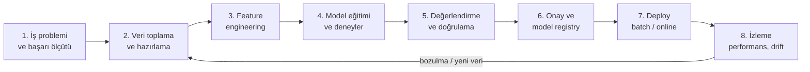

# 13.1 ML Yaşam Döngüsü

## Nedir?
**ML yaşam döngüsü**, bir makine öğrenmesi modelinin iş probleminin tanımından başlayıp, canlı ortamda çalışması, izlenmesi ve yenilenmesine kadar geçen tüm aşamalardır.

**MLOps (Machine Learning Operations)**, bu döngüyü **tekrarlanabilir, otomatik, izlenebilir ve denetlenebilir** hâle getiren uygulamalar bütünüdür. DevOps'un ([6.1](../06-ci-cd/01-ci-cd-nedir.md)) ML'e uyarlanmış hâli: Kod + **veri** + **model** birlikte yönetilir.

## Hangi problemi çözer?
Araştırmalar ve sektör tecrübesi, modellerin büyük kısmının notebook'ta kalıp canlıya hiç çıkamadığını gösterir. Çıkanlarda da sorunlar görülür:
- "Bu model hangi veriyle, hangi parametrelerle eğitildi?" sorusu cevapsız kalır.
- Eğitimdeki feature hesaplaması ile canlıdaki hesaplama farklıdır; model canlıda kötü çalışır.
- Model zamanla bozulur (veri değişir) ama kimse fark etmez.
- Düzenleyici ve iç denetim (model risk yönetimi) için gereken belgeler ve geçmiş kayıtları yoktur.

## Nasıl çalışır?



| Aşama | Ne yapılır? | MLOps karşılığı |
|---|---|---|
| İş problemi | Hedef değişken, başarı ölçütü (AUC, Gini, iş metriği), kısıtlar | Dokümante edilmiş model kartı |
| Veri | Kaynak tespiti, kalite, etiketleme, örneklem | Veri versiyonlama, kalite testleri ([11.5](../11-veri-akisi/05-veri-kalitesi.md)) |
| Feature | Değişken türetme | Feature store, point-in-time doğruluk ([13.6](06-feature-store-nedir.md)) |
| Eğitim | Algoritma, hiperparametre denemeleri | Experiment tracking ([13.2](02-mlflow.md)) |
| Değerlendirme | Test seti, zaman dışı (out-of-time) doğrulama, adillik, açıklanabilirlik | Otomatik doğrulama adımları, karşılaştırma |
| Onay | Model risk / validasyon ekibi onayı | Model registry'de aşama (stage) ve onay kaydı |
| Deploy | Batch skorlama veya API | CI/CD, container, Kubernetes ([13.3](03-model-serving.md)) |
| İzleme | Performans, veri ve tahmin dağılımı | Drift tespiti, alarm ([13.4](04-monitoring-drift.md)) |

**MLOps olgunluk seviyeleri (sadeleştirilmiş)**
| Seviye | Durum |
|---|---|
| 0 — Elle | Notebook'ta eğitim, model dosyası e-postayla/klasörle teslim, elle deploy |
| 1 — Otomatik eğitim hattı | Eğitim pipeline'ı kodla tanımlı, zamanlanmış, deney ve modeller kayıtlı |
| 2 — Tam CI/CD | Kod, veri ve model değişiklikleri otomatik test, doğrulama ve deploy süreçlerinden geçer; izleme ve yeniden eğitim tetikleri otomatik |

**Bankacılıkta model riski:** Kredi skorlama, fiyatlama, provizyon (IFRS 9) gibi modeller düzenleyici denetime tabidir. Bağımsız model validasyonu, dokümantasyon, versiyon geçmişi ve izleme raporları zorunludur. MLOps bu gereksinimleri kod ve kayıtlarla karşılar.

## Mini örnek
Notebook'tan yeniden üretilebilir eğitim adımına geçiş (sadeleştirilmiş proje yapısı):
```
kredi_skor_modeli/
├── pyproject.toml              # sabitlenmiş bağımlılıklar (2.5)
├── configs/egitim.yaml         # veri tarihleri, hiperparametreler
├── src/
│   ├── veri.py                 # veri çekme (SQL), kalite kontrolleri
│   ├── featurelar.py           # feature fonksiyonları (eğitim ve skorlamada AYNI kod)
│   ├── egit.py                 # eğitim + MLflow kaydı
│   ├── dogrula.py              # eşik kontrolleri: Gini > 0.55, PSI < 0.1
│   └── skorla.py               # batch skorlama
├── tests/                      # unit testler (6.3)
└── Dockerfile
```

```python
# src/egit.py (özet)
import mlflow, yaml
from sklearn.metrics import roc_auc_score
from lightgbm import LGBMClassifier
from veri import egitim_verisi
from featurelar import feature_uret

cfg = yaml.safe_load(open("configs/egitim.yaml"))
df = feature_uret(egitim_verisi(cfg["baslangic"], cfg["bitis"]))
X_tr, X_te, y_tr, y_te = ...           # zamana göre bölme (out-of-time)

with mlflow.start_run():
    mlflow.log_params(cfg["model"])
    model = LGBMClassifier(**cfg["model"]).fit(X_tr, y_tr)
    gini = 2 * roc_auc_score(y_te, model.predict_proba(X_te)[:, 1]) - 1
    mlflow.log_metric("gini_oot", gini)
    mlflow.sklearn.log_model(model, "model", registered_model_name="kredi_skor")
```

## Nerede kullanılır?
- Kredi başvuru ve davranış skorlama, erken uyarı modelleri
- Fraud ve anomali tespiti (ör. personel sorgu davranışları)
- Müşteri ürün sahipliği / kampanya yanıt tahmini, churn
- Nakit akışı ve mevduat tahmini, fiyatlama modelleri

## Benzerleri ve farkları
- **DevOps:** Kod ve altyapıyı yönetir. **MLOps:** Bunlara ek olarak veri ve modelin versiyonlanmasını, eğitim–canlı tutarlılığını ve modelin zamanla bozulmasını yönetir.
- **DataOps:** Veri hatlarının kalite ve otomasyonuna odaklanır (Bölüm 11).
- **LLMOps:** Büyük dil modelli uygulamalara özgü işler: prompt versiyonlama, değerlendirme setleri, RAG bileşenleri ([13.12](12-genai-rag.md)).
- **CRISP-DM:** Veri madenciliği projelerinin klasik süreç modeli (iş anlama → veri anlama → hazırlama → modelleme → değerlendirme → yayına alma); MLOps bunun operasyon tarafını tamamlar.

## İlgili sayfalar
- [13.2 MLflow](02-mlflow.md)
- [13.3 Model serving](03-model-serving.md)
- [13.11 ML platformları](11-ml-platformlari.md)
- [13.13 Model riski ve validasyon](13-model-riski-validasyon.md)
