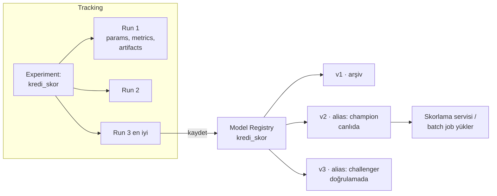

# 13.2 Experiment Tracking ve Model Registry (MLflow)

## Nedir?
- **Experiment tracking (deney takibi):** Her model eğitim denemesinin parametrelerini, metriklerini, kullanılan veri ve kod sürümünü ve üretilen dosyaları (artifact) otomatik kaydetmek.
- **Model registry (model kayıt defteri):** Onaylanan modellerin isim ve sürüm numarasıyla saklandığı, yaşam döngüsü durumlarının (aday, canlıda, emekli) takip edildiği merkezi depo.

Örnekler **MLflow** ile verilmiştir: açık kaynak ve en yaygın araç. Kavramlar diğer araçlarda da aynıdır.

## Hangi problemi çözer?
- "Geçen ay en iyi sonucu veren model hangi parametrelerle eğitilmişti?" → Excel'de veya hafızada aranmaz, kayıtlıdır.
- Onlarca denemeyi yan yana karşılaştırmak.
- Canlıdaki modelin **tam olarak** hangi kod, veri ve parametreyle üretildiğini bilmek (tekrar üretilebilirlik).
- Modeli bir dosya olarak e-postayla göndermek yerine, kontrollü bir yerden sürümüyle yüklemek.
- Model validasyonu ve denetim için kanıt kaydı.

## Nasıl çalışır?



**Tracking kavramları**
| Kavram | Anlamı |
|---|---|
| **Experiment** | Bir problem için yapılan denemelerin grubu (`kredi_skor`) |
| **Run** | Tek bir eğitim çalıştırması |
| **Parameter** | Girdi ayarları: `learning_rate=0.05`, `max_depth=6`, veri tarih aralığı |
| **Metric** | Sonuçlar: AUC, Gini, KS, precision; zamana bağlı da kaydedilebilir (epoch bazında) |
| **Artifact** | Dosyalar: model, grafikler (ROC, feature importance), veri örneği, rapor |
| **Tag** | Etiketler: Git commit, veri sürümü, geliştirici |

**Registry kavramları**
| Kavram | Anlamı |
|---|---|
| **Registered model** | İsimli model: `kredi_skor` |
| **Version** | Her kayıt yeni sürüm: v1, v2, v3 |
| **Alias** | Sürüme takılan isim: `champion` (canlıdaki), `challenger` (aday). Skorlama kodu sürüm numarası yerine alias kullanır; geçiş tek hamlede yapılır |
| **Model signature** | Beklenen girdi/çıktı şeması |

(Eski MLflow sürümlerindeki `Staging/Production` stage kavramı yerini alias ve etiketlere bıraktı.)

## Mini örnek
```python
import mlflow
import mlflow.sklearn
from sklearn.metrics import roc_auc_score
from lightgbm import LGBMClassifier

mlflow.set_tracking_uri("http://mlflow.sirket.local")
mlflow.set_experiment("kredi_skor")

params = {"n_estimators": 500, "learning_rate": 0.05, "num_leaves": 31}

with mlflow.start_run(run_name="lgbm_oot_2026q3") as run:
    mlflow.set_tags({"git_commit": "a3f9c21", "veri_donemi": "2023-01..2026-06"})
    mlflow.log_params(params)

    model = LGBMClassifier(**params).fit(X_tr, y_tr)
    auc = roc_auc_score(y_oot, model.predict_proba(X_oot)[:, 1])
    mlflow.log_metrics({"auc_oot": auc, "gini_oot": 2 * auc - 1})

    mlflow.log_artifact("raporlar/roc.png")
    mlflow.sklearn.log_model(
        model, "model",
        input_example=X_tr.head(5),
        registered_model_name="kredi_skor",      # registry'ye yeni sürüm olarak kaydet
    )
```

Sürüme alias vermek ve canlıda yüklemek:
```python
from mlflow import MlflowClient

client = MlflowClient()
client.set_registered_model_alias("kredi_skor", "challenger", version=3)
# validasyon onayı sonrası:
client.set_registered_model_alias("kredi_skor", "champion", version=3)

# Skorlama tarafı: her zaman "champion"ı yükler
model = mlflow.pyfunc.load_model("models:/kredi_skor@champion")
skorlar = model.predict(yeni_basvurular)
```

Arayüz ve sunucu:
```bash
pip install mlflow
mlflow ui                                    # yerelde: http://localhost:5000
mlflow server --backend-store-uri postgresql://... --artifacts-destination s3://mlflow-artifacts
```

## Nerede kullanılır?
- Model geliştirme sürecinde tüm denemelerin kaydı
- Champion–challenger yaklaşımı: yeni modelin mevcut modelle karşılaştırılması
- Model validasyon ekibine kanıt sunma (parametre, metrik, veri dönemi, kod sürümü)
- CI/CD'de: "Yeni sürüm metrik eşiğini geçti mi?" kontrolü ve otomatik kayıt

## Benzerleri ve farkları
| Araç | Not |
|---|---|
| **MLflow** | Açık kaynak; tracking + registry + model paketleme; Databricks'e entegre |
| **Weights & Biases, Neptune, Comet** | Ticari, zengin görselleştirme, özellikle derin öğrenmede |
| **Dataiku** | Platform içinde "Saved Model" sürümleri ve deney takibi ([13.11](11-ml-platformlari.md)) |
| **SageMaker, Vertex AI, Azure ML** | Bulut platformlarının yerleşik registry'leri |
| **DVC** | Veri ve model dosyalarını Git benzeri versiyonlama |

- **Git ile farkı:** Git kodu versiyonlar; tracking aracı **çalıştırmaların sonuçlarını** ve büyük model dosyalarını. İkisi birlikte kullanılır (run'a Git commit etiketi eklenir).

## İlgili sayfalar
- [13.1 ML yaşam döngüsü](01-ml-yasam-dongusu.md)
- [13.3 Model serving](03-model-serving.md)
- [17.13 Model ve notebook formatları](../17-formatlar/13-model-notebook-formatlari.md)
