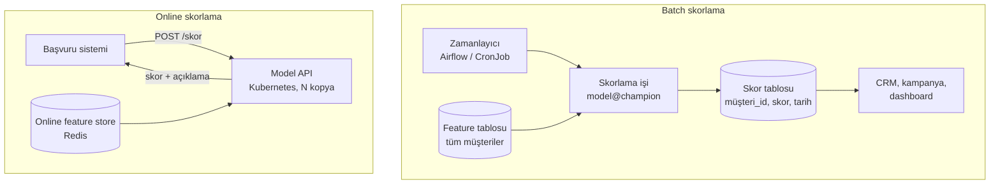

# 13.3 Model Serving: Batch ve Online

## Nedir?
**Model serving (model sunumu)**, eğitilmiş bir modelin yeni veriler için tahmin (skor) üretmesini sağlayan çalıştırma biçimidir. İki ana yol vardır:
- **Batch (toplu) skorlama:** Model belirli aralıklarla (gece, haftalık) çalışır, çok sayıda kaydı birden skorlar ve sonuçları bir tabloya yazar.
- **Online (gerçek zamanlı) skorlama:** Model bir servis (API) olarak sürekli açıktır; her istek geldiğinde milisaniyeler içinde tek bir kaydı skorlar.

## Hangi problemi çözer?
Bir model, kararın verildiği **an ve yerde** kullanılabilir olduğunda değer üretir. Doğru sunum biçimi şu sorulara göre seçilir:
- Tahmine ne zaman ihtiyaç var? (Başvuru anında mı, ertesi sabahki kampanya listesinde mi?)
- Kaç kayıt? (Tüm portföy mü, tek müşteri mi?)
- Feature'lar o anda hazır mı?

## Nasıl çalışır?



| Özellik | Batch | Online |
|---|---|---|
| Gecikme | Saat–gün | Milisaniye–saniye |
| Hacim | Milyonlarca kayıt birden | Tek tek, saniyede çok istek |
| Altyapı | Job (Spark, Python script, SQL) | Sürekli çalışan servis (API) |
| Feature kaynağı | Veri ambarı / lakehouse | Online store, istek içeriği |
| Hata etkisi | Yeniden çalıştırılır | Anında karar etkilenir; yedek kural (fallback) gerekir |
| Maliyet | Düşük | Daha yüksek (sürekli açık, yüksek erişilebilirlik) |
| Örnek | Aylık davranış skoru, churn listesi, IFRS 9 PD hesabı | Kredi başvuru kararı, kart fraud kontrolü |

**Ara biçimler**
- **Near real-time / streaming skorlama:** Kafka'dan gelen olaylar akış işleyicide skorlanır ([11.6](../11-veri-akisi/06-batch-streaming.md)).
- **Veritabanı içinde skorlama:** Model SQL ifadesine veya veritabanının ML özelliğine dönüştürülür (basit modellerde).
- **Önceden hesaplanmış (precomputed) skorlar:** Batch skorlanır, online sistem sadece tablodan okur. Çoğu ihtiyaç için en basit ve güvenilir yöntemdir.

**Canlıya geçiş stratejileri**
| Strateji | Açıklama |
|---|---|
| **Shadow (gölge)** | Yeni model gerçek trafikte paralel çalışır, sonuçları kaydedilir ama kararı etkilemez |
| **Canary** | Trafiğin küçük bir yüzdesi yeni modele gider, sorun yoksa artırılır |
| **A/B testi** | İki model rastgele gruplara uygulanır, iş sonuçları karşılaştırılır |
| **Champion–challenger** | Mevcut (champion) ve aday (challenger) modelin performansı düzenli karşılaştırılır |

## Mini örnek
**Batch skorlama işi**
```python
import mlflow, pandas as pd
from sqlalchemy import create_engine
from featurelar import feature_uret          # eğitimdekiyle AYNI fonksiyon

engine = create_engine("postgresql+psycopg2://...")
model = mlflow.pyfunc.load_model("models:/kredi_skor@champion")

musteriler = pd.read_sql("SELECT * FROM silver.musteri_ozet WHERE donem = '2026-09-30'", engine)
X = feature_uret(musteriler)
musteriler["skor"] = model.predict(X)
musteriler["model_surumu"] = "kredi_skor@champion"
musteriler[["musteri_id", "skor", "model_surumu"]].assign(skor_tarihi=pd.Timestamp.today()) \
    .to_sql("musteri_skor", engine, schema="gold", if_exists="append", index=False)
```

**Online skorlama API'si (FastAPI)**
```python
import mlflow, pandas as pd
from fastapi import FastAPI
from pydantic import BaseModel, Field

app = FastAPI(title="Kredi Skor Servisi")
model = mlflow.pyfunc.load_model("models:/kredi_skor@champion")   # açılışta bir kez yüklenir

class Basvuru(BaseModel):
    musteri_id: int
    tutar: float = Field(gt=0)
    vade_ay: int = Field(ge=1, le=120)
    gelir: float = Field(ge=0)

@app.get("/ready")
def ready():
    return {"model": "kredi_skor@champion", "durum": "hazir"}

@app.post("/v1/skor")
def skorla(b: Basvuru):
    X = pd.DataFrame([b.model_dump()])
    skor = float(model.predict(X)[0])
    return {"musteri_id": b.musteri_id, "skor": round(skor, 4),
            "karar": "onay" if skor < 0.08 else "inceleme"}
```
Bu servis Docker ile paketlenir, Kubernetes/OpenShift'te Deployment + HPA ile çalıştırılır; readiness probe modelin yüklendiğini kontrol eder ([5.11](../05-kubernetes/11-probe-resources.md)).

## Nerede kullanılır?
- **Batch:** Davranış skorları, kampanya hedef listeleri, erken uyarı, aylık PD/LGD hesapları, personel sorgu anomali skorları
- **Online:** Kredi başvuru kararı, kart işlem fraud kontrolü, anlık fiyat teklifi, chatbot/LLM servisleri

## Benzerleri ve farkları
| Araç | Not |
|---|---|
| **FastAPI + Docker** | En esnek, tam kontrol ([7.4](../07-api/04-fastapi.md)) |
| **MLflow models serve** | MLflow modelinden hızlıca REST servisi |
| **KServe, Seldon Core** | Kubernetes üzerinde standart model sunumu, canary, ölçekleme; OpenShift AI KServe kullanır |
| **BentoML** | Model paketleme ve servisleştirme |
| **Triton, vLLM** | GPU'da yüksek performanslı sunum (derin öğrenme, LLM) |
| **Dataiku API Node** | Dataiku modellerini API olarak sunma |

**Dikkat:**
- **Training–serving skew:** Eğitimde ve skorlamada feature'ların farklı hesaplanması en sık canlı hatasıdır. Aynı kod veya feature store kullanılmalıdır ([13.6](06-feature-store-nedir.md)).
- Her skorla birlikte **model sürümü ve girdiler** kaydedilmelidir; denetim ve izleme bunlara dayanır.

## İlgili sayfalar
- [13.4 Monitoring ve drift](04-monitoring-drift.md)
- [13.8 Offline ve online store](08-offline-online-store.md)
- [7.4 FastAPI](../07-api/04-fastapi.md)
