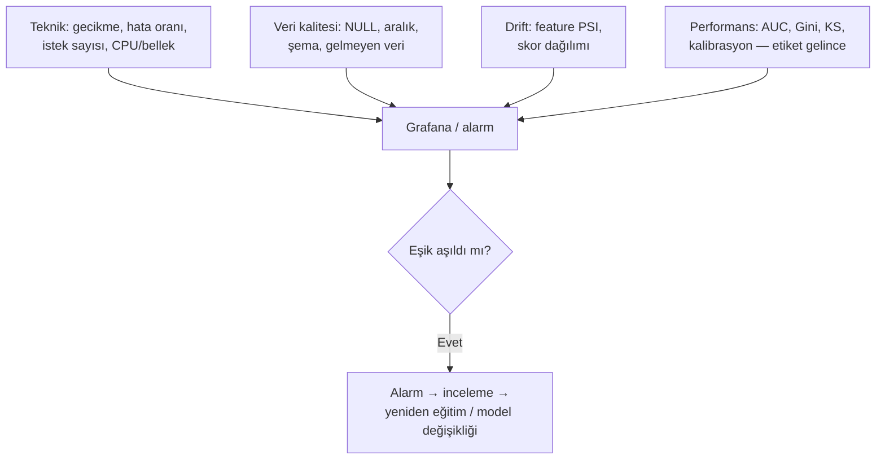

# 13.4 Model Monitoring ve Drift

## Nedir?
**Model monitoring (model izleme)**, canlıdaki bir modelin hem **teknik sağlığını** (çalışıyor mu, ne kadar hızlı) hem de **istatistiksel sağlığını** (hâlâ doğru tahmin ediyor mu) sürekli takip etmektir.

**Drift (kayma)**, modelin eğitildiği dönemdeki veri veya ilişkilerin zamanla değişmesidir. Model kodu hiç değişmese bile performansı düşebilir.

## Hangi problemi çözer?
Yazılım genellikle "ya çalışır ya hata verir". Model ise **sessizce kötüleşir**: Hata vermez, skor üretmeye devam eder ama skorlar artık yanlıştır. Örnek:
- Faiz ortamı, enflasyon, düzenleme veya kampanya politikası değişti → başvuran müşteri profili değişti.
- Kaynak sistemde bir alanın anlamı veya birimi değişti (TL → bin TL) → feature dağılımı kaydı.
- Pandemi gibi şoklar → geçmişteki ilişkiler geçerliliğini yitirdi.

İzleme olmadan bu durum ancak zarar ortaya çıkınca fark edilir.

## Nasıl çalışır?

**Drift türleri**
| Tür | Ne değişir? | Örnek | Ölçmek için |
|---|---|---|---|
| **Data drift (covariate shift)** | Girdi dağılımı P(X) | Başvuranların gelir dağılımı yükseldi | PSI, KS, dağılım karşılaştırması |
| **Prediction drift** | Skor dağılımı | Onay oranı aniden %40'tan %60'a çıktı | Skor PSI, ortalama skor |
| **Concept drift** | Girdi–hedef ilişkisi P(Y\|X) | Aynı profildeki müşterilerin temerrüt oranı arttı | Gerçekleşen sonuçlarla performans (AUC, Gini) |
| **Label drift** | Hedef dağılımı P(Y) | Genel temerrüt oranı yükseldi | Gerçekleşen oran |
| **Veri kalitesi sorunu** | Boş değer, aralık dışı değer, şema | Bir feature tamamen NULL gelmeye başladı | Kalite testleri ([11.5](../11-veri-akisi/05-veri-kalitesi.md)) |

**Gecikmeli etiket sorunu:** Kredi modellerinde "müşteri temerrüde düştü mü?" bilgisi aylar sonra gelir. Bu süre içinde gerçek performans ölçülemez; bu yüzden **data drift ve prediction drift erken uyarı göstergesi** olarak izlenir.

**PSI (Population Stability Index)** bankacılıkta en yaygın kararlılık ölçüsüdür:

`PSI = Σ (gerçekleşen_% − beklenen_%) × ln(gerçekleşen_% / beklenen_%)`

| PSI | Yorum (yaygın eşikler) |
|---|---|
| < 0.10 | Kararlı |
| 0.10 – 0.25 | Orta düzey değişim, incele |
| > 0.25 | Önemli değişim, aksiyon gerekli |

**İzleme katmanları**


## Mini örnek
PSI hesaplama:
```python
import numpy as np
import pandas as pd

def psi(beklenen: pd.Series, gerceklesen: pd.Series, kova: int = 10) -> float:
    kesimler = np.unique(np.quantile(beklenen.dropna(), np.linspace(0, 1, kova + 1)))
    kesimler[0], kesimler[-1] = -np.inf, np.inf
    b = pd.cut(beklenen, kesimler).value_counts(normalize=True, sort=False)
    g = pd.cut(gerceklesen, kesimler).value_counts(normalize=True, sort=False)
    b, g = b.clip(lower=1e-6), g.clip(lower=1e-6)
    return float(((g - b) * np.log(g / b)).sum())

egitim = pd.read_parquet("egitim_ornegi.parquet")
bu_ay  = pd.read_sql("SELECT * FROM gold.basvuru_featurelari WHERE donem = '2026-09'", engine)

rapor = pd.DataFrame({
    "feature": egitim.columns,
    "psi": [psi(egitim[c], bu_ay[c]) for c in egitim.columns],
}).sort_values("psi", ascending=False)

alarm = rapor[rapor["psi"] > 0.25]
```

İzleme sonuçlarını bir tabloya yazıp Grafana'da göstermek ([12.3](../12-bi/03-grafana.md)):
```sql
-- Grafana paneli: feature bazında aylık PSI
SELECT donem AS "time", feature AS metric, psi
FROM model_izleme.psi_aylik
WHERE model = 'kredi_skor' AND $__timeFilter(donem);
```

Hazır kütüphane ile (Evidently, kavramsal):
```python
from evidently import Report
from evidently.presets import DataDriftPreset

rapor = Report([DataDriftPreset()])
sonuc = rapor.run(reference_data=egitim, current_data=bu_ay)
sonuc.save_html("drift_raporu_2026_09.html")
```

## Nerede kullanılır?
- Kredi skorlama modellerinin aylık/çeyreklik izleme raporları (model risk yönetimi gereği)
- Fraud modellerinde günlük skor dağılımı ve uyarı oranı takibi
- Anomali modellerinde alarm sayısının ani artışı/azalışı
- LLM uygulamalarında cevap kalitesi ve konu dağılımı izleme

## Benzerleri ve farkları
| Araç | Not |
|---|---|
| **Evidently** | Açık kaynak; drift ve kalite raporları, test setleri |
| **NannyML** | Etiket yokken performans tahmini |
| **WhyLabs, Arize, Fiddler** | Ticari model izleme platformları |
| **Dataiku model evaluation store** | Platform içinde drift ve performans takibi |
| **Kendi SQL + Grafana çözümü** | Kurum içinde basit ve şeffaf; çoğu durumda yeterli |

- **Yeniden eğitim ne zaman?** Takvime bağlı (her 6 ayda), olaya bağlı (PSI eşiği aşıldı) veya performansa bağlı (Gini %10 düştü). Otomatik yeniden eğitim yapılsa bile canlıya geçiş genellikle onaylı olmalıdır.
- **Uygulama izleme ile farkı:** Teknik metrikler (gecikme, hata) Bölüm 14'teki araçlarla izlenir; model izleme bunlara istatistiksel katmanı ekler.

## İlgili sayfalar
- [13.3 Model serving](03-model-serving.md)
- [14.4 Alarm kurgusu](../14-gozlemlenebilirlik/04-alarm.md)
- [11.5 Veri kalitesi](../11-veri-akisi/05-veri-kalitesi.md)
- [13.13 Model riski ve validasyon](13-model-riski-validasyon.md)
