# 13.5 Feature ve Feature Engineering Kavramı

## Nedir?
- **Feature (özellik, değişken):** Modelin tahmin yaparken kullandığı ölçülebilir girdi. "Son 3 aydaki ortalama kart harcaması", "kredi kullanım oranı", "müşterilik süresi (ay)" gibi.
- **Feature engineering (özellik mühendisliği):** Ham veriden, modelin öğrenmesine yardımcı olacak anlamlı feature'lar türetme süreci.

Ham veri genellikle modelin doğrudan kullanabileceği biçimde değildir: işlem kayıtları, tarihler, metinler, kategoriler. Feature engineering bunları model için **sayısal ve bilgilendirici** hâle getirir.

## Hangi problemi çözer?
Model performansını çoğu zaman algoritma seçiminden çok **feature kalitesi** belirler. İyi feature'lar:
- İş bilgisini modele taşır (bankacının "kullanım oranı yüksekse risk artar" sezgisi),
- Gürültüyü azaltır,
- Modeli daha açıklanabilir yapar (düzenleyici beklenti).

## Nasıl çalışır?

**Ham veriden feature'a**

```mermaid
flowchart LR
    H[(Ham işlemler<br/>musteri_id, tarih, tutar, tür)] --> A[Pencere ve toplama<br/>son 30/90/180 gün]
    A --> F1[harcama_ort_90g]
    A --> F2[islem_sayisi_30g]
    A --> F3[nakit_avans_orani_180g]
    M[(Müşteri bilgisi)] --> F4[musterilik_suresi_ay]
    L[(Limit / bakiye)] --> F5[limit_kullanim_orani]
    F1 & F2 & F3 & F4 & F5 --> V[Feature vektörü<br/>müşteri × tarih]
    V --> MD[Model]
```


**Yaygın feature türleri**
| Tür | Örnek | Teknik |
|---|---|---|
| Toplama (aggregation) | Son 90 gün toplam/ortalama harcama | `GROUP BY` + zaman penceresi |
| Oran | Limit kullanım oranı = bakiye / limit | Bölme (sıfıra bölmeye dikkat) |
| Trend / değişim | Son 3 ay ortalaması / önceki 3 ay ortalaması | Pencere fonksiyonları |
| Zaman | Müşterilik süresi, son işlemden bu yana gün | Tarih farkları |
| Sıklık / tekrarlılık | Son 6 ayda gecikme sayısı | Sayma |
| Kategorik kodlama | Sektör, il | One-hot, target/WoE encoding |
| Gruplama (binning) | Yaş grupları, WoE kovaları | Kredi skorlamada yaygın (scorecard) |
| Etkileşim | Gelir × vade | Çarpım, oran |
| Metin / graph | Şikâyet metni embedding'i, grup firma bağlantı sayısı | NLP, graph analizi ([9.8](../09-veri-depolama/08-graph-db.md)) |

**Feature'ın iki boyutu: varlık (entity) ve zaman**
Bir feature değeri her zaman **"hangi müşteri için"** ve **"hangi tarih itibarıyla"** sorularına bağlıdır:
```
musteri_id | tarih      | limit_kullanim_orani
123        | 2026-08-31 | 0.42
123        | 2026-09-30 | 0.67
```
Bu yüzden feature'lar zaman damgasıyla saklanmalıdır. Aksi hâlde eğitimde geleceğe ait bilgi sızabilir ([13.9](09-point-in-time.md)).

## Mini örnek
SQL ile müşteri bazında feature üretimi (gözlem tarihi parametreli):
```sql
-- :gozlem_tarihi = '2026-09-30'  → sadece bu tarihten ÖNCEKİ veri kullanılır
SELECT
    m.musteri_id,
    DATE :gozlem_tarihi                                              AS gozlem_tarihi,
    (DATE :gozlem_tarihi - m.musteri_baslangic) / 30                 AS musterilik_suresi_ay,
    AVG(i.tutar)   FILTER (WHERE i.tarih > DATE :gozlem_tarihi - 90) AS harcama_ort_90g,
    COUNT(*)       FILTER (WHERE i.tarih > DATE :gozlem_tarihi - 30) AS islem_sayisi_30g,
    SUM(i.tutar)   FILTER (WHERE i.tur = 'NAKIT_AVANS' AND i.tarih > DATE :gozlem_tarihi - 180)
      / NULLIF(SUM(i.tutar) FILTER (WHERE i.tarih > DATE :gozlem_tarihi - 180), 0) AS nakit_avans_orani_180g
FROM musteri m
LEFT JOIN kart_islem i
       ON i.musteri_id = m.musteri_id
      AND i.tarih <= DATE :gozlem_tarihi          -- geleceği görme!
GROUP BY m.musteri_id, m.musteri_baslangic;
```

Aynı mantık pandas'ta tek bir fonksiyon olarak yazılıp hem eğitimde hem skorlamada kullanılmalıdır:
```python
def feature_uret(islem: pd.DataFrame, gozlem_tarihi: pd.Timestamp) -> pd.DataFrame:
    gecmis = islem[islem["tarih"] <= gozlem_tarihi]
    son90 = gecmis[gecmis["tarih"] > gozlem_tarihi - pd.Timedelta(days=90)]
    return (son90.groupby("musteri_id")["tutar"]
                 .agg(harcama_ort_90g="mean", harcama_top_90g="sum")
                 .reset_index()
                 .assign(gozlem_tarihi=gozlem_tarihi))
```

## Nerede kullanılır?
- Kredi skorlama: davranış, ödeme geçmişi, kullanım oranları
- Fraud: işlem hızı, alışılmadık saat/konum, cihaz değişimi
- Anomali tespiti: kullanıcının kendi geçmişine ve segmentine göre sapma (ör. personel sorgu sayısının kişinin normaline oranı)
- Pazarlama: ürün sahipliği, kanal kullanımı, yaşam döngüsü göstergeleri

## Benzerleri ve farkları
- **Feature selection (seçimi):** Türetilen yüzlerce feature arasından faydalı olanları seçmek (IV, korelasyon, model önemi, SHAP).
- **Otomatik feature üretimi:** Featuretools, derin öğrenmede temsil öğrenme (representation learning).
- **Feature store:** Feature'ların tanımlanması, hesaplanması, saklanması ve paylaşılmasının merkezi yönetimi ([13.6](06-feature-store-nedir.md)).

## İlgili sayfalar
- [13.6 Feature store nedir](06-feature-store-nedir.md)
- [13.9 Point-in-time doğruluk](09-point-in-time.md)
- [10.1 SQL pencere fonksiyonları](../10-veri-isleme/01-sql.md)
