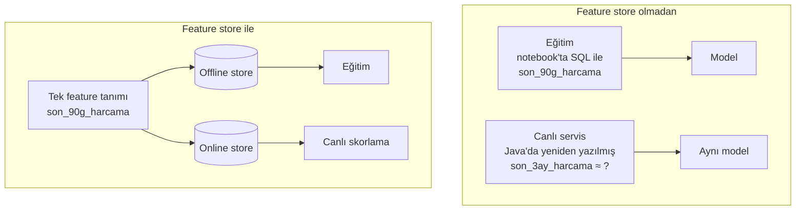

# 13.6 Feature Store Nedir: Hangi Problemi Çözer?

## Nedir?
**Feature store**, makine öğrenmesi feature'larının **tanımlandığı, hesaplandığı, saklandığı, paylaşıldığı ve hem eğitimde hem canlıda tutarlı biçimde sunulduğu** merkezi sistemdir.

Kavramsal olarak bir feature store şu soruya cevap verir: "Bu feature nasıl hesaplanır, hangi tarihte hangi değere sahipti ve onu şimdi milisaniyeler içinde nasıl okurum?"

## Hangi problemi çözer?

**1. Training–serving skew (eğitim–sunum tutarsızlığı)**
En yaygın ve en sinsi sorun: Veri bilimci eğitimde feature'ı Python/SQL ile bir şekilde hesaplar; yazılım ekibi canlı serviste aynı feature'ı başka bir dilde, başka bir kaynaktan, biraz farklı mantıkla yeniden yazar. Model canlıda, eğitimdekinden farklı veri görür ve beklenenden kötü çalışır. Hata vermediği için de fark edilmez.



**2. Tekrar eden iş ve tutarsız tanımlar**
Beş farklı ekip "müşterinin son 90 günlük ortalama bakiyesi"ni beş farklı şekilde hesaplar. Feature store'da bir kez tanımlanır, keşfedilebilir ve herkes tarafından tekrar kullanılır.

**3. Veri sızıntısı (leakage)**
Eğitim setini oluştururken her gözlem için **o tarihte bilinen** feature değerinin alınması gerekir. Feature store bunu otomatik yapar (point-in-time join, [13.9](09-point-in-time.md)).

**4. Düşük gecikmeli erişim**
Online skorlamada, karmaşık feature'ları istek anında veri ambarından hesaplamak çok yavaştır. Feature store önceden hesaplanmış değerleri hızlı bir depoda (online store) hazır tutar.

**5. Yönetişim**
Her feature'ın sahibi, açıklaması, kaynağı, sürümü ve hangi modellerde kullanıldığı kayıtlıdır. Bir kaynak tablo değişince hangi modellerin etkileneceği görülür (lineage).

## Nasıl çalışır?
Bir feature store'un üstlendiği işler (ayrıntılar [13.7](07-feature-store-bilesenleri.md)):

| İş | Açıklama |
|---|---|
| **Tanımlama** | Feature'lar kodla (Python/SQL) ve metadata ile tanımlanır |
| **Hesaplama** | Tanımlara göre batch veya streaming hesaplanır |
| **Saklama** | Geçmiş değerler offline store'da, en güncel değerler online store'da |
| **Eğitim seti üretimi** | Etiket tablosu verilince, her satır için doğru tarihteki feature'lar eklenir |
| **Sunum** | Canlı servislere düşük gecikmeyle feature vektörü verilir |
| **Keşif** | Katalog: hangi feature'lar var, ne anlama geliyor, kim sahip |
| **İzleme** | Feature dağılımı, güncellik, kalite |

## Mini örnek
Feature store **olmadan** ve **ile** veri bilimcinin eğitim seti hazırlama işi:

Olmadan:
```python
# Her proje kendi SQL'ini yazar; tarih hizalaması elle ve hataya açık
etiketler = pd.read_sql("SELECT musteri_id, gozlem_tarihi, temerrut_12ay FROM etiketler", engine)
f1 = pd.read_sql("SELECT ... son 90g harcama ... ", engine)           # hangi tarihe göre?
f2 = pd.read_sql("SELECT ... limit kullanım ... ", engine)
egitim = etiketler.merge(f1, on="musteri_id").merge(f2, on="musteri_id")   # geleceği sızdırma riski
```

İle (kavramsal, araçtan bağımsız):
```python
egitim = feature_store.get_historical_features(
    entity_df=etiketler,                       # musteri_id, gozlem_tarihi, temerrut_12ay
    features=[
        "kart_davranis:harcama_ort_90g",
        "kart_davranis:nakit_avans_orani_180g",
        "kredi_kullanim:limit_kullanim_orani",
    ],
)   # her satıra gozlem_tarihi itibarıyla geçerli değerler eklenir

# Canlıda aynı feature'lar:
vektor = feature_store.get_online_features(
    features=[...aynı liste...], entity_rows=[{"musteri_id": 123}]
)
```

## Nerede kullanılır?
- Birçok modelin aynı müşteri feature'larını kullandığı kurumlar (skorlama, fraud, pazarlama)
- Online skorlama yapan sistemler (başvuru anında karar, fraud)
- Model sayısı arttıkça feature tekrarının ve tutarsızlığın sorun olduğu ekipler

**Ne zaman gerekmez?** Az sayıda, sadece batch çalışan model varsa; iyi yapılandırılmış gold feature tabloları ([9.13](../09-veri-depolama/13-medallion.md)) ve eğitim–skorlamada **aynı feature fonksiyonunu** kullanmak çoğu zaman yeterlidir. Feature store bir disiplinin ürünleşmiş hâlidir; disiplin olmadan araç tek başına çözüm değildir.

## Benzerleri ve farkları
- **Veri ambarı / gold tablolar:** Feature store'un offline kısmı genellikle zaten bir lakehouse/DWH üzerinde durur; fark, zaman yönetimi, online sunum ve feature metadata'sıdır.
- **Feature store ile model registry:** Registry modelleri, feature store modellerin girdilerini yönetir. İkisi birlikte "bu model hangi feature sürümleriyle eğitildi" bilgisini tamamlar.
- **Örnek araçlar** (ürün değil kavram odaklı anlatıldığı için sadece referans): Feast (açık kaynak), Hopsworks, Databricks Feature Engineering, SageMaker/Vertex AI Feature Store, Tecton, Dataiku'nun feature group yetenekleri.

## İlgili sayfalar
- [13.7 Feature store bileşenleri](07-feature-store-bilesenleri.md)
- [13.8 Offline ve online store](08-offline-online-store.md)
- [13.9 Point-in-time doğruluk](09-point-in-time.md)
