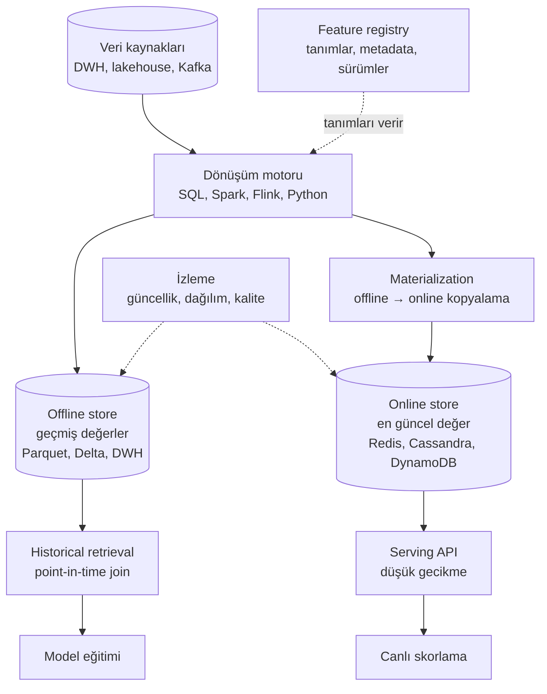

# 13.7 Feature Store Bileşenleri: Registry, Dönüşüm, Materialization, Serving

## Nedir?
Bir feature store tek bir veritabanı değil, birlikte çalışan bileşenlerden oluşan bir sistemdir. Ürünler farklı isimler kullansa da kavramsal mimari benzerdir.

## Hangi problemi çözer?
Bileşenleri bilmek, bir feature store'u değerlendirirken, kurarken veya kendi basit çözümünüzü tasarlarken "hangi parça hangi işi yapıyor ve eksik olan ne?" sorusunu cevaplamayı sağlar.

## Nasıl çalışır?



### 1. Feature registry (kayıt / katalog)
Feature'ların "tek doğru kaynağı" olan metadata deposu.

| Kayıtlı bilgi | Örnek |
|---|---|
| **Entity (varlık)** | `musteri` (anahtar: `musteri_id`), `kart` (`kart_no`) |
| **Feature view / feature group** | Aynı kaynaktan, aynı varlık için hesaplanan feature grubu: `kart_davranis` |
| **Feature tanımı** | Ad, tip, açıklama, hesaplama mantığı (SQL/Python) |
| **Kaynak** | Hangi tablo/topic'ten geldiği, zaman damgası sütunu |
| **Sahip ve etiketler** | Ekip, hassasiyet (kişisel veri mi?), kullanım alanı |
| **TTL** | Değerin ne kadar süre geçerli sayılacağı |
| **Sürüm ve lineage** | Hangi modeller kullanıyor, kaynak değişirse kim etkilenir |

### 2. Dönüşüm (transformation)
Ham veriden feature değerlerinin hesaplanması. Üç zamanlama türü:
| Tür | Ne zaman? | Örnek |
|---|---|---|
| **Batch** | Periyodik (gece) | Son 90 günlük ortalama bakiye |
| **Streaming** | Olay geldikçe | Son 10 dakikadaki işlem sayısı (fraud) |
| **On-demand (istek anında)** | Skorlama isteği sırasında | Başvuru tutarı / mevcut limit oranı (istek içeriğine bağlı) |

### 3. Offline store
- Feature'ların **tüm geçmiş değerlerini** zaman damgasıyla saklar.
- Büyük hacim, ucuz depolama: lakehouse tabloları (Delta/Iceberg), veri ambarı.
- Kullanım: Eğitim setleri, batch skorlama, geriye dönük analiz.

### 4. Materialization (somutlaştırma)
- Offline store'daki (veya akıştaki) **en güncel** değerlerin online store'a kopyalanması.
- Zamanlanmış iş veya akış olarak çalışır; "online store'daki değer ne kadar taze?" sorusunun cevabı buradadır.

### 5. Online store
- Her varlık için **sadece en son değeri** tutar.
- Anahtar–değer erişimi, milisaniye altı okuma: Redis, Cassandra, DynamoDB, bazen PostgreSQL ([9.7](../09-veri-depolama/07-redis-cache.md)).

### 6. Serving (sunum)
- **Historical retrieval:** Eğitim için, verilen her (varlık, tarih) satırına o tarihteki değerleri ekler ([13.9](09-point-in-time.md)).
- **Online retrieval:** Canlı servis için, varlık anahtarlarıyla güncel feature vektörünü döndürür (SDK veya REST/gRPC API).

### 7. İzleme
- **Güncellik (freshness):** Son materialization ne zaman?
- **Dağılım ve kalite:** Feature drift, NULL oranı ([13.4](04-monitoring-drift.md)).

## Mini örnek
Bileşenlerin bir feature tanımında görünümü. Açık kaynak **Feast** söz dizimiyle, kavramları göstermek için:
```python
from datetime import timedelta
from feast import Entity, FeatureView, Field, FileSource
from feast.types import Float64, Int64

# Entity (registry)
musteri = Entity(name="musteri", join_keys=["musteri_id"])

# Kaynak: offline store'daki tablo/dosya, zaman damgasıyla
kart_kaynak = FileSource(
    path="s3://lake/gold/kart_davranis.parquet",
    timestamp_field="hesap_tarihi",
)

# Feature view: tanım + TTL + online'a alınsın mı?
kart_davranis = FeatureView(
    name="kart_davranis",
    entities=[musteri],
    ttl=timedelta(days=35),
    schema=[
        Field(name="harcama_ort_90g", dtype=Float64),
        Field(name="islem_sayisi_30g", dtype=Int64),
        Field(name="nakit_avans_orani_180g", dtype=Float64),
    ],
    source=kart_kaynak,
    online=True,
    tags={"sahip": "risk-analitik", "kisisel_veri": "hayir"},
)
```

```bash
feast apply                                   # tanımları registry'ye kaydet
feast materialize-incremental 2026-10-13T00:00:00   # offline → online kopyala
```

## Nerede kullanılır?
- Ortak müşteri feature'larının birçok model tarafından kullanıldığı platformlar
- Hem batch hem online skorlama yapan sistemler
- Feature yönetişiminin (sahiplik, kişisel veri etiketi, lineage) önemli olduğu kurumlar

## Benzerleri ve farkları
- **"Virtual" (sanal) feature store:** Dönüşüm ve depolamayı mevcut veri platformuna (DWH/lakehouse/Spark) bırakır, sadece registry, point-in-time retrieval ve online sunumu yönetir (Feast bu yaklaşıma yakındır).
- **"Literal / tam" feature store:** Dönüşüm motorunu da içerir, hesaplamayı kendisi yönetir (ör. bazı ticari ürünler).
- **Kendi çözümünüz:** Gold feature tabloları + zaman damgası + Redis'e periyodik kopyalama + metadata tablosu. Küçük ölçekte feature store'un temel faydalarının çoğunu verir.
- Bir ML platformuna eklenti olarak eklenmesi: [13.10](10-plugin-mimarisi.md).

## İlgili sayfalar
- [13.6 Feature store nedir](06-feature-store-nedir.md)
- [13.8 Offline ve online store](08-offline-online-store.md)
- [13.10 Plugin mimarisi](10-plugin-mimarisi.md)
