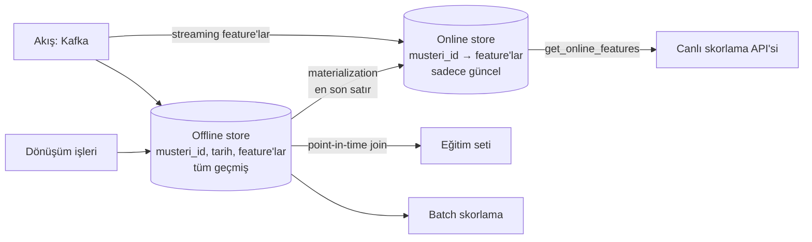

# 13.8 Offline ve Online Store

## Nedir?
Feature store'daki iki depolama katmanı ([13.7](07-feature-store-bilesenleri.md)):
- **Offline store:** Feature'ların **tüm geçmişini** zaman damgasıyla saklayan, büyük hacimli ve ucuz depo. Eğitim ve batch skorlama içindir.
- **Online store:** Her varlık (müşteri, kart) için **yalnızca en güncel** feature değerlerini tutan, milisaniyeler içinde okunabilen hızlı depo. Canlı (online) skorlama içindir.

## Hangi problemi çözer?
Eğitim ve canlı skorlamanın veri ihtiyaçları birbirine zıttır:

| İhtiyaç | Eğitim / batch | Canlı skorlama |
|---|---|---|
| Ne kadar veri? | Milyonlarca satır, yıllarca geçmiş | Tek müşteri, tek satır |
| Hangi zaman? | Geçmişteki her gözlem tarihi | Şu an |
| Gecikme | Dakikalar kabul edilebilir | Milisaniyeler |
| Erişim deseni | Büyük tarama (scan), join | Anahtarla nokta okuma |

Tek bir depo bu iki ihtiyacı birden verimli karşılayamaz. Veri ambarından tek müşteri için 30 feature'ı canlı hesaplamak saniyeler sürer; Redis'te yıllık geçmişi tutmak ise pahalı ve anlamsızdır.

## Nasıl çalışır?



**Offline store'da veri (geçmiş)**
```
musteri_id | hesap_tarihi | harcama_ort_90g | limit_kullanim_orani
123        | 2026-07-31   | 4.200           | 0.38
123        | 2026-08-31   | 5.100           | 0.42
123        | 2026-09-30   | 7.900           | 0.67
456        | 2026-09-30   | 1.150           | 0.10
```

**Online store'da veri (sadece güncel)**
```
anahtar                       değer
kart_davranis:123   →   {harcama_ort_90g: 7900, limit_kullanim_orani: 0.67, _ts: 2026-09-30}
kart_davranis:456   →   {harcama_ort_90g: 1150, limit_kullanim_orani: 0.10, _ts: 2026-09-30}
```

| Özellik | Offline store | Online store |
|---|---|---|
| İçerik | Tüm geçmiş, zaman damgalı | Varlık başına son değer |
| Teknoloji | Lakehouse (Delta/Iceberg/Parquet), DWH (Snowflake, BigQuery, Oracle), Spark | Redis, Cassandra, DynamoDB, Bigtable, PostgreSQL |
| Okuma | Toplu, analitik sorgu | Anahtarla nokta okuma |
| Gecikme | Saniye–dakika | Milisaniye altı – birkaç ms |
| Boyut | TB'lar | GB'lar (varlık sayısı × feature sayısı) |
| Güncelleme | Batch / akış ile ekleme | Materialization veya akışla üzerine yazma |
| Kullanım | Eğitim, backtest, batch skorlama, analiz | Gerçek zamanlı karar |

**Tutarlılık kuralı:** İki store'daki değerler **aynı tanım ve aynı dönüşüm kodundan** gelmelidir. Online store, offline'ın "son satır" kopyasıdır; ayrı bir mantıkla doldurulmamalıdır.

**Tazelik (freshness) ve TTL**
- Online store'daki değer, son materialization kadar tazedir. Gece batch ile doldurulan bir değer, gün içinde en fazla ~24 saatlik olabilir.
- TTL süresi dolan değerler "bilinmiyor" sayılır; model bunun için varsayılan (fallback) değer veya kural kullanmalıdır.
- Fraud gibi saniyelik tazelik gereken feature'lar akıştan doğrudan online store'a yazılır.

## Mini örnek
Basit, araçtan bağımsız bir kurgu: offline store PostgreSQL/lakehouse, online store Redis.

Materialization (gece işi):
```python
import json, redis, pandas as pd
from sqlalchemy import create_engine

engine = create_engine("postgresql+psycopg2://...")
r = redis.Redis(host="redis.sirket.local", decode_responses=True)

# Offline'dan her müşterinin EN SON satırı
son = pd.read_sql("""
    SELECT DISTINCT ON (musteri_id) musteri_id, hesap_tarihi, harcama_ort_90g, limit_kullanim_orani
    FROM fs.kart_davranis
    ORDER BY musteri_id, hesap_tarihi DESC
""", engine)

pipe = r.pipeline()
for row in son.itertuples(index=False):
    pipe.set(f"kart_davranis:{row.musteri_id}",
             json.dumps({"harcama_ort_90g": row.harcama_ort_90g,
                         "limit_kullanim_orani": row.limit_kullanim_orani,
                         "_ts": str(row.hesap_tarihi)}),
             ex=35 * 24 * 3600)                      # TTL: 35 gün
pipe.execute()
```

Canlı skorlama sırasında okuma:
```python
def online_feature(musteri_id: int) -> dict:
    deger = r.get(f"kart_davranis:{musteri_id}")
    if deger is None:                                # yeni müşteri veya süresi dolmuş
        return {"harcama_ort_90g": None, "limit_kullanim_orani": None}
    return json.loads(deger)
```

Eğitim seti için offline store'dan point-in-time join: [13.9](09-point-in-time.md).

## Nerede kullanılır?
- **Offline:** Model eğitimi ve yeniden eğitim, champion–challenger karşılaştırmaları, aylık batch skorlama, geriye dönük testler
- **Online:** Kredi başvuru anında skor, kart işlemi anında fraud kontrolü, mobil uygulamada anlık teklif

## Benzerleri ve farkları
- **Cache ile online store:** Teknik olarak benzer (çoğu zaman aynı Redis), ama online store'daki değerler **tanımlı, sürümlü ve offline ile tutarlı** feature'lardır; cache ise herhangi bir sorgu sonucunu geçici tutar.
- **Sadece batch skorlama yapılıyorsa** online store'a gerek yoktur; skorlar zaten tablolara yazılır ([13.3](03-model-serving.md)).
- **Offline store ile veri ambarı:** Offline store çoğu zaman mevcut lakehouse/DWH'nin içinde, belirli kurallara (zaman damgası, varlık anahtarı) uyan tablolardan ibarettir.

## İlgili sayfalar
- [13.7 Feature store bileşenleri](07-feature-store-bilesenleri.md)
- [13.9 Point-in-time doğruluk](09-point-in-time.md)
- [9.7 Redis](../09-veri-depolama/07-redis-cache.md)
