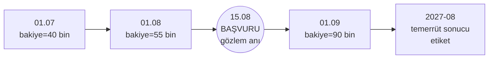

# 13.9 Point-in-Time Doğruluk ve Veri Sızıntısı (Leakage)

## Nedir?
- **Veri sızıntısı (data leakage):** Modelin eğitim sırasında, gerçek kullanımda **o anda bilinemeyecek** bir bilgiyi görmesi. Model eğitimde mükemmel görünür, canlıda başarısız olur.
- **Point-in-time doğruluk (zaman noktasında doğruluk):** Eğitim setindeki her gözlem için feature'ların **tam olarak o gözlem tarihinde bilinen** değerleriyle alınması.
- **Point-in-time join (as-of join):** Bunu sağlayan birleştirme yöntemi: Her etiket satırına, kendi tarihinden **önceki veya o tarihteki en son** feature değerini eklemek.

## Hangi problemi çözer?
Bankacılık modellerinde sızıntı çok kolay oluşur ve çok pahalıya mal olur:
- Müşterinin **bugünkü** bakiyesi, 2 yıl önceki bir kredi başvurusunun eğitim satırına eklenir.
- Temerrüde düştükten **sonra** oluşan "yapılandırma bayrağı" feature olarak kullanılır.
- Feature tablosu her ay üzerine yazıldığı için geçmiş değerler kaybolmuştur; eğitimde mecburen güncel değer kullanılır.

Sonuç: Eğitimde Gini 0.85, canlıda 0.40. Model validasyonunda yakalanmazsa yanlış kredi kararları verilir.

## Nasıl çalışır?

**Zaman çizelgesi üzerinde**

15.08'deki başvuru için kullanılabilecek bakiye **55 bin**'dir (01.08 değeri). 01.09'daki 90 bin gelecektir; kullanmak sızıntıdır. Etiket (12 ay sonraki temerrüt) ise sadece hedef değişken olarak kullanılır.

**Point-in-time join mantığı**
```
Etiket tablosu (entity_df)            Feature tablosu (offline store)
musteri | gozlem_tarihi | hedef      musteri | hesap_tarihi | bakiye
123     | 2026-08-15    | 1          123     | 2026-07-01   | 40
456     | 2026-09-20    | 0          123     | 2026-08-01   | 55   ← 15.08 için en son geçerli
                                     123     | 2026-09-01   | 90   ← gelecek, ALINMAZ
                                     456     | 2026-09-01   | 12   ← 20.09 için en son geçerli

Sonuç
musteri | gozlem_tarihi | hedef | bakiye
123     | 2026-08-15    | 1     | 55
456     | 2026-09-20    | 0     | 12
```
Kural: `hesap_tarihi <= gozlem_tarihi` olan satırlar arasından **en büyük** `hesap_tarihi`. Ayrıca TTL: Değer çok eskiyse (ör. 35 günden eski) "bilinmiyor" sayılır.

**Dikkat edilmesi gereken zamanlar**
| Zaman | Anlamı | Tuzak |
|---|---|---|
| **Olay zamanı** | Değerin gerçekte geçerli olduğu an (ay sonu bakiyesi: 30.09) | |
| **Kullanılabilirlik zamanı** | Verinin sisteme gerçekten ulaştığı an (ay sonu bakiyesi 3 iş günü sonra yüklenir: 03.10) | 01.10'daki bir karar 30.09 bakiyesini henüz göremez |
| **Gözlem zamanı** | Tahminin yapıldığı an | |

Kesin doğruluk için join'de **kullanılabilirlik zamanı** esas alınmalı veya bilinen gecikme kadar pay bırakılmalıdır.

**Diğer sızıntı türleri**
| Tür | Örnek | Önlem |
|---|---|---|
| Hedef sızıntısı (target leakage) | "Takibe alındı mı" bayrağını temerrüt modeline koymak | Her feature için "karar anında bilinir mi?" sorusu |
| Eğitim–test sızıntısı | Ölçekleme/doldurma parametrelerini tüm veriden hesaplamak | Pipeline'ı sadece eğitim verisine fit etmek |
| Zaman sızıntısı | Rastgele train/test bölmek (gelecek eğitimde) | Zamana göre bölmek, out-of-time test |
| Grup sızıntısı | Aynı müşterinin satırları hem eğitimde hem testte | Müşteri bazında bölmek |

## Mini örnek
**pandas ile as-of join**
```python
import pandas as pd

etiket = pd.DataFrame({
    "musteri_id": [123, 456],
    "gozlem_tarihi": pd.to_datetime(["2026-08-15", "2026-09-20"]),
    "hedef": [1, 0],
}).sort_values("gozlem_tarihi")

feature = pd.DataFrame({
    "musteri_id": [123, 123, 123, 456],
    "hesap_tarihi": pd.to_datetime(["2026-07-01", "2026-08-01", "2026-09-01", "2026-09-01"]),
    "bakiye": [40, 55, 90, 12],
}).sort_values("hesap_tarihi")

egitim = pd.merge_asof(
    etiket, feature,
    left_on="gozlem_tarihi", right_on="hesap_tarihi",
    by="musteri_id",
    direction="backward",                 # sadece geçmişe bak
    tolerance=pd.Timedelta(days=35),      # TTL: 35 günden eskiyse NaN
)
```

**SQL ile (LATERAL / window)**
```sql
SELECT e.musteri_id, e.gozlem_tarihi, e.hedef, f.bakiye
FROM etiket e
LEFT JOIN LATERAL (
    SELECT bakiye
    FROM fs.kart_davranis f
    WHERE f.musteri_id = e.musteri_id
      AND f.hesap_tarihi <= e.gozlem_tarihi
      AND f.hesap_tarihi >  e.gozlem_tarihi - INTERVAL '35 days'
    ORDER BY f.hesap_tarihi DESC
    LIMIT 1
) f ON TRUE;
```

**DuckDB'de hazır ASOF JOIN**
```sql
SELECT e.*, f.bakiye
FROM etiket e
ASOF LEFT JOIN kart_davranis f
  ON e.musteri_id = f.musteri_id AND e.gozlem_tarihi >= f.hesap_tarihi;
```

Feature store'larda bu işlem `get_historical_features` benzeri tek bir çağrıyla yapılır ([13.6](06-feature-store-nedir.md)).

## Nerede kullanılır?
- Kredi başvuru ve davranış skorlama eğitim setleri
- Fraud modellerinde işlem anı itibarıyla müşteri profili
- Churn ve kampanya modellerinde gözlem tarihine göre ürün sahipliği
- Geriye dönük testlerde (backtest) "o gün model nasıl karar verirdi?" simülasyonu

## Benzerleri ve farkları
- **Snapshot tabloları:** Her ay sonu tam görüntü saklamak ([11.3](../11-veri-akisi/03-yukleme-turleri.md)) point-in-time join'i mümkün kılar; üzerine yazılan tablolar kılmaz.
- **SCD Tip 2:** Boyut tablolarında geçerlilik aralıklarıyla geçmişi korur; join koşulu `gozlem_tarihi BETWEEN gecerlilik_baslangic AND gecerlilik_bitis` olur.
- **Delta/Iceberg time travel:** Tablonun geçmiş sürümünü okur ([9.14](../09-veri-depolama/14-delta-iceberg.md)); ancak bu "tablonun o gün nasıl göründüğü"dür, olay zamanına göre join'in yerini tutmaz.

## İlgili sayfalar
- [13.5 Feature kavramı](05-feature-kavrami.md)
- [13.8 Offline ve online store](08-offline-online-store.md)
- [10.5 DuckDB](../10-veri-isleme/05-polars-duckdb.md)
- [12.7 SCD ve point-in-time boyutlar](../12-bi/07-scd-data-vault.md)
