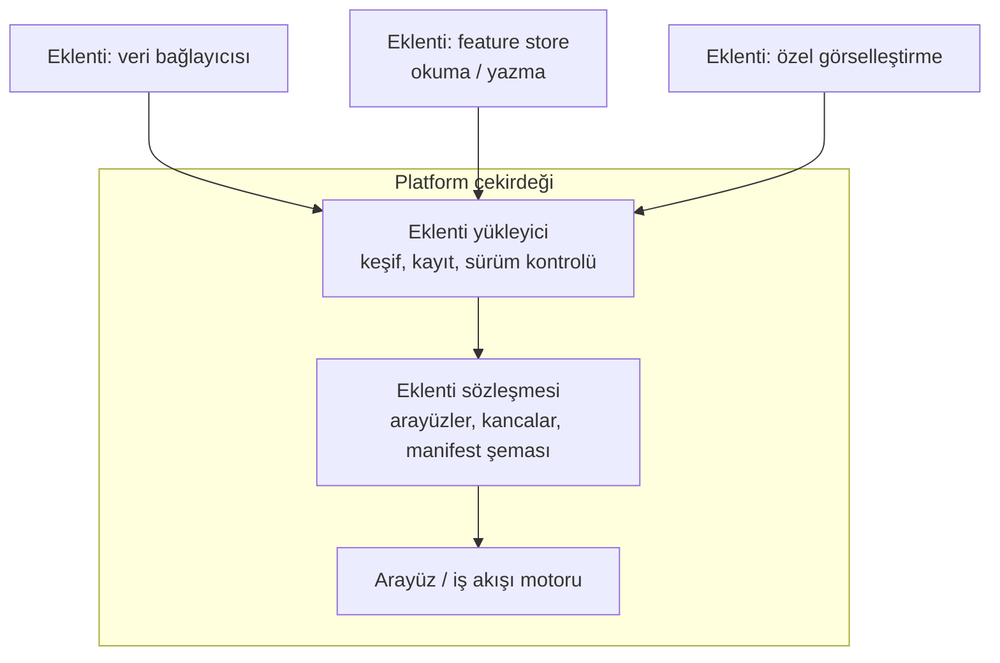
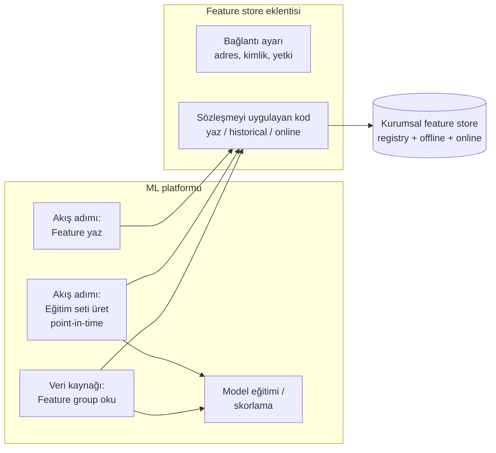

# 13.10 Plugin / Eklenti Mimarisi: Platforma Yeni Yetenek Eklemek

## Nedir?
**Plugin (eklenti) mimarisi**, bir yazılım platformunun çekirdeğine dokunmadan, önceden tanımlanmış **genişleme noktaları (extension points)** üzerinden yeni yetenekler eklenebilmesini sağlayan tasarım yaklaşımıdır.

- **Çekirdek (core / host):** Platformun temel işlevlerini sağlar ve eklentilerin uyması gereken **sözleşmeyi (arayüz / API)** tanımlar.
- **Eklenti (plugin):** Bu sözleşmeye uyan, bağımsız paketlenen, kurulup kaldırılabilen bileşen.

Gündelik örnekler: Tarayıcı eklentileri, VS Code uzantıları, Grafana veri kaynağı eklentileri, Airflow provider'ları, dbt adapter'ları, Kubernetes operator'ları ve CRD'leri.

## Hangi problemi çözer?
- **Çekirdeği değiştirmeden genişleme:** Platform üreticisi her ihtiyacı öngöremez; kurum kendi ihtiyacını eklentiyle ekler.
- **Bağımsız yaşam döngüsü:** Eklenti, platform güncellemelerinden ayrı sürümlenir ve dağıtılır.
- **Tekrar kullanım:** Bir ekip yazdığı eklentiyi (ör. "kurum içi veri kaynağı bağlayıcısı") tüm ekiplere sunar.
- **Kurumsal standart:** Ortak işlemler (kurumsal feature store'a yazma, model kayıt kuralları, maskeleme) tek yerde kodlanır, herkes aynı yolu kullanır.

## Nasıl çalışır?



**Ortak kavramlar**
| Kavram | Açıklama |
|---|---|
| **Genişleme noktası** | Platformun eklentiye açtığı yer: yeni veri kaynağı, yeni iş akışı adımı, yeni görsel, yeni komut |
| **Sözleşme (interface)** | Eklentinin uygulaması gereken fonksiyonlar/sınıflar: `oku()`, `yaz()`, `calistir(girdi) -> cikti` |
| **Manifest** | Eklentinin kimlik kartı: ad, sürüm, bağımlılıklar, hangi genişleme noktalarını kullandığı, parametreleri |
| **Keşif ve kayıt** | Platformun kurulu eklentileri bulması (klasör taraması, paket giriş noktası, kayıt servisi) |
| **İzolasyon** | Eklentinin ayrı ortamda (ayrı Python ortamı, container) çalışması; çekirdeği veya diğer eklentileri bozmaması |
| **Yetki** | Eklentinin hangi kaynaklara erişebileceği; kim kurabilir, kim kullanabilir |
| **Sürüm uyumu** | Eklentinin hangi platform sürümleriyle çalıştığı |

**Feature store örneğiyle: Bir ML platformuna feature store yeteneği eklemek**

ML platformunuzun (ör. görsel akışlı bir veri bilimi platformu) yerleşik bir feature store'u olmadığını veya kurumun merkezi bir feature store'u kullanmak istediğini düşünün. Eklenti mimarisi şöyle kurulur:



| Eklenti bileşeni | Platformda karşılığı | Görevi |
|---|---|---|
| **Yazma adımı** | Akışa eklenen yeni bir adım (recipe/step/operator) | Hesaplanan feature'ları feature group olarak kaydeder, metadata'yı registry'ye yazar |
| **Eğitim seti adımı** | Yeni bir adım | Etiket tablosunu alır, point-in-time join ile feature'ları ekler ([13.9](09-point-in-time.md)) |
| **Veri kaynağı / bağlayıcı** | Yeni bir veri kaynağı türü | Feature group'ları platformda tablo gibi okunur hâle getirir |
| **Bağlantı ayarı (preset)** | Yönetici tarafından bir kez tanımlanan ayar | Adres ve kimlik bilgilerini kullanıcılardan saklar; secret yönetimiyle entegre ([15.7](../15-guvenlik/07-secret-yonetimi.md)) |
| **Arayüz parçası** | Ayar formu, katalog ekranı | Kullanıcının kod yazmadan feature seçmesi |
| **Online sunum yardımcısı** | API/servis tarafında kütüphane | Canlı skorlamada aynı feature'ları online store'dan okumak |

Böylece veri bilimci platformdan çıkmadan feature store kullanır; feature tanımları, point-in-time mantığı ve güvenlik kuralları tek bir eklentide, merkezi olarak yönetilir.

## Mini örnek
Python'da basit bir eklenti sistemi: Çekirdek bir sözleşme tanımlar, eklentiler paket **giriş noktası (entry point)** ile kendini kaydeder.

Çekirdekteki sözleşme:
```python
# platform/eklenti.py
from abc import ABC, abstractmethod
import pandas as pd

class FeatureDeposu(ABC):
    """Tüm feature store eklentilerinin uyması gereken sözleşme."""

    ad: str

    @abstractmethod
    def yaz(self, grup: str, df: pd.DataFrame, zaman_sutunu: str) -> None: ...

    @abstractmethod
    def gecmis(self, etiketler: pd.DataFrame, featurelar: list[str]) -> pd.DataFrame: ...

    @abstractmethod
    def canli(self, anahtarlar: list[dict], featurelar: list[str]) -> pd.DataFrame: ...
```

Çekirdekteki yükleyici:
```python
# platform/yukleyici.py
from importlib.metadata import entry_points

def eklentileri_yukle() -> dict:
    return {ep.name: ep.load() for ep in entry_points(group="platform.feature_deposu")}

depolar = eklentileri_yukle()
depo = depolar["kurumsal_fs"](ayarlar)       # yapılandırmadan seçilir
```

Eklenti paketi (ayrı repo, ayrı sürüm):
```python
# kurumsal_fs_eklenti/depo.py
from platform.eklenti import FeatureDeposu

class KurumsalFS(FeatureDeposu):
    ad = "kurumsal_fs"
    def __init__(self, ayarlar): self.istemci = ...           # kurumsal feature store istemcisi
    def yaz(self, grup, df, zaman_sutunu): ...
    def gecmis(self, etiketler, featurelar): ...               # point-in-time join
    def canli(self, anahtarlar, featurelar): ...
```
```toml
# kurumsal_fs_eklenti/pyproject.toml
[project]
name = "kurumsal-fs-eklenti"
version = "1.2.0"
dependencies = ["pandas>=2.2"]

[project.entry-points."platform.feature_deposu"]
kurumsal_fs = "kurumsal_fs_eklenti.depo:KurumsalFS"
```
`pip install kurumsal-fs-eklenti` sonrası platform eklentiyi otomatik bulur; çekirdek kodda hiçbir değişiklik gerekmez.

Manifest örneği (birçok platformun eklentileri JSON/YAML manifestle tanımlanır):
```json
{
  "id": "kurumsal-feature-store",
  "version": "1.2.0",
  "meta": { "label": "Kurumsal Feature Store", "description": "Feature yazma, point-in-time eğitim seti, online okuma" },
  "components": ["recipe:feature-yaz", "recipe:egitim-seti", "dataset:feature-group", "preset:baglanti"],
  "params": [
    { "name": "baglanti", "type": "PRESET", "label": "Feature store bağlantısı" },
    { "name": "feature_group", "type": "STRING", "mandatory": true }
  ]
}
```

## Nerede kullanılır?
- ML/veri platformlarına kurum içi sistem bağlayıcıları eklemek (iç veri kaynakları, feature store, model registry, onay akışları)
- BI araçlarına özel görsel ve veri kaynağı eklemek ([12.2](../12-bi/02-bi-araclari.md))
- Orkestratörlere yeni görev türleri eklemek (Airflow provider'ları, n8n özel düğümleri)
- Kubernetes'e yeni kaynak türleri eklemek (CRD + operator) — aynı fikrin altyapıdaki karşılığı

## Benzerleri ve farkları
| Yaklaşım | Fark |
|---|---|
| **Plugin** | Platformun **içinde** çalışır, onun arayüzü ve yaşam döngüsüyle bütünleşir |
| **Entegrasyon / API çağrısı** | Platform dışındaki bir servisle konuşmak; daha gevşek bağlı ama kullanıcı deneyimi parçalı |
| **Fork (çatallama)** | Platform kodunu kopyalayıp değiştirmek; güncellemeleri almak zorlaşır, kaçınılmalı |
| **Script / notebook kodu** | Hızlıdır ama her projede kopyalanır; standart ve yönetişim zayıf |
| **Mikroservis** | Yetenek ayrı servis olarak sunulur; eklenti çoğu zaman bu servisin platform içindeki "istemcisi"dir |

**Tasarım ilkeleri:** Sözleşmeyi küçük ve kararlı tutun; eklentiye sadece gerekli yetkiyi verin; sürüm uyumunu manifestte belirtin; eklentiyi de kod gibi Git, test ve CI/CD ile yönetin ([6.1](../06-ci-cd/01-ci-cd-nedir.md)).

## İlgili sayfalar
- [13.7 Feature store bileşenleri](07-feature-store-bilesenleri.md)
- [13.11 ML platformları](11-ml-platformlari.md)
- [2.5 pyproject.toml](../02-python-ortam/05-bagimlilik-dosyalari.md)
