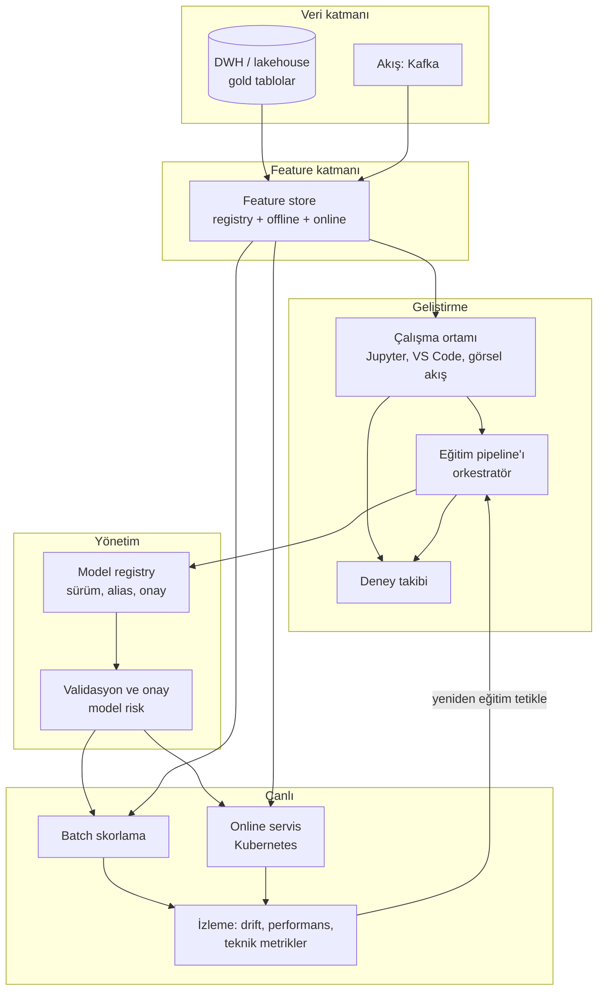

# 13.11 Uçtan Uca ML Platformları: Bileşenler Nasıl Bir Araya Gelir

## Nedir?
**ML platformu**, bir kurumun makine öğrenmesi modellerini geliştirmek, eğitmek, yayına almak ve izlemek için kullandığı araçların **birlikte çalışan bütünüdür**. Tek bir ürün olabileceği gibi (hepsi bir arada platformlar), açık kaynak ve kurumsal bileşenlerin birleşimi de olabilir.

Bu sayfa önceki sayfalarda anlatılan parçaları (veri, feature store, deney takibi, registry, serving, izleme) tek bir resimde birleştirir.

## Hangi problemi çözer?
Her ekibin kendi notebook'u, kendi sunucusu ve kendi deploy yöntemiyle çalıştığı ortamda:
- Modeller tekrar üretilemez ve denetlenemez,
- Aynı altyapı sorunları her projede yeniden çözülür,
- Canlıya çıkış aylar sürer.

Ortak bir platform; standart yol (golden path), self-servis altyapı, merkezi yönetişim ve hızlı canlıya geçiş sağlar.

## Nasıl çalışır?

**Platform yetenekleri kontrol listesi**
| Yetenek | Soru | Bölüm |
|---|---|---|
| Veri erişimi | Veri bilimci yetkili olduğu veriye kolayca ve güvenli ulaşabiliyor mu? | 9, 15 |
| Çalışma ortamı | Notebook/IDE, GPU, paket yönetimi hazır mı? | 2 |
| Feature yönetimi | Feature'lar tanımlı, paylaşılabilir, point-in-time doğru mu? | 13.6–13.9 |
| Deney takibi | Her deneme kayıtlı mı? | 13.2 |
| Pipeline / orkestrasyon | Eğitim tek komutla, zamanlanmış ve tekrar üretilebilir mi? | 11.8 |
| Model registry | Sürüm, onay, canlıdaki model belli mi? | 13.2 |
| CI/CD | Kod ve model değişiklikleri otomatik test ve deploy ediliyor mu? | 6 |
| Serving | Batch ve online sunum standart mı? | 13.3 |
| İzleme | Drift, performans ve teknik metrikler alarm üretiyor mu? | 13.4, 14 |
| Yönetişim | Erişim, lineage, dokümantasyon, denetim kaydı var mı? | 15 |
| Genişletilebilirlik | Kurum ihtiyaçları eklentiyle eklenebiliyor mu? | 13.10 |

**Platform türleri**
| Tür | Örnekler | Güçlü yanı | Dikkat |
|---|---|---|---|
| **Hepsi bir arada, görsel + kod** | Dataiku, SAS Viya, H2O, KNIME | Hızlı başlangıç, iş birimleriyle ortak çalışma, yerleşik yönetişim | Lisans maliyeti; özel ihtiyaçlar için eklenti/entegrasyon gerekir |
| **Lakehouse tabanlı** | Databricks, Microsoft Fabric | Veri + Spark + MLflow + feature store aynı yerde | Platforma bağımlılık |
| **Bulut sağlayıcı** | SageMaker, Vertex AI, Azure ML | Yönetilen altyapı | Kurum içi veri kısıtları |
| **Kubernetes tabanlı** | OpenShift AI, Kubeflow | Kurum içi (on-prem), açık kaynak, mevcut OpenShift altyapısı | Kurulum ve bakım yetkinliği |
| **Açık kaynak birleşimi** | JupyterHub + MLflow + Feast + Airflow + KServe + Evidently | Esneklik, lisans yok | Entegrasyon ve operasyon yükü ekipte |

**Hepsi bir arada platformların yeri (ör. Dataiku):** Görsel akışlar ve kod tarifleri (recipe) ile veri hazırlama, otomatik model eğitimi ve kodlu modeller, kayıtlı model sürümleri, senaryolarla zamanlama ([11.8](../11-veri-akisi/08-orkestrasyon.md)), API olarak sunum ve model değerlendirme/drift takibi gibi yaşam döngüsü adımlarının çoğunu tek arayüzde toplar. Platformda bulunmayan veya kurumsal standarda bağlanması gereken yetenekler (kurumsal feature store, özel veri kaynakları, onay akışları) ise eklentilerle eklenir ([13.10](10-plugin-mimarisi.md)).

## Mini örnek
Kurum içi, açık kaynak ağırlıklı bir referans mimari (OpenShift üzerinde):

| İhtiyaç | Bileşen |
|---|---|
| Veri | Oracle DWH + MinIO üzerinde Iceberg/Delta lakehouse |
| İşleme | Spark (Spark Operator), DuckDB/Polars (tek makine işleri) |
| Çalışma ortamı | JupyterHub / OpenShift AI workbench'leri |
| Feature store | Feast (offline: lakehouse, online: Redis) |
| Deney + registry | MLflow (PostgreSQL + MinIO) |
| Orkestrasyon | Airflow veya Argo Workflows |
| CI/CD | GitLab CI / OpenShift Pipelines + OpenShift GitOps |
| Serving | FastAPI container'ları veya KServe |
| İzleme | Prometheus + Grafana (teknik), Evidently + SQL tabloları (drift) |
| Kimlik ve yetki | LDAP/AD + OpenShift OAuth + RBAC |

Bir modelin bu platformdaki yolculuğu:
1. Veri bilimci workbench'te feature store'dan point-in-time eğitim seti alır.
2. Deneyleri MLflow'a kaydeder, en iyi modeli registry'ye `challenger` olarak yazar.
3. Eğitim kodu Git'e gider; CI testleri ve doğrulama eşiklerini çalıştırır.
4. Model validasyon ekibi registry'deki kayıtları ve raporları inceleyip onaylar → `champion`.
5. GitOps reposundaki model sürümü güncellenir; ArgoCD skorlama servisini yeni modelle dağıtır.
6. Grafana panoları ve aylık PSI raporları modeli izler; eşik aşılırsa yeniden eğitim pipeline'ı tetiklenir.

## Nerede kullanılır?
- Birden çok veri bilimi ekibinin ortak altyapı kullandığı kurumlar
- Model sayısının arttığı ve model risk yönetimi gereksinimlerinin olgunlaştığı bankalar
- GenAI uygulamalarının da aynı yönetişimle sunulması istenen ortamlar ([13.12](12-genai-rag.md))

## Benzerleri ve farkları
- **Platform mühendisliği (platform engineering):** Geliştiricilere self-servis "standart yol" sunan iç platform yaklaşımının ML'deki karşılığıdır.
- **Satın al ya da kur:** Hepsi bir arada platformlar hız ve yönetişim sağlar; açık kaynak birleşimi esneklik ve maliyet avantajı sağlar ama ekip yetkinliği ister. Çoğu kurum hibrit yol izler.

## İlgili sayfalar
- [13.1 ML yaşam döngüsü](01-ml-yasam-dongusu.md)
- [13.10 Plugin mimarisi](10-plugin-mimarisi.md)
- [5.16 OpenShift](../05-kubernetes/16-openshift-nedir.md)
