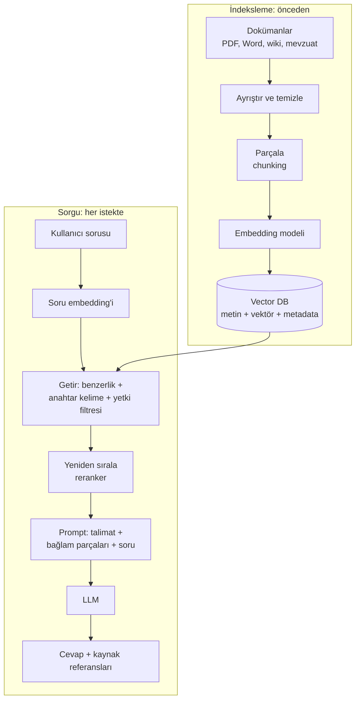

# 13.12 GenAI Altyapısı: Embedding, RAG ve LLMOps

## Nedir?
- **LLM (Large Language Model — büyük dil modeli):** Çok büyük metin verisiyle eğitilmiş, metin anlayan ve üreten model.
- **Embedding:** Metnin anlamını temsil eden sayı vektörü ([9.9](../09-veri-depolama/09-vector-db.md)).
- **RAG (Retrieval-Augmented Generation — getirme destekli üretim):** LLM'e soru sormadan önce, kurumun kendi dokümanlarından ilgili parçaları bulup **bağlam olarak** vermek. Model cevabını bu kaynaklara dayandırır.
- **LLMOps:** LLM tabanlı uygulamaların geliştirme, değerlendirme, yayına alma ve izleme süreçleri; MLOps'un GenAI'a uyarlanmış hâli.

## Hangi problemi çözer?
LLM'ler genel bilgide güçlüdür ama:
- Kurumun iç prosedürlerini, ürün dokümanlarını, güncel mevzuatı bilmez,
- Bilmediği konuda uydurabilir (**hallucination**),
- Kaynak göstermez.

RAG bu sorunları, modeli yeniden eğitmeden, **güncel ve yetkili kaynaklara dayalı** cevaplarla azaltır. LLMOps ise bu uygulamaların kalitesinin ölçülmesini ve güvenli işletilmesini sağlar.

## Nasıl çalışır?



**RAG'ın kalitesini belirleyen kararlar**
| Karar | Seçenekler / dikkat |
|---|---|
| Parçalama (chunking) | Parça boyutu (ör. 300–800 token), örtüşme, başlık/bölüm yapısını korumak |
| Embedding modeli | Türkçe performansı, boyut, kurum içinde çalıştırılabilirlik |
| Getirme | Vektör + BM25 (hibrit), metadata filtresi (belge türü, tarih), **kullanıcı yetkisine göre filtre** |
| Yeniden sıralama | Cross-encoder reranker ile ilk 20 sonuçtan en iyi 5'i |
| Prompt | "Sadece verilen kaynaklara dayan, bilmiyorsan söyle, kaynak numarası ver" |
| Model | Kurum içinde barındırılan açık modeller veya kurumsal sözleşmeli API; veri gizliliği kararı |

**LLMOps bileşenleri**
| Bileşen | Açıklama |
|---|---|
| **Prompt yönetimi** | Prompt'ların kod gibi versiyonlanması ve test edilmesi |
| **Değerlendirme (evaluation)** | Soru–beklenen cevap setleri; doğruluk, kaynağa sadakat (faithfulness), getirme isabeti, LLM-as-judge |
| **Guardrails (korkuluklar)** | Kişisel veri (TCKN, kart no) maskeleme, zararlı/konu dışı içerik filtresi, prompt injection'a karşı koruma |
| **Gözlemlenebilirlik** | Her istek için prompt, getirilen parçalar, cevap, gecikme, token maliyeti kaydı (tracing) |
| **Geri bildirim** | Kullanıcı beğeni/beğenmeme; hatalı cevapların değerlendirme setine eklenmesi |
| **Maliyet ve kapasite** | Token kullanımı, önbellekleme, model boyutu seçimi |

**İleri yaklaşımlar**
- **Agent (ajan):** LLM'in araç çağırarak (SQL sorgusu, API, hesaplama) çok adımlı iş yapması.
- **GraphRAG:** Bilgiyi graph yapısında (varlıklar ve ilişkiler) tutup getirme ([9.8](../09-veri-depolama/08-graph-db.md)).
- **Fine-tuning (ince ayar):** Modeli kurum verisiyle ek eğitmek. Bilgi eklemek için genellikle RAG daha uygun ve güncellenebilirdir; fine-tuning üslup ve format için tercih edilir.

## Mini örnek
Sadeleştirilmiş RAG akışı (araçtan bağımsız; `embed` ve `llm` kurumun onayladığı modellere bağlanır):
```python
import psycopg
from pgvector.psycopg import register_vector

def embed(metin: str) -> list[float]: ...          # kurum içi embedding servisi
def llm(prompt: str) -> str: ...                    # kurum içi / sözleşmeli LLM

def getir(soru: str, kullanici_rolleri: list[str], k: int = 5):
    with psycopg.connect("postgresql://...") as conn:
        register_vector(conn)
        return conn.execute("""
            SELECT belge, bolum, icerik
            FROM dokuman_parca
            WHERE erisim_rolu = ANY(%s)               -- yetki filtresi
            ORDER BY embedding <=> %s
            LIMIT %s
        """, (kullanici_rolleri, embed(soru), k)).fetchall()

def cevapla(soru: str, roller: list[str]) -> str:
    parcalar = getir(soru, roller)
    baglam = "\n\n".join(f"[{i+1}] ({b} – {s})\n{t}" for i, (b, s, t) in enumerate(parcalar))
    prompt = f"""Aşağıdaki kaynaklara dayanarak Türkçe cevap ver.
Kaynaklarda yoksa "Bu bilgi kaynaklarda yok" de. Her cümleden sonra kaynak numarasını yaz.

KAYNAKLAR:
{baglam}

SORU: {soru}"""
    return llm(prompt)
```

Basit değerlendirme seti:
```python
test_seti = [
    {"soru": "Kredi kartı yıllık ücreti hangi durumda iade edilir?", "beklenen_kaynak": "Kart Ürün Prosedürü"},
    {"soru": "KOBİ kredisinde teminat oranı nedir?",               "beklenen_kaynak": "Kredi Politikası"},
]
isabet = sum(
    any(t["beklenen_kaynak"] in b for b, _, _ in getir(t["soru"], ["genel"]))
    for t in test_seti
) / len(test_seti)
print(f"Getirme isabeti: %{isabet*100:.0f}")
```

## Nerede kullanılır?
- İç prosedür ve mevzuat asistanları (şube, çağrı merkezi, uyum ekipleri)
- Müşteri şikâyetlerinin sınıflandırılması ve özetlenmesi
- Rapor yorumlama: metrik tablolarından otomatik yönetici özeti (ör. n8n ile rapor üretim akışları)
- Kod ve SQL yardımcıları, doküman karşılaştırma, kredi dosyası özetleme

## Benzerleri ve farkları
- **Klasik ML ile GenAI:** Klasik ML yapılandırılmış veriyle belirli bir hedefi tahmin eder (skor). GenAI metin üretir; değerlendirmesi daha zordur, bu yüzden değerlendirme setleri ve insan kontrolü kritik önemdedir.
- **Araçlar (referans):** LangChain, LlamaIndex (RAG çatıları); vLLM, Ollama (model sunumu); Langfuse, MLflow (izleme ve değerlendirme); OpenShift AI, Dataiku LLM Mesh gibi platform bileşenleri.

**Bankacılıkta dikkat:**
- Müşteri ve kişisel veri dış servislere gönderilmeden önce KVKK ve kurum politikaları kontrol edilmelidir ([15.9](../15-guvenlik/09-maskeleme-kvkk.md)).
- Cevaplar karar destek amaçlıdır; kredi kararı gibi kritik süreçlerde insan onayı ve açıklanabilirlik gereklidir.
- Kullanıcının yetkisi olmayan dokümanların parçaları cevaba girmemelidir (yetki filtresi getirme adımında uygulanır).

## İlgili sayfalar
- [9.9 Vector veritabanları](../09-veri-depolama/09-vector-db.md)
- [13.1 ML yaşam döngüsü](01-ml-yasam-dongusu.md)
- [11.8 Orkestrasyon (n8n)](../11-veri-akisi/08-orkestrasyon.md)
