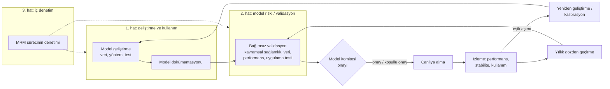

# 13.13 Model Riski Yönetimi ve Model Validasyonu

## Nedir?
**Model riski**, bir modelin hatalı olması veya yanlış kullanılması sonucu yanlış kararlar alınması ve bunun finansal kayıp, düzenleyici yaptırım veya itibar kaybına yol açması riskidir. Kredi skoru yanlış kalibre edilmişse fazla risk alınır; erken uyarı modeli bozulmuşsa sorunlu krediler geç fark edilir.

**Model riski yönetimi (MRM, Model Risk Management)**, bu riski modelin tüm yaşam döngüsü boyunca yöneten çerçevedir: model envanteri, geliştirme standartları, **bağımsız validasyon**, onay, izleme, periyodik gözden geçirme ve emeklilik. Bankacılıkta bu alanda en çok başvurulan referanslardan biri ABD'nin **SR 11-7** rehberidir; Basel çerçevesi (içsel derecelendirme modelleri), IFRS 9 beklenen kredi zararı modelleri ve ulusal düzenleyicilerin beklentileri de benzer ilkeleri içerir. AB Yapay Zekâ Yasası (AI Act), kişilerin kredi değerliliğini değerlendiren sistemleri **yüksek riskli** yapay zekâ sistemleri arasında sayar.

## Hangi problemi çözer?
- "Bu model ne zaman, kim tarafından, hangi veriyle geliştirildi; kim onayladı?" sorusunun cevapsız kalması
- Geliştiricinin kendi modelini değerlendirmesi (çıkar çatışması); hataların canlıya geçmeden yakalanamaması
- Modelin zamanla bozulmasının (drift) fark edilmemesi ([13.4](04-monitoring-drift.md))
- Kayıtlı olmayan "gölge modeller": Excel'de hesaplanan skorlar, onaysız script'ler
- Denetim ve düzenleyici incelemelerde kanıt sunulamaması

## Nasıl çalışır?

**Üç savunma hattı ve model yaşam döngüsü**


**Model envanteri:** Kurumdaki tüm modellerin kaydı. Her model için:
| Alan | Örnek |
|---|---|
| Model kimliği ve adı | `KOBI-PD-2026`, KOBİ temerrüt olasılığı modeli |
| Amaç ve kullanım | Kredi tahsis kararı, fiyatlama, sermaye hesaplaması |
| Model sahibi / geliştirici / kullanıcı birim | Kredi Riski Yönetimi / Risk Analitiği / Kurumsal Krediler |
| **Risk seviyesi (tiering)** | Yüksek: düzenleyici sermayeyi veya müşteri kararını doğrudan etkiliyor |
| Durum | Geliştirmede, validasyonda, canlıda, emekli |
| Son validasyon tarihi ve sonucu | 2026-03, koşullu onay (2 bulgu) |
| Bağımlılıklar | Girdi tabloları, üst modeller, kullanan sistemler (lineage, [16.3](../16-veri-yonetisimi/03-lineage.md)) |
| Teknik referans | MLflow model adı ve sürümü, kod deposu, eğitim veri seti sürümü ([13.2](02-mlflow.md)) |

Risk seviyesi; validasyonun derinliğini ve sıklığını belirler (yüksek riskli modeller her yıl, düşük riskliler daha seyrek).

**Model dokümantasyonunun bölümleri**
1. Amaç, kapsam, kullanım sınırları (model **neye** kullanılmamalı)
2. Veri: kaynaklar, dönem, temerrüt/hedef tanımı, örneklem, dışlamalar, veri kalitesi
3. Yöntem: değişken seçimi, dönüşümler (WoE, binning), algoritma, hiperparametreler, gerekçeler
4. Performans: ayrıştırma gücü, kalibrasyon, stabilite; geliştirme, test ve zaman dışı (out-of-time) örneklemlerde
5. Açıklanabilirlik ve adillik analizleri ([13.14](14-aciklanabilirlik-adillik.md))
6. Varsayımlar ve sınırlamalar, uzman müdahaleleri (override)
7. Uygulama: üretim kodu, skorlama ortamı, girdi eşleştirmesi, testler
8. İzleme planı: metrikler, eşikler, sorumlular

**Bağımsız validasyonun kontrolleri**
| Alan | Ne kontrol edilir? |
|---|---|
| **Kavramsal sağlamlık** | Yöntem amaca uygun mu, değişkenler iş açısından anlamlı mı, işaretler mantıklı mı? |
| **Veri** | Hedef tanımı doğru mu, sızıntı (leakage) var mı ([13.9](09-point-in-time.md)), örneklem temsilî mi? |
| **Yeniden üretim (replication)** | Validasyon ekibi aynı veri ve kodla aynı sonuçları üretebiliyor mu? |
| **Performans** | Ayrıştırma gücü, kalibrasyon, zaman dışı ve segment bazında performans |
| **Stabilite** | Değişken ve skor dağılımları zamanla kayıyor mu (PSI, CSI)? |
| **Duyarlılık ve stres** | Girdilerdeki değişimlere ve olumsuz senaryolara tepki |
| **Benchmark** | Basit bir alternatif model (lojistik regresyon) ile karşılaştırma |
| **Uygulama** | Canlıdaki skorlar geliştirme ortamındakiyle aynı mı (skorlama paritesi)? |

**Kredi modellerinde sık kullanılan metrikler**
| Metrik | Ne ölçer? | Kaba yorum |
|---|---|---|
| **AUC / Gini** (Gini = 2·AUC − 1) | Ayrıştırma gücü: kötüleri iyilerden ayırma | Uygulamaya ve portföye göre değişir; zaman içindeki düşüş önemlidir |
| **KS (Kolmogorov–Smirnov)** | İyi ve kötü kümülatif dağılımları arasındaki en büyük fark | Yüksek daha iyi |
| **PSI (Population Stability Index)** | Skor dağılımının geliştirme dönemine göre kayması | < 0,10 stabil; 0,10–0,25 izle; > 0,25 ciddi kayma (yaygın kabul) |
| **CSI** | Tek bir değişkenin dağılım kayması | PSI ile aynı mantık |
| **Kalibrasyon (binom testi, Hosmer–Lemeshow, gerçekleşen/tahmin oranı)** | Tahmin edilen temerrüt oranı gerçekleşenle uyumlu mu? | Not dereceleri bazında kontrol edilir |
| **Brier skoru** | Olasılık tahminlerinin ortalama karesel hatası | Düşük daha iyi |

**Champion / challenger:** Canlıdaki model (champion) ile yeni aday model (challenger) aynı veride paralel çalıştırılır. Challenger sadece skor üretir, kararı etkilemez (**shadow mode**). Belirli bir süre performansı ve stabilitesi karşılaştırıldıktan sonra değişim kararı verilir.

## Mini örnek
**Validasyon metriklerini hesaplamak**
```python
import numpy as np
import pandas as pd
from sklearn.metrics import roc_auc_score, brier_score_loss
from scipy.stats import ks_2samp

def gini(y, p):
    return 2 * roc_auc_score(y, p) - 1

def ks(y, p):
    return ks_2samp(p[y == 1], p[y == 0]).statistic

def psi(beklenen, gerceklesen, kova=10):
    sinirlar = np.quantile(beklenen, np.linspace(0, 1, kova + 1))
    sinirlar[0], sinirlar[-1] = -np.inf, np.inf
    b = np.histogram(beklenen, sinirlar)[0] / len(beklenen)
    g = np.histogram(gerceklesen, sinirlar)[0] / len(gerceklesen)
    b, g = np.clip(b, 1e-6, None), np.clip(g, 1e-6, None)
    return float(np.sum((g - b) * np.log(g / b)))

def kalibrasyon_tablosu(y, p, kova=10):
    df = pd.DataFrame({"y": y, "p": p})
    df["dilim"] = pd.qcut(df["p"], kova, labels=False, duplicates="drop")
    return df.groupby("dilim").agg(adet=("y", "size"), tahmin_pd=("p", "mean"), gerceklesen=("y", "mean"))

rapor = {
    "gini_gelistirme": gini(y_dev, p_dev),
    "gini_oot":        gini(y_oot, p_oot),          # zaman dışı örneklem
    "ks_oot":          ks(y_oot, p_oot),
    "brier_oot":       brier_score_loss(y_oot, p_oot),
    "psi_skor":        psi(p_dev, p_canli_son_ay),
}
print(pd.Series(rapor).round(3))
print(kalibrasyon_tablosu(y_oot, p_oot))
```

**Champion / challenger karşılaştırması**
```python
sonuc = pd.DataFrame({
    "model": ["champion_v3", "challenger_v4"],
    "gini":  [gini(y, p_champion), gini(y, p_challenger)],
    "ks":    [ks(y, p_champion), ks(y, p_challenger)],
    "psi":   [psi(p_champion_dev, p_champion), psi(p_challenger_dev, p_challenger)],
})
# Bootstrap ile Gini farkının güven aralığı: fark gerçekten anlamlı mı?
rng = np.random.default_rng(42)
farklar = []
for _ in range(1000):
    i = rng.integers(0, len(y), len(y))
    farklar.append(gini(y[i], p_challenger[i]) - gini(y[i], p_champion[i]))
print(sonuc, np.percentile(farklar, [2.5, 97.5]))
```

**Model kaydında validasyon bilgisini tutmak (MLflow)**
```python
from mlflow import MlflowClient

client = MlflowClient()
client.set_model_version_tag("kobi_pd", "4", "validasyon_durumu", "kosullu_onay")
client.set_model_version_tag("kobi_pd", "4", "validasyon_raporu", "MRM-2026-014")
client.set_model_version_tag("kobi_pd", "4", "risk_seviyesi", "yuksek")
client.set_registered_model_alias("kobi_pd", "champion", "3")     # canlıdaki sürüm
client.set_registered_model_alias("kobi_pd", "challenger", "4")   # gölge modda çalışan
```
Skorlama servisi sürüm numarası yerine `models:/kobi_pd@champion` takma adını kullanırsa, onaylı değişim tek bir alias güncellemesiyle yapılır ve kayıt altında kalır.

**Skorlama paritesi testi**
```python
# Aynı müşteriler için geliştirme ortamı skorları ile canlı servis skorları aynı mı?
fark = (skor_gelistirme - skor_canli).abs()
assert fark.max() < 1e-6, f"Skorlama paritesi bozuk: en büyük fark {fark.max()}"
```

## Nerede kullanılır?
- Kredi skorlama (başvuru ve davranış skorları), temerrüt olasılığı (PD), temerrüt hâlinde kayıp (LGD), temerrüt tutarı (EAD) modelleri
- IFRS 9 beklenen kredi zararı ve stres testi modelleri
- Fraud, AML ve erken uyarı modelleri
- Fiyatlama, limit ve gelir tahmin modelleri
- Generatif yapay zekâ uygulamaları: yeni nesil model envanterlerine LLM tabanlı sistemler de eklenmekte ([13.12](12-genai-rag.md))

## Benzerleri ve farkları
- **MLOps:** Modelin teknik yaşam döngüsünü (eğitim, kayıt, dağıtım, izleme) otomatikleştirir; MRM ise bu döngünün **yönetişim ve kontrol** tarafıdır. MLflow kayıtları, izleme panelleri ve lineage MRM'nin kanıt kaynaklarıdır ([13.1](01-ml-yasam-dongusu.md)).
- **Model izleme:** Canlıdaki modelin sürekli takibi; validasyon ise periyodik ve bağımsız derinlemesine incelemedir ([13.4](04-monitoring-drift.md)).
- **Yazılım testi:** Kodun doğruluğunu test eder; validasyon modelin **istatistiksel ve iş açısından** uygunluğunu değerlendirir.
- **Veri yönetişimi:** Modelin girdisi olan verinin sahipliği ve kalitesi; model riski yönetiminin ön koşuludur ([16.1](../16-veri-yonetisimi/01-veri-yonetisimi-nedir.md)).

## İlgili sayfalar
- [13.14 Açıklanabilirlik ve adillik](14-aciklanabilirlik-adillik.md)
- [13.4 Model monitoring ve drift](04-monitoring-drift.md)
- [13.2 MLflow](02-mlflow.md)
- [13.9 Point-in-time doğruluk](09-point-in-time.md)
