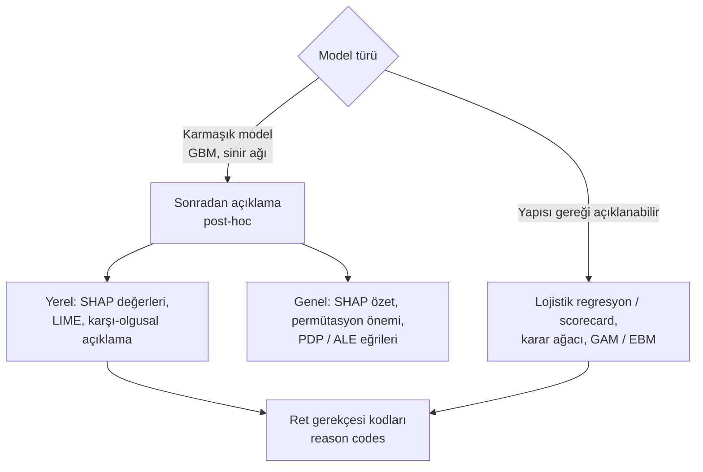

# 13.14 Model Açıklanabilirliği ve Adillik

## Nedir?
- **Açıklanabilirlik (explainability, XAI):** Bir modelin **neden** belirli bir sonucu ürettiğinin insanlar tarafından anlaşılabilir biçimde gösterilmesidir. İki düzeyi vardır:
  - **Genel (global) açıklama:** Model genel olarak hangi değişkenlere, hangi yönde dayanıyor?
  - **Yerel (local) açıklama:** **Bu müşterinin** başvurusu neden reddedildi, skoru neden düşük?
- **Adillik (fairness):** Modelin kararlarının belirli kişi gruplarına (cinsiyet, yaş, uyruk, engellilik gibi korunan özellikler) karşı haksız ve sistematik bir dezavantaj üretmemesidir.

İkisi de model riski yönetiminin parçasıdır ([13.13](13-model-riski-validasyon.md)) ve kişiler hakkında otomatik karar veren sistemlerde hukuki bir boyut taşır: KVKK, kişinin verilerinin münhasıran otomatik sistemlerle analiz edilmesi sonucu aleyhine bir sonuç ortaya çıkmasına **itiraz etme hakkını** düzenler; AB Yapay Zekâ Yasası kredi değerliliği değerlendirmesini yüksek riskli kullanım olarak sınıflar.

## Hangi problemi çözer?
- Müşteriye ve şube personeline "başvurunuz neden olumsuz sonuçlandı?" sorusunun cevabı
- Kredi komitesi ve validasyon ekibinin "kara kutu" modele güvenmemesi
- Modelin iş mantığına aykırı davranışlarının yakalanması (gelir arttıkça risk artıyor gibi)
- Veri sızıntısı ve hatalı değişkenlerin tespiti: Açıklamada beklenmedik derecede baskın çıkan bir değişken çoğu zaman sızıntı işaretidir ([13.9](09-point-in-time.md))
- Doğrudan kullanılmasa bile **vekil (proxy)** değişkenler üzerinden korunan gruplara ayrımcılık riski
- Düzenleyici ve denetim incelemelerinde modelin savunulabilmesi

## Nasıl çalışır?

**Yöntemler haritası**


**Yaygın yöntemler**
| Yöntem | Düzey | Ne söyler? | Not |
|---|---|---|---|
| **Katsayılar / scorecard puanları** | Genel + yerel | Her değişken diliminin skora katkısı | Bankacılıkta geleneksel; WoE dönüşümlü lojistik regresyon |
| **Permütasyon önemi** | Genel | Değişken karıştırılınca performans ne kadar düşüyor? | Modelden bağımsız; ilişkili değişkenlerde yanıltabilir |
| **SHAP** | Genel + yerel | Her değişkenin bu tahmine katkısı (oyun teorisindeki Shapley değerleri); katkılar toplanınca tahmini verir | Ağaç modellerinde hızlı (TreeSHAP); en yaygın yöntem |
| **PDP / ICE / ALE** | Genel | Bir değişken değiştikçe tahmin nasıl değişiyor? | Yön ve şekil kontrolü (monotonluk) |
| **LIME** | Yerel | Tahmin etrafında basit bir vekil model | Kararsız olabilir |
| **Karşı-olgusal (counterfactual)** | Yerel | "Hangi değer ne kadar değişseydi sonuç olumlu olurdu?" | Müşteriye anlatılması kolay; gerçekçi ve değiştirilebilir değişkenlerle sınırlanmalı |
| **EBM (Explainable Boosting Machine)** | Yapısı gereği | Her değişkenin ayrı ve görselleştirilebilir etkisi | Açıklanabilirlik ile performans arasında iyi denge |

**Monoton kısıtlar:** Gradient boosting modellerinde (XGBoost, LightGBM) bir değişkenin etkisinin tek yönlü olması zorlanabilir: "Gecikme gün sayısı arttıkça risk azalamaz", "gelir arttıkça risk artamaz". Bu, hem iş mantığını korur hem de açıklamayı tutarlı yapar.

**Ret gerekçesi kodları (reason codes):** Olumsuz kararda skoru en çok düşüren 2–4 faktör, önceden tanımlanmış anlaşılır metinlere eşlenir. Gerekçeler; müşterinin anlayabileceği, değiştirebileceği ve korunan özelliklere dayanmayan ifadelerle yazılmalıdır.

| Değişken | Gerekçe metni |
|---|---|
| `gecikme_gun_max_12ay` | Son 12 ayda ödeme gecikmesi bulunması |
| `limit_kullanim_orani` | Mevcut limitlerin kullanım oranının yüksek olması |
| `kredi_sorgu_sayisi_3ay` | Son dönemde çok sayıda kredi başvurusu yapılması |
| `musteri_suresi_ay` | Bankayla çalışma süresinin kısa olması |

**Adillik**
| Kavram | Açıklama |
|---|---|
| **Korunan özellikler** | Cinsiyet, yaş, uyruk, din, engellilik gibi ayrımcılık yasağı kapsamındaki özellikler; çoğu zaman modelde kullanılmaz ve kullanılmamalıdır |
| **Vekil değişken (proxy)** | Korunan özellikle güçlü ilişkili değişken: belirli posta kodları, isimden türetilen özellikler, bazı harcama kategorileri |
| **"Kullanmıyoruz, o hâlde adiliz" yanılgısı** | Korunan özelliği modele koymamak yeterli değildir; vekil değişkenler aynı etkiyi taşıyabilir. Bu yüzden ölçüm için korunan özellik **analiz amaçlı ve izinli** olarak ayrı tutulur |

**Adillik metrikleri**
| Metrik | Soru | Formül (sadeleştirilmiş) |
|---|---|---|
| **Demographic parity (eşit onay oranı)** | Gruplar arasında onay oranları benzer mi? | P(onay \| A) ≈ P(onay \| B) |
| **Disparate impact oranı** | En düşük onay oranı / en yüksek onay oranı | Yaygın eşik 0,8 ("dörtte beş kuralı") |
| **Equal opportunity (eşit fırsat)** | Gerçekte iyi olan müşteriler gruplar arasında eşit oranda onaylanıyor mu? | TPR(A) ≈ TPR(B) |
| **Equalized odds** | Hem doğru pozitif hem yanlış pozitif oranları eşit mi? | TPR ve FPR eşitliği |
| **Kalibrasyon eşitliği** | Aynı skor, her grupta aynı gerçek riski mi ifade ediyor? | Grup bazında tahmin/gerçekleşen |

Bu metriklerin hepsini aynı anda sağlamak matematiksel olarak çoğu zaman mümkün değildir; hangisinin esas alınacağı iş, hukuk ve uyum birimleriyle birlikte belirlenir ve gerekçesi dokümante edilir.

## Mini örnek
**Monoton kısıtlı model ve SHAP açıklamaları**
```python
import numpy as np
import pandas as pd
import shap                       # pip install shap
import xgboost as xgb

ozellikler = ["gecikme_gun_max_12ay", "limit_kullanim_orani", "aylik_gelir", "musteri_suresi_ay",
              "kredi_sorgu_sayisi_3ay"]
# +1: arttıkça risk artar, -1: arttıkça risk azalır, 0: serbest
monoton = (1, 1, -1, -1, 1)

model = xgb.XGBClassifier(n_estimators=300, max_depth=4, learning_rate=0.05,
                          monotone_constraints=monoton, eval_metric="auc")
model.fit(X_train[ozellikler], y_train)

aciklayici = shap.TreeExplainer(model)
shap_degerleri = aciklayici(X_test[ozellikler])        # Explanation nesnesi (log-odds ölçeğinde)

shap.plots.beeswarm(shap_degerleri)                     # genel: değişken etkileri ve yönleri
shap.plots.waterfall(shap_degerleri[0])                 # yerel: tek bir başvurunun açıklaması
```

**Ret gerekçesi kodları üretmek**
```python
GEREKCE = {
    "gecikme_gun_max_12ay": "Son 12 ayda ödeme gecikmesi bulunması",
    "limit_kullanim_orani": "Mevcut limitlerin kullanım oranının yüksek olması",
    "aylik_gelir": "Beyan edilen gelirin talep edilen tutara göre düşük olması",
    "musteri_suresi_ay": "Bankayla çalışma süresinin kısa olması",
    "kredi_sorgu_sayisi_3ay": "Son dönemde çok sayıda kredi başvurusu yapılması",
}

def ret_gerekceleri(sv_satir, n=3):
    katkilar = pd.Series(sv_satir.values, index=sv_satir.feature_names)
    riski_artiranlar = katkilar[katkilar > 0].sort_values(ascending=False)   # pozitif: riski artırır
    return [GEREKCE[d] for d in riski_artiranlar.index[:n]]

print(ret_gerekceleri(shap_degerleri[0]))
```

**Adillik analizi (fairlearn)**
```python
from fairlearn.metrics import MetricFrame, selection_rate, true_positive_rate  # pip install fairlearn

onay = (model.predict_proba(X_test[ozellikler])[:, 1] < 0.08).astype(int)    # düşük risk → onay
iyi_musteri = 1 - y_test                                                       # temerrüde düşmeyen

mf = MetricFrame(metrics={"onay_orani": selection_rate, "esit_firsat_tpr": true_positive_rate},
                 y_true=iyi_musteri, y_pred=onay,
                 sensitive_features=analiz_verisi["yas_grubu"])     # modelde kullanılmayan, analiz amaçlı
print(mf.by_group)
print("Disparate impact oranı:", round(mf.by_group["onay_orani"].min() / mf.by_group["onay_orani"].max(), 3))
```

**Vekil değişken kontrolü**
```python
from sklearn.metrics import roc_auc_score
from sklearn.ensemble import HistGradientBoostingClassifier

# Model girdilerinden korunan özellik tahmin edilebiliyor mu? AUC 0,5'e yakın değilse vekil risk var
hedef = (analiz_verisi_train["cinsiyet"] == "K").astype(int)
kontrol = HistGradientBoostingClassifier().fit(X_train[ozellikler], hedef)
print("Vekil AUC:", roc_auc_score((analiz_verisi_test["cinsiyet"] == "K").astype(int),
                                  kontrol.predict_proba(X_test[ozellikler])[:, 1]))
```
Korunan özelliklerin analiz amacıyla işlenmesi kişisel veri, hatta bazı durumlarda özel nitelikli kişisel veri işlemesidir; hukuki dayanak, erişim kısıtı ve maskeleme gerektirir ([15.9](../15-guvenlik/09-maskeleme-kvkk.md), [16.6](../16-veri-yonetisimi/06-siniflandirma.md)).

## Nerede kullanılır?
- Bireysel ve KOBİ kredi başvuru kararları, limit artırımları
- Model validasyon raporları ve kredi komitesi sunumları
- Müşteri şikâyetleri ve itirazlarının değerlendirilmesi
- Fraud ve AML modellerinde analistin alarmı neden aldığını anlaması
- Model izleme: SHAP değerlerinin zaman içindeki değişimi, açıklama düzeyinde drift ([13.4](04-monitoring-drift.md))

## Benzerleri ve farkları
- **Değişken önemi (feature importance):** Ağaç modellerinin yerleşik önem değerleri hızlıdır ama yön bilgisi vermez ve yanlı olabilir; SHAP daha tutarlıdır.
- **Açıklanabilir model ve açıklanan model:** Scorecard ve EBM gibi yapısı gereği açıklanabilir modeller, karmaşık modelin sonradan açıklanmasından daha sağlam savunulur. Performans farkı küçükse açıklanabilir model tercih edilir.
- **Araçlar:** SHAP, LIME, InterpretML (EBM), Alibi, DiCE (karşı-olgusal); adillik için Fairlearn ve AIF360; MLflow'da SHAP açıklamaları model artefaktı olarak saklanabilir.
- **LLM açıklamaları:** Büyük dil modellerinin "neden" cevapları gerçek iç mekanizmayı yansıtmayabilir; kredi kararlarında açıklama, karar veren modelin kendisinden üretilmelidir.

## İlgili sayfalar
- [13.13 Model riski yönetimi ve validasyon](13-model-riski-validasyon.md)
- [13.5 Feature kavramı](05-feature-kavrami.md)
- [13.4 Model monitoring ve drift](04-monitoring-drift.md)
- [15.9 Maskeleme ve KVKK](../15-guvenlik/09-maskeleme-kvkk.md)
