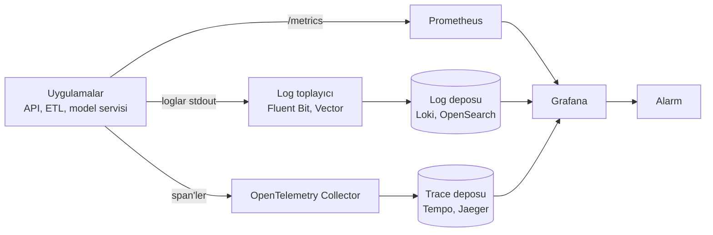

# 14.1 Log, Metrik ve Trace

## Nedir?
**Gözlemlenebilirlik (observability)**, bir sistemin dışarıya verdiği sinyallere bakarak **içinde ne olduğunu anlayabilme** yeteneğidir. Üç temel sinyal ("üç sütun") vardır:

| Sinyal | Nedir? | Cevapladığı soru |
|---|---|---|
| **Log (günlük)** | Olayların zaman damgalı metin kayıtları | **Ne oldu?** "14:05'te kredi 123 için DB bağlantı hatası" |
| **Metrik** | Zamana göre ölçülen sayısal değerler | **Ne kadar / ne sıklıkla?** "Saniyede 250 istek, hata oranı %2, p95 gecikme 180 ms" |
| **Trace (iz)** | Bir isteğin birden çok servis içindeki yolculuğu | **Nerede zaman harcandı?** "İsteğin 900 ms'sinin 700'ü skor servisindeki DB sorgusunda" |

## Hangi problemi çözer?
Tek sunuculu bir uygulamada sorun bulmak görece kolaydır. Kubernetes'te onlarca pod'a dağılmış, birbirini çağıran servislerde ise:
- Pod'lar ölüp yenisi gelince logları kaybolur,
- Yavaşlığın hangi serviste olduğu bilinmez,
- Sorun kullanıcı şikâyet edince fark edilir.

Gözlemlenebilirlik, sorunları **kullanıcıdan önce** fark etmeyi ve **kök nedeni hızla** bulmayı sağlar.

## Nasıl çalışır?



**Loglar: iyi pratikler**
- **Yapılandırılmış (structured) log:** Düz metin yerine JSON. Aranabilir ve filtrelenebilir.
- **Seviyeler:** `DEBUG` < `INFO` < `WARNING` < `ERROR` < `CRITICAL`. Canlıda genellikle `INFO`.
- **Bağlam:** Her logda `request_id` / `trace_id`, servis adı, ortam.
- **Container'larda:** Dosyaya değil **stdout/stderr**'e yazılır; toplayıcı alır ([4.4](../04-docker/04-docker-komutlari.md)).
- **Hassas veri loglanmaz:** Şifre, token, TCKN, kart numarası (maskeleme, [15.9](../15-guvenlik/09-maskeleme-kvkk.md)).

**Metrikler: türler ve yöntemler**
| Tür | Açıklama | Örnek |
|---|---|---|
| **Counter (sayaç)** | Sadece artar | Toplam istek sayısı, toplam hata |
| **Gauge (gösterge)** | Artar/azalır, anlık değer | Bellek kullanımı, kuyruktaki iş sayısı |
| **Histogram** | Değerlerin dağılımı (kovalar) | İstek süresi → p50, p95, p99 |

İzlenecek temel metrik setleri:
- **RED (servisler için):** Rate (istek hızı), Errors (hata oranı), Duration (süre).
- **USE (kaynaklar için):** Utilization (kullanım), Saturation (doygunluk), Errors.
- **Dört altın sinyal (Google SRE):** Gecikme, trafik, hatalar, doygunluk.

**Trace kavramları**
- **Trace:** Bir isteğin baştan sona tüm yolculuğu (tek `trace_id`).
- **Span:** Yolculuğun bir adımı (bir servis çağrısı, bir DB sorgusu); başlangıç, süre ve üst span bilgisi taşır.
- **Context propagation:** `trace_id`'nin HTTP header'larıyla (`traceparent`) servisten servise taşınması.

```
trace_id=8f2c...  POST /v1/basvuru                          [██████████████████] 920 ms
 ├─ span: kimlik doğrulama                                   [█]                    40 ms
 ├─ span: feature okuma (Redis)                              [█]                    15 ms
 ├─ span: skor servisi çağrısı                               [██████████████]      760 ms
 │   └─ span: PostgreSQL sorgusu (müşteri geçmişi)           [████████████]        690 ms  ← darboğaz
 └─ span: karar kaydı                                        [█]                    60 ms
```

## Mini örnek
Python'da yapılandırılmış log:
```python
import json, logging, sys, uuid

class JsonFormatter(logging.Formatter):
    def format(self, record):
        return json.dumps({
            "zaman": self.formatTime(record),
            "seviye": record.levelname,
            "servis": "kredi-api",
            "mesaj": record.getMessage(),
            **getattr(record, "ek", {}),
        }, ensure_ascii=False)

h = logging.StreamHandler(sys.stdout)
h.setFormatter(JsonFormatter())
log = logging.getLogger("kredi"); log.addHandler(h); log.setLevel(logging.INFO)

istek_id = str(uuid.uuid4())
log.info("Skorlama tamamlandı", extra={"ek": {"request_id": istek_id, "sure_ms": 84, "model": "kredi_skor@champion"}})
# {"zaman": "...", "seviye": "INFO", "servis": "kredi-api", "mesaj": "Skorlama tamamlandı", "request_id": "...", "sure_ms": 84, ...}
```

FastAPI'ye Prometheus metrikleri eklemek:
```python
from fastapi import FastAPI
from prometheus_client import Counter, Histogram, make_asgi_app

app = FastAPI()
app.mount("/metrics", make_asgi_app())             # Prometheus buradan okur

ISTEK = Counter("skor_istek_toplam", "Skor istekleri", ["sonuc"])
SURE = Histogram("skor_sure_saniye", "Skorlama süresi")

@app.post("/v1/skor")
def skorla(...):
    with SURE.time():
        ...
    ISTEK.labels(sonuc="basarili").inc()
```

OpenTelemetry ile otomatik trace (kavramsal):
```bash
pip install opentelemetry-distro opentelemetry-exporter-otlp
opentelemetry-bootstrap -a install
OTEL_SERVICE_NAME=kredi-api OTEL_EXPORTER_OTLP_ENDPOINT=http://otel-collector:4317 \
  opentelemetry-instrument uvicorn main:app
```

## Nerede kullanılır?
- API ve dashboard'ların hata ve yavaşlık tespiti
- ETL işlerinin süre, satır sayısı ve başarı durumu izlemesi
- Model servislerinin gecikme ve istek hacmi takibi (istatistiksel izleme için [13.4](../13-mlops/04-monitoring-drift.md))
- Olay sonrası analiz (post-mortem): ne oldu, neden oldu, nasıl önleriz

## Benzerleri ve farkları
- **Monitoring ile observability:** Monitoring önceden bilinen soruları izler ("CPU %90'ı geçti mi?"). Observability, önceden düşünülmemiş soruları da sorabilmeyi hedefler ("bu yavaşlık sadece KOBİ başvurularında ve yeni sürümde mi?").
- **OpenTelemetry (OTel):** Log, metrik ve trace için satıcıdan bağımsız açık standart ve SDK'lar; uygulamayı bir kez enstrümante edip istediğiniz arka uca göndermeyi sağlar.
- **Audit log (denetim kaydı):** "Kim, neye, ne zaman erişti?" kayıtları; güvenlik ve uyum amaçlıdır, uygulama loglarından ayrı ve değiştirilemez şekilde tutulur (Bölüm 15).

## İlgili sayfalar
- [14.2 Prometheus ve Grafana](02-prometheus-grafana.md)
- [14.3 Merkezi loglama](03-merkezi-loglama.md)
- [14.4 Alarm](04-alarm.md)
