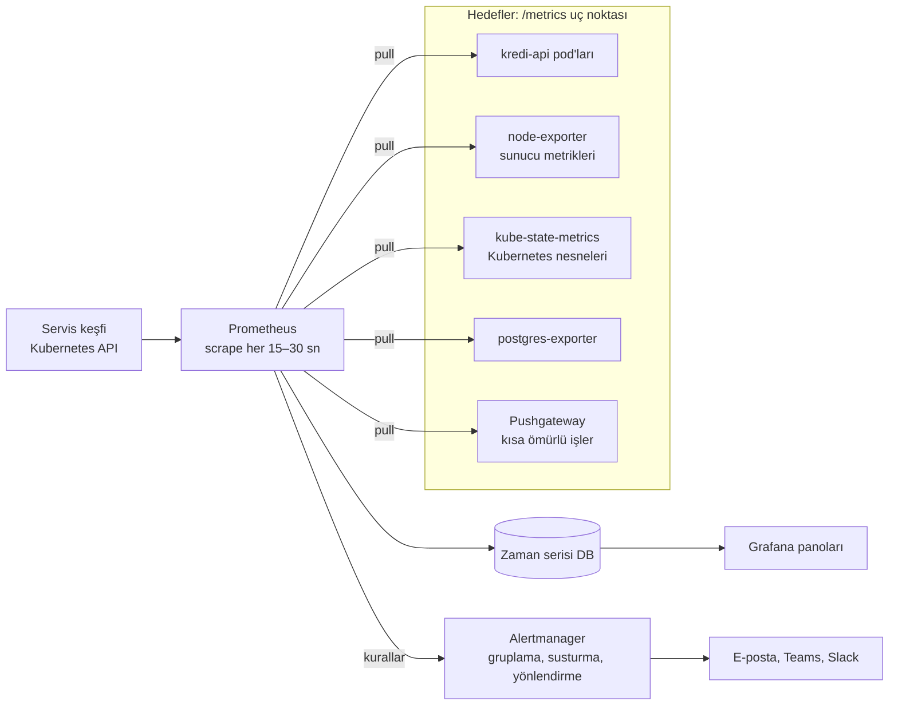

# 14.2 Prometheus ve Grafana

## Nedir?
- **Prometheus:** Açık kaynak **metrik toplama ve saklama** sistemi. Uygulamalardan ve altyapıdan düzenli aralıklarla metrikleri çeker, zaman serisi veritabanında saklar ve **PromQL** sorgu diliyle sorgulanmasını sağlar. CNCF projesidir; Kubernetes izlemenin fiilî standardıdır.
- **Grafana:** Prometheus (ve birçok başka kaynak) verisini panolarda görselleştiren ve alarm üreten araç ([12.3](../12-bi/03-grafana.md)).

İkisi birlikte en yaygın açık kaynak izleme yığınıdır. OpenShift'in yerleşik izleme sistemi de Prometheus + Alertmanager tabanlıdır.

## Hangi problemi çözer?
- Yüzlerce pod ve servisin CPU, bellek, istek sayısı, hata oranı, gecikme gibi metriklerini tek yerde toplamak
- Zamana göre eğilim görmek ("bellek kullanımı her gün artıyor: sızıntı var")
- Eşik aşımlarında otomatik alarm üretmek
- Kapasite planlaması yapmak

## Nasıl çalışır?



**Temel kavramlar**
| Kavram | Açıklama |
|---|---|
| **Pull (çekme) modeli** | Prometheus hedeflere gidip `/metrics` adresinden okur (scrape); uygulamalar göndermez |
| **Exporter** | Kendi metriğini vermeyen sistemler için çevirici (node-exporter, postgres-exporter, blackbox-exporter) |
| **Zaman serisi** | Metrik adı + etiketler (labels) + zaman damgalı değerler: `http_requests_total{service="kredi-api", status="500"}` |
| **Etiket (label)** | Boyutlar; kırılım ve filtre bunlarla yapılır. Yüksek kardinaliteli etiketlerden (müşteri ID, istek ID) kaçınılır |
| **PromQL** | Sorgu dili: oran, toplama, yüzdelik |
| **Recording rule** | Sık kullanılan ağır sorguyu önceden hesaplayıp yeni seri olarak saklamak |
| **Alerting rule** | Koşul belirli süre doğruysa alarm üretmek |
| **Alertmanager** | Alarmları gruplar, tekrarlarını bastırır, bakım dönemlerinde susturur, doğru kanala yönlendirir |
| **Pushgateway** | Kısa ömürlü batch işlerin (ETL) bitişte metrik bırakması için ara durak |

`/metrics` çıktısı örneği (metin formatı):
```
# HELP skor_istek_toplam Skor istekleri
# TYPE skor_istek_toplam counter
skor_istek_toplam{sonuc="basarili"} 18342
skor_istek_toplam{sonuc="hata"} 27
# TYPE skor_sure_saniye histogram
skor_sure_saniye_bucket{le="0.1"} 17010
skor_sure_saniye_bucket{le="0.5"} 18290
skor_sure_saniye_bucket{le="+Inf"} 18369
```

## Mini örnek
**Sık kullanılan PromQL sorguları**
```promql
# Saniyedeki istek sayısı (son 5 dk ortalaması)
sum(rate(skor_istek_toplam[5m]))

# Hata oranı
sum(rate(skor_istek_toplam{sonuc="hata"}[5m])) / sum(rate(skor_istek_toplam[5m]))

# p95 gecikme
histogram_quantile(0.95, sum by (le) (rate(skor_sure_saniye_bucket[5m])))

# Namespace'teki pod'ların bellek kullanımı
sum by (pod) (container_memory_working_set_bytes{namespace="veri-prod", container!=""})

# Son 1 saatte yeniden başlayan container'lar
increase(kube_pod_container_status_restarts_total{namespace="veri-prod"}[1h]) > 0

# Disk 4 saat içinde dolacak mı? (eğilim tahmini)
predict_linear(node_filesystem_avail_bytes{mountpoint="/"}[6h], 4*3600) < 0
```

**Alarm kuralı** (PrometheusRule — Kubernetes/OpenShift'te CRD olarak)
```yaml
apiVersion: monitoring.coreos.com/v1
kind: PrometheusRule
metadata:
  name: kredi-api-alarmlari
  namespace: veri-prod
spec:
  groups:
    - name: kredi-api
      rules:
        - alert: KrediApiYuksekHataOrani
          expr: |
            sum(rate(skor_istek_toplam{sonuc="hata"}[5m]))
              / sum(rate(skor_istek_toplam[5m])) > 0.05
          for: 10m
          labels:
            severity: critical
          annotations:
            summary: "Kredi API hata oranı %5'in üzerinde"
            description: "Son 10 dakikadır hata oranı {{ $value | humanizePercentage }}."
```

**Uygulamayı Prometheus'a tanıtmak** (Prometheus Operator / OpenShift kullanıcı iş yükü izleme):
```yaml
apiVersion: monitoring.coreos.com/v1
kind: ServiceMonitor
metadata:
  name: kredi-api
  namespace: veri-prod
spec:
  selector:
    matchLabels: { app: kredi-api }      # bu Service'in arkasındaki pod'lar
  endpoints:
    - port: http
      path: /metrics
      interval: 30s
```

**ETL işinin bitişte metrik bırakması** (Pushgateway):
```python
from prometheus_client import CollectorRegistry, Gauge, push_to_gateway
import time

reg = CollectorRegistry()
Gauge("etl_son_basarili_zaman", "Son başarılı çalışma (unix)", registry=reg).set(time.time())
Gauge("etl_yuklenen_satir", "Yüklenen satır sayısı", registry=reg).set(18432)
push_to_gateway("pushgateway.izleme:9091", job="bddk_kredi_etl", registry=reg)
```
Alarm: `time() - etl_son_basarili_zaman{job="bddk_kredi_etl"} > 26*3600` → "ETL 26 saattir başarılı çalışmadı".

## Nerede kullanılır?
- Kubernetes/OpenShift cluster, node ve pod izleme
- API'lerin RED metrikleri (istek, hata, süre)
- Veritabanı, Kafka, Redis gibi altyapı bileşenleri (exporter'larla)
- ETL ve batch işlerin başarı/süre takibi
- Model servislerinin teknik metrikleri (model sürümü etiketiyle)

## Benzerleri ve farkları
- **Uzun süreli saklama:** Prometheus yerel diskte genellikle günler–haftalar tutar. Uzun süre ve çok cluster için **Thanos**, **Cortex/Mimir** veya **VictoriaMetrics** kullanılır.
- **Push tabanlı sistemler:** InfluxDB/Telegraf, StatsD, Datadog ajanları metrikleri gönderir (push).
- **Loglardan metrik çıkarmak:** Mümkündür (Loki ile) ama doğrudan metrik üretmek daha verimlidir.

## İlgili sayfalar
- [12.3 Grafana](../12-bi/03-grafana.md)
- [14.4 Alarm kurgusu](04-alarm.md)
- [5.11 Probe ve kaynaklar](../05-kubernetes/11-probe-resources.md)
