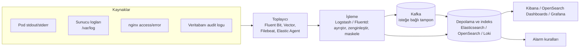

# 14.3 Merkezi Loglama: ELK / OpenSearch

## Nedir?
**Merkezi loglama**, tüm sunuculardan, container'lardan ve uygulamalardan gelen logların **tek bir yerde toplanması, saklanması, aranması ve analiz edilmesidir**.

En bilinen yığınlar:
- **ELK / Elastic Stack:** **E**lasticsearch (depolama ve arama) + **L**ogstash (işleme) + **K**ibana (arayüz) + Beats/Elastic Agent (toplama).
- **OpenSearch:** Elasticsearch'ün lisans değişikliği sonrası AWS öncülüğünde oluşturulan açık kaynak çatalı; OpenSearch Dashboards arayüzüyle.
- **Grafana Loki:** Logları içerik yerine **etiketlerle** indeksleyen, daha hafif ve ucuz yaklaşım; Grafana ile birlikte.

## Hangi problemi çözer?
- Kubernetes'te pod silinince logu da gider; merkezi depoda kalır.
- 20 pod'un logunu tek tek `kubectl logs` ile okumak yerine tek ekranda aramak.
- "Son 1 saatte `ERROR` seviyesinde, `kredi-api` servisinde, `timeout` içeren loglar" gibi sorguları saniyeler içinde yapmak.
- Güvenlik ve denetim: Erişim ve işlem kayıtlarının belirlenen süre boyunca, değiştirilemez şekilde saklanması (yasal saklama süreleri).
- Logdan eğilim ve alarm üretmek.

## Nasıl çalışır?



| Aşama | Görevi | Örnek |
|---|---|---|
| **Toplama** | Logları kaynaktan okumak; Kubernetes'te her node'da DaemonSet olarak ([5.5](../05-kubernetes/05-statefulset-daemonset.md)) | Fluent Bit |
| **Ayrıştırma (parsing)** | Düz metni alanlara bölmek (zaman, seviye, mesaj); JSON loglarda kolay | Grok desenleri, JSON parser |
| **Zenginleştirme** | Pod adı, namespace, ortam, ekip etiketi eklemek | Kubernetes metadata filtresi |
| **Maskeleme** | TCKN, kart numarası, e-posta gibi verileri gizlemek | Regex tabanlı filtreler |
| **Depolama ve indeksleme** | Aranabilir hâle getirmek | Günlük indeksler: `logs-veri-prod-2026.10.13` |
| **Saklama politikası** | Sıcak (hızlı disk, son 7 gün) → ılık → soğuk/arşiv (nesne depolama) → silme | ILM / ISM politikaları |
| **Arama ve görselleştirme** | Sorgu, pano, keşif | KQL, Lucene, LogQL |

**Elasticsearch/OpenSearch ile Loki farkı**
| | Elasticsearch / OpenSearch | Loki |
|---|---|---|
| İndeksleme | Log içeriğinin tamamı (tam metin) | Sadece etiketler; içerik sıkıştırılmış saklanır |
| Arama | Çok güçlü, tam metin, analitik | Etiketle daralt, sonra metin filtrele |
| Maliyet | Yüksek (disk, bellek) | Düşük |
| Kullanım | Güvenlik analitiği (SIEM), karmaşık arama | Uygulama logları, Grafana entegrasyonu |

## Mini örnek
**Kibana/OpenSearch Dashboards'ta arama (KQL)**
```
kubernetes.namespace : "veri-prod" and level : "ERROR" and message : *timeout*
service : "kredi-api" and http.status >= 500 and not path : "/health"
request_id : "8f2c3a1e-..."              # bir isteğin tüm loglarını takip et
```

**Loki'de arama (LogQL)**
```logql
{namespace="veri-prod", app="kredi-api"} |= "ERROR" | json | sure_ms > 500
sum by (app) (count_over_time({namespace="veri-prod"} |= "ERROR" [5m]))   # logdan metrik
```

**Fluent Bit ile Kubernetes loglarını toplama (sadeleştirilmiş yapılandırma)**
```ini
[INPUT]
    Name              tail
    Path              /var/log/containers/*.log
    multiline.parser  docker, cri
    Tag               kube.*

[FILTER]
    Name              kubernetes
    Match             kube.*
    Merge_Log         On                  # JSON logları alanlara aç

[FILTER]
    Name              modify
    Match             kube.*
    Add               ortam prod

[OUTPUT]
    Name              opensearch
    Match             kube.*
    Host              opensearch.izleme.svc
    Port              9200
    Logstash_Format   On
    Logstash_Prefix   logs-veri
```

**OpenSearch'te doğrudan sorgu (REST)**
```bash
curl -s -u kullanici:sifre "https://opensearch.sirket.local/logs-veri-*/_search" \
  -H 'Content-Type: application/json' -d '{
    "query": { "bool": { "must": [
      { "match": { "level": "ERROR" } },
      { "range": { "@timestamp": { "gte": "now-1h" } } }
    ]}},
    "size": 20, "sort": [{ "@timestamp": "desc" }]
  }'
```

## Nerede kullanılır?
- Uygulama hata ayıklama ve olay incelemesi
- Güvenlik izleme (SIEM): şüpheli girişler, yetkisiz erişim denemeleri
- Denetim kayıtlarının saklanması (kim hangi müşteri kaydını sorguladı — personel sorgu izleme ve anomali modellerinin veri kaynağı)
- nginx/Ingress erişim loglarından trafik analizi
- OpenShift'te yerleşik **OpenShift Logging** (Loki tabanlı, eski sürümlerde Elasticsearch tabanlı)

## Benzerleri ve farkları
- **Splunk:** Ticari, kurumsal log analitiği ve SIEM'de çok yaygın; güçlü sorgu dili (SPL).
- **Bulut hizmetleri:** CloudWatch Logs, Azure Monitor/Log Analytics, Google Cloud Logging.
- **Graylog:** Açık kaynak alternatif.
- **Metrik ile log:** "Kaç tane?" sorusu için metrik daha ucuz ve hızlıdır; "tam olarak ne oldu?" için log gerekir ([14.1](01-log-metrik-trace.md)).

**Dikkat:** Loglar kolayca terabaytlara ulaşır. Saklama süresi, örnekleme (DEBUG loglarını canlıda kapatmak) ve kişisel veri maskeleme baştan planlanmalıdır.

## İlgili sayfalar
- [14.1 Log, metrik ve trace](01-log-metrik-trace.md)
- [14.4 Alarm kurgusu](04-alarm.md)
- [8.8 nginx logları](../08-nginx/08-log-hatalar.md)
