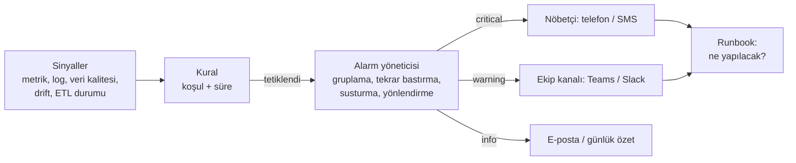

# 14.4 Alarm ve Uyarı Kurgusu

## Nedir?
**Alarm (alert)**, izlenen bir sinyal (metrik, log, veri kalitesi, model drift) belirlenen koşulu sağladığında **ilgili kişiyi veya sistemi otomatik olarak bilgilendirmektir**. İyi bir alarm kurgusu; neyin, hangi eşikte, kime, hangi kanaldan ve hangi aciliyetle bildirileceğini tanımlar.

## Hangi problemi çözer?
İki uç da zararlıdır:
- **Alarm yoksa:** Sorunlar kullanıcı şikâyetiyle veya yönetim raporundaki yanlış rakamla fark edilir.
- **Çok fazla alarm varsa (alert fatigue — alarm yorgunluğu):** Ekip bildirimleri görmezden gelmeye başlar, gerçek sorun gürültüde kaybolur.

İyi kurgu; **az, anlamlı, aksiyon alınabilir** alarmlar üretir.

## Nasıl çalışır?



**İyi alarmın özellikleri**
| İlke | Açıklama |
|---|---|
| **Belirtiye göre alarm (symptom-based)** | Kullanıcının hissettiği soruna göre: "API hata oranı %5" — "CPU %80" gibi neden metrikleri ise ikinci planda |
| **Aksiyon alınabilir** | Alarmı alan kişinin yapabileceği bir şey olmalı; yoksa alarm değil rapor olmalı |
| **Süre koşulu** | Anlık sıçramalar için değil, "10 dakika boyunca" gibi kalıcı durumlar için (`for: 10m`) |
| **Önem seviyesi** | `critical` (hemen müdahale, gece uyandırır), `warning` (mesai içinde bakılır), `info` |
| **Bağlam** | Mesajda: ne oldu, ne kadar, hangi servis/ortam, pano linki, **runbook** linki |
| **Sahiplik** | Her alarmın sorumlu ekibi belli |
| **Gruplama ve bastırma** | 50 pod aynı anda düşünce 50 değil 1 bildirim; üst sistem çökünce alt sistem alarmları bastırılır |
| **Bakım penceresi** | Planlı çalışmalarda alarmlar susturulur |
| **Düzenli gözden geçirme** | Hiç aksiyon alınmayan alarmlar kaldırılır veya ayarlanır |

**SLI, SLO, SLA**
| Kavram | Anlamı | Örnek |
|---|---|---|
| **SLI** (Service Level Indicator) | Ölçülen gösterge | Başarılı isteklerin oranı, p95 gecikme |
| **SLO** (Service Level Objective) | Hedef | Aylık %99,5 başarılı istek, p95 < 300 ms |
| **SLA** (Service Level Agreement) | Sözleşmeyle taahhüt (ihlalin sonucu var) | İş birimine %99 erişilebilirlik taahhüdü |
| **Error budget (hata bütçesi)** | SLO'nun izin verdiği hata payı | %99,5 → ayda ~3,6 saat kesinti payı |

Olgun yaklaşım: Alarmlar SLO'ya ve **hata bütçesinin tükenme hızına (burn rate)** göre kurulur.

**Veri ekipleri için alarm türleri**
| Alan | Örnek alarm |
|---|---|
| Altyapı | Pod sürekli yeniden başlıyor, disk %90 dolu, sertifika 14 gün içinde sona eriyor |
| Uygulama | API hata oranı > %5 (10 dk), p95 gecikme > 1 sn |
| ETL / veri akışı | İş zamanında bitmedi, son başarılı yükleme 26 saatten eski, yüklenen satır sayısı sıfır |
| Veri kalitesi | Kritik test başarısız ([11.5](../11-veri-akisi/05-veri-kalitesi.md)) |
| Model | Skor dağılımı PSI > 0,25, onay oranında ani değişim ([13.4](../13-mlops/04-monitoring-drift.md)) |
| İş metrikleri | Dakikalık işlem sayısı beklenen aralığın dışında (anomali) |

## Mini örnek
**Alertmanager yönlendirme yapılandırması** (önem seviyesine ve ekibe göre)
```yaml
route:
  receiver: varsayilan-eposta
  group_by: [alertname, namespace]
  group_wait: 30s
  group_interval: 5m
  repeat_interval: 4h
  routes:
    - matchers: [severity="critical"]
      receiver: nobetci
    - matchers: [team="veri"]
      receiver: veri-ekibi-teams

inhibit_rules:
  - source_matchers: [alertname="ClusterErisilemez"]
    target_matchers: [severity="warning"]       # cluster yoksa alt alarmları bastır
    equal: [cluster]

receivers:
  - name: varsayilan-eposta
    email_configs:
      - to: platform@sirket.local
  - name: veri-ekibi-teams
    webhook_configs:
      - url: http://teams-bridge.izleme/veri-ekibi     # Teams'e ileten köprü servis
  - name: nobetci
    webhook_configs:
      - url: http://nobet-sistemi.izleme/alarm
```

**ETL gecikme alarmı** (PrometheusRule kuralı)
```yaml
- alert: BddkEtlGecikti
  expr: time() - etl_son_basarili_zaman{job="bddk_kredi_etl"} > 26 * 3600
  for: 15m
  labels: { severity: warning, team: veri }
  annotations:
    summary: "BDDK kredi ETL 26 saattir başarılı çalışmadı"
    runbook_url: "https://git.sirket.local/veri/runbook/bddk-etl.md"
    dashboard: "https://grafana.sirket.local/d/etl"
```

**Runbook şablonu** (her kritik alarm için)
```markdown
# BddkEtlGecikti
**Etki:** Sabah kredi dashboard'u ve HQ raporu eski veriyle açılır.
**Kontrol:**
1. Airflow'da `bddk_aylik` DAG'ının son çalışması: hangi görev düştü?
2. `kubectl logs job/...` veya Airflow görev logu
3. BDDK sayfasında yeni dönem yayımlanmış mı? (Yayımlanmadıysa alarm beklenen davranış)
**Çözüm:** Kaynak dosya formatı değiştiyse ETL parser'ını güncelle; geçici hata ise görevi yeniden çalıştır.
**Eskalasyon:** 2 saat içinde çözülmezse veri ekibi lideri.
```

Basit bir Python bildirimi (orkestratör veya script içinde):
```python
import requests

def teams_bildir(baslik: str, mesaj: str, webhook_url: str):
    requests.post(webhook_url, json={"text": f"**{baslik}**\n\n{mesaj}"}, timeout=10)
```

## Nerede kullanılır?
- Canlı servisler, cluster'lar ve veritabanları
- Zamanlanmış veri işleri ve yönetim raporlarını besleyen akışlar
- Model izleme ve veri kalitesi kontrolleri
- Güvenlik olayları (başarısız giriş artışı, olağan dışı veri erişimi)

## Benzerleri ve farkları
- **Grafana alerting:** Grafana içinden, farklı veri kaynakları (SQL dahil) üzerinde alarm kuralları ([12.3](../12-bi/03-grafana.md)).
- **Orkestratör bildirimleri:** Airflow `on_failure_callback`, n8n hata dalları; iş bazında hata bildirimi ([11.8](../11-veri-akisi/08-orkestrasyon.md)).
- **Olay yönetimi araçları:** PagerDuty, Opsgenie, ServiceNow; nöbet çizelgesi, eskalasyon ve olay kaydı.
- **Anomali tabanlı alarm:** Sabit eşik yerine geçmiş davranıştan sapmaya göre (mevsimsellik olan iş metriklerinde faydalı, ama yanlış alarm riski de yüksek).

## İlgili sayfalar
- [14.2 Prometheus ve Grafana](02-prometheus-grafana.md)
- [13.4 Model monitoring](../13-mlops/04-monitoring-drift.md)
- [11.5 Veri kalitesi](../11-veri-akisi/05-veri-kalitesi.md)
