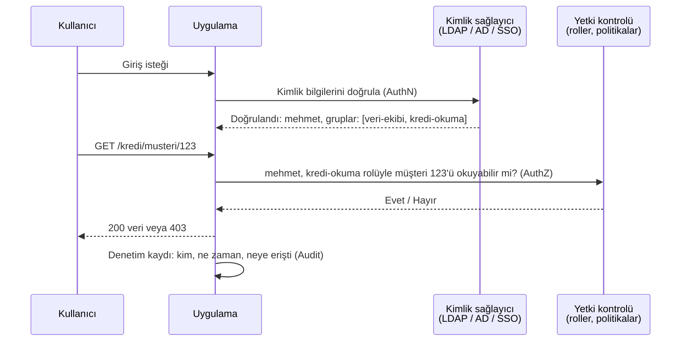

# 15.1 Kimlik Doğrulama ve Yetkilendirme Farkı (AuthN / AuthZ)

## Nedir?
Erişim güvenliğinin iki ayrı adımı:
- **Kimlik doğrulama (Authentication — AuthN):** "**Sen kimsin?** Bunu kanıtla." Kullanıcının veya sistemin iddia ettiği kişi olduğunu doğrulamak.
- **Yetkilendirme (Authorization — AuthZ):** "**Ne yapabilirsin?**" Kimliği doğrulanmış kişinin hangi kaynaklara, hangi işlemlerle erişebileceğine karar vermek.

> Benzetme: Bankanın girişindeki kart okuyucu kimliğinizi doğrular (AuthN). İçeride hangi katlara ve kasa dairesine girebileceğiniz ise kartınıza tanımlı yetkilere bağlıdır (AuthZ).

Bunlara sıklıkla üçüncü bir "A" eklenir:
- **Denetim / kayıt (Accounting / Audit):** "**Ne yaptın?**" Yapılan işlemlerin kayıt altına alınması.

## Hangi problemi çözer?
İki kavramı karıştırmak tipik güvenlik açıklarına yol açar:
- Giriş yapmış her kullanıcıya her şeyi göstermek (kimlik var, yetki kontrolü yok).
- Yetki kontrolünü sadece arayüzde yapıp API'de yapmamak (URL'yi değiştiren başka müşterinin verisini görür).

Ayrıca hata kodlarını doğru kullanmayı sağlar: **401** = kimlik doğrulanamadı, **403** = kimlik doğrulandı ama yetki yok ([7.2](../07-api/02-http.md)).

## Nasıl çalışır?



**Kimlik doğrulama faktörleri**
| Faktör | Örnek |
|---|---|
| Bildiğiniz bir şey | Parola, PIN |
| Sahip olduğunuz bir şey | Telefon (OTP), donanım anahtarı, akıllı kart, sertifika |
| Olduğunuz bir şey | Parmak izi, yüz tanıma |

**Çok faktörlü kimlik doğrulama (MFA):** En az iki farklı faktör; parola sızsa bile hesabı korur.

**İnsan ve makine kimlikleri**
| Tür | Örnek | Kimlik doğrulama |
|---|---|---|
| İnsan kullanıcı | Analist, geliştirici | LDAP/AD, SSO, MFA |
| Servis hesabı | ETL işi, CI/CD pipeline, uygulama | Token, sertifika, Kubernetes ServiceAccount, Vault ile dinamik kimlik |

**Yetkilendirme modelleri**
| Model | Açıklama | Örnek |
|---|---|---|
| **RBAC** (rol tabanlı) | Yetkiler rollere, roller kişilere/gruplara verilir | `kredi-okuma` rolü ([15.6](06-rbac-en-az-yetki.md)) |
| **ABAC** (öznitelik tabanlı) | Kural, kullanıcı/kaynak/ortam özniteliklerine bakar | "Kullanıcı bölgesi = müşteri bölgesi ise okuyabilir" |
| **ACL** (erişim listesi) | Kaynak bazında izin listesi | Dosya izinleri ([1.3](../01-linux/03-izinler.md)) |
| **ReBAC** (ilişki tabanlı) | Kişi–kaynak ilişkisine göre | "Müşterinin portföy yöneticisi okuyabilir" |

## Mini örnek
FastAPI'de iki adımın ayrımı:
```python
from fastapi import Depends, FastAPI, HTTPException

app = FastAPI()

def kimlik_dogrula(token: str = Depends(...)) -> dict:          # AuthN
    kullanici = token_cozumle(token)                              # imza, süre kontrolü
    if kullanici is None:
        raise HTTPException(401, "Kimlik doğrulanamadı")
    return kullanici                                              # {"ad": "mehmet", "roller": [...], "bolge": "IST"}

def yetki(gerekli_rol: str):
    def kontrol(k: dict = Depends(kimlik_dogrula)):               # AuthZ
        if gerekli_rol not in k["roller"]:
            raise HTTPException(403, "Bu işlem için yetkiniz yok")
        return k
    return kontrol

@app.get("/kredi/musteri/{musteri_id}")
def musteri_kredi(musteri_id: int, k: dict = Depends(yetki("kredi-okuma"))):
    musteri = getir(musteri_id)
    if musteri["bolge"] != k["bolge"]:                            # ABAC: satır düzeyinde kontrol
        raise HTTPException(403, "Bu bölgenin müşterisini göremezsiniz")
    denetim_kaydi(k["ad"], "musteri_kredi_okuma", musteri_id)    # Audit
    return musteri
```

Veritabanında satır düzeyinde güvenlik (PostgreSQL RLS):
```sql
ALTER TABLE musteri ENABLE ROW LEVEL SECURITY;
CREATE POLICY bolge_politikasi ON musteri
    USING (bolge = current_setting('app.kullanici_bolge'));
```

## Nerede kullanılır?
- Her uygulama, API, dashboard, veritabanı ve platform (Kubernetes, BI, ML platformu)
- Bankacılıkta özellikle: müşteri verisine erişimde "bilmesi gereken" (need-to-know) prensibi, personel sorgu kayıtlarının denetimi

## Benzerleri ve farkları
- **Kimlik yönetimi (IAM — Identity and Access Management):** Kimliklerin oluşturulması, rollerin atanması, işten ayrılanın erişiminin kapatılması gibi süreçlerin bütünü.
- **Kimlik sağlayıcı (IdP):** Kimlik doğrulamayı merkezi olarak yapan sistem: Active Directory, Keycloak, Azure AD (Entra ID), Okta ([15.5](05-sso-oauth-oidc.md)).
- **PAM (Privileged Access Management):** Yönetici (root, DBA) hesaplarının kasada saklanması, oturumların kaydedilmesi; bankalarda zorunluluk.

## İlgili sayfalar
- [15.2 LDAP](02-ldap.md)
- [15.5 SSO, OAuth, OIDC](05-sso-oauth-oidc.md)
- [15.6 RBAC](06-rbac-en-az-yetki.md)
