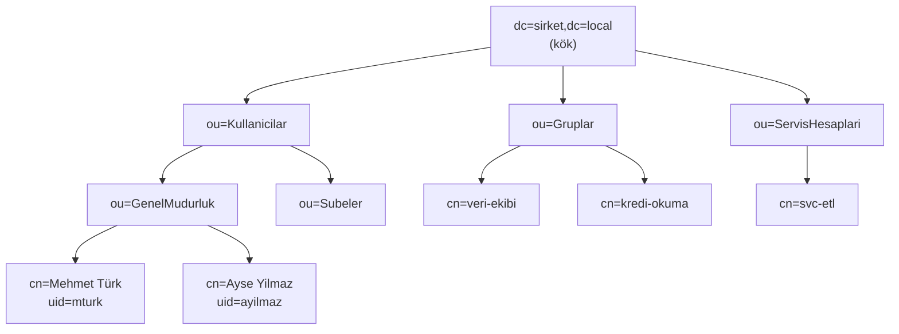
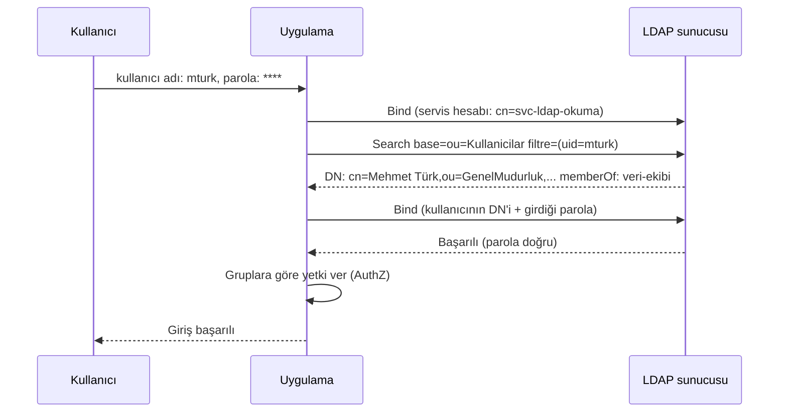

# 15.2 LDAP Nedir: Dizin Yapısı, DN, OU, Bind

## Nedir?
**LDAP (Lightweight Directory Access Protocol — Hafif Dizin Erişim Protokolü)**, kullanıcılar, gruplar, bilgisayarlar gibi kurumsal varlıkların bilgilerini tutan **dizin servislerine** erişmek için kullanılan standart protokoldür.

**Dizin (directory)**, okuma ağırlıklı, hiyerarşik yapıda bir veri deposudur. Kurumun "telefon rehberi + kimlik kartı ofisi" gibidir: Kim kimdir, hangi birimdedir, hangi gruplara üyedir, parolası doğru mu?

Önemli ayrım: **LDAP bir protokoldür**; konuştuğu sunucu Active Directory, OpenLDAP, Red Hat Directory Server/FreeIPA gibi bir dizin ürünüdür ([15.3](03-active-directory.md)).

## Hangi problemi çözer?
- **Tek kimlik:** Her uygulamanın kendi kullanıcı tablosunu tutması yerine, tüm uygulamalar kimlik doğrulamayı merkezi dizine sorar.
- **Merkezi yaşam döngüsü:** Çalışan işe başlayınca bir kez eklenir; ayrılınca bir yerde kapatılır, tüm sistemlerde erişimi biter.
- **Grup tabanlı yetki:** "veri-ekibi" grubuna eklenen kişi, bu gruba yetki verilmiş tüm sistemlere erişir.
- **Standart:** Linux, Kubernetes/OpenShift, Grafana, Jenkins, BI araçları, veritabanları LDAP'ı destekler.

## Nasıl çalışır?

**Ağaç yapısı: DIT (Directory Information Tree)**


**Temel kavramlar**
| Kavram | Açıklama | Örnek |
|---|---|---|
| **Entry (kayıt)** | Ağaçtaki her düğüm; bir kişi, grup, birim | Mehmet'in kaydı |
| **DN (Distinguished Name)** | Kaydın **tam adresi**, yaprağından köküne | `cn=Mehmet Türk,ou=GenelMudurluk,ou=Kullanicilar,dc=sirket,dc=local` |
| **RDN** | DN'in en soldaki parçası | `cn=Mehmet Türk` |
| **Base DN** | Aramanın başladığı kök | `dc=sirket,dc=local` |
| **dc (Domain Component)** | Alan adı parçaları | `sirket.local` → `dc=sirket,dc=local` |
| **ou (Organizational Unit)** | Klasör benzeri birim | `ou=Kullanicilar` |
| **cn (Common Name)** | Ortak ad | `cn=veri-ekibi` |
| **uid / sAMAccountName** | Kullanıcı adı (OpenLDAP / Active Directory) | `mturk` |
| **objectClass** | Kaydın türü ve hangi özniteliklere sahip olacağı | `person`, `inetOrgPerson`, `groupOfNames`, `user` |
| **Attribute (öznitelik)** | Kayıttaki alanlar | `mail`, `title`, `department`, `memberOf` |
| **Schema** | Hangi objectClass'ların ve özniteliklerin geçerli olduğu | |

**LDAP işlemleri**
| İşlem | Anlamı |
|---|---|
| **Bind** | Dizine kimlik doğrulayarak bağlanmak (DN + parola veya Kerberos/SASL) |
| **Search** | Base DN + kapsam (base, one, sub) + filtre ile kayıt aramak |
| **Compare** | Bir özniteliğin değerini kontrol etmek |
| **Add / Modify / Delete** | Kayıt eklemek, değiştirmek, silmek |
| **Unbind** | Bağlantıyı kapatmak |

**Bir uygulamanın LDAP ile kullanıcı doğrulaması (tipik "search + bind" akışı)**


**LDAP filtre söz dizimi** (önek gösterim: işleç başta)
| Filtre | Anlamı |
|---|---|
| `(uid=mturk)` | uid'i mturk olan |
| `(&(objectClass=person)(department=Veri))` | VE: kişi olan ve departmanı Veri |
| `(\|(uid=mturk)(uid=ayilmaz))` | VEYA |
| `(!(accountStatus=disabled))` | DEĞİL |
| `(cn=Gal*)` | Gal ile başlayan |
| `(memberOf=cn=veri-ekibi,ou=Gruplar,dc=sirket,dc=local)` | Bu grubun üyesi |

**Portlar ve güvenlik**
| Port | Anlamı |
|---|---|
| 389 | LDAP (düz) — **StartTLS** ile şifreli hâle getirilebilir |
| 636 | **LDAPS** (baştan TLS ile şifreli) |
| 3268 / 3269 | Active Directory Global Catalog (düz / TLS) |

Parolalar ağda taşındığı için **şifresiz LDAP (389, StartTLS olmadan) kullanılmamalıdır.**

## Mini örnek
Komut satırında arama (`ldapsearch`, OpenLDAP istemci araçları):
```bash
# Kullanıcıyı bul (servis hesabıyla bind)
ldapsearch -H ldaps://ldap.sirket.local:636 \
  -D "cn=svc-ldap-okuma,ou=ServisHesaplari,dc=sirket,dc=local" -W \
  -b "ou=Kullanicilar,dc=sirket,dc=local" \
  "(uid=mturk)" cn mail department memberOf

# Bir grubun üyeleri
ldapsearch -H ldaps://ldap.sirket.local -D "..." -W \
  -b "ou=Gruplar,dc=sirket,dc=local" "(cn=veri-ekibi)" member

# Parolayı test etmek (kullanıcının kendi DN'iyle bind)
ldapwhoami -H ldaps://ldap.sirket.local -D "cn=Mehmet Türk,ou=GenelMudurluk,ou=Kullanicilar,dc=sirket,dc=local" -W
```

LDIF formatında bir kayıt (dizine veri eklemek/dışa aktarmak için standart metin formatı):
```ldif
dn: cn=Mehmet Türk,ou=GenelMudurluk,ou=Kullanicilar,dc=sirket,dc=local
objectClass: inetOrgPerson
cn: Mehmet Türk
sn: Türk
uid: mturk
mail: mehmet@sirket.local
departmentNumber: Veri Analitigi
```
LDIF standardında ASCII dışı karakter (ü, ş, ı...) içeren değerler `::` ile **base64** kodlanır: `cn:: TWVobWV0IFTDvHJr`. `ldapsearch` çıktısında Türkçe karakterli adları bu biçimde görürsünüz; çözmek için `echo TWVobWV0IFTDvHJr | base64 -d`.

Python (`ldap3`):
```python
from ldap3 import Server, Connection, ALL, SUBTREE

server = Server("ldaps://ldap.sirket.local", use_ssl=True, get_info=ALL)
conn = Connection(server, user="cn=svc-ldap-okuma,ou=ServisHesaplari,dc=sirket,dc=local",
                  password=SERVIS_PAROLASI, auto_bind=True)

conn.search("ou=Kullanicilar,dc=sirket,dc=local", "(uid=mturk)",
            search_scope=SUBTREE, attributes=["cn", "mail", "memberOf"])
kullanici = conn.entries[0]
print(kullanici.entry_dn, kullanici.memberOf.values)
```

## Nerede kullanılır?
- Uygulama ve araçlara kurumsal kullanıcı adı/parolayla giriş ([15.4](04-ldap-entegrasyonu.md))
- Linux sunuculara merkezi kullanıcı yönetimi (SSSD)
- OpenShift, Grafana, Jenkins, Airflow, BI araçlarının kimlik doğrulaması ve grup senkronizasyonu
- E-posta adres defterleri, organizasyon şemaları

## Benzerleri ve farkları
- **LDAP ile veritabanı:** LDAP okuma ağırlıklı, hiyerarşik ve kimlik odaklıdır; işlem (transaction) ve karmaşık sorgu için tasarlanmamıştır.
- **LDAP ile SSO/OIDC:** LDAP genellikle her uygulamanın parolayı alıp dizine sorduğu "doğrudan" bir yöntemdir. Modern uygulamalarda parola uygulamaya hiç verilmez; bir kimlik sağlayıcı (Keycloak, AD FS, Entra ID) LDAP/AD'ye bağlanır ve uygulamalar ona OIDC/SAML ile güvenir ([15.5](05-sso-oauth-oidc.md)).
- **LDAP injection:** Kullanıcı girdisi filtreye doğrudan eklenirse (`(uid=` + girdi + `)`) manipüle edilebilir; girdi kaçışlanmalıdır (SQL injection'a benzer).

## İlgili sayfalar
- [15.3 Active Directory](03-active-directory.md)
- [15.4 LDAP entegrasyonu](04-ldap-entegrasyonu.md)
- [LDAP cheat sheet](../ekler/ldap-cheatsheet.md)
