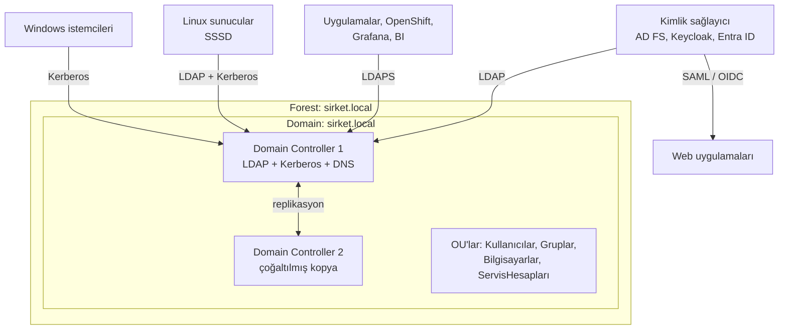

# 15.3 Active Directory ve LDAP İlişkisi

## Nedir?
**Active Directory (AD)**, Microsoft'un kurumsal **dizin ve kimlik yönetimi** hizmetidir. Kurumlarda kullanıcıların, grupların, bilgisayarların ve güvenlik politikalarının merkezi olarak yönetildiği sistemdir. Çoğu bankada "şirket kullanıcı adı ve parolası" AD'de durur.

**İlişki:** AD bir dizin **ürünüdür**; LDAP ise o dizine erişmenin **protokollerinden biridir**. AD, LDAP'ı konuşur; ayrıca kimlik doğrulama için **Kerberos**, politika dağıtımı için **Group Policy** ve isim çözümleme için **DNS** gibi bileşenleri bir arada sunar.

## Hangi problemi çözer?
- Binlerce kullanıcı ve bilgisayarın tek merkezden yönetilmesi
- Windows oturumu, e-posta, dosya paylaşımı, VPN ve iş uygulamalarına **aynı kimlikle** erişim
- Parola politikası, hesap kilitleme, ekran kilidi gibi güvenlik kurallarının tüm makinelere dağıtılması
- Diğer sistemlerin (Linux, OpenShift, BI, Grafana) kimlik doğrulamayı AD'ye devretmesi

## Nasıl çalışır?



**Temel kavramlar**
| Kavram | Açıklama |
|---|---|
| **Domain** | Ortak yönetim ve güvenlik sınırı: `sirket.local` |
| **Domain Controller (DC)** | AD veritabanını barındıran ve kimlik doğrulayan sunucu; birden çok DC birbirini çoğaltır |
| **Forest / tree** | Birden çok domain'in güven ilişkisiyle bağlı yapısı |
| **OU** | Organizasyon birimi; politika ve yetki devri için klasör |
| **Group Policy (GPO)** | OU'lara bağlanan güvenlik ve yapılandırma kuralları |
| **Güvenlik grubu / dağıtım grubu** | Yetki vermek için / e-posta listesi için |
| **Global Catalog** | Forest'taki tüm nesnelerin kısmi kopyası; hızlı arama (3268/3269) |
| **Kerberos** | AD'nin varsayılan kimlik doğrulama protokolü; parolayı ağda göndermeden bilet (ticket) ile çalışır ([15.5](05-sso-oauth-oidc.md)) |
| **Servis hesabı / gMSA** | Uygulamaların kullandığı hesaplar; gMSA'da parola AD tarafından otomatik yönetilir |

**AD'ye özgü LDAP öznitelikleri**
| Öznitelik | Anlamı |
|---|---|
| `sAMAccountName` | Eski stil kullanıcı adı: `gsoken` |
| `userPrincipalName` (UPN) | E-posta biçiminde oturum adı: `gsoken@sirket.local` |
| `memberOf` | Kullanıcının doğrudan üye olduğu gruplar |
| `member` | Grubun üyeleri |
| `distinguishedName` | DN |
| `userAccountControl` | Hesap durumu bayrakları (devre dışı, parola süresi dolmaz vb.) |
| `objectGUID`, `objectSid` | Değişmez kimlikler (ad değişse bile) |
| `whenCreated`, `lastLogonTimestamp` | Oluşturulma, son oturum |

## Mini örnek
AD'de bir kullanıcıyı ve gruplarını LDAP ile sorgulamak:
```bash
ldapsearch -H ldaps://dc01.sirket.local:636 \
  -D "svc-ldap-okuma@sirket.local" -W \
  -b "DC=sirket,DC=local" \
  "(&(objectClass=user)(sAMAccountName=gsoken))" \
  displayName mail department memberOf userAccountControl
```

İç içe grup üyeliğini de bulan AD'ye özgü filtre:
```bash
# Doğrudan veya dolaylı olarak 'veri-ekibi' grubunun üyesi olan kullanıcılar
"(memberOf:1.2.840.113556.1.4.1941:=CN=veri-ekibi,OU=Gruplar,DC=sirket,DC=local)"
```

Devre dışı hesapları hariç tutmak:
```bash
"(&(objectClass=user)(!(userAccountControl:1.2.840.113556.1.4.803:=2)))"
```

PowerShell ile (Windows yönetim tarafında):
```powershell
Get-ADUser gsoken -Properties memberOf, department, lastLogonTimestamp
Get-ADGroupMember "veri-ekibi" -Recursive | Select-Object Name, SamAccountName
```

## Nerede kullanılır?
- Kurumun tüm kullanıcı kimliklerinin ana kaynağı
- Linux sunucuların AD'ye katılması (SSSD/realmd) — sunuculara AD hesabıyla SSH
- OpenShift, Grafana, Jenkins, Airflow, BI araçları, veritabanlarının AD grupları ile yetkilendirilmesi ([15.4](04-ldap-entegrasyonu.md))
- Kimlik sağlayıcılar (AD FS, Keycloak, Entra ID Connect) üzerinden web uygulamalarına SSO

## Benzerleri ve farkları
| Ürün | Not |
|---|---|
| **Active Directory (AD DS)** | Kurum içi (on-prem), Windows sunucular |
| **Microsoft Entra ID** (eski adı Azure AD) | Bulut kimlik hizmeti; OIDC/SAML odaklı, klasik LDAP sunmaz. Hibrit yapılarda AD ile senkronize edilir |
| **OpenLDAP** | Açık kaynak LDAP sunucusu |
| **Red Hat Identity Management / FreeIPA** | Linux ağırlıklı ortamlar için LDAP + Kerberos + DNS; AD ile güven ilişkisi kurabilir |
| **Keycloak** | Dizin değil, kimlik sağlayıcı; AD/LDAP'ı kullanıcı kaynağı olarak bağlar ve OIDC/SAML sunar |

**Pratik notlar:**
- Uygulamalar AD'ye bağlanırken **salt okunur yetkili ayrı bir servis hesabı** kullanmalıdır; kişisel hesap kullanılmamalıdır.
- AD kullanıcı adları büyük/küçük harf duyarsızdır; uygulamalarda normalize edilmelidir.
- Grup isimleri yerine mümkünse değişmeyen kimlik (`objectGUID`) eşlenmelidir; grup yeniden adlandırılınca yetkiler kırılmaz.

## İlgili sayfalar
- [15.2 LDAP](02-ldap.md)
- [15.4 LDAP entegrasyonu](04-ldap-entegrasyonu.md)
- [15.5 SSO ve Kerberos](05-sso-oauth-oidc.md)
