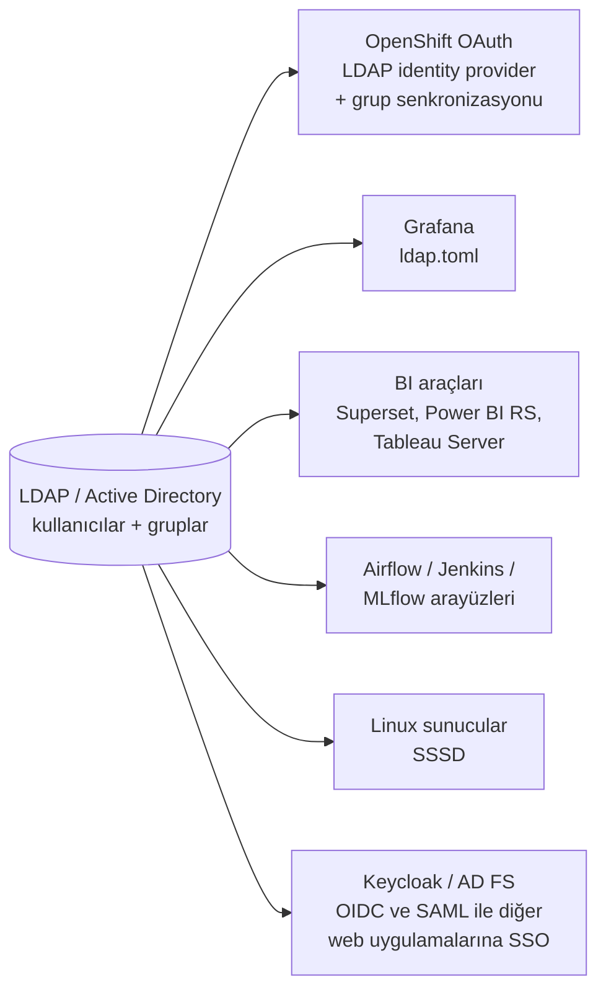

# 15.4 LDAP Entegrasyonu: Uygulamalarda, OpenShift'te, BI Araçlarında

## Nedir?
Bir uygulamanın veya platformun kullanıcı kimlik doğrulamasını ve grup bilgisini **kurumsal dizinden (LDAP / Active Directory)** almasının yapılandırılması. Uygulama kendi kullanıcı/parola tablosunu tutmaz; dizine sorar.

## Hangi problemi çözer?
- Kullanıcılar her araç için ayrı parola ezberlemez.
- İşten ayrılan kişinin erişimi, dizindeki hesabı kapatılınca **tüm araçlarda** biter.
- Yetkiler kişi kişi değil **dizin grupları** üzerinden verilir; ekip değişikliği tek yerden yönetilir.
- Denetimde "bu araca kimler erişebiliyor?" sorusu grup üyelikleriyle cevaplanır.

## Nasıl çalışır?
Her entegrasyonda aynı yapılandırma soruları cevaplanır:

| Ayar | Açıklama | Örnek |
|---|---|---|
| **Sunucu URL'si** | LDAPS tercih edilir | `ldaps://ldap.sirket.local:636` |
| **CA sertifikası** | LDAPS bağlantısının doğrulanması için kurum CA'sı | `sirket-ca.pem` |
| **Bind DN / parola** | Arama yapmak için salt okunur servis hesabı | `cn=svc-ldap-okuma,ou=ServisHesaplari,...` |
| **Kullanıcı base DN** | Kullanıcıların arandığı yer | `ou=Kullanicilar,dc=sirket,dc=local` |
| **Kullanıcı filtresi** | Kullanıcı adının hangi öznitelikte olduğu | `(uid=%s)`, AD: `(sAMAccountName=%s)` |
| **Öznitelik eşlemesi** | Ad, e-posta, görünen ad | `cn`, `mail`, `displayName` |
| **Grup base DN ve filtresi** | Grupların arandığı yer | `ou=Gruplar,...`, `(member=%s)` |
| **Grup → rol eşlemesi** | Hangi dizin grubu, uygulamada hangi rol | `veri-ekibi` → Editor |



**İki yaklaşım**
| Yaklaşım | Nasıl? | Artı | Eksi |
|---|---|---|---|
| **Doğrudan LDAP** | Her uygulama LDAP'a bağlanır, parolayı kendisi alır | Basit, her araç destekler | Parola her uygulamadan geçer; her uygulamada ayrı yapılandırma; SSO yok |
| **Kimlik sağlayıcı üzerinden** | Keycloak/AD FS LDAP'a bağlanır; uygulamalar OIDC/SAML ile ona güvenir | Tek giriş (SSO), MFA tek yerde, parola uygulamaya gelmez | Ek bileşen ([15.5](05-sso-oauth-oidc.md)) |

Kurumsal öneri: Mümkün olan her yerde kimlik sağlayıcı (OIDC/SAML); OIDC desteklemeyen araçlarda doğrudan LDAPS.

## Mini örnek

### OpenShift: LDAP kimlik sağlayıcısı
```yaml
apiVersion: config.openshift.io/v1
kind: OAuth
metadata:
  name: cluster
spec:
  identityProviders:
    - name: kurumsal-ad
      mappingMethod: claim
      type: LDAP
      ldap:
        url: "ldaps://dc01.sirket.local:636/DC=sirket,DC=local?sAMAccountName?sub?(objectClass=user)"
        bindDN: "CN=svc-ocp-ldap,OU=ServisHesaplari,DC=sirket,DC=local"
        bindPassword:
          name: ldap-bind-password          # openshift-config namespace'indeki Secret
        ca:
          name: sirket-ca                   # ConfigMap: kurum CA sertifikası
        attributes:
          id: ["sAMAccountName"]
          preferredUsername: ["sAMAccountName"]
          name: ["displayName"]
          email: ["mail"]
```

**Grup senkronizasyonu** (AD grupları → OpenShift grupları → RBAC):
```yaml
# ldap-sync.yaml
kind: LDAPSyncConfig
apiVersion: v1
url: ldaps://dc01.sirket.local:636
bindDN: "CN=svc-ocp-ldap,OU=ServisHesaplari,DC=sirket,DC=local"
bindPassword: { file: "/etc/secrets/bind-password" }
ca: /etc/ldap-ca/ca.crt
activeDirectory:
  usersQuery:
    baseDN: "OU=Kullanicilar,DC=sirket,DC=local"
    scope: sub
    derefAliases: never
    filter: (objectClass=user)
  userNameAttributes: [sAMAccountName]
  groupMembershipAttributes: [memberOf]
```
```bash
oc adm groups sync --sync-config=ldap-sync.yaml --whitelist=gruplar.txt --confirm
oc get groups
oc adm policy add-role-to-group edit veri-ekibi -n veri-dev        # 5.13
oc adm policy add-role-to-group view veri-ekibi -n veri-prod
```
Senkronizasyon genellikle bir CronJob ile düzenli çalıştırılır.

### Grafana: `ldap.toml`
```toml
[[servers]]
host = "dc01.sirket.local"
port = 636
use_ssl = true
root_ca_cert = "/etc/grafana/sirket-ca.pem"
bind_dn = "CN=svc-grafana-ldap,OU=ServisHesaplari,DC=sirket,DC=local"
bind_password = "${LDAP_BIND_PASSWORD}"          # ortam değişkeninden
search_filter = "(sAMAccountName=%s)"
search_base_dns = ["OU=Kullanicilar,DC=sirket,DC=local"]

[servers.attributes]
username = "sAMAccountName"
name = "givenName"
surname = "sn"
email = "mail"
member_of = "memberOf"

[[servers.group_mappings]]
group_dn = "CN=grafana-yonetici,OU=Gruplar,DC=sirket,DC=local"
org_role = "Admin"

[[servers.group_mappings]]
group_dn = "CN=veri-ekibi,OU=Gruplar,DC=sirket,DC=local"
org_role = "Editor"

[[servers.group_mappings]]
group_dn = "*"
org_role = "Viewer"
```

### Python web uygulaması (Superset, Airflow ve Flask tabanlı araçlar — Flask-AppBuilder ayarları)
```python
from flask_appbuilder.security.manager import AUTH_LDAP

AUTH_TYPE = AUTH_LDAP
AUTH_LDAP_SERVER = "ldaps://dc01.sirket.local:636"
AUTH_LDAP_BIND_USER = "CN=svc-bi-ldap,OU=ServisHesaplari,DC=sirket,DC=local"
AUTH_LDAP_BIND_PASSWORD = os.environ["LDAP_BIND_PASSWORD"]
AUTH_LDAP_SEARCH = "OU=Kullanicilar,DC=sirket,DC=local"
AUTH_LDAP_UID_FIELD = "sAMAccountName"
AUTH_LDAP_GROUP_FIELD = "memberOf"
AUTH_ROLES_MAPPING = {
    "CN=veri-ekibi,OU=Gruplar,DC=sirket,DC=local": ["Alpha"],
    "CN=bi-okuma,OU=Gruplar,DC=sirket,DC=local": ["Gamma"],
}
AUTH_ROLES_SYNC_AT_LOGIN = True           # her girişte grup üyeliğine göre rol güncelle
AUTH_USER_REGISTRATION = True
```

### Streamlit / FastAPI uygulamasında basit LDAP girişi
```python
from ldap3 import Server, Connection, SUBTREE
from ldap3.utils.conv import escape_filter_chars

def ldap_giris(kullanici: str, parola: str) -> dict | None:
    server = Server("ldaps://dc01.sirket.local", use_ssl=True)
    svc = Connection(server, user=SVC_DN, password=SVC_PAROLA, auto_bind=True)
    svc.search("OU=Kullanicilar,DC=sirket,DC=local",
               f"(sAMAccountName={escape_filter_chars(kullanici)})",   # LDAP injection'a karşı
               search_scope=SUBTREE, attributes=["displayName", "memberOf"])
    if not svc.entries:
        return None
    kayit = svc.entries[0]
    try:
        Connection(server, user=kayit.entry_dn, password=parola, auto_bind=True)   # parola kontrolü
    except Exception:
        return None
    return {"ad": str(kayit.displayName), "gruplar": list(kayit.memberOf.values)}
```
Canlı ortamda bu tür kendi yazılmış girişler yerine, uygulamanın önüne **OIDC ile çalışan bir kimlik proxy'si** (ör. OAuth2 Proxy + Keycloak, OpenShift OAuth proxy) koymak daha güvenli ve bakımı kolaydır.

## Nerede kullanılır?
- OpenShift/Kubernetes erişimi ve namespace yetkileri
- Grafana, Superset, Airflow, MLflow, Jenkins, SonarQube gibi iç araçlar
- Linux sunucularına SSH erişimi (SSSD + AD grupları ile `sudo` yetkisi)
- Veritabanları: PostgreSQL LDAP kimlik doğrulaması, Oracle'da kurumsal kullanıcılar

## Benzerleri ve farkları
- **SCIM:** Kullanıcı ve grupların uygulamalara otomatik olarak oluşturulması/silinmesi (provisioning) için standart; bulut uygulamalarında yaygın.
- **Yerel kullanıcılar:** Acil durum (break-glass) yönetici hesabı dışında kaçınılmalıdır.

**Sık hatalar:**
- `certificate verify failed` → Kurum CA sertifikası tanıtılmamış.
- Kullanıcı giriş yapıyor ama yetkisi yok → Grup DN'i eşlemesi yanlış veya iç içe gruplar desteklenmiyor.
- Servis hesabı parolasının süresi doldu → Tüm kullanıcılar giriş yapamaz; servis hesapları için parola politikası ve izleme gerekir.

## İlgili sayfalar
- [15.2 LDAP](02-ldap.md)
- [15.3 Active Directory](03-active-directory.md)
- [5.13 Kubernetes RBAC](../05-kubernetes/13-rbac.md)
