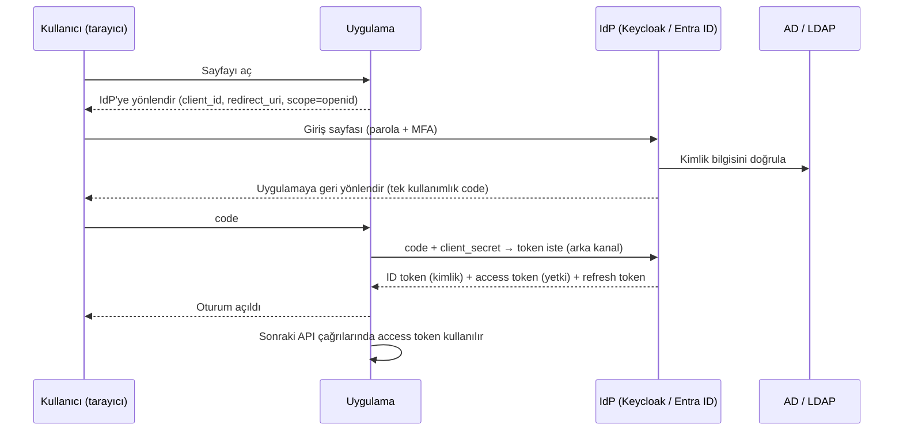
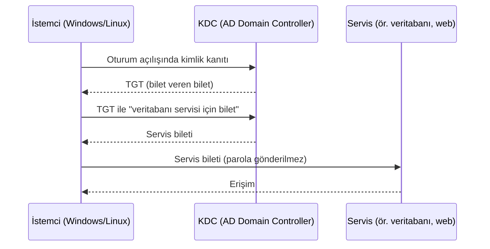

# 15.5 SSO, Kerberos, OAuth 2.0 ve OpenID Connect

## Nedir?
- **SSO (Single Sign-On — Tek Oturum Açma):** Kullanıcının bir kez giriş yapıp birçok uygulamaya tekrar parola girmeden erişebilmesi. Bir **hedef/deneyimdir**; aşağıdaki protokollerle gerçekleştirilir.
- **Kerberos:** Kurum ağı içinde, parolayı ağda göndermeden **bilet (ticket)** ile kimlik doğrulayan protokol. Active Directory'nin temelidir.
- **SAML 2.0:** XML tabanlı, kurumsal web uygulamalarında yaygın SSO standardı.
- **OAuth 2.0:** Bir uygulamaya, kullanıcı adına sınırlı **erişim yetkisi** (access token) vermek için yetkilendirme çerçevesi.
- **OpenID Connect (OIDC):** OAuth 2.0'ın üzerine **kimlik** katmanı ekleyen standart; "kim giriş yaptı" bilgisini **ID token** (JWT) ile taşır. Modern SSO'nun en yaygın protokolüdür.

## Hangi problemi çözer?
- Kullanıcı onlarca araç için onlarca kez giriş yapmaz.
- Parola, uygulamalara **hiç verilmez**; sadece kimlik sağlayıcı (IdP) parolayı görür.
- MFA, parola politikası, hesap kilitleme **tek yerde** uygulanır.
- Uygulamalar ve servisler birbirini güvenli şekilde çağırabilir (servisler arası token).

## Nasıl çalışır?

**Roller**
| Rol | Açıklama | Örnek |
|---|---|---|
| **Kimlik sağlayıcı (IdP / Authorization Server)** | Kimliği doğrular, token üretir | Keycloak (Red Hat build of Keycloak), AD FS, Microsoft Entra ID, Okta |
| **Uygulama (Client / Relying Party / Service Provider)** | IdP'ye güvenir, token'ı doğrular | Grafana, Superset, kendi Streamlit uygulamanız |
| **Kaynak sunucusu (Resource Server)** | Token ile korunan API | Kredi API'si |
| **Kullanıcı dizini** | IdP'nin kullanıcıları okuduğu yer | Active Directory / LDAP ([15.3](03-active-directory.md)) |

### OIDC Authorization Code akışı (web uygulamaları için standart)


**Token türleri**
| Token | İçerik | Kim kullanır? |
|---|---|---|
| **ID token** (JWT) | Kullanıcı kimliği: `sub`, `name`, `email`, `groups` | Uygulama (kim giriş yaptı?) |
| **Access token** | Yetki: `scope`, `aud` (hedef API), süre (`exp`, genellikle dakikalar) | API'ler |
| **Refresh token** | Süresi dolan access token'ı yenilemek için, uzun ömürlü | Uygulama, güvenli saklanmalı |

**Diğer OAuth akışları**
| Akış | Ne zaman? |
|---|---|
| **Authorization Code + PKCE** | Web, mobil ve tek sayfa uygulamaları (önerilen) |
| **Client Credentials** | Kullanıcı olmadan servisten servise (ETL'in API çağırması) |
| **Device Code** | Tarayıcısı olmayan cihazlar, CLI araçları |
| ~~Implicit, Password~~ | Eski ve güvensiz; kullanılmamalı |

### Kerberos (kurum içi ağ)

Kullanıcı Windows'a giriş yaptığında aldığı biletle, tarayıcıda veya veritabanı araçlarında parola girmeden giriş yapılabilir (**entegre Windows kimlik doğrulaması / SPNEGO**).

**Karşılaştırma**
| | Kerberos | SAML 2.0 | OAuth 2.0 | OIDC |
|---|---|---|---|---|
| Amaç | Ağ içi kimlik doğrulama | Web SSO | Yetkilendirme (erişim izni) | Kimlik + SSO |
| Format | İkili bilet | XML | Token (çoğu zaman JWT) | JWT |
| Ortam | Kurum içi ağ, AD | Kurumsal web uygulamaları | API'ler | Web, mobil, API, bulut |
| Güncellik | Köklü | Köklü, yaygın | Modern | Modern standart |

## Mini örnek
**Grafana'yı Keycloak (OIDC) ile bağlamak**
```ini
[auth.generic_oauth]
enabled = true
name = Kurumsal Giriş
client_id = grafana
client_secret = ${OIDC_CLIENT_SECRET}
scopes = openid profile email groups
auth_url  = https://sso.sirket.local/realms/sirket/protocol/openid-connect/auth
token_url = https://sso.sirket.local/realms/sirket/protocol/openid-connect/token
api_url   = https://sso.sirket.local/realms/sirket/protocol/openid-connect/userinfo
role_attribute_path = contains(groups[*], 'grafana-yonetici') && 'Admin' || contains(groups[*], 'veri-ekibi') && 'Editor' || 'Viewer'
```

**Servisten servise çağrı (Client Credentials)**
```python
import requests

token = requests.post(
    "https://sso.sirket.local/realms/sirket/protocol/openid-connect/token",
    data={"grant_type": "client_credentials", "client_id": "bddk-etl", "client_secret": SECRET},
    timeout=10,
).json()["access_token"]

r = requests.get("https://api.sirket.local/v1/kredi/ozet",
                 headers={"Authorization": f"Bearer {token}"}, timeout=10)
```

**API tarafında JWT doğrulama**
```python
import jwt                                   # PyJWT
from jwt import PyJWKClient

jwks = PyJWKClient("https://sso.sirket.local/realms/sirket/protocol/openid-connect/certs")

def dogrula(token: str) -> dict:
    anahtar = jwks.get_signing_key_from_jwt(token).key
    return jwt.decode(token, anahtar, algorithms=["RS256"],
                      audience="kredi-api", issuer="https://sso.sirket.local/realms/sirket")
```

**Mevcut bir uygulamayı koda dokunmadan korumak:** Uygulamanın önüne **OAuth2 Proxy** (veya OpenShift'te oauth-proxy sidecar) konur; kullanıcı önce IdP'ye yönlendirilir, giriş yapmayan uygulamaya ulaşamaz. Streamlit gibi kimlik doğrulaması zayıf araçlar için pratik çözümdür.

## Nerede kullanılır?
- **OIDC:** Grafana, Superset, Airflow, MLflow, OpenShift konsolu, iç web uygulamaları, API'ler
- **SAML:** Kurumsal SaaS ve eski web uygulamaları
- **Kerberos:** Windows ağı, veritabanı bağlantıları (SQL Server, Oracle, Hadoop/Hive), dosya paylaşımları
- **Client credentials:** ETL'lerin, pipeline'ların ve servislerin API çağrıları

## Benzerleri ve farkları
- **OAuth 2.0 bir kimlik doğrulama protokolü değildir:** Yetki verir; "kim" bilgisini standart biçimde OIDC ekler. "OAuth ile giriş" denince çoğu zaman aslında OIDC kastedilir.
- **LDAP ile OIDC:** LDAP bir dizin erişim protokolüdür; IdP arka planda LDAP/AD'yi kullanır, uygulamalara OIDC sunar ([15.4](04-ldap-entegrasyonu.md)).
- **mTLS:** Sertifika tabanlı karşılıklı kimlik doğrulama; servisler arası trafikte (service mesh) ve bankalar arası entegrasyonlarda.

## İlgili sayfalar
- [15.1 AuthN ve AuthZ](01-authn-authz.md)
- [15.4 LDAP entegrasyonu](04-ldap-entegrasyonu.md)
- [7.5 API güvenliği](../07-api/05-api-guvenligi.md)
