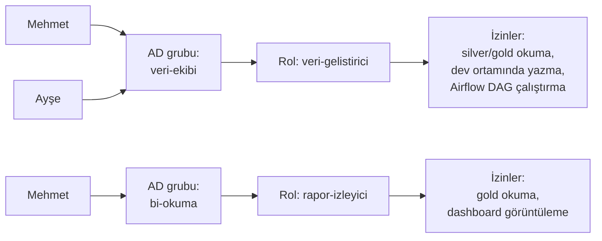

# 15.6 Rol Bazlı Erişim (RBAC) ve En Az Yetki Prensibi

## Nedir?
- **RBAC (Role-Based Access Control — rol bazlı erişim kontrolü):** Yetkilerin doğrudan kişilere değil **rollere** verildiği, kişilerin de rollere (genellikle dizin grupları aracılığıyla) atandığı yetkilendirme modeli.
- **En az yetki prensibi (Principle of Least Privilege):** Her kullanıcı, servis ve uygulamanın **işini yapmaya yetecek en az yetkiye**, **gerektiği süre boyunca** sahip olması.

## Hangi problemi çözer?
- Yüzlerce kişiye tek tek yetki vermek yönetilemez; rol ve grup ile ölçeklenir.
- Zamanla biriken yetkiler (bir projeden diğerine geçen kişinin eski yetkilerinin kalması — "yetki birikmesi") güvenlik riski oluşturur.
- Bir hesap ele geçirilirse veya hata yapılırsa, zarar o hesabın yetkileriyle sınırlı kalır.
- Denetimde "kimin neye neden erişimi var?" sorusu rollerle cevaplanır.
- Bankacılık düzenlemeleri görevler ayrılığı ve yetki gözden geçirmelerini zorunlu kılar.

## Nasıl çalışır?



**Temel ilkeler**
| İlke | Açıklama |
|---|---|
| **En az yetki** | Varsayılan "kapalı"; ihtiyaç kanıtlandıkça açılır |
| **Bilmesi gereken (need-to-know)** | Müşteri verisine sadece işi gerektiren erişir |
| **Görevler ayrılığı (Segregation of Duties — SoD)** | Kritik işlemler tek kişiye bırakılmaz: Kodu yazan ile canlıya alan, kredi tahsis eden ile onaylayan farklı kişi |
| **Ortam ayrımı** | Dev'de geniş, test'te sınırlı, prod'da çok dar yetki; prod'a insan erişimi istisnai |
| **Grup tabanlı atama** | Kişiye doğrudan yetki verilmez; grup üyeliği yönetilir |
| **Süreli / anlık yetki (just-in-time)** | Prod'a acil erişim onaylı ve süreli verilir, oturum kaydedilir |
| **Periyodik gözden geçirme (access review)** | Yöneticiler düzenli aralıklarla ekiplerinin yetkilerini onaylar veya kaldırır |
| **Servis hesapları için de geçerli** | ETL hesabı sadece gerektiği tablolara, gerektiği işlemlerle (SELECT/INSERT) erişir |

**Katmanlarda RBAC**
| Katman | Örnek |
|---|---|
| Kubernetes / OpenShift | Role, RoleBinding; `view`, `edit`, `admin` ([5.13](../05-kubernetes/13-rbac.md)) |
| Veritabanı | `GRANT SELECT ON schema gold TO rol_rapor_okuma` |
| Lakehouse / katalog | Unity Catalog, Ranger: tablo, sütun, satır yetkileri |
| BI | Çalışma alanı rolleri, satır düzeyinde güvenlik (RLS) |
| Uygulama / API | Endpoint bazında rol kontrolü ([15.1](01-authn-authz.md)) |
| Git / CI | Branch koruma, deploy yetkisi sadece pipeline'da |

**Rol tasarımı: iyi ve kötü örnekler**
| Kötü | İyi |
|---|---|
| Herkese `db_owner` / `cluster-admin` | Görev bazlı roller: okuma, yazma, yönetim |
| Kişiye özel roller (`mehmet_rolu`) | İşe göre roller (`kredi-analist`) |
| Prod şifresi ekipte paylaşılan bir dosyada | Kişisel kimlikle giriş + kayıt, servis şifreleri Vault'ta |
| Geliştiricinin prod'a doğrudan yazma yetkisi | Değişiklik sadece CI/CD pipeline'ının servis hesabıyla |

## Mini örnek
PostgreSQL'de rol hiyerarşisi:
```sql
-- Grup rolleri (LOGIN yok)
CREATE ROLE rol_gold_okuma NOLOGIN;
CREATE ROLE rol_etl_yazma  NOLOGIN;

GRANT USAGE ON SCHEMA gold TO rol_gold_okuma;
GRANT SELECT ON ALL TABLES IN SCHEMA gold TO rol_gold_okuma;
ALTER DEFAULT PRIVILEGES IN SCHEMA gold GRANT SELECT ON TABLES TO rol_gold_okuma;   -- gelecekteki tablolar

GRANT USAGE ON SCHEMA silver TO rol_etl_yazma;
GRANT SELECT, INSERT, UPDATE ON ALL TABLES IN SCHEMA silver TO rol_etl_yazma;       -- DELETE/DROP yok

-- Kişi ve servis hesapları rollere atanır
CREATE ROLE svc_bddk_etl LOGIN PASSWORD '...';          -- parola Vault'tan
GRANT rol_etl_yazma TO svc_bddk_etl;
GRANT rol_gold_okuma TO grafana_okuma;

-- Hassas sütunu gizlemek için view
CREATE VIEW gold.musteri_maskeli AS
SELECT musteri_id, segment, LEFT(tckn, 3) || '******' || RIGHT(tckn, 2) AS tckn_maskeli
FROM gold.musteri;
REVOKE SELECT ON gold.musteri FROM rol_gold_okuma;
GRANT SELECT ON gold.musteri_maskeli TO rol_gold_okuma;
```

Yetki gözden geçirme için sorgu:
```sql
SELECT r.rolname AS kullanici, m.rolname AS uye_oldugu_rol
FROM pg_auth_members am
JOIN pg_roles r ON r.oid = am.member
JOIN pg_roles m ON m.oid = am.roleid
ORDER BY 1;
```

## Nerede kullanılır?
- Veri platformları: kim hangi şemaya/tabloya erişebilir
- OpenShift namespace'leri, CI/CD ve Git repoları
- BI raporları ve dashboard'lar (bölge/şube bazlı satır yetkisi)
- ML platformları: proje bazında erişim, model registry'de onay yetkisi

## Benzerleri ve farkları
- **ABAC:** Rollerin yetersiz kaldığı ince taneli kurallar (bölge, hassasiyet etiketi, saat) için öznitelik tabanlı politikalar; çoğu zaman RBAC ile birlikte kullanılır ([15.1](01-authn-authz.md)).
- **Politika motorları:** Open Policy Agent (OPA), Kyverno; yetki ve yapılandırma kurallarını kod olarak tanımlar.
- **Zero trust (sıfır güven):** "Ağın içindeysen güvenilirsin" varsayımını bırakmak; her erişimin kimlik, yetki ve bağlamla doğrulanması. En az yetki bunun temel taşıdır.

## İlgili sayfalar
- [5.13 Kubernetes RBAC](../05-kubernetes/13-rbac.md)
- [15.7 Secret yönetimi](07-secret-yonetimi.md)
- [15.9 Maskeleme ve KVKK](09-maskeleme-kvkk.md)
- [16.7 Veriye erişim politikaları](../16-veri-yonetisimi/07-erisim-politikalari.md)
