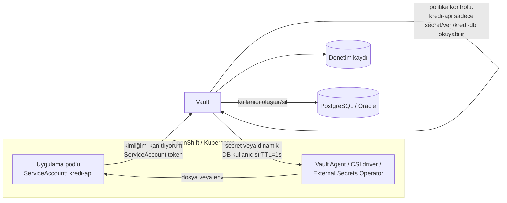

# 15.7 Secret Yönetimi: Vault, Şifrelerin Koddan Ayrılması

## Nedir?
**Secret (gizli bilgi)**; parola, API anahtarı, token, veritabanı bağlantı bilgisi, özel anahtar ve sertifika gibi, ele geçirilmesi yetkisiz erişime yol açacak her türlü bilgidir.

**Secret yönetimi**, bu bilgilerin **güvenli saklanması, sadece yetkili uygulamalara verilmesi, düzenli değiştirilmesi (rotation) ve erişimlerinin kaydedilmesi** sürecidir. Kurumsal ortamlarda bunun için **HashiCorp Vault**, CyberArk Conjur, bulut sağlayıcıların secret yöneticileri (AWS Secrets Manager, Azure Key Vault) gibi araçlar kullanılır.

## Hangi problemi çözer?
Tipik sızıntı yolları:
- Parolanın koda yazılıp Git'e gönderilmesi (Git geçmişinden silmek çok zordur, [3.4](../03-git/04-gitignore.md))
- Docker image katmanlarında kalan parolalar ([4.2](../04-docker/02-dockerfile.md))
- Paylaşılan Excel/Wiki sayfalarında prod şifreleri
- Yıllarca değişmeyen, herkesin bildiği servis hesabı parolaları
- Loglara düşen token'lar

Secret yönetimi:
- Secret'ı koddan ve image'dan **ayırır**,
- Erişimi **kimliğe ve role bağlar** (hangi uygulama hangi secret'ı okuyabilir),
- **Kim, ne zaman okudu** kaydını tutar,
- Değiştirmeyi (rotation) **otomatik** hâle getirir,
- Mümkünse **kısa ömürlü (dinamik)** kimlik bilgileri üretir.

## Nasıl çalışır?

**Olgunluk seviyeleri**
| Seviye | Yöntem | Değerlendirme |
|---|---|---|
| 0 | Koda gömülü parola | Kabul edilemez |
| 1 | `.env` dosyası / ortam değişkeni ([1.5](../01-linux/05-environment.md)) | Geliştirme için uygun; dosya korunmalı ve Git'e girmemeli |
| 2 | Kubernetes Secret ([5.9](../05-kubernetes/09-configmap-secret.md)) | Kod/image'dan ayrılmış; base64 olduğu için RBAC ve etcd şifrelemesi şart |
| 3 | Merkezi secret yöneticisi (Vault) + otomatik enjeksiyon | Kurumsal standart |
| 4 | Dinamik, kısa ömürlü kimlik bilgileri | En güvenli: sızsa bile kısa sürede geçersiz |



**Vault temel kavramları**
| Kavram | Açıklama |
|---|---|
| **Secret engine** | Secret türü: KV (anahtar–değer), database (dinamik DB kullanıcıları), PKI (sertifika üretimi), transit (şifreleme servisi) |
| **Auth method** | Kimlik doğrulama yolu: Kubernetes ServiceAccount, LDAP, OIDC, AppRole |
| **Policy** | Hangi kimliğin hangi yolu hangi işlemle kullanabileceği |
| **Lease / TTL** | Verilen secret'ın geçerlilik süresi; süre dolunca otomatik iptal |
| **Dinamik secret** | İstek anında oluşturulan, süreli, kişiye/uygulamaya özel kimlik bilgisi |
| **Seal / unseal** | Vault'un ana anahtarının korunması; açılışta birden çok kişinin anahtar parçasıyla açılması veya HSM/KMS ile otomatik |

## Mini örnek
**Vault CLI ile KV secret**
```bash
export VAULT_ADDR=https://vault.sirket.local
vault login -method=ldap username=gsoken                # kurumsal kimlikle giriş
vault kv put secret/veri/kredi-db kullanici=svc_kredi parola='...'
vault kv get -field=parola secret/veri/kredi-db
```

**Politika**
```hcl
# kredi-api.hcl
path "secret/data/veri/kredi-db" {
  capabilities = ["read"]
}
path "database/creds/kredi-okuma" {
  capabilities = ["read"]
}
```

**Dinamik veritabanı kullanıcısı**
```bash
vault read database/creds/kredi-okuma
# Key        Value
# username   v-kredi-okuma-x8Fk2...
# password   A1b2-...
# lease_duration 1h          ← 1 saat sonra Vault bu kullanıcıyı veritabanından siler
```

**Kubernetes'te External Secrets Operator ile Vault'tan Secret üretmek**
```yaml
apiVersion: external-secrets.io/v1beta1
kind: ExternalSecret
metadata:
  name: kredi-db
  namespace: veri-prod
spec:
  refreshInterval: 1h
  secretStoreRef:
    name: vault-kurumsal
    kind: ClusterSecretStore
  target:
    name: kredi-db-secret              # oluşturulacak Kubernetes Secret
  data:
    - secretKey: DB_PASSWORD
      remoteRef:
        key: veri/kredi-db
        property: parola
```
Bu sayede GitOps reposunda ([6.5](../06-ci-cd/05-gitops-argocd.md)) parolanın kendisi değil, sadece **nereden okunacağı** bulunur.

**Python'dan doğrudan okuma (hvac)**
```python
import hvac, os

client = hvac.Client(url="https://vault.sirket.local")
with open("/var/run/secrets/kubernetes.io/serviceaccount/token") as f:
    client.auth.kubernetes.login(role="kredi-api", jwt=f.read())
db = client.secrets.kv.v2.read_secret_version(path="veri/kredi-db")["data"]["data"]
```

**Sızıntıyı önleyen araçlar**
```bash
# Commit öncesi secret taraması
gitleaks detect --source . -v
# pre-commit kancası olarak her commit'te otomatik çalıştırılabilir
```

## Nerede kullanılır?
- Uygulama ve ETL'lerin veritabanı, API, SFTP kimlik bilgileri
- CI/CD pipeline'larının registry ve cluster erişim token'ları
- TLS sertifikalarının üretimi ve yenilenmesi (Vault PKI, cert-manager)
- Hassas alanların uygulama dışında şifrelenmesi (Vault transit: şifreleme hizmeti olarak)

## Benzerleri ve farkları
| Araç | Not |
|---|---|
| **HashiCorp Vault / OpenBao** | En yaygın; dinamik secret, PKI, çok sayıda entegrasyon (OpenBao: açık kaynak çatal) |
| **CyberArk** | Bankalarda yaygın PAM ve secret çözümü (yönetici hesap kasası) |
| **AWS Secrets Manager, Azure Key Vault, GCP Secret Manager** | Bulut yönetilen |
| **Sealed Secrets** | Şifrelenmiş Secret'ı Git'te saklamaya izin verir; sadece cluster çözebilir |
| **SOPS** | YAML/JSON dosyalarındaki değerleri KMS/PGP ile şifreler |
| **KMS / HSM** | Anahtar yönetimi ve donanım güvenlik modülü; secret yöneticilerinin kök anahtarlarını korur |

**Altın kurallar:** Secret'ı asla koda, image'a, loga, Git'e, e-postaya, sohbete yazmayın. Sızdığından şüphelenirseniz önce **değiştirin (rotate)**, sonra temizleyin.

## İlgili sayfalar
- [5.9 ConfigMap ve Secret](../05-kubernetes/09-configmap-secret.md)
- [15.8 Şifreleme](08-sifreleme.md)
- [16.8 .env dosyaları](../16-formatlar/08-env.md)
