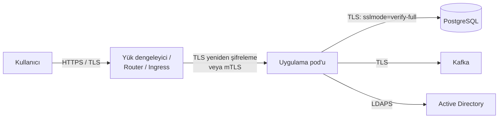

# 15.8 Şifreleme: TLS, At-Rest ve In-Transit

## Nedir?
**Şifreleme (encryption)**, veriyi yalnızca doğru anahtara sahip olanların okuyabileceği bir biçime dönüştürmektir. Verinin **bulunduğu duruma** göre iki ana alan vardır:
- **In-transit (aktarımda) şifreleme:** Veri ağda bir yerden başka bir yere giderken (tarayıcı → sunucu, uygulama → veritabanı). Standart yöntem **TLS**.
- **At-rest (durağan) şifreleme:** Veri diskte, veritabanında, yedekte, nesne depolamada dururken.

Üçüncü ve daha zor alan: **In-use (kullanımda) şifreleme** — veri bellekte işlenirken (gizli hesaplama / confidential computing).

## Hangi problemi çözer?
| Tehdit | Koruma |
|---|---|
| Ağ trafiğinin dinlenmesi, araya girme (man-in-the-middle) | In-transit (TLS) |
| Çalınan disk, yanlış yere giden yedek, silinmeden atılan sunucu | At-rest |
| Veritabanı dosyalarına işletim sistemi seviyesinde erişim | At-rest (TDE) |
| Yetkili DBA'nın bile görmemesi gereken alanlar (TCKN, kart no) | Uygulama/sütun seviyesinde şifreleme, tokenizasyon |

Ayrıca KVKK, PCI DSS (kart verisi) ve BDDK bilgi sistemleri düzenlemeleri şifrelemeyi zorunlu tutar.

## Nasıl çalışır?

**Temel kavramlar**
| Kavram | Açıklama |
|---|---|
| **Simetrik şifreleme** | Aynı anahtarla şifreleme ve çözme; hızlı. Örnek: AES-256 |
| **Asimetrik şifreleme** | Açık anahtarla şifrele, özel anahtarla çöz (veya özel anahtarla imzala, açıkla doğrula); anahtar değişimi ve imza için. Örnek: RSA, ECDSA |
| **Hash** | Geri döndürülemez parmak izi; bütünlük kontrolü, parola saklama. Örnek: SHA-256; parolalar için bcrypt/Argon2 |
| **Sertifika** | Açık anahtarın kime ait olduğunu bir CA'nın imzasıyla doğrulayan belge ([8.6](../08-nginx/06-https-tls.md)) |
| **Zarf şifreleme (envelope encryption)** | Veri, bir veri anahtarıyla (DEK) şifrelenir; DEK de ana anahtarla (KEK, KMS/HSM'de) şifrelenir. Anahtar değişimi kolaylaşır |
| **KMS / HSM** | Anahtarların güvenli üretildiği, saklandığı ve kullanıldığı sistem/donanım |

**Şifreleme ve hash farkı:** Şifreleme geri çözülebilir (anahtarla); hash çözülemez. **Parolalar şifrelenmez, hash'lenir** (tuz/salt ile, yavaş algoritmalarla).

**In-transit: katmanlar**


**At-rest: katmanlar**
| Katman | Yöntem | Neye karşı korur? |
|---|---|---|
| Disk / depolama | Tam disk şifreleme (LUKS, SAN şifrelemesi), bulut disk şifrelemesi | Fiziksel disk çalınması |
| Veritabanı | **TDE** (Transparent Data Encryption): Oracle TDE, SQL Server TDE | Veri dosyalarının ve yedeklerin kopyalanması |
| Nesne depolama | S3/MinIO sunucu tarafı şifreleme (SSE-KMS) | Depolama katmanına yetkisiz erişim |
| Sütun / alan | Uygulama tarafında şifreleme, `pgcrypto`, Vault transit | Veritabanına erişimi olan ama yetkisi olmayan kişiler |
| Kubernetes | etcd şifrelemesi (Secret'lar için) | etcd verisinin okunması |
| Yedekler | Yedek dosyalarının şifrelenmesi | Yedeklerin sızması |

**Önemli:** TDE ve disk şifrelemesi, veritabanına **normal yoldan bağlanan** birine karşı koruma sağlamaz; veri onlara açık görünür. O seviyede koruma için erişim yetkileri, maskeleme ve alan seviyesinde şifreleme gerekir ([15.9](09-maskeleme-kvkk.md)).

## Mini örnek
**PostgreSQL'e şifreli ve sunucu doğrulamalı bağlantı**
```python
from sqlalchemy import create_engine

engine = create_engine(
    "postgresql+psycopg2://etl@pg.sirket.local/bddk",
    connect_args={"sslmode": "verify-full", "sslrootcert": "/etc/ssl/sirket-ca.pem"},
)
```
`sslmode` seviyeleri: `disable` < `require` (şifreli ama sunucu doğrulamaz) < `verify-ca` < `verify-full` (sunucu adı da doğrulanır, önerilen).

**Parola hash'leme**
```python
import bcrypt
h = bcrypt.hashpw("parola123".encode(), bcrypt.gensalt(rounds=12))
bcrypt.checkpw("parola123".encode(), h)          # True
```

**Alan seviyesinde simetrik şifreleme (anahtar Vault/KMS'ten gelir)**
```python
from cryptography.fernet import Fernet

anahtar = vault_anahtar_getir("veri/alan-sifreleme")    # asla koda gömülmez
f = Fernet(anahtar)
sifreli = f.encrypt(b"12345678901")                     # TCKN
f.decrypt(sifreli)                                       # yetkili servis çözebilir
```

**Dosya bütünlüğü kontrolü (hash)**
```bash
sha256sum bddk_kredi_2026_09.xlsx > bddk_kredi_2026_09.xlsx.sha256
sha256sum -c bddk_kredi_2026_09.xlsx.sha256
```

**Sertifika ve TLS kontrolü**
```bash
openssl s_client -connect pg.sirket.local:5432 -starttls postgres </dev/null | openssl x509 -noout -dates -subject
```

## Nerede kullanılır?
- Tüm dış ve iç ağ trafiği (HTTPS, LDAPS, veritabanı TLS, Kafka TLS)
- Müşteri verisi içeren veritabanları, lakehouse depolaması ve yedekler
- Kart verisi (PCI DSS kapsamında kart numarasının şifrelenmesi veya tokenizasyonu)
- Dışarıya gönderilen dosyalar (şifreli arşiv, PGP), SFTP aktarımları

## Benzerleri ve farkları
- **Tokenizasyon:** Hassas değerin yerine anlamsız bir token konur, eşleşme ayrı ve korumalı bir kasada tutulur. Şifrelemeden farkı: token'dan matematiksel olarak orijinal değere ulaşılamaz.
- **Maskeleme:** Değerin bir kısmının gizlenmesi (gösterim amaçlı); şifreleme değildir ([15.9](09-maskeleme-kvkk.md)).
- **Encoding (base64):** Şifreleme **değildir**; herkes çözebilir ([5.9](../05-kubernetes/09-configmap-secret.md)).
- **Uçtan uca şifreleme (E2EE):** Veri sadece gönderen ve alıcıda çözülür; aradaki sunucular dahil kimse göremez.

## İlgili sayfalar
- [8.6 HTTPS ve TLS](../08-nginx/06-https-tls.md)
- [15.7 Secret yönetimi](07-secret-yonetimi.md)
- [15.9 Maskeleme ve KVKK](09-maskeleme-kvkk.md)
