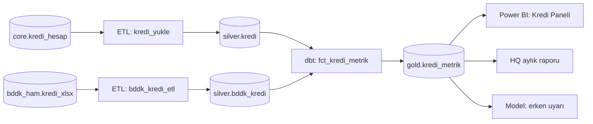

# 15.10 Veri Yönetişimi: Data Catalog, Metadata, Lineage

## Nedir?
**Veri yönetişimi (data governance)**, kurumdaki verinin **doğru, güvenilir, güvenli ve kurallara uygun** biçimde yönetilmesi için tanımlanan roller, politikalar, süreçler ve araçlardır. Üç teknik yapı taşı vardır:
- **Metadata (üst veri):** "Veri hakkındaki veri": tablonun sahibi, açıklaması, sütun anlamları, güncelleme sıklığı, hassasiyet sınıfı.
- **Data catalog (veri kataloğu):** Kurumdaki veri varlıklarının aranabilir envanteri; "veri için Google".
- **Data lineage (veri soy ağacı):** Bir verinin nereden geldiğini, hangi dönüşümlerden geçtiğini ve nereye gittiğini gösteren akış haritası.

## Hangi problemi çözer?
- **"Bu rakam nereden geliyor?"** Yönetime sunulan bir KPI'nın kaynağı, hesaplama adımları ve sorumlusu bulunamaz.
- **"Hangi tabloyu kullanmalıyım?"** Aynı isimli 5 tablo var; hangisi güncel ve resmi?
- **"Bu sütunu değiştirirsem ne bozulur?"** Kaynak tablo değişince hangi raporlar, modeller etkilenir? (etki analizi)
- **"Hassas veri nerede?"** TCKN, kart numarası hangi tablolarda var, kim erişiyor? (KVKK uyumu, [15.9](09-maskeleme-kvkk.md))
- **Düzenleyici gereksinimler:** Risk verisi toplama ve raporlamada (BCBS 239 prensipleri) verinin doğruluğu, tamlığı, zamanlılığı ve izlenebilirliği beklenir.

## Nasıl çalışır?

**Roller**
| Rol | Sorumluluk |
|---|---|
| **Veri sahibi (data owner)** | İş biriminden; verinin tanımı, erişim onayı ve kalitesinden hesap verir |
| **Veri sorumlusu (data steward)** | Günlük yönetim: tanımlar, kalite kuralları, katalog bilgilerinin güncelliği |
| **Veri yöneticisi / mühendisi (custodian)** | Teknik saklama, güvenlik, yedekleme, akışlar |
| **Veri yönetişimi ofisi / CDO** | Politika, standart, önceliklendirme |
| **Veri kullanıcısı** | Kurallara uygun kullanım, kalite sorunlarını bildirme |

**Metadata türleri**
| Tür | Örnek |
|---|---|
| Teknik | Şema, sütun tipi, boyut, bölümleme, son güncelleme zamanı |
| İş (business) | Sütunun iş tanımı, hesaplama formülü, sahibi, iş sözlüğü (glossary) terimleri |
| Operasyonel | Yükleme süreleri, kalite test sonuçları, kullanım sıklığı |
| Yönetişim | Hassasiyet sınıfı, saklama süresi, erişim politikası |

**Lineage seviyeleri**

- **Tablo seviyesi:** Hangi tablo hangisinden besleniyor.
- **Sütun seviyesi:** `gold.kredi_metrik.yoy` hangi kaynak sütunlardan, hangi formülle hesaplandı.
- **İş seviyesi:** Rapordaki KPI ↔ iş sözlüğü terimi ↔ teknik tablo.

Lineage elle çizilmez; araçlar SQL'i ayrıştırarak, dbt/Airflow/Spark çalışmalarından olay toplayarak (OpenLineage standardı) otomatik üretir.

## Mini örnek
**dbt ile metadata ve lineage'i kodda tutmak**
```yaml
models:
  - name: fct_kredi_metrik
    description: "Aylık kalem bazında kredi bakiyesi ve MoM/YoY değişimleri. HQ aylık raporunun kaynağı."
    meta:
      sahip: "risk-analitik"
      steward: "gsoken"
      hassasiyet: "dahili"
      guncelleme: "her iş günü 07:30"
    columns:
      - name: yoy
        description: "Yıllık değişim = tutar / 12 ay önceki tutar - 1"
        meta: { glossary_terim: "Yıllık Kredi Büyümesi" }
```
```bash
dbt docs generate && dbt docs serve     # model açıklamaları + otomatik lineage grafiği
```

**Basit bir metadata tablosu (katalog aracı yoksa başlangıç)**
```sql
CREATE TABLE yonetisim.veri_katalogu (
    tablo            TEXT PRIMARY KEY,         -- 'gold.kredi_metrik'
    aciklama         TEXT NOT NULL,
    sahip_birim      TEXT NOT NULL,
    steward          TEXT NOT NULL,
    hassasiyet       TEXT CHECK (hassasiyet IN ('genel', 'dahili', 'gizli', 'kisisel')),
    kaynak_tablolar  TEXT[],
    guncelleme       TEXT,
    saklama_suresi   INTERVAL
);
```

**OpenLineage ile Airflow/Spark'tan otomatik lineage (kavramsal)**
```bash
# Airflow: openlineage provider kurulup ortam değişkeniyle bir lineage sunucusuna (Marquez vb.) bağlanır
export OPENLINEAGE_URL=http://marquez.sirket.local:5000
export OPENLINEAGE_NAMESPACE=veri-prod
```

## Nerede kullanılır?
- Yönetim ve düzenleyici raporların izlenebilirliği ("bu rakamın denetim izi")
- Self-servis analitik: analistlerin doğru ve onaylı veriyi bulması
- Değişiklik yönetimi: kaynak sistem değişikliğinin etki analizi
- KVKK: kişisel veri envanteri, hassas sütunların etiketlenmesi ve erişim takibi
- Veri kalitesi sonuçlarının katalogda "güven" göstergesi olarak yayımlanması ([11.5](../11-veri-akisi/05-veri-kalitesi.md))

## Benzerleri ve farkları
| Araç | Not |
|---|---|
| **Collibra, Alation, Informatica (Axon/EDC)** | Kurumsal ticari katalog ve yönetişim platformları |
| **DataHub, OpenMetadata, Apache Atlas** | Açık kaynak katalog ve lineage |
| **Unity Catalog, Microsoft Purview, AWS Glue Data Catalog** | Platforma gömülü katalog + yetki |
| **Marquez / OpenLineage** | Açık lineage standardı ve referans sunucu |
| **dbt docs** | dbt projesi kapsamında açıklama ve lineage |

- **Veri yönetişimi ile veri yönetimi:** Yönetişim kuralları ve sorumlulukları belirler; veri yönetimi (data management) bu kurallara göre teknik işleri yapar.
- **Master Data Management (MDM):** Müşteri, ürün gibi ana verilerin kurum genelinde tek ve tutarlı kaydını (golden record) oluşturma disiplini.
- **Data mesh:** Yönetişimi merkezi bir ekip yerine alan ekiplerine dağıtan, ortak standartlarla ("federe yönetişim") çalışan yaklaşım ([9.12](../09-veri-depolama/12-warehouse-lake-lakehouse.md)).

## İlgili sayfalar
- [11.4 dbt](../11-veri-akisi/04-dbt.md)
- [15.9 Maskeleme ve KVKK](09-maskeleme-kvkk.md)
- [12.1 BI (semantik katman)](../12-bi/01-bi-nedir.md)
