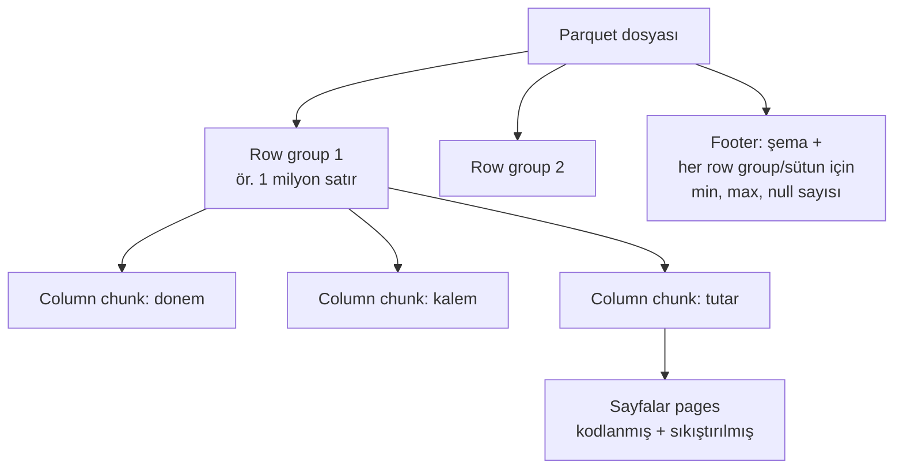

# 16.5 Parquet

## Nedir?
**Apache Parquet**, analitik iş yükleri için tasarlanmış, **sütun bazlı (columnar), sıkıştırılmış, şemalı ve ikili** bir dosya formatıdır. Lakehouse'ların ([9.12](../09-veri-depolama/12-warehouse-lake-lakehouse.md)), Spark'ın ve modern veri araçlarının (pandas, Polars, DuckDB, Trino, Snowflake, BigQuery) standart veri dosyasıdır. Delta Lake ve Iceberg tabloları da altta Parquet dosyalarından oluşur ([9.14](../09-veri-depolama/14-delta-iceberg.md)).

## Hangi problemi çözer?
| CSV sorunu | Parquet çözümü |
|---|---|
| Büyük boyut | Sütun bazlı sıkıştırma; çoğu zaman CSV'nin **5–10 katı daha küçük** |
| Yavaş okuma | Sadece gereken sütunlar okunur (column pruning) |
| Tüm dosyayı taramak | Satır grubu istatistikleriyle ilgisiz bölümler atlanır (predicate pushdown) |
| Tip kaybı (tarih metin olur, `00123` sayı olur) | Şema dosyanın içinde; tipler korunur (tarih, ondalık, tamsayı, metin, iç içe) |
| Türkçe karakter / ayırıcı / kodlama sorunları | İkili format; bu sorunlar yok |

## Nasıl çalışır?

**Dosya yapısı**


| Kavram | Açıklama |
|---|---|
| **Row group** | Satırların yatay parçası; paralel işleme birimi (genellikle 64–512 MB) |
| **Column chunk** | Bir row group içindeki tek sütunun verisi |
| **Page** | Sıkıştırma ve kodlama birimi |
| **Footer (metadata)** | Şema ve her sütun parçası için istatistikler (min/max/null sayısı) |
| **Kodlama (encoding)** | Sözlük kodlama (tekrar eden metinler: `KOBİ`, `KOBİ`... → 0, 0...), RLE, delta kodlama |
| **Sıkıştırma** | Snappy (hızlı, varsayılan), Zstd (daha iyi oran), Gzip |

**Okuyucu nasıl hız kazanır?**
- `SELECT SUM(tutar) WHERE donem = '2026-09'` sorgusunda:
  1. **Column pruning:** Sadece `tutar` ve `donem` sütunları okunur.
  2. **Predicate pushdown:** Footer'daki min/max'a bakılır; `donem` aralığı 2026-09'u içermeyen row group'lar hiç okunmaz.

**Bölümlenmiş (partitioned) klasör yapısı (Hive tarzı)**
```
kredi/
├── donem=2026-08/
│   ├── part-0000.parquet
│   └── part-0001.parquet
└── donem=2026-09/
    └── part-0000.parquet
```
`WHERE donem = '2026-09'` filtresinde sadece ilgili klasör okunur.

## Mini örnek
**pandas / PyArrow**
```python
import pandas as pd

df = pd.read_csv("kredi.csv", dtype={"musteri_no": str}, parse_dates=["donem"])
df.to_parquet("kredi.parquet", index=False, compression="zstd")

# Sadece gereken sütunlar ve filtre (dosyanın tamamı okunmaz)
kucuk = pd.read_parquet("kredi.parquet", columns=["donem", "tutar"],
                        filters=[("donem", ">=", pd.Timestamp("2026-01-01"))])

# Bölümlenmiş yazma
df.assign(yil=df["donem"].dt.year).to_parquet("kredi_bolumlu/", partition_cols=["yil"], index=False)
```

**Şemayı ve istatistikleri incelemek**
```python
import pyarrow.parquet as pq

dosya = pq.ParquetFile("kredi.parquet")
print(dosya.schema_arrow)                  # sütun tipleri
print(dosya.metadata)                      # row group sayısı, satır sayısı
print(dosya.metadata.row_group(0).column(2).statistics)   # min, max, null_count
```

**DuckDB ile doğrudan SQL**
```sql
SELECT donem, SUM(tutar) FROM 'kredi_bolumlu/**/*.parquet' GROUP BY donem;
DESCRIBE SELECT * FROM 'kredi.parquet';
SELECT * FROM parquet_metadata('kredi.parquet');
COPY (SELECT * FROM read_csv('kredi.csv')) TO 'kredi.parquet' (FORMAT parquet, COMPRESSION zstd);
```

**Polars ve Spark**
```python
import polars as pl
pl.scan_parquet("kredi_bolumlu/**/*.parquet").filter(pl.col("tutar") > 0).collect()

df = spark.read.parquet("s3a://lake/silver/kredi/")
df.write.partitionBy("donem").parquet("s3a://lake/gold/kredi/")
```

Boyut karşılaştırması (örnek):
```bash
ls -lh kredi.csv kredi.parquet
# 1,2G kredi.csv
# 180M kredi.parquet
```

## Nerede kullanılır?
- Lakehouse ve data lake'lerde bronze/silver/gold tabloları
- Veritabanından büyük veri dışa aktarımı ve arşivleme
- ML eğitim setlerinin saklanması (hızlı okuma, tipler korunur)
- Ekipler ve araçlar arası büyük veri paylaşımı (Spark yazar, DuckDB/pandas okur)
- Feature store'ların offline katmanı ([13.8](../13-mlops/08-offline-online-store.md))

## Benzerleri ve farkları
| Format | Fark |
|---|---|
| **CSV** | Metin, şemasız, evrensel; küçük veri ve insan okuması için ([16.2](02-csv.md)) |
| **ORC** | Benzer sütun formatı; Hive/Hadoop dünyasında yaygın ([16.9](09-digerleri.md)) |
| **Avro** | Satır bazlı ve şemalı; tek tek kayıt yazma ve akışlar için daha uygun |
| **Arrow** | Bellek içi sütun formatı; Parquet diskte, Arrow bellekte ([16.9](09-digerleri.md)) |
| **Delta / Iceberg** | Parquet dosyaları + işlem günlüğü/metadata: ACID, güncelleme, zaman yolculuğu ([9.14](../09-veri-depolama/14-delta-iceberg.md)) |

**Dikkat:**
- Parquet dosyaları **değiştirilemez (immutable)**; satır güncellemek için dosya yeniden yazılır. Güncellenen tablolar için Delta/Iceberg kullanılır.
- **Çok sayıda küçük dosya** performansı düşürür ("small files problem"); dosyaları birleştirmek (compaction) gerekir.
- Excel ile açılamaz; iş kullanıcılarına CSV/Excel olarak dışa aktarım gerekebilir.

## İlgili sayfalar
- [9.14 Delta Lake ve Iceberg](../09-veri-depolama/14-delta-iceberg.md)
- [10.5 Polars ve DuckDB](../10-veri-isleme/05-polars-duckdb.md)
- [16.9 Avro, ORC, Arrow](09-digerleri.md)
