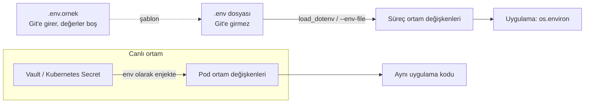

# 16.8 .env Dosyaları

## Nedir?
**`.env` dosyası**, bir uygulamanın **ortam değişkenlerini** (environment variables, [1.5](../01-linux/05-environment.md)) satır satır `ANAHTAR=değer` biçiminde tutan düz metin dosyasıdır. Resmî bir standardı yoktur; "dotenv" kütüphaneleri ve araçlar (Docker Compose, Python `python-dotenv`, Node `dotenv`) tarafından yaygın kabul görmüş bir gelenektir.

```bash
# .env
DB_HOST=localhost
DB_PORT=5432
DB_USER=etl
DB_PASSWORD=gizli
LOG_LEVEL=INFO
```

## Hangi problemi çözer?
- **Ayar ile kodu ayırmak:** Aynı kod; laptopta yerel veritabanına, test ortamında test veritabanına bağlanır. Değişen sadece `.env` ([12-Factor App: Config](../01-linux/05-environment.md)).
- **Şifreleri koddan çıkarmak:** Parola koda değil `.env`'e yazılır ve `.env` **Git'e gönderilmez**.
- **Kolay yerel geliştirme:** Her seferinde `export` yazmak yerine değişkenler tek dosyadan yüklenir.

## Nasıl çalışır?



**Söz dizimi (yaygın kurallar)**
| Kural | Örnek |
|---|---|
| Satır başına bir değişken | `ANAHTAR=değer` |
| `=` etrafında boşluk olmamalı | `DB_HOST=localhost` (✗ `DB_HOST = localhost`) |
| Yorum satırı | `# açıklama` |
| Boşluk içeren değer tırnaklı | `RAPOR_BASLIGI="Aylık Kredi Raporu"` |
| Tek tırnak: değer olduğu gibi | `SIFRE='a$b#c'` (`$` ve `#` yorumlanmaz) |
| Değişken genişletme (araca göre) | `DB_URL=postgresql://${DB_USER}@${DB_HOST}/kredi` |
| `export` öneki (bash uyumu için, bazı araçlar destekler) | `export LOG_LEVEL=INFO` |
| Adlandırma geleneği | BÜYÜK_HARF ve alt çizgi |

**Önemli:** Tüm değerler **metindir**. `DB_PORT=5432` uygulamaya `"5432"` olarak gelir; tip dönüşümü uygulamada yapılmalıdır. `DEBUG=false` metni Python'da boş olmayan string olduğu için `if os.environ["DEBUG"]:` ifadesi **True** döner (sık yapılan hata).

**Dosya düzeni**
| Dosya | Git'e girer mi? | Amaç |
|---|---|---|
| `.env` | **Hayır** (`.gitignore`) | Gerçek yerel değerler ve şifreler |
| `.env.ornek` / `.env.example` | Evet | Hangi değişkenlerin gerektiğini gösteren şablon (değerler boş/örnek) |
| `.env.test` | Duruma göre (şifresizse) | Test ayarları |

## Mini örnek
**Python: `python-dotenv` + tip dönüşümü**
```python
import os
from dotenv import load_dotenv           # pip install python-dotenv

load_dotenv()                            # .env'i oku; zaten tanımlı ortam değişkenlerini EZMEZ

DB_HOST = os.environ["DB_HOST"]                                   # yoksa hata: zorunlu ayar
DB_PORT = int(os.getenv("DB_PORT", "5432"))                       # varsayılanlı + tip dönüşümü
DEBUG   = os.getenv("DEBUG", "false").lower() in {"1", "true", "yes"}
```

**Pydantic Settings ile doğrulanmış ayarlar**
```python
from pydantic import SecretStr
from pydantic_settings import BaseSettings, SettingsConfigDict   # pip install pydantic-settings

class Ayarlar(BaseSettings):
    model_config = SettingsConfigDict(env_file=".env", env_file_encoding="utf-8")
    db_host: str
    db_port: int = 5432
    db_password: SecretStr             # loglarda '**********' olarak görünür
    log_level: str = "INFO"

ayar = Ayarlar()                       # eksik veya hatalı tipte değişken varsa açık hata
```

**Docker ve Docker Compose**
```bash
docker run --env-file .env kredi-izleme:1.0
```
```yaml
# compose.yaml: ${...} değerleri aynı klasördeki .env'den gelir
services:
  db:
    image: postgres:16
    environment:
      POSTGRES_PASSWORD: ${DB_PASSWORD}
  etl:
    env_file: .env
```

**Kubernetes'te `.env`'den Secret/ConfigMap üretmek** (geliştirme ortamları için)
```bash
kubectl create configmap etl-ayar --from-env-file=ayar.env
kubectl create secret generic etl-gizli --from-env-file=.env
```

**Kabukta yüklemek**
```bash
set -a; source .env; set +a          # tüm değişkenleri export et
```

**Güvenlik kontrolleri**
```bash
echo ".env" >> .gitignore
chmod 600 .env                        # sadece sahibi okuyabilsin (1.3)
git check-ignore -v .env              # gerçekten ignore ediliyor mu?
gitleaks detect --source . -v         # yanlışlıkla commit'lenmiş şifre var mı?
```

## Nerede kullanılır?
- Yerel geliştirme ortamı (laptop): veritabanı adresi, API anahtarları, log seviyesi
- Docker Compose ile çalışan küçük kurulumlar
- CI pipeline'larında test ayarları (şifreler pipeline değişkenlerinden gelir)

**Canlı ortamda `.env` dosyası kullanılmaz:** Değişkenler Kubernetes ConfigMap/Secret, Vault veya platformun secret yönetimi üzerinden enjekte edilir ([15.7](../15-guvenlik/07-secret-yonetimi.md)). Uygulama kodu aynı kalır; sadece değişkenlerin kaynağı değişir.

## Benzerleri ve farkları
| | `.env` | YAML / TOML config | Secret yöneticisi (Vault) |
|---|---|---|---|
| Yapı | Düz anahtar=değer | Hiyerarşik, tipli | Anahtar–değer + politika |
| Tipler | Hepsi metin | Var | Metin |
| Gizli bilgi için | Sadece geliştirmede, Git dışında | Uygun değil | Doğru yer |
| Tipik kullanım | Ortama özgü birkaç ayar | Uygulama davranışı, çok sayıda ayar | Parola, token, sertifika |

Yaygın düzen: **Yapısal ayarlar YAML/TOML dosyasında, ortama özgü değerler ve şifreler ortam değişkenlerinde** (yerelde `.env`, canlıda Secret/Vault).

## İlgili sayfalar
- [1.5 Environment variable'lar](../01-linux/05-environment.md)
- [3.4 .gitignore](../03-git/04-gitignore.md)
- [15.7 Secret yönetimi](../15-guvenlik/07-secret-yonetimi.md)
