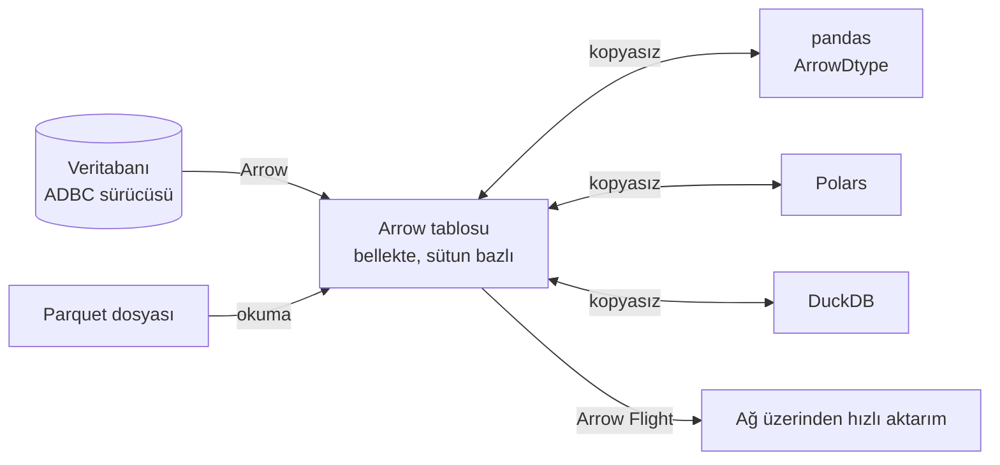

# 16.9 Diğerleri: Avro, ORC, Arrow, XML, Excel

## Nedir?
Veri projelerinde sık karşılaşılan diğer beş format:
| Format | Kısaca |
|---|---|
| **Avro** | Satır bazlı, şemalı, ikili; şema evrimi güçlü. Kafka ve veri aktarımında yaygın |
| **ORC** | Sütun bazlı, sıkıştırılmış, ikili; Hive/Hadoop ekosisteminde Parquet'in muadili |
| **Apache Arrow** | **Bellek içi** sütun formatı; araçlar arası kopyasız veri paylaşımı. Dosya karşılığı: Feather / Arrow IPC |
| **XML** | Etiket tabanlı, hiyerarşik metin formatı; şema (XSD) desteği. SOAP, eski entegrasyonlar, resmî bildirim formatları |
| **Excel (xlsx)** | Sayfalardan oluşan, biçimlendirilebilir tablo dosyası (zip içinde XML). İş birimlerinin ve birçok dış kaynağın formatı |

## Hangi problemi çözer?
- **Avro:** Akış ve mesajlaşmada her kaydın şemayla birlikte (veya Schema Registry referansıyla) küçük ve hızlı taşınması; üretici ve tüketici farklı şema sürümlerinde olsa da uyum.
- **ORC:** Hive tablolarında yüksek sıkıştırma ve hızlı analitik.
- **Arrow:** pandas, Polars, DuckDB, Spark ve veritabanı sürücüleri arasında veriyi kopyalamadan/dönüştürmeden aktarmak; bellek içi analitik hızı.
- **XML:** Katı şemalı, doğrulanabilir belge alışverişi.
- **Excel:** İnsanların açıp okuyabildiği, biçimlendirilmiş rapor ve veri paylaşımı.

## Nasıl çalışır?

**Avro**
- Şema JSON ile tanımlanır; veri ikili olarak kodlanır.
- Dosyada (`.avro`) şema dosyanın başında durur; Kafka'da genellikle mesajda sadece şema ID'si bulunur, şema **Schema Registry**'de saklanır ([11.7](../11-veri-akisi/07-kafka.md)).
- **Şema evrimi:** Varsayılan değeri olan yeni alan eklemek geriye uyumludur; eski tüketiciler yeni mesajları okumaya devam eder.
```json
{
  "type": "record",
  "name": "KartIslem",
  "namespace": "sirket.kart",
  "fields": [
    {"name": "kart_no", "type": "string"},
    {"name": "tutar", "type": {"type": "bytes", "logicalType": "decimal", "precision": 18, "scale": 2}},
    {"name": "ts", "type": {"type": "long", "logicalType": "timestamp-millis"}},
    {"name": "kanal", "type": ["null", "string"], "default": null}
  ]
}
```

**ORC**
- Parquet'e benzer: "stripe" adı verilen satır grupları, sütun bazlı saklama, dosya sonunda istatistikler, hafif index'ler.
- Hive ACID tablolarının formatı; Hadoop tabanlı eski veri gölleri ve Hive ağırlıklı ortamlarda yaygın.

**Arrow**

- Parquet **diskte depolama** için, Arrow **bellekte işleme ve aktarım** için optimize edilmiştir; birbirini tamamlar.

**XML**
```xml
<?xml version="1.0" encoding="UTF-8"?>
<KrediBildirim donem="2026-09" xmlns="urn:sirket:kredi:v1">
  <Kalem kod="KOBI">
    <Tutar paraBirimi="TRY">1250000.50</Tutar>
  </Kalem>
  <Kalem kod="KONUT">
    <Tutar paraBirimi="TRY">980000.00</Tutar>
  </Kalem>
</KrediBildirim>
```
- **Öğe (element)** ve **öznitelik (attribute)** ayrımı vardır.
- **XSD** ile şema tanımlanıp belge doğrulanır; **XPath** ile sorgulanır; **namespace**'ler isim çakışmalarını önler.
- Güvenlik: Güvenilmeyen XML ayrıştırılırken **XXE** (dış varlık) saldırılarına karşı güvenli ayrıştırıcı kullanılmalıdır (Python'da `defusedxml`).

**Excel (xlsx)**
- Aslında zip arşivi içinde XML dosyalarıdır (Office Open XML). Eski format `.xls` ikilidir.
- Hücre biçimleri, formüller, birleştirilmiş hücreler, birden çok sayfa, gizli satırlar içerebilir; bunlar makine okumasını zorlaştırır.
- Sınırlar: Sayfa başına 1.048.576 satır, 16.384 sütun.

## Mini örnek
**Avro (fastavro)**
```python
from fastavro import parse_schema, writer, reader
sema = parse_schema({"type": "record", "name": "Kredi",
                     "fields": [{"name": "kalem", "type": "string"}, {"name": "tutar", "type": "double"}]})
with open("kredi.avro", "wb") as f:
    writer(f, sema, [{"kalem": "kobi", "tutar": 1250000.5}])
with open("kredi.avro", "rb") as f:
    for kayit in reader(f):
        print(kayit)
```

**ORC (PyArrow)**
```python
import pyarrow.orc as orc, pyarrow as pa
orc.write_table(pa.table({"kalem": ["kobi"], "tutar": [1250000.5]}), "kredi.orc")
tablo = orc.read_table("kredi.orc")
```

**Arrow**
```python
import pyarrow as pa, pyarrow.feather as feather, pandas as pd, polars as pl, duckdb

tablo = pa.table({"kalem": ["kobi", "konut"], "tutar": [1250000.5, 980000.0]})
df_pd = tablo.to_pandas(types_mapper=pd.ArrowDtype)        # Arrow destekli pandas
df_pl = pl.from_arrow(tablo)                                 # kopyasız
duckdb.sql("SELECT SUM(tutar) FROM tablo").show()            # DuckDB Arrow tablosunu doğrudan okur
feather.write_feather(tablo, "kredi.feather")                # hızlı geçici dosya (Arrow IPC)
```

**XML**
```python
import pandas as pd
from defusedxml import ElementTree as ET

kok = ET.parse("bildirim.xml").getroot()
ns = {"k": "urn:sirket:kredi:v1"}
for kalem in kok.findall("k:Kalem", ns):
    print(kalem.get("kod"), kalem.find("k:Tutar", ns).text)

df = pd.read_xml("bildirim.xml", xpath="//k:Kalem", namespaces=ns)   # basit yapılarda doğrudan tablo
```

**Excel: dış kaynaktan okuma ve rapor yazma**
```python
import pandas as pd

# BDDK/TÜİK tarzı dosyalar: başlık satırlarını atla, sadece gereken alanı oku
df = pd.read_excel("bddk_kredi.xlsx", sheet_name="Krediler", skiprows=3, usecols="A:C", dtype=str)
tum_sayfalar = pd.read_excel("rapor.xlsx", sheet_name=None)        # {sayfa_adi: DataFrame}

# Biçimli çıktı
with pd.ExcelWriter("kredi_ozet.xlsx", engine="openpyxl") as w:
    ozet.to_excel(w, sheet_name="Özet", index=False)
    detay.to_excel(w, sheet_name="Detay", index=False)
```
```sql
-- DuckDB ile Excel'i SQL'le okumak (excel eklentisi)
INSTALL excel; LOAD excel;
SELECT * FROM read_xlsx('bddk_kredi.xlsx', sheet = 'Krediler', range = 'A4:C200');
```

## Nerede kullanılır?
| Format | Tipik kullanım |
|---|---|
| Avro | Kafka mesajları (Schema Registry ile), CDC olayları, sistemler arası veri aktarımı |
| ORC | Hive tabloları, eski Hadoop veri gölleri |
| Arrow | Analitik kütüphanelerin iç formatı, hızlı veritabanı sürücüleri (ADBC), Arrow Flight ile servisler arası aktarım |
| XML | SOAP servisleri, eski bankacılık entegrasyonları, bazı resmî kurum bildirim ve raporlama formatları, e-belge sistemleri |
| Excel | İş birimleriyle paylaşım, dış kurumların yayımladığı veri dosyaları (BDDK, TÜİK, HMB), elle girilen referans tabloları |

## Benzerleri ve farkları
| | Avro | Parquet | ORC | Arrow |
|---|---|---|---|---|
| Yerleşim | Satır | Sütun | Sütun | Sütun |
| Ortam | Disk / ağ | Disk | Disk | Bellek (+ IPC dosyası) |
| Güçlü yanı | Tek kayıt yazma, akış, şema evrimi | Analitik okuma, geniş ekosistem | Hive, yüksek sıkıştırma | Kopyasız paylaşım, bellek içi hız |

- **Excel'i veri kaynağı olarak kullanırken:** Format kırılgandır (başlık satırı kayabilir, sütun adları değişebilir, birleştirilmiş hücreler). Okuma sonrası mutlaka şema ve kalite kontrolü yapılmalı ([11.5](../11-veri-akisi/05-veri-kalitesi.md)); ham dosya bronze katmanda saklanmalıdır ([9.13](../09-veri-depolama/13-medallion.md)).
- **XML ile JSON:** Yeni API'lerde JSON tercih edilir; XML, katı şema doğrulaması ve belge odaklı senaryolarda ve mevcut entegrasyonlarda devam eder ([16.3](03-json.md)).

## İlgili sayfalar
- [16.1 Genel bakış](01-genel-bakis.md)
- [16.5 Parquet](05-parquet.md)
- [11.7 Kafka](../11-veri-akisi/07-kafka.md)
