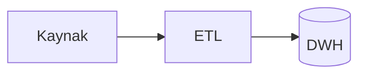
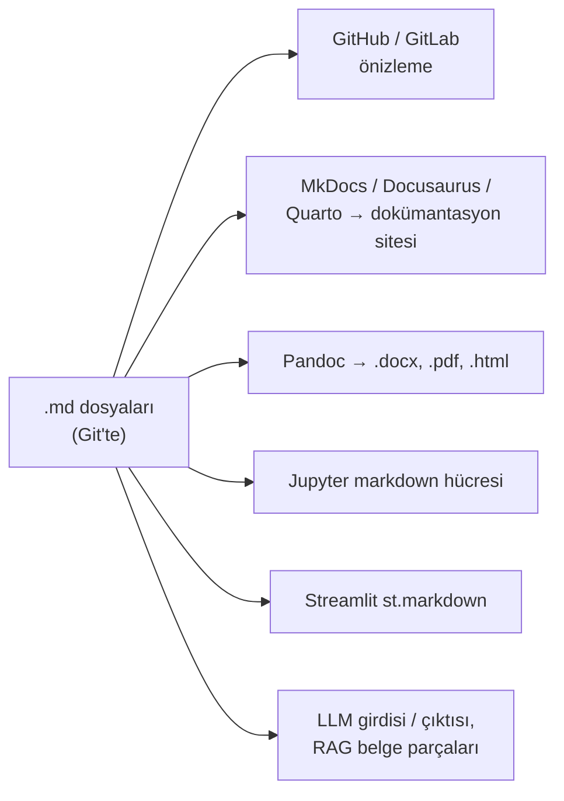

# 16.10 Markdown (.md)

## Nedir?
**Markdown**, düz metne birkaç basit işaret (`#`, `*`, `-`, `` ` ``) ekleyerek başlık, liste, tablo, bağlantı ve kod bloğu yazmayı sağlayan hafif bir **biçimlendirme dilidir** (markup language). Dosya uzantısı `.md`'dir. 2004'te John Gruber tarafından "okunması kolay düz metin, gerektiğinde HTML'e dönüşsün" fikriyle tasarlandı.

İşlenmemiş hâliyle de okunabilir; GitHub, GitLab, VS Code, Jupyter ve birçok araç onu biçimli olarak gösterir. Bu kitabın tüm sayfaları Markdown'dır.

**Lehçeler (flavor):**
| Lehçe | Not |
|---|---|
| **CommonMark** | Belirsizlikleri gideren ortak standart |
| **GFM (GitHub Flavored Markdown)** | CommonMark + tablo, görev listesi, üstü çizili, otomatik link; GitHub'da ek olarak Mermaid diyagramları, matematik ifadeleri ve uyarı kutuları |
| **MyST, Pandoc Markdown, R Markdown / Quarto** | Belge, kitap ve bilimsel yayın için genişletilmiş lehçeler |

## Hangi problemi çözer?
- **Sürüm kontrolüne uygun dokümantasyon:** Word dosyası Git'te ikili (binary) görünür, farkı okunmaz; Markdown satır satır karşılaştırılır, Pull Request'te incelenir ([3.6](../03-git/06-github-pull-request.md)).
- **Kod ile belgeyi bir arada tutmak:** README, kurulum adımları, mimari kararlar kodun yanında yaşar ve güncel kalır.
- **Araç bağımsızlık:** Düz metindir; herhangi bir editörle açılır, yıllar sonra da okunur.
- **Tek kaynaktan çok çıktı:** Aynı dosyadan HTML site, PDF, Word veya sunum üretilebilir.
- **Yapay zekâ ve otomasyon:** LLM'ler hem girdi hem çıktı olarak Markdown'ı iyi işler; RAG için belge parçalarken başlık yapısı doğal sınırlar sunar ([13.12](../13-mlops/12-genai-rag.md)).

## Nasıl çalışır?

**Temel söz dizimi**
| Yazılan | Sonuç |
|---|---|
| `# Başlık 1` / `## Başlık 2` / `### Başlık 3` | Başlık seviyeleri |
| `**kalın**`, `*italik*`, `~~üstü çizili~~` | Vurgu |
| `- madde` veya `1. madde` | Madde işaretli / numaralı liste (girintiyle iç içe) |
| `- [ ] yapılacak`, `- [x] yapıldı` | Görev listesi (GFM) |
| `[metin](https://ornek.com)` | Bağlantı |
| `[9.4](../09-veri-depolama/04-performans.md)` | Repo içi göreli bağlantı |
| `` | Resim |
| `` `kod` `` | Satır içi kod |
| ```` ```python ```` ... ```` ``` ```` | Dil belirtilmiş kod bloğu (renklendirme) |
| `> alıntı` | Alıntı bloğu |
| `---` | Yatay çizgi |
| `\*` | Özel karakteri kaçışla yazmak |

**Tablo (GFM)**
```markdown
| Kalem | Tutar | Değişim |
|:------|------:|:-------:|
| KMH   | 1.250 |  %3,2   |
| Konut | 8.400 |  %1,1   |
```
`:---` sola, `---:` sağa, `:---:` ortaya hizalar. Sayısal sütunları sağa hizalamak okunabilirliği artırır.

**GitHub'a özgü yetenekler**
````markdown


> [!WARNING]
> Prod veritabanında çalıştırmadan önce yedek alın.

Satır içi formül: $PSI = \sum (a_i - e_i) \ln(a_i / e_i)$
````
Mermaid bu kitaptaki tüm diyagramların kaynağıdır; resim dosyası yerine metin olarak tutulduğu için güncellemesi ve Git'te izlenmesi kolaydır.

**Front matter:** Dosyanın en başına `---` arasında YAML ile metadata yazılabilir. Statik site üreticileri ve not araçları (MkDocs, Hugo, Jekyll, Docusaurus, Obsidian) bunu başlık, etiket, tarih gibi bilgiler için okur ([16.6](06-yaml.md)).
```markdown
---
title: BDDK Kredi ETL Çalışma Kılavuzu
sahip: veri-muhendisligi
etiketler: [etl, bddk, runbook]
son_guncelleme: 2026-10-24
---
```

**Markdown nereye dönüşür?**


**Sık hatalar**
- Liste veya kod bloğundan önce **boş satır** bırakmamak: Bazı işleyicilerde biçim bozulur.
- Tablo içinde `|` karakteri: `\|` olarak kaçırılmalı.
- Satır sonu: Tek satır atlaması (Enter) yeni paragraf yapmaz; paragraf için boş satır gerekir.
- Mutlak dosya yolları (`C:\Users\...`): Başkalarında çalışmaz; repo içinde göreli bağlantı kullanın.
- Aynı dosyada çok uzun satırlar: Git farkını okumayı zorlaştırır; cümle başına satır yazmak bir seçenektir.

## Mini örnek
**Bir veri projesi için README iskeleti**
````markdown
# bddk-kredi-etl

BDDK aylık kredi verisini indirip `dwh.bddk_kredi` tablosuna yükler.

## Kurulum
```bash
uv sync
cp .env.example .env    # bağlantı bilgilerini doldurun
```

## Çalıştırma
```bash
uv run python -m etl.main --donem 2026-09
```

## Tablolar
| Tablo | Açıklama | Güncelleme |
|---|---|---|
| `dwh.bddk_kredi` | Kalem bazında aylık tutarlar | Her ayın 5'i |

## Sorumlu
Veri Mühendisliği ekibi
````

**Python ile Markdown üretmek ve dönüştürmek**
```python
import pandas as pd

ozet = pd.DataFrame({"kalem": ["KMH", "Konut"], "tutar": [1250, 8400]})
print(ozet.to_markdown(index=False))          # tabulate paketi gerekir

import markdown                                # pip install markdown
html = markdown.markdown(open("README.md", encoding="utf-8").read(), extensions=["tables"])

import streamlit as st
st.markdown("### Aylık özet\n**KMH** bakiyesi %3,2 arttı.")
```

**Komut satırı araçları**
```bash
pandoc rapor.md -o rapor.docx                         # Word'e
pandoc rapor.md -o rapor.docx --reference-doc=kurum-sablon.docx   # kurum şablonuyla
pandoc rapor.md -o rapor.pdf                          # PDF (LaTeX motoru gerekir)
npx markdownlint-cli "docs/**/*.md"                   # biçim kuralları kontrolü
npx markdown-link-check README.md                     # kırık link kontrolü
```

**Dokümantasyon sitesi (MkDocs)**
```yaml
# mkdocs.yml
site_name: Atlas
theme:
  name: material
  language: tr
nav:
  - Ana sayfa: index.md
  - Veri Depolama:
      - OLTP ve OLAP: 09-veri-depolama/01-oltp-olap.md
markdown_extensions:
  - tables
  - admonition
  - pymdownx.superfences
```
```bash
pip install mkdocs-material
mkdocs serve        # http://127.0.0.1:8000 yerel önizleme
mkdocs build        # site/ klasörüne statik HTML; GitHub Pages veya nginx ile yayınlanır
```
Mermaid diyagramları için `pymdownx.superfences` içinde ayrıca `custom_fences` tanımı gerekir; MkDocs Material belgelerinde hazır örneği bulunur.

## Nerede kullanılır?
- README, CONTRIBUTING, CHANGELOG dosyaları; bu kitap gibi Git tabanlı bilgi kaynakları
- Runbook'lar, mimari karar kayıtları (ADR), postmortem notları
- Jupyter notebook'larda açıklama hücreleri ([16.13](13-model-notebook-formatlari.md))
- Pull Request ve issue açıklamaları
- Streamlit uygulamalarında metin, Grafana panellerinde metin kutuları
- LLM istemleri ve çıktıları, RAG için belge tabanları

## Benzerleri ve farkları
| Format | Not |
|---|---|
| **reStructuredText (.rst)** | Python dokümantasyonunun (Sphinx) geleneksel formatı; daha güçlü ama daha karmaşık |
| **AsciiDoc (.adoc)** | Kitap ve teknik belge için zengin özellikler |
| **HTML** | Markdown'ın genellikle dönüştürüldüğü hedef; doğrudan yazmak zahmetli |
| **Word (.docx)** | Biçim zengin, iş birimleri için alışılmış; Git'te farkı izlenemez |
| **Wiki söz dizimi (Confluence)** | Kurum içi wiki'ler; çoğu Markdown içe aktarmayı destekler |
| **Notion / Obsidian** | Markdown tabanlı veya Markdown dışa aktarabilen not araçları |

## İlgili sayfalar
- [16.1 Formatlara genel bakış](01-genel-bakis.md)
- [16.6 YAML](06-yaml.md)
- [3.6 GitHub ve Pull Request](../03-git/06-github-pull-request.md)
- [12.5 Streamlit](../12-bi/05-streamlit.md)
