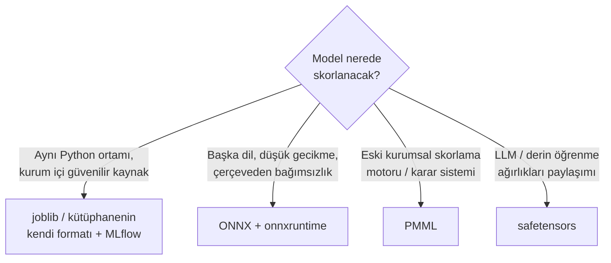

# 16.13 Model ve Notebook Formatları: pickle, joblib, ONNX, PMML, .ipynb

## Nedir?
Veri bilimi projelerinde tablo verisi dışında iki tür dosya sürekli üretilir:
1. **Model dosyaları:** Eğitilmiş bir modelin parametrelerini (ve bazen kodunu) saklayan dosyalar. Eğitimden sonra kaydedilir, skorlama ortamında yüklenir ([13.3](../13-mlops/03-model-serving.md)).
2. **Notebook dosyaları (`.ipynb`):** Jupyter'in kod hücrelerini, açıklamaları (Markdown) ve **çıktıları** (tablolar, grafikler) tek dosyada tutan JSON formatı.

| Format | Ne saklar? | Kim kullanır? |
|---|---|---|
| **pickle** (`.pkl`) | Herhangi bir Python nesnesi | Python; scikit-learn, pandas |
| **joblib** (`.joblib`) | pickle + büyük NumPy dizileri için verimli saklama | scikit-learn'ün önerdiği yol |
| **skops** (`.skops`) | scikit-learn modelleri, güvenli yükleme | Güvenlik önemli olduğunda |
| **ONNX** (`.onnx`) | Hesaplama grafiği; çerçeveden bağımsız | Farklı dil ve platformlarda skorlama |
| **PMML** (`.pmml`) | XML tabanlı model tanımı | Eski skorlama motorları, SAS/SPSS, kurumsal karar sistemleri |
| **Model kütüphanesinin kendi formatı** | XGBoost `.json`/`.ubj`, LightGBM `.txt`, CatBoost `.cbm` | Aynı kütüphaneyle yükleme; sürümler arası daha dayanıklı |
| **PyTorch** (`.pt`, `.pth`) | Tensörler ve (pickle ile) nesneler | Derin öğrenme |
| **safetensors** (`.safetensors`) | Sadece tensörler; kod çalıştırmaz | Hugging Face, LLM ağırlıkları |
| **Keras** (`.keras`, eski `.h5`) | Model mimarisi + ağırlıklar | TensorFlow/Keras |
| **MLflow model** (klasör + `MLmodel` dosyası) | Model + ortam bilgisi + imza + yükleme talimatı | MLflow Registry ve serving ([13.2](../13-mlops/02-mlflow.md)) |
| **Jupyter notebook** (`.ipynb`) | Hücreler, çıktılar, metadata (JSON) | Keşifsel analiz, raporlama, eğitim |

## Hangi problemi çözer?
- Modeli eğitimden **skorlama ortamına** taşımak (batch skorlama, API, başka dilde yazılmış uygulama)
- Model **sürümlerini** saklamak ve denetimde "hangi modelle skorlandı" sorusunu yanıtlamak
- Farklı platformlar arası taşınabilirlik (Python'da eğit, Java/C# veya veritabanı içinde skorla)
- Analizi kodu, açıklaması ve sonuçlarıyla birlikte paylaşmak (notebook)

## Nasıl çalışır?

**Format seçimi**


**pickle'ın güvenlik riski:** pickle dosyası yüklenirken **içinde gömülü Python kodunu çalıştırabilir**. Güvenilmeyen bir kaynaktan gelen `.pkl`, `.joblib` veya eski tip `.pt` dosyasını yüklemek, o dosyayı hazırlayanın bilgisayarınızda istediği komutu çalıştırması demektir.
- Sadece kendi ürettiğiniz veya güvenilir model deposundan (MLflow Registry, kurum içi artifact deposu) gelen dosyaları yükleyin.
- Dışarıdan gelen modeller için kod çalıştırmayan formatlar: ONNX, safetensors, skops, kütüphanelerin JSON formatları.
- PyTorch 2.6'dan itibaren `torch.load` varsayılan olarak `weights_only=True` ile çalışır; bu ayarı kapatmayın.

**Sürüm uyumluluğu:** pickle/joblib dosyası, onu üreten kütüphane sürümlerine (scikit-learn, NumPy, pandas) sıkı bağlıdır. scikit-learn 1.3 ile kaydedilen model 1.6'da uyarı verebilir veya hatalı çalışabilir. Bu yüzden model dosyasıyla birlikte **ortam bilgisi** (`requirements.txt`, `pyproject.toml`, conda ortamı) saklanmalıdır; MLflow bunu otomatik yapar ([2.5](../02-python-ortam/05-bagimlilik-dosyalari.md)).

**Önişleme dahil mi?** Modelin beklediği özellik dönüşümleri (kodlama, ölçekleme, eksik değer doldurma) modelle birlikte kaydedilmezse skorlama ortamında farklı uygulanır ve sessizce yanlış skorlar üretilir. scikit-learn `Pipeline` ile önişleme ve modeli tek nesnede saklamak bu riski azaltır.

**Notebook dosyasının içi**
```json
{
  "cells": [
    {"cell_type": "markdown", "source": ["# Kredi skoru analizi"]},
    {"cell_type": "code", "execution_count": 3,
     "source": ["df.head()"],
     "outputs": [{"output_type": "execute_result", "data": {"text/html": ["<table>...müşteri verisi...</table>"]}}]}
  ],
  "metadata": {"kernelspec": {"name": "python3"}},
  "nbformat": 4, "nbformat_minor": 5
}
```
**Notebook sorunları ve çözümleri**
| Sorun | Çözüm |
|---|---|
| Çıktılar içinde **gerçek müşteri verisi** Git'e gider | `nbstripout` ile commit öncesi çıktıları temizlemek ([15.9](../15-guvenlik/09-maskeleme-kvkk.md)) |
| Git farkları okunmaz (JSON + base64 resimler) | `nbdime` ile notebook farkı, `jupytext` ile eşlenik `.py` dosyası |
| Hücreler karışık sırayla çalıştırılmış, sonuç tekrarlanamaz | "Restart & Run All" ile doğrulamak; üretim kodunu `.py` modüllere taşımak |
| Notebook'u zamanlanmış job olarak çalıştırmak | `papermill` ile parametreli çalıştırma veya kodu script'e çevirmek |
| Paylaşım | `nbconvert` ile HTML/PDF rapor |

## Mini örnek
**scikit-learn: Pipeline ile kaydet/yükle**
```python
import joblib
from sklearn.pipeline import Pipeline
from sklearn.preprocessing import StandardScaler
from sklearn.linear_model import LogisticRegression

model = Pipeline([("olcek", StandardScaler()), ("lr", LogisticRegression(max_iter=1000))])
model.fit(X_train, y_train)

joblib.dump(model, "pd_model_v3.joblib")              # sadece güvenilir ortamda yükleyin
model = joblib.load("pd_model_v3.joblib")
```

**Kütüphanenin kendi formatı (XGBoost / LightGBM)**
```python
xgb_model.save_model("pd_xgb_v3.json")                # pickle değil, sürümler arası daha dayanıklı
yeni = xgboost.XGBClassifier(); yeni.load_model("pd_xgb_v3.json")

lgb_model.booster_.save_model("pd_lgb_v3.txt")
booster = lightgbm.Booster(model_file="pd_lgb_v3.txt")
```

**ONNX'e çevirip başka ortamda skorlama**
```python
from skl2onnx import to_onnx                          # pip install skl2onnx onnxruntime
import onnxruntime as ort
import numpy as np

onx = to_onnx(model, X_train[:1].astype(np.float32))
open("pd_model_v3.onnx", "wb").write(onx.SerializeToString())

oturum = ort.InferenceSession("pd_model_v3.onnx")
girdi_adi = oturum.get_inputs()[0].name
skorlar = oturum.run(None, {girdi_adi: X_test.astype(np.float32)})
```
ONNX Runtime; Python, Java, C#, C++ ve JavaScript'ten kullanılabilir. Çevirmeden sonra skorları orijinal modelle karşılaştırıp küçük sayısal farkları kontrol edin.

**PMML (kurumsal skorlama motorları için)**
```python
from sklearn2pmml import sklearn2pmml                 # Java gerektirir
from sklearn2pmml.pipeline import PMMLPipeline

pmml_pipe = PMMLPipeline([("lr", LogisticRegression())]).fit(X_train, y_train)
sklearn2pmml(pmml_pipe, "pd_model_v3.pmml")
```

**MLflow ile model + ortam + imza**
```python
import mlflow
from mlflow.models import infer_signature

with mlflow.start_run():
    mlflow.sklearn.log_model(model, name="pd_model",
                             signature=infer_signature(X_train, model.predict_proba(X_train)),
                             registered_model_name="kurumsal_pd")
yuklu = mlflow.pyfunc.load_model("models:/kurumsal_pd/3")
```
Eski MLflow sürümlerinde `name=` yerine `artifact_path=` parametresi kullanılır.

**Notebook araçları**
```bash
pip install nbstripout jupytext nbdime papermill
nbstripout --install                                  # bu repoda commit öncesi çıktıları otomatik temizle
jupytext --set-formats ipynb,py:percent analiz.ipynb  # .ipynb ile eşlenik okunabilir .py
nbdime diff eski.ipynb yeni.ipynb
jupyter nbconvert --to html --no-input rapor.ipynb    # kodu gizleyip HTML rapor
papermill sablon.ipynb cikti_2026_09.ipynb -p donem 2026-09
```

**Diğer bilimsel dosyalar**
| Uzantı | Not |
|---|---|
| `.npy` / `.npz` | NumPy dizileri (`np.save`, `np.savez_compressed`); `allow_pickle=False` ile güvenli yükleme |
| `.feather` / `.arrow` | pandas/Arrow arasında çok hızlı ara dosya ([16.9](09-digerleri.md)) |
| `.h5` / `.hdf5` | Büyük, hiyerarşik bilimsel veri; pandas `HDFStore` |
| `.rds` / `.RData` | R nesneleri; Python'dan `pyreadr` ile |
| `.sas7bdat`, `.sav`, `.dta` | SAS, SPSS, Stata veri dosyaları: `pd.read_sas`, `pd.read_spss`, `pd.read_stata` |

## Nerede kullanılır?
- Kredi skoru, erken uyarı, churn modellerinin canlıya alınması ve model envanteri
- Model risk yönetimi ve validasyon: modelin, ortamın ve eğitim verisinin birlikte saklanması
- Farklı platformlarda skorlama (Java tabanlı çekirdek sistemler, karar motorları)
- Analizlerin notebook olarak paylaşımı ve aylık parametreli raporlar

## Benzerleri ve farkları
- **Feature store ve model registry:** Dosya formatı modelin nasıl saklandığını, registry ise hangi sürümün nerede kullanıldığını yönetir ([13.6](../13-mlops/06-feature-store-nedir.md), [13.2](../13-mlops/02-mlflow.md)).
- **Container image:** Model + kod + ortamın tamamını paketlemenin en taşınabilir yolu ([4.1](../04-docker/01-docker-nedir.md)).
- **Kod olarak model (SQL skorlama):** Lojistik regresyon gibi basit modeller katsayılarıyla SQL ifadesine çevrilip doğrudan veritabanında skorlanabilir.

## İlgili sayfalar
- [13.2 MLflow](../13-mlops/02-mlflow.md)
- [13.3 Model serving](../13-mlops/03-model-serving.md)
- [16.3 JSON](03-json.md)
- [16.10 Markdown](10-markdown.md)
