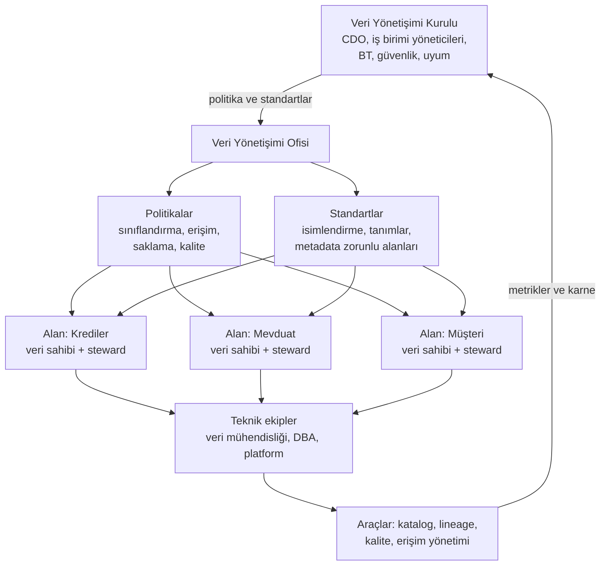

# 16.1 Veri Yönetişimi Nedir: Çerçeve, Roller ve Politikalar

## Nedir?
**Veri yönetişimi (data governance)**, kurumdaki verinin **doğru, güvenilir, güvenli, anlaşılır ve kurallara uygun** biçimde yönetilmesi için tanımlanan **roller, politikalar, standartlar, süreçler ve araçların** bütünüdür. Kısaca: "Kim, hangi veriden, hangi kurallarla sorumlu ve bunu nasıl kanıtlıyoruz?" sorusunun cevabıdır.

Yönetişim tek bir araç veya proje değil, sürekli işleyen bir **işletim modelidir**. Bu bölüm onun yapı taşlarını sırayla ele alır:

| Yapı taşı | Sorduğu soru | Sayfa |
|---|---|---|
| **Metadata ve katalog** | Hangi veri var, ne anlama geliyor, nerede? | [16.2](02-katalog-metadata.md) |
| **Lineage** | Nereden geliyor, nereye gidiyor, değişirse ne etkilenir? | [16.3](03-lineage.md), [16.4](04-openlineage-datahub.md) |
| **Sahiplik** | Kimden sorulur, kim onaylar, kim düzeltir? | [16.5](05-sahiplik-data-contract.md) |
| **Sınıflandırma** | Ne kadar hassas, hangi kurallara tabi? | [16.6](06-siniflandirma.md) |
| **Erişim politikaları** | Kim görebilir, hangi koşulla, kim onayladı? | [16.7](07-erisim-politikalari.md) |
| **Kalite** | Ne kadar doğru ve güncel, kurallar sağlanıyor mu? | [16.8](08-kalite-yonetimi.md), [16.9](09-kalite-araclari.md) |

## Hangi problemi çözer?
- **"Bu rakam nereden geliyor?"** Yönetime veya düzenleyiciye sunulan bir KPI'nın kaynağı, hesaplama adımları ve sorumlusu bulunamaz.
- **"Hangi tabloyu kullanmalıyım?"** Aynı isimli beş tablo var; hangisi güncel ve resmî?
- **"Aynı kavram, farklı rakam":** "Aktif müşteri" tanımı pazarlama, risk ve finans raporlarında farklı; toplantılar rakam tartışmasıyla geçer.
- **"Bu sütunu değiştirirsem ne bozulur?"** Kaynak tablo değişince hangi raporlar ve modeller etkilenir? (etki analizi)
- **"Hassas veri nerede, kim erişiyor?"** TCKN, kart numarası, maaş bilgisi hangi tablolarda? (KVKK, [15.9](../15-guvenlik/09-maskeleme-kvkk.md))
- **Düzenleyici beklentiler:** Bankalarda risk verisinin toplanması ve raporlanmasında doğruluk, tamlık, zamanlılık ve izlenebilirlik (BCBS 239); kişisel verilerin envanteri ve korunması (KVKK); denetimde "bu rapor hangi veriyle üretildi" sorusu.

## Nasıl çalışır?

**İşletim modeli**


**Roller**
| Rol | Sorumluluk |
|---|---|
| **CDO (Chief Data Officer) / Veri Yönetişimi Ofisi** | Strateji, politika, standart, önceliklendirme, kurula raporlama |
| **Veri sahibi (data owner)** | İş biriminden üst düzey kişi; verinin tanımından, kalitesinden ve erişim onayından **hesap verir** |
| **Veri sorumlusu (data steward)** | Günlük yönetim: iş tanımları, kalite kuralları, katalog bilgilerinin güncelliği, sorunların takibi |
| **Teknik sorumlu (data custodian)** | Saklama, güvenlik, yedekleme, akışların çalışması (veri mühendisliği, DBA) |
| **Veri kullanıcısı (consumer)** | Kurallara uygun kullanım, kalite sorunlarını bildirme |
| **Bilgi güvenliği, KVKK ve uyum** | Sınıflandırma ve erişim politikalarının denetimi |

Roller ve sorumluluklar [16.5](05-sahiplik-data-contract.md)'te RACI ile ayrıntılandırılır.

**Politika katmanları**
| Politika | İçerik örneği |
|---|---|
| **Veri sınıflandırma politikası** | Genel / Kuruma özel / Gizli / Çok gizli seviyeleri ve her birinin kuralları ([16.6](06-siniflandirma.md)) |
| **Erişim politikası** | Kim, hangi onayla, ne kadar süreyle erişir; periyodik gözden geçirme ([16.7](07-erisim-politikalari.md)) |
| **Veri kalitesi politikası** | Kritik veri öğeleri için zorunlu kurallar, eşikler, sorun çözüm süreleri ([16.8](08-kalite-yonetimi.md)) |
| **Saklama ve imha politikası** | Hangi veri ne kadar saklanır, nasıl silinir/anonimleştirilir |
| **Metadata standardı** | Her tablo için zorunlu alanlar: açıklama, sahip, sınıf, güncelleme sıklığı |
| **İsimlendirme standardı** | Şema, tablo, sütun adlandırma kuralları (`dwh.fct_kredi_aylik`, `_tarih`, `_tutar` son ekleri) |

**Kritik veri öğeleri (CDE, Critical Data Elements):** Her sütunu aynı titizlikle yönetmek mümkün değildir. Düzenleyici raporlar, yönetim KPI'ları ve risk modelleri için kritik olan alanlar (ör. kredi bakiyesi, gecikme gün sayısı, risk sınıfı, müşteri segmenti) belirlenir; tanım, sahiplik, lineage ve kalite kuralları önce bunlar için zorunlu tutulur.

**BCBS 239 (Etkin Risk Verisi Toplama ve Risk Raporlama İlkeleri):** Basel Komitesi'nin, özellikle sistemik önemli bankalardan beklediği ilkelerdir. Yönetişim ve altyapı, verinin doğruluğu ve bütünlüğü, tamlığı, zamanlılığı, uyarlanabilirliği ve raporların doğruluğu gibi başlıklar içerir. Pratikteki karşılığı: kritik risk verilerinin sahipliği, lineage'i, kalite kontrolleri ve mutabakatlarının belgelenmiş ve kanıtlanabilir olması.

**Olgunluk yolculuğu**
| Seviye | Durum |
|---|---|
| 1. Başlangıç | Bilgi kişilerin kafasında; Excel envanterleri, e-postayla onay |
| 2. Tanımlı | Politikalar yazıldı, roller atandı, kritik tablolar katalogda |
| 3. Yönetilen | Katalog ve lineage otomatik toplanıyor, kalite kuralları düzenli çalışıyor, erişim talepleri iş akışında |
| 4. Ölçülen | Yönetişim metrikleri (katalog kapsama oranı, kalite skoru, sorun çözüm süresi) kurula raporlanıyor |
| 5. Gömülü | Kurallar platformda kod olarak; yeni veri ürünü yönetişim kontrollerinden geçmeden yayına çıkamıyor |

## Mini örnek
**Bir kritik veri öğesinin yönetişim kartı**
```yaml
cde: kredi_bakiye_tl
tanim: "Ay sonu itibarıyla nakdi kredi anapara bakiyesi, TL karşılığı (tahakkuk etmiş faiz hariç)"
glossary_terim: "Nakdi Kredi Bakiyesi"
veri_sahibi: "Kredi Riski Yönetimi Daire Başkanı"
steward: "Kredi Raporlama Ekibi"
teknik_sorumlu: "Veri Mühendisliği - Kredi Alanı"
siniflandirma: "Kuruma Özel"
kaynak_sistem: "core.kredi_hesap"
hedef_tablolar: ["dwh.fct_kredi_aylik", "gold.kredi_metrik"]
kullanildigi_raporlar: ["BDDK aylık raporu", "Yönetim kredi paneli", "Erken uyarı modeli"]
kalite_kurallari:
  - "Boş olamaz"
  - "Negatif olamaz"
  - "Muhasebe (GL) bakiyesiyle mutabakat farkı ±%0,1 içinde"
guncelleme: "Her ayın ilk iş günü 07:00'ye kadar"
saklama: "10 yıl"
```

**Yönetişim metrikleri (kurula giden karne)**
```sql
SELECT
    COUNT(*) FILTER (WHERE aciklama IS NOT NULL)::float / COUNT(*)   AS aciklama_kapsama,
    COUNT(*) FILTER (WHERE sahip_birim IS NOT NULL)::float / COUNT(*) AS sahiplik_kapsama,
    COUNT(*) FILTER (WHERE siniflandirma IS NOT NULL)::float / COUNT(*) AS siniflandirma_kapsama
FROM yonetisim.veri_katalogu
WHERE katman IN ('silver', 'gold');
```

## Nerede kullanılır?
- Düzenleyici raporlama ve iç/dış denetim: "bu rakamın denetim izi"
- Self-servis analitik: analistlerin doğru ve onaylı veriyi bulması
- KVKK: kişisel veri envanteri, hassas alanların etiketlenmesi ve erişim takibi
- Veri göçleri, yeni çekirdek sistem projeleri, birleşme ve devralmalar
- Yapay zekâ projeleri: model eğitiminde kullanılan verinin izinli, doğru ve izlenebilir olması

## Benzerleri ve farkları
- **Veri yönetişimi ile veri yönetimi (data management):** Yönetişim kuralları ve sorumlulukları belirler; veri yönetimi bu kurallara göre teknik işleri (depolama, entegrasyon, kalite kontrolleri) yapar.
- **DAMA-DMBOK:** Veri yönetimi alanlarını (yönetişim, mimari, kalite, metadata, güvenlik, MDM...) tanımlayan yaygın başvuru çerçevesi.
- **Master Data Management (MDM):** Müşteri, ürün gibi ana verilerin kurum genelinde tek ve tutarlı kaydını (golden record) oluşturma disiplini; yönetişimin bir alt alanı.
- **Bilgi güvenliği:** Verinin gizliliği, bütünlüğü ve erişilebilirliğine odaklanır; yönetişim ise bunlara ek olarak anlam, sahiplik ve kaliteyle ilgilenir ([15.1](../15-guvenlik/01-authn-authz.md)).
- **Data mesh:** Yönetişimi merkezi bir ekip yerine alan ekiplerine dağıtan, ortak standartlarla ("federe yönetişim") çalışan yaklaşım ([16.5](05-sahiplik-data-contract.md)).

## İlgili sayfalar
- [16.2 Veri kataloğu ve metadata yönetimi](02-katalog-metadata.md)
- [16.6 Veri sınıflandırma](06-siniflandirma.md)
- [16.8 Veri kalitesi yönetimi](08-kalite-yonetimi.md)
- [15.9 Maskeleme ve KVKK](../15-guvenlik/09-maskeleme-kvkk.md)
