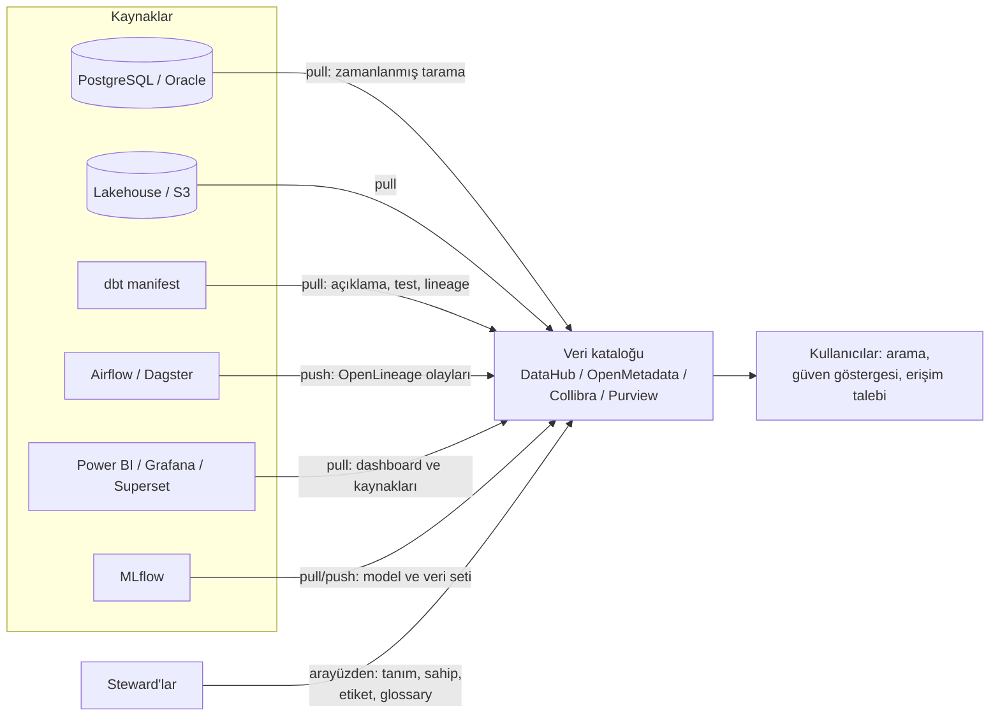

# 16.2 Veri Kataloğu ve Metadata Yönetimi

## Nedir?
- **Metadata (üst veri)**, "veri hakkındaki veri"dir: tablonun açıklaması, sütunların anlamı, sahibi, hassasiyet sınıfı, ne zaman ve nasıl güncellendiği, kalite durumu, kimlerin kullandığı.
- **Veri kataloğu (data catalog)**, kurumdaki veri varlıklarının (tablolar, view'lar, dosyalar, dashboard'lar, modeller, API'ler) metadata'sıyla birlikte toplandığı, **aranabilir envanterdir**. "Veri için arama motoru" olarak düşünülebilir.
- **İş sözlüğü (business glossary)**, kurumun iş terimlerinin ("aktif müşteri", "takipteki kredi", "nakdi risk") resmî tanımlarını tutan ve bu terimleri teknik sütunlara bağlayan sözlüktür.

## Hangi problemi çözer?
- Analistin doğru tabloyu bulmak için haftalarca kişilere sorması
- Aynı terimin farklı birimlerde farklı tanımlanması ve "hangisi doğru" tartışmaları
- Bilginin kişilerde kalması: tabloyu kuran kişi ayrılınca anlamının kaybolması
- Hassas verinin nerede olduğunun bilinmemesi
- Kullanılmayan, kopya ve terk edilmiş tabloların birikmesi (maliyet ve risk)

## Nasıl çalışır?

**Metadata türleri**
| Tür | Örnek | Nereden gelir? |
|---|---|---|
| **Teknik** | Şema, sütun adı ve tipi, satır sayısı, boyut, partition, son güncelleme | Veritabanı sistem katalogları, otomatik tarama |
| **İş (business)** | Açıklama, iş tanımı, hesaplama formülü, glossary terimi, sahip | Steward'lar, dbt `description`, dokümantasyon |
| **Operasyonel** | Yükleme süresi, başarılı/başarısız çalışmalar, kalite test sonuçları, tazelik | Orkestratör, kalite araçları, lineage olayları |
| **Kullanım** | Kim, ne sıklıkla sorguluyor; hangi dashboard kullanıyor | Sorgu logları, BI aracı API'leri |
| **Yönetişim** | Sınıflandırma, saklama süresi, erişim politikası, KVKK işleme amacı | Politikalar, sınıflandırma araçları |

**Katalog nasıl dolar? Push ve pull**

- **Pull (çekme):** Katalog, kaynaklara bağlanıp metadata'yı belirli aralıklarla tarar. Kurulumu kolaydır ama değişiklikleri gecikmeli görür.
- **Push (itme):** Kaynak sistem veya pipeline, her çalışmada metadata olayını kataloğa gönderir. Güncel ve olay bazlıdır (OpenLineage, [16.4](04-openlineage-datahub.md)).

**İyi bir katalog kaydında ne olmalı?**
| Alan | Neden? |
|---|---|
| Açıklama (iş dilinde) | "Bu tablo ne işe yarar?" sorusunun cevabı |
| Sahip ve steward | Soru ve onay için kime gidileceği |
| Güncelleme sıklığı ve tazelik | Verinin ne kadar güncel olduğu |
| Sınıflandırma ve etiketler | Hangi kurallara tabi olduğu ([16.6](06-siniflandirma.md)) |
| Glossary terimleri | İş kavramıyla bağlantısı |
| Kalite durumu | Son kalite kontrolleri geçti mi ([16.8](08-kalite-yonetimi.md)) |
| Lineage | Kaynağı ve kullanıldığı yerler ([16.3](03-lineage.md)) |
| Sertifikasyon | "Onaylı / resmî kaynak" rozeti; aynı veriyi içeren diğer kopyalardan ayırır |
| Örnek sorgular ve kullanım | En çok kim kullanıyor, nasıl sorgulanıyor |

**Metadata'yı kodda tutmak (metadata as code):** Açıklamaları ve sahiplik bilgisini dbt `schema.yml` dosyalarında, tablo yorumlarında (`COMMENT ON`) veya YAML dosyalarında tutup Git'te yönetmek; katalog bunları otomatik okur. Böylece metadata kod incelemesinden (PR) geçer ve kodla birlikte güncel kalır.

**Sık hatalar**
- Kataloğu bir kerelik "envanter projesi" olarak doldurup bırakmak: birkaç ay içinde güncelliğini yitirir. Otomatik toplama + sahiplik + metrikler şarttır.
- Her şeyi kataloğa almak: Önce kritik ve paylaşılan varlıklarla (gold katman, raporların kaynakları, CDE'ler) başlamak daha etkilidir.
- Sadece teknik metadata: Sütun adları ve tipleri tek başına "bu ne anlama geliyor?" sorusunu cevaplamaz.

## Mini örnek
**Veritabanında açıklama (tüm araçların okuduğu en basit metadata)**
```sql
COMMENT ON TABLE dwh.fct_kredi_aylik IS
  'Aylık, kalem bazında nakdi kredi bakiyeleri. Kaynak: core.kredi_hesap. Sahip: Kredi Riski. Güncelleme: ayın ilk iş günü.';
COMMENT ON COLUMN dwh.fct_kredi_aylik.bakiye_tl IS
  'Ay sonu anapara bakiyesi, TL karşılığı; tahakkuk etmiş faiz hariç. Glossary: Nakdi Kredi Bakiyesi';
```

**dbt ile metadata ve sahiplik**
```yaml
models:
  - name: fct_kredi_aylik
    description: "Aylık kalem bazında kredi bakiyesi ve MoM/YoY değişimleri. Yönetim kredi panelinin kaynağı."
    config:
      meta:
        sahip: "kredi-riski"
        steward: "kredi-raporlama"
        siniflandirma: "kuruma_ozel"
        guncelleme: "her ayın ilk iş günü 07:00"
        sertifikali: true
    columns:
      - name: bakiye_tl
        description: "Ay sonu anapara bakiyesi (TL)"
        config:
          meta: { glossary_terim: "Nakdi Kredi Bakiyesi", cde: true }
```
```bash
dbt docs generate && dbt docs serve      # açıklamalar + lineage grafiği; katalog araçları manifest.json'u okur
```
Eski dbt sürümlerinde `meta` doğrudan model altında da yazılabilir; yeni sürümler `config.meta` biçimini önerir.

**Katalog aracı yoksa başlangıç: metadata tablosu**
```sql
CREATE TABLE yonetisim.veri_katalogu (
    tablo            text PRIMARY KEY,                -- 'gold.kredi_metrik'
    katman           text CHECK (katman IN ('bronze', 'silver', 'gold')),
    aciklama         text,
    sahip_birim      text,
    steward          text,
    siniflandirma    text CHECK (siniflandirma IN ('genel', 'kuruma_ozel', 'gizli', 'cok_gizli')),
    kisisel_veri     boolean DEFAULT false,
    kaynak_tablolar  text[],
    guncelleme       text,
    saklama_suresi   interval,
    sertifikali      boolean DEFAULT false,
    son_guncelleme   timestamptz DEFAULT now()
);

-- Teknik metadata'yı sistem kataloğundan otomatik doldurmak
INSERT INTO yonetisim.veri_katalogu (tablo, katman, aciklama)
SELECT n.nspname || '.' || c.relname, n.nspname, obj_description(c.oid)
FROM pg_class c JOIN pg_namespace n ON n.oid = c.relnamespace
WHERE c.relkind IN ('r', 'p', 'v', 'm') AND n.nspname IN ('bronze', 'silver', 'gold')
ON CONFLICT (tablo) DO UPDATE SET aciklama = COALESCE(EXCLUDED.aciklama, veri_katalogu.aciklama);
```

**İş sözlüğü kaydı**
```yaml
terim: "Takipteki Kredi"
tanim: "Anapara veya faiz ödemesi 90 günden fazla geciken ya da tahsili şüpheli hâle gelen kredi."
kaynak: "İlgili düzenleyici mevzuat ve kurum içi kredi politikası"
sahip: "Kredi Riski Yönetimi"
esanlamlilar: ["NPL", "Donuk alacak"]
iliskili_sutunlar:
  - dwh.fct_kredi_aylik.takip_flag
  - gold.kredi_metrik.npl_orani
hesaplama: "npl_orani = takipteki_bakiye / toplam_nakdi_bakiye"
```

## Nerede kullanılır?
- Self-servis BI ve analitik ekipleri için veri keşfi
- Yeni başlayan analist ve veri bilimcilerin uyum süreci
- Düzenleyici raporların tanımlarının belgelenmesi
- KVKK kişisel veri envanteri ve VERBİS kayıtlarının teknik tarafla eşleştirilmesi
- Platform temizliği: kullanılmayan tabloları bulup kaldırmak
- RAG ve yapay zekâ asistanları için "hangi tablo ne anlama geliyor" bilgisinin kaynağı

## Benzerleri ve farkları
| Araç | Not |
|---|---|
| **DataHub** | Açık kaynak; geniş konnektör seti, olay tabanlı mimari, lineage ve glossary ([16.4](04-openlineage-datahub.md)) |
| **OpenMetadata** | Açık kaynak; katalog + kalite + gözlemlenebilirlik tek arayüzde |
| **Amundsen, Apache Atlas** | Daha eski açık kaynak kataloglar; Atlas Hadoop ekosisteminde yaygındı |
| **Collibra, Alation, Informatica CDGC** | Kurumsal ticari yönetişim ve katalog platformları; iş akışları, politika yönetimi güçlü |
| **Microsoft Purview, Google Dataplex, AWS Glue Data Catalog / DataZone** | Bulut platformlarına gömülü katalog ve yönetişim |
| **Unity Catalog (Databricks), Snowflake Horizon** | Veri platformuna gömülü katalog + erişim kontrolü + lineage |
| **dbt docs / dbt Explorer** | dbt projesi kapsamında açıklama ve lineage |

- **Veri sözlüğü (data dictionary):** Genellikle tek bir sistemin tablo/sütun açıklamalarıdır; katalog ise kurum genelini ve iş bağlamını kapsar.
- **Semantik katman:** Metriklerin (KPI) hesaplama tanımını tek yerde tutar ve BI araçlarına sunar; katalogla birlikte "tek doğru tanım"ı destekler ([12.1](../12-bi/01-bi-nedir.md)).

## İlgili sayfalar
- [16.1 Veri yönetişimi nedir](01-veri-yonetisimi-nedir.md)
- [16.3 Data lineage](03-lineage.md)
- [16.4 OpenLineage ve DataHub](04-openlineage-datahub.md)
- [11.4 dbt](../11-veri-akisi/04-dbt.md)
