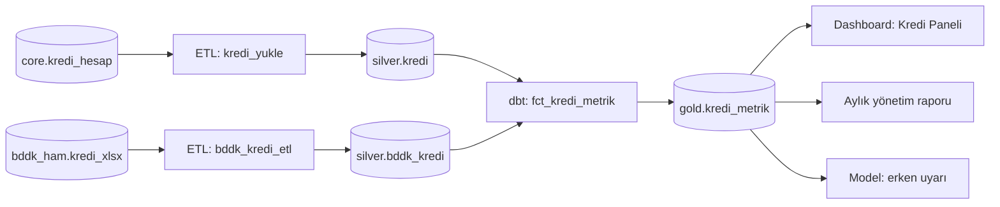
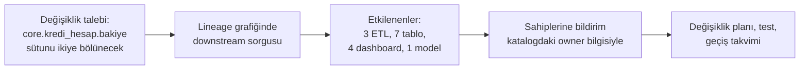

# 16.3 Data Lineage ve Etki Analizi

## Nedir?
**Data lineage (veri soy ağacı)**, bir verinin **nereden geldiğini, hangi dönüşümlerden geçtiğini ve nereye gittiğini** gösteren haritadır. Kaynak sistemden başlayıp ETL/ELT adımları, ara tablolar, metrikler, dashboard'lar ve modellere kadar uzanır.

İki yönde okunur:
- **Geriye doğru (upstream):** "Bu rapordaki rakam hangi kaynaklardan, hangi hesaplamayla geldi?" → kök neden analizi, denetim izi
- **İleriye doğru (downstream):** "Bu kaynak sütunu değiştirirsem veya bu ETL bozulursa nereler etkilenir?" → **etki analizi**

## Hangi problemi çözer?
- **Denetim ve düzenleyici izlenebilirlik:** Bir düzenleyici rapordaki rakamın kaynağa kadar izlenebilmesi (BCBS 239, iç denetim)
- **Kök neden analizi:** Dashboard'da yanlış rakam görüldüğünde hatanın hangi adımda oluştuğunu bulmak
- **Değişiklik yönetimi:** Çekirdek sistemde bir sütun adı veya anlamı değişmeden önce etkilenen raporları ve sahiplerini bilmek
- **Olay yönetimi:** Gece ETL'i başarısız olduğunda hangi raporların ve modellerin bayat veriyle çalışacağını görmek ve kullanıcıları önceden uyarmak
- **Hassasiyetin yayılması:** Kişisel veri içeren bir sütundan türetilen alanların da etiketlenmesi
- **Temizlik:** Hiçbir yere akmayan (kullanılmayan) tabloları ve job'ları bulmak

## Nasıl çalışır?

**Lineage seviyeleri**

| Seviye | Ne gösterir? | Örnek soru |
|---|---|---|
| **Tablo (dataset) seviyesi** | Hangi tablo hangisinden besleniyor | "`gold.kredi_metrik` neye bağlı?" |
| **Sütun (column) seviyesi** | Hangi sütun hangi kaynak sütunlardan, hangi dönüşümle türetildi | "`npl_orani` hangi alanlardan hesaplanıyor?" |
| **İş (business) seviyesi** | Rapordaki KPI ↔ glossary terimi ↔ teknik tablo | "Yönetim raporundaki 'takip oranı' hangi tanıma dayanıyor?" |
| **Çalışma (run) seviyesi** | Belirli bir çalıştırmanın hangi veri sürümünü okuyup yazdığı | "Eylül raporu hangi yüklemenin verisiyle üretildi?" |

**Lineage nasıl toplanır?**
| Yöntem | Nasıl? | Artı | Eksi |
|---|---|---|---|
| **SQL ayrıştırma (parsing)** | View, procedure, dbt ve sorgu loglarındaki SQL analiz edilir | Kod değişikliği gerekmez; sütun seviyesine inebilir | Dinamik SQL, Python dönüşümleri görünmez |
| **Çalışma zamanı olayları** | Orkestratör ve motorlar her çalışmada "şunu okudum, şunu yazdım" olayı gönderir (**OpenLineage**) | Gerçekte olanı gösterir, run seviyesi | Her araçta entegrasyon gerekir ([16.4](04-openlineage-datahub.md)) |
| **Araç metadata'sı** | dbt manifest, BI aracının veri kaynağı bilgisi, ETL aracının tasarım dosyaları | Kolay, zengin | Sadece o aracın kapsamı |
| **Elle tanımlama** | Excel, wiki veya katalog arayüzünden | Her şeyi kapsayabilir | Hızla eskir; sadece boşlukları doldurmak için |

Gerçek hayatta bu yöntemler birlikte kullanılır ve katalogda tek bir grafikte birleştirilir.

**Lineage ile etki analizi süreci**


**Lineage ve gözlemlenebilirlik:** Lineage, kalite ve tazelik bilgisiyle birleştiğinde **veri gözlemlenebilirliği (data observability)** ortaya çıkar: "`silver.kredi` bu sabah güncellenmedi; bu yüzden şu 4 dashboard bayat veri gösteriyor" uyarısı otomatik üretilebilir ([14.4](../14-gozlemlenebilirlik/04-alarm.md)).

**Zorluklar**
- Python/pandas içindeki dönüşümler, dinamik SQL ve stored procedure'ler sütun seviyesinde lineage'i zorlaştırır.
- Excel ve e-postayla yapılan elle adımlar lineage'de **kopukluk** yaratır; kritik süreçlerde bu adımların otomasyona alınması gerekir.
- Farklı araçlarda aynı tablonun farklı adlarla görünmesi (namespace/URN eşleştirme) birleştirme gerektirir.

## Mini örnek
**dbt'den lineage: model bağımlılıkları kodda**
```sql
-- models/gold/fct_kredi_metrik.sql
SELECT k.donem, k.kalem,
       SUM(k.bakiye_tl)                              AS bakiye_tl,
       SUM(k.bakiye_tl) FILTER (WHERE k.takip_flag) AS takipteki_bakiye_tl
FROM {{ ref('silver_kredi') }} k                     -- ref() lineage'i otomatik kurar
JOIN {{ source('bddk', 'kredi_kalem') }} b USING (kalem)
GROUP BY 1, 2
```
```bash
dbt ls --select +fct_kredi_metrik        # upstream: bu modelin bağlı olduğu her şey
dbt ls --select silver_kredi+            # downstream: silver_kredi değişirse etkilenenler
dbt build --select silver_kredi+         # değişiklikten sonra etkilenenleri yeniden çalıştır ve test et
```

**SQL'den sütun lineage'i çıkarmak (sqlglot)**
```python
from sqlglot.lineage import lineage           # pip install sqlglot

sql = """
SELECT donem, SUM(takip_bakiye) / NULLIF(SUM(bakiye), 0) AS npl_orani
FROM silver.kredi GROUP BY donem
"""
sema = {"silver": {"kredi": {"donem": "date", "takip_bakiye": "numeric", "bakiye": "numeric"}}}
node = lineage("npl_orani", sql, schema=sema, dialect="postgres")   # şema vermek çözümlemeyi netleştirir
for n in node.walk():
    print(n.name)                             # npl_orani → takip_bakiye, bakiye (silver.kredi)
```

**PostgreSQL'de view bağımlılıklarını bulmak**
```sql
SELECT DISTINCT dependent_ns.nspname || '.' || dependent_view.relname AS bagimli_view
FROM pg_depend d
JOIN pg_rewrite r            ON r.oid = d.objid
JOIN pg_class dependent_view ON dependent_view.oid = r.ev_class
JOIN pg_namespace dependent_ns ON dependent_ns.oid = dependent_view.relnamespace
JOIN pg_class source_table   ON source_table.oid = d.refobjid
WHERE source_table.relname = 'kredi' AND dependent_view.relname <> 'kredi';
```

**Oracle'da bağımlılıklar**
```sql
SELECT name, type, referenced_owner, referenced_name
FROM all_dependencies
WHERE referenced_name = 'KREDI_HESAP';        -- bu tabloya bağlı view, procedure, package'lar
```

## Nerede kullanılır?
- Düzenleyici ve yönetim raporlarının denetim izi
- Çekirdek sistem değişiklikleri, göç ve modernizasyon projelerinde etki analizi
- Gece ETL hatalarında etkilenen rapor ve kullanıcıların tespiti
- KVKK: kişisel verinin hangi sistemlere aktığının gösterilmesi
- Model risk yönetimi: modelin eğitim verisinin kaynağa kadar izlenmesi

## Benzerleri ve farkları
- **Bağımlılık grafiği (DAG):** Orkestratördeki DAG job'lar arası sırayı gösterir; lineage ise **veri** varlıkları arasındaki akışı. Dagster gibi varlık odaklı araçlarda ikisi birleşir ([11.10](../11-veri-akisi/10-orkestrator-karsilastirma.md)).
- **Provenance (köken):** Bilimsel ve ML bağlamında bir sonucun hangi veri, kod ve parametrelerle üretildiği; run seviyesindeki lineage'e karşılık gelir ([13.2](../13-mlops/02-mlflow.md)).
- **Audit log (denetim kaydı):** Kimin ne zaman neye eriştiğini kaydeder; lineage ise verinin nasıl aktığını.

## İlgili sayfalar
- [16.4 OpenLineage ve DataHub](04-openlineage-datahub.md)
- [16.2 Veri kataloğu ve metadata](02-katalog-metadata.md)
- [11.4 dbt](../11-veri-akisi/04-dbt.md)
- [9.13 Medallion mimarisi](../09-veri-depolama/13-medallion.md)
