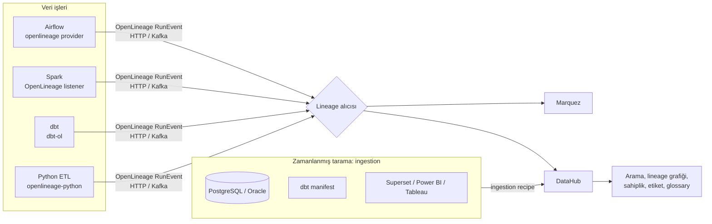

# 16.4 OpenLineage ve DataHub: Lineage ve Metadata'yı Otomatik Toplamak

## Nedir?
- **OpenLineage**, veri işlerinin (job) hangi veri setlerini okuyup yazdığını standart bir formatta bildiren **açık bir lineage standardıdır** (LF AI & Data vakfı projesi). Airflow, Spark, dbt, Flink gibi araçlar her çalışmada "başladım / bitti / hata verdim; şunları okudum, şunları yazdım" olaylarını aynı JSON yapısında gönderir. **Marquez**, OpenLineage olaylarını saklayıp gösteren referans sunucudur.
- **DataHub**, LinkedIn'de geliştirilip açık kaynak yapılan bir **metadata platformu ve veri kataloğudur**. Veritabanlarından, dbt'den, BI araçlarından, orkestratörlerden metadata toplar; arama, lineage, sahiplik, etiket, glossary, kalite ve erişim taleplerini tek arayüzde sunar.

Kısaca: OpenLineage **olayların dilidir**, DataHub (veya Marquez, OpenMetadata) bu olayları ve diğer metadata'yı toplayan **merkezdir**.

## Hangi problemi çözer?
- Her aracın kendi lineage görünümü olması (dbt kendi, Airflow kendi, Spark kendi): Uçtan uca resim görünmez.
- Lineage'in elle çizilmesi ve hızla eskimesi
- "Bu tablo bu sabah güncellendi mi, hangi job yazdı, başarılı mıydı?" sorusunun cevabının farklı sistemlere dağılmış olması
- Katalog bilgilerinin (sahip, açıklama, etiket) kaynaklardan otomatik ve düzenli olarak toplanması

## Nasıl çalışır?

**Mimari**


**OpenLineage modeli**
| Kavram | Anlamı | Örnek |
|---|---|---|
| **Job** | Tekrarlanan bir iş tanımı | `bddk_aylik.yukle_kredi` (DAG + task) |
| **Run** | Job'ın belirli bir çalışması (benzersiz `runId`) | 24 Ekim 07:00 çalışması |
| **Dataset** | Okunan/yazılan veri; `namespace` + `name` ile tanımlanır | `postgres://pg.sirket.local:5432` + `dwh.gold.kredi_metrik` |
| **Event türleri** | `START`, `RUNNING`, `COMPLETE`, `FAIL`, `ABORT` | |
| **Facet** | Olaya eklenen ek bilgi blokları | şema, sütun lineage'i, satır sayısı, kalite sonuçları, SQL metni, kaynak kod konumu |

**Örnek olay**
```json
{
  "eventType": "COMPLETE",
  "eventTime": "2026-10-24T04:05:12.000Z",
  "producer": "https://ornek.sirket.local/etl/bddk-kredi",
  "schemaURL": "https://openlineage.io/spec/2-0-2/OpenLineage.json#/definitions/RunEvent",
  "run": { "runId": "0192c3a4-7b1e-7cde-9a10-2f4b8d6e1a55" },
  "job": { "namespace": "veri-prod", "name": "bddk_aylik.yukle_kredi" },
  "inputs": [
    { "namespace": "postgres://pg.sirket.local:5432", "name": "dwh.staging.bddk_kredi" }
  ],
  "outputs": [
    {
      "namespace": "postgres://pg.sirket.local:5432",
      "name": "dwh.dwh.bddk_kredi",
      "facets": {
        "schema": {
          "_producer": "https://ornek.sirket.local/etl/bddk-kredi",
          "_schemaURL": "https://openlineage.io/spec/facets/1-1-1/SchemaDatasetFacet.json",
          "fields": [
            { "name": "donem", "type": "date" },
            { "name": "kalem", "type": "text" },
            { "name": "tutar", "type": "numeric" }
          ]
        }
      }
    }
  ]
}
```

**DataHub kavramları**
| Kavram | Anlamı |
|---|---|
| **Entity** | Kataloğdaki varlık türleri: dataset, dashboard, chart, dataJob, dataFlow, mlModel, glossaryTerm, domain, user/group |
| **URN** | Varlığın benzersiz kimliği: `urn:li:dataset:(urn:li:dataPlatform:postgres,dwh.gold.kredi_metrik,PROD)` |
| **Aspect** | Varlığın bir bilgi parçası: şema, sahiplik, etiketler, açıklama, glossary terimleri, lineage |
| **Ingestion recipe** | Hangi kaynaktan (source), hangi ayarlarla, nereye (sink) metadata toplanacağını tanımlayan YAML |
| **Domain** | İş alanı gruplaması: Krediler, Mevduat, Müşteri |
| **Data product** | Bir alanın sunduğu, sahibi ve sözleşmesi belli veri varlıkları paketi ([16.5](05-sahiplik-data-contract.md)) |
| **Assertions / data contracts** | Varlık üzerindeki kalite beklentileri ve sonuçları |

## Mini örnek
**Marquez'i yerelde denemek ve Python'dan olay göndermek**
```bash
git clone https://github.com/MarquezProject/marquez && cd marquez
./docker/up.sh                           # API: http://localhost:5000, arayüz: http://localhost:3000
pip install openlineage-python
export OPENLINEAGE_URL=http://localhost:5000
export OPENLINEAGE_NAMESPACE=veri-dev
```
```python
from datetime import datetime, timezone
from openlineage.client import OpenLineageClient
from openlineage.client.event_v2 import RunEvent, RunState, Run, Job, InputDataset, OutputDataset
from openlineage.client.uuid import generate_new_uuid

client = OpenLineageClient()                  # OPENLINEAGE_URL ortam değişkeninden okur
PG = "postgres://pg.sirket.local:5432"
run = Run(runId=str(generate_new_uuid()))
job = Job(namespace="veri-dev", name="bddk_kredi_etl.yukle")
girdi = [InputDataset(namespace=PG, name="dwh.staging.bddk_kredi")]
cikti = [OutputDataset(namespace=PG, name="dwh.dwh.bddk_kredi")]

def olay(durum):
    return RunEvent(eventType=durum, eventTime=datetime.now(timezone.utc).isoformat(),
                    run=run, job=job, producer="https://ornek.sirket.local/etl/bddk-kredi",
                    inputs=girdi, outputs=cikti)

client.emit(olay(RunState.START))
try:
    yukle()                                    # asıl ETL işi
    client.emit(olay(RunState.COMPLETE))
except Exception:
    client.emit(olay(RunState.FAIL))
    raise
```

**Airflow, Spark ve dbt entegrasyonları**
```bash
# Airflow (2.7+ / 3.x): resmî provider
pip install apache-airflow-providers-openlineage
export AIRFLOW__OPENLINEAGE__TRANSPORT='{"type": "http", "url": "http://marquez.sirket.local:5000"}'
export AIRFLOW__OPENLINEAGE__NAMESPACE=veri-prod
# SQL operatörleri (Postgres, Snowflake vb.) okunan/yazılan tabloları otomatik bildirir

# Spark: listener ekleyerek
spark-submit \
  --packages "io.openlineage:openlineage-spark_2.12:${OPENLINEAGE_SURUM}" \
  --conf spark.extraListeners=io.openlineage.spark.agent.OpenLineageSparkListener \
  --conf spark.openlineage.transport.type=http \
  --conf spark.openlineage.transport.url=http://marquez.sirket.local:5000 \
  --conf spark.openlineage.namespace=veri-prod \
  etl_job.py

# dbt: dbt komutunu sarmalayan dbt-ol
pip install openlineage-dbt
dbt-ol run --select fct_kredi_metrik
```
Paket sürümlerini kullandığınız Spark/Scala ve Airflow sürümüyle uyumlu seçin.

**DataHub'ı yerelde denemek**
```bash
pip install acryl-datahub
datahub docker quickstart                   # arayüz: http://localhost:9002
datahub ingest -c postgres_recipe.yml
```

**Ingestion recipe: PostgreSQL**
```yaml
source:
  type: postgres
  config:
    host_port: pg.sirket.local:5432
    database: dwh
    username: ${PG_USER}
    password: ${PG_PASSWORD}
    schema_pattern:
      allow: ["silver", "gold"]
    include_views: true
    profiling:
      enabled: true              # satır sayısı, null oranı, min/max gibi istatistikler
sink:
  type: datahub-rest
  config:
    server: http://datahub-gms.sirket.local:8080
    token: ${DATAHUB_TOKEN}
```

**Ingestion recipe: dbt (açıklamalar, testler, model lineage'i)**
```yaml
source:
  type: dbt
  config:
    manifest_path: ./target/manifest.json
    catalog_path: ./target/catalog.json
    run_results_paths: ["./target/run_results.json"]   # test sonuçları
    target_platform: postgres
    meta_mapping:                                       # dbt meta alanlarını DataHub'a eşle
      sahip:
        match: ".*"
        operation: add_owner
        config:
          owner_type: group
      siniflandirma:
        match: "kisisel|gizli"
        operation: add_tag
        config:
          tag: "{{ $match }}"
sink:
  type: datahub-rest
  config:
    server: http://datahub-gms.sirket.local:8080
```

**Python SDK ile etiket ve sahip eklemek**
```python
from datahub.emitter.mce_builder import make_dataset_urn, make_tag_urn, make_group_urn
from datahub.emitter.mcp import MetadataChangeProposalWrapper
from datahub.emitter.rest_emitter import DatahubRestEmitter
from datahub.metadata.schema_classes import (GlobalTagsClass, TagAssociationClass,
                                             OwnershipClass, OwnerClass, OwnershipTypeClass)

emitter = DatahubRestEmitter("http://datahub-gms.sirket.local:8080", token=TOKEN)
urn = make_dataset_urn(platform="postgres", name="dwh.gold.kredi_metrik", env="PROD")

emitter.emit(MetadataChangeProposalWrapper(entityUrn=urn, aspect=GlobalTagsClass(
    tags=[TagAssociationClass(tag=make_tag_urn("KurumaOzel"))])))
emitter.emit(MetadataChangeProposalWrapper(entityUrn=urn, aspect=OwnershipClass(
    owners=[OwnerClass(owner=make_group_urn("kredi-riski"), type=OwnershipTypeClass.DATAOWNER)])))
```
Bu yöntem ilgili aspect'i **tamamen değiştirir** (mevcut etiketlerin üzerine yazar); var olanlara eklemek için önce okuyup birleştirin veya SDK'nın yama (patch) yardımcılarını kullanın.

## Nerede kullanılır?
- Birden çok aracın (Airflow, Spark, dbt, BI) kullanıldığı veri platformlarında uçtan uca lineage
- Katalogda tazelik ve "son başarılı çalışma" bilgisini göstermek
- Etki analizi ve değişiklik yönetimi ([16.3](03-lineage.md))
- Sahiplik, etiket ve sınıflandırma bilgisinin kod ve kurallarla otomatik yönetimi

## Benzerleri ve farkları
| Araç | Not |
|---|---|
| **Marquez** | OpenLineage'in referans sunucusu; sade, lineage odaklı |
| **OpenMetadata** | DataHub'a benzer açık kaynak katalog; kalite testleri ve profil çıkarma yerleşik |
| **Apache Atlas** | Hadoop ekosisteminin klasik katalog ve lineage aracı; Ranger ile etiket tabanlı politikalar |
| **Egeria** | Açık metadata alışverişi standardı ve platformu |
| **Ticari platformlar** | Collibra, Alation, Informatica, Microsoft Purview, Atlan, Manta (lineage odaklı); birçoğu OpenLineage olaylarını da kabul eder |
| **Platform içi lineage** | Databricks Unity Catalog, Snowflake, BigQuery kendi işleri için otomatik lineage üretir |

## İlgili sayfalar
- [16.3 Data lineage](03-lineage.md)
- [16.2 Veri kataloğu ve metadata](02-katalog-metadata.md)
- [11.10 Orkestratörler: Airflow, Dagster, Prefect](../11-veri-akisi/10-orkestrator-karsilastirma.md)
- [10.3 Spark](../10-veri-isleme/03-spark.md)
