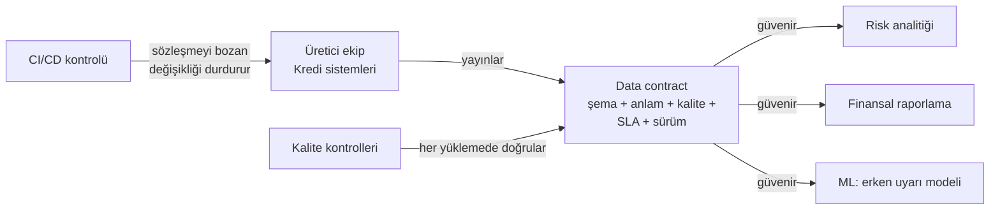

# 16.5 Veri Sahipliği, Data Contract ve Data Mesh

## Nedir?
- **Veri sahipliği (data ownership)**, her veri varlığı veya alanı için **kimin hesap verdiğinin** açıkça belirlenmesidir: tanımı kim onaylar, kalite sorunu kime gider, erişime kim izin verir, değişikliği kim duyurur.
- **Data contract (veri sözleşmesi)**, veriyi **üreten** ekip ile **kullanan** ekipler arasındaki yazılı ve makinece doğrulanabilir anlaşmadır: şema, anlam, kalite kuralları, tazelik ve değişiklik kuralları. Bir API sözleşmesinin veri karşılığıdır.
- **Data mesh**, verinin merkezi tek bir ekip yerine **iş alanı (domain) ekipleri** tarafından "ürün" olarak sahiplenildiği; ortak platform ve **federe yönetişim** standartlarıyla çalışan organizasyon yaklaşımıdır.

## Hangi problemi çözer?
- **"Bu tablonun sahibi kim?"** sorusunun cevapsız kalması; sorunların ekipler arasında top gibi dolaşması
- Kaynak sistem ekibinin bir sütunu habersiz değiştirmesiyle gece ETL'lerinin ve raporların bozulması
- Merkezi veri ekibinin her talebi karşılamaya çalışırken darboğaz olması
- Kalite sorunlarının **kaynağında** değil, en sonda (raporda) fark edilmesi
- Veri kullanıcılarının "bu veriye güvenebilir miyim?" sorusuna dayanak bulamaması

## Nasıl çalışır?

**RACI ile sorumluluklar (örnek)**
| Faaliyet | Veri sahibi | Steward | Teknik sorumlu | Yönetişim ofisi | Kullanıcı |
|---|---|---|---|---|---|
| İş tanımını onaylamak | **A** | R | C | C | I |
| Kalite kurallarını belirlemek | A | **R** | C | C | C |
| Kalite kontrollerini çalıştırmak | I | C | **R/A** | I | I |
| Kalite sorununu çözmek | A | R | **R** | I | I |
| Erişim talebini onaylamak | **A/R** | C | I | I | I |
| Şema değişikliğini duyurmak | A | C | **R** | I | I |
| Sınıflandırmayı belirlemek | **A** | R | C | C | I |

R: Yapan (Responsible), A: Hesap veren (Accountable), C: Danışılan (Consulted), I: Bilgilendirilen (Informed). Her satırda **tek bir A** olmalıdır.

**Sahiplik nasıl atanır?**
- Sahiplik kişiye değil **role** bağlanmalıdır ("Kredi Riski Yönetimi Daire Başkanı"); kişi değişse de sahiplik kaybolmaz.
- Sahip, veriyi **üreten veya iş anlamından sorumlu** iş birimidir; BT değil. BT teknik sorumludur.
- Ortak kullanılan ana veriler (müşteri, ürün, şube) için tek bir sahip belirlenir; diğer birimler kullanıcıdır.
- Katalogda her kritik varlık için sahip alanı **zorunlu** olmalı ve sahipsiz varlık oranı yönetişim karnesinde izlenmelidir ([16.1](01-veri-yonetisimi-nedir.md)).

**Data contract'ın içeriği**

| Bölüm | İçerik |
|---|---|
| **Şema** | Sütunlar, tipler, zorunluluk, birincil anahtar |
| **Anlam** | Her alanın iş tanımı, birimleri (TL, kuruş), kodların anlamı |
| **Kalite kuralları** | Boş olmama, benzersizlik, geçerli değerler, aralıklar ([16.8](08-kalite-yonetimi.md)) |
| **SLA / SLO** | Tazelik ("her gün 06:00'ya kadar"), erişilebilirlik, gecikme |
| **Sınıflandırma ve kullanım koşulları** | Hassasiyet, izinli kullanım amaçları, saklama süresi |
| **Sürüm ve değişiklik kuralı** | Kırıcı (breaking) değişiklik ne zaman ve nasıl yapılır; eski sürüm ne kadar desteklenir |
| **İletişim** | Sahip, destek kanalı, sorun bildirme yolu |

**Kırıcı ve kırıcı olmayan değişiklikler**
| Kırıcı olmayan (minor) | Kırıcı (major) |
|---|---|
| Yeni isteğe bağlı sütun eklemek | Sütun silmek veya adını değiştirmek |
| Açıklamayı iyileştirmek | Tipini değiştirmek (`numeric` → `text`) |
| Geçerli değer listesine yeni kod eklemek (kullanıcılar hazırsa) | Bir alanın **anlamını** değiştirmek (brüt → net) |
| | Birincil anahtarı veya satır düzeyini (granülerlik) değiştirmek |

Kırıcı değişiklik yeni sürümle (`v2`) yapılır, eski sürüm belirli bir süre paralel yayınlanır ve kullanıcılar önceden bilgilendirilir.

**Data mesh'in dört ilkesi**
| İlke | Anlamı |
|---|---|
| **Alan sahipliği (domain ownership)** | Veriyi en iyi bilen iş alanı ekibi sahiplenir |
| **Ürün olarak veri (data as a product)** | Veri setleri keşfedilebilir, anlaşılır, güvenilir, sözleşmeli "ürünler" olarak sunulur |
| **Self-servis platform** | Merkezi platform ekibi altyapıyı (depolama, işlem, katalog, kalite araçları) hazır sunar |
| **Federe hesaplanabilir yönetişim** | Ortak kurallar (sınıflandırma, isimlendirme, güvenlik) merkezi belirlenir, platformda **kod olarak** otomatik uygulanır |

Bankalar gibi düzenlemeye tabi kurumlarda tam data mesh yerine çoğunlukla **hibrit** model uygulanır: merkezi platform ve yönetişim, alan bazlı sahiplik ve veri ürünleri.

## Mini örnek
**Data contract (Open Data Contract Standard'dan esinlenen sadeleştirilmiş YAML)**
```yaml
kind: DataContract
id: kredi-aylik-bakiye
version: 2.1.0
status: active
domain: krediler
sahip: "Kredi Riski Yönetimi"
destek: "#kredi-veri-destek"
aciklama: "Ay sonu nakdi kredi bakiyeleri, kredi hesabı düzeyinde."
siniflandirma: kuruma_ozel
kullanim_amaclari: ["düzenleyici raporlama", "risk analitiği", "ML modelleri"]

sema:
  tablo: gold.kredi_aylik_bakiye
  granulerlik: "donem + kredi_id"
  sutunlar:
    - { ad: donem,      tip: date,          zorunlu: true, aciklama: "Ay sonu tarihi" }
    - { ad: kredi_id,   tip: varchar(20),   zorunlu: true, birincil_anahtar: true }
    - { ad: musteri_id, tip: bigint,        zorunlu: true, siniflandirma: kisisel_veri_baglantili }
    - { ad: bakiye_tl,  tip: "numeric(18,2)", zorunlu: true, aciklama: "Anapara, TL, faiz hariç" }
    - { ad: gecikme_gun, tip: integer,      zorunlu: true }

kalite:
  - "row_count > 0"
  - "duplicate_count(donem, kredi_id) = 0"
  - "min(bakiye_tl) >= 0"
  - "gecikme_gun between 0 and 10000"
  - "GL mutabakat farkı < %0,1"

sla:
  tazelik: "Her ayın ilk iş günü 07:00 (Europe/Istanbul)"
  erisilebilirlik: "%99"

degisiklik_politikasi:
  kirici_degisiklik_bildirim_suresi: "30 gün"
  eski_surum_destek_suresi: "90 gün"
```

**CI'da sözleşme kontrolü (kavramsal)**
```python
# Üretici repo'sunun pipeline'ında: yeni şema sözleşmeyle uyumlu mu?
import yaml

sozlesme = yaml.safe_load(open("contracts/kredi-aylik-bakiye.yaml", encoding="utf-8"))
beklenen = {s["ad"]: s["tip"] for s in sozlesme["sema"]["sutunlar"]}
mevcut = veritabanindan_sema_oku("gold.kredi_aylik_bakiye")     # {sütun: tip}

eksik = set(beklenen) - set(mevcut)
tip_degisen = {k for k in beklenen if k in mevcut and mevcut[k] != beklenen[k]}
if eksik or tip_degisen:
    raise SystemExit(f"Kırıcı değişiklik! Eksik: {eksik}, tipi değişen: {tip_degisen}")
```
dbt'de aynı fikir **model contracts** (`contract: {enforced: true}`) ile uygulanır: modelin çıktısı tanımlı sütun ve tiplere uymazsa build başarısız olur ([11.4](../11-veri-akisi/04-dbt.md)).

## Nerede kullanılır?
- Çekirdek sistemlerden veri ambarına gelen kritik akışlar
- Birden çok ekibin kullandığı ortak veri ürünleri (müşteri 360, kredi bakiyeleri, işlem verisi)
- ML modellerinin girdi verisi (feature'ların anlamı ve kalitesi, [13.5](../13-mlops/05-feature-kavrami.md))
- Dış kurumlarla veri alışverişi (düzenleyici raporlar, iş ortakları)

## Benzerleri ve farkları
- **API sözleşmesi (OpenAPI):** Servisler arası istek/cevap sözleşmesi; data contract aynı disiplini tablo ve akışlara uygular ([7.1](../07-api/01-api-nedir.md)).
- **Schema Registry:** Kafka gibi akış sistemlerinde mesaj şemasını ve uyumluluk kurallarını zorlayan teknik bileşen; data contract'ın şema kısmını uygular ([11.11](../11-veri-akisi/11-kafka-redpanda.md)).
- **SLA:** Sözleşmenin sadece zaman ve erişilebilirlik kısmıdır.
- **Standartlar:** Open Data Contract Standard (ODCS) ve Data Contract Specification gibi açık formatlar ile `datacontract-cli` benzeri araçlar sözleşmeleri doğrulamak için kullanılabilir.

## İlgili sayfalar
- [16.1 Veri yönetişimi nedir](01-veri-yonetisimi-nedir.md)
- [16.8 Veri kalitesi yönetimi](08-kalite-yonetimi.md)
- [11.4 dbt](../11-veri-akisi/04-dbt.md)
- [9.13 Medallion](../09-veri-depolama/13-medallion.md)
