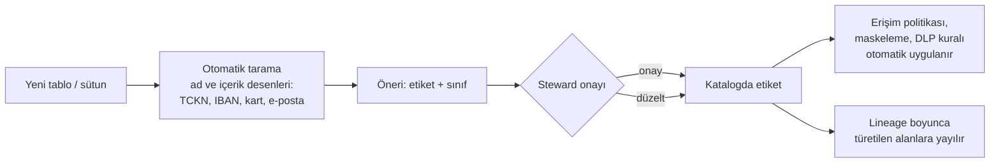

# 16.6 Veri Sınıflandırma ve Etiketleme

## Nedir?
**Veri sınıflandırma (data classification)**, verinin **hassasiyetine ve tabi olduğu kurallara göre** kategorilere ayrılmasıdır. Her kategorinin; kimlerin erişebileceği, nasıl saklanacağı, şifrelenip şifrelenmeyeceği, maskelenip maskelenmeyeceği, kurum dışına çıkıp çıkamayacağı ve ne kadar süre tutulacağı gibi kuralları vardır.

**Etiketleme (tagging)**, bu sınıfların ve ek özelliklerin (kişisel veri, özel nitelikli kişisel veri, banka sırrı, finansal veri, saklama süresi) tablo ve **sütun** düzeyinde metadata olarak işaretlenmesidir. Etiketler katalogda görünür ve erişim politikaları tarafından otomatik kullanılır.

## Hangi problemi çözer?
- **"Hassas veri nerede?"** sorusunun envanter bazında cevaplanması (KVKK kişisel veri envanteri, denetimler)
- Her tabloya tek tek erişim kuralı yazmak yerine **sınıfa göre** genel kural uygulamak
- Hassas verinin test ortamına, Excel'lere, e-postalara ve yapay zekâ araçlarına kontrolsüz kopyalanmasını önlemek
- Yeni gelen tablolarda kişisel verinin fark edilmeden açık kalması
- Veri sızıntısı olduğunda etkinin hızla değerlendirilmesi

## Nasıl çalışır?

**Tipik sınıflandırma seviyeleri (kurumdan kuruma isimler değişir)**
| Seviye | Örnek veri | Tipik kurallar |
|---|---|---|
| **Genel / Kamuya açık** | Yayımlanmış faiz oranları, kamuya açık BDDK/TÜİK istatistikleri, basın bültenleri | Serbest paylaşım |
| **Kuruma özel (dahili)** | Şube performans raporları, iç prosedürler, toplulaştırılmış iş metrikleri | Sadece çalışanlar; dışarı paylaşım onaylı |
| **Gizli** | Müşteri kimlik ve iletişim bilgileri, hesap/kredi detayları, banka sırrı niteliğindeki bilgiler | İş ihtiyacına göre yetki, maskeleme, şifreleme, erişim kaydı, dışarı çıkış yasak/DLP |
| **Çok gizli** | Özel nitelikli kişisel veri (sağlık vb.), kart verileri (PAN), kimlik doğrulama bilgileri, stratejik planlar | En dar yetki, güçlü şifreleme/tokenizasyon, ayrı ortam, düzenli gözden geçirme |

**Kişisel veri boyutu (KVKK açısından)**
| Etiket | Örnek |
|---|---|
| **Kişisel veri** | Ad soyad, TCKN, telefon, e-posta, adres, müşteri numarası, IP adresi |
| **Özel nitelikli kişisel veri** | Sağlık, biyometrik veri, din, mezhep, ceza mahkûmiyeti gibi kanunda sayılan kategoriler |
| **Dolaylı tanımlayıcı** | Doğum tarihi + posta kodu + cinsiyet gibi, birleşince kişiyi belirleyebilen alanlar |
| **Anonim / toplulaştırılmış** | Kişiyle ilişkilendirilemeyecek hâle getirilmiş veri; kişisel veri sayılmaz ([15.9](../15-guvenlik/09-maskeleme-kvkk.md)) |

Kişisel veri olup olmama ile gizlilik seviyesi iki ayrı boyuttur: Toplulaştırılmış bir kredi stratejisi raporu kişisel veri içermez ama "gizli" olabilir.

**Sınıflandırma süreci**


**Otomatik sınıflandırma ipuçları**
| Yöntem | Örnek |
|---|---|
| **Sütun adı** | `tckn`, `tc_kimlik`, `vkn`, `iban`, `kart_no`, `telefon`, `eposta`, `dogum_tarihi` |
| **İçerik deseni (regex)** | 11 haneli ve algoritmayı sağlayan TCKN, `TR` ile başlayan 26 karakterlik IBAN, Luhn kontrolünü geçen 16 haneli kart numarası ([Regex](../ekler/regex-cheatsheet.md)) |
| **Sözlük eşleşmesi** | İl/ilçe adları, yaygın ad-soyad listeleri |
| **Lineage ile yayılım** | Kaynağı kişisel veri olan bir sütundan kopyalanan veya türetilen sütun da etiketlenir |
| **Makine öğrenmesi / LLM** | Serbest metin alanlarında (açıklama, not) kişisel veri tespiti; sonuç her zaman insan onayıyla kesinleşmeli |

Otomatik tarama **öneri** üretir; yanlış pozitif (sipariş numarası 11 hane diye TCKN sanılması) ve yanlış negatifler (serbest metin içinde telefon numarası) olur. Son karar steward'dadır.

**Etiketlerin kullanıldığı yerler**
- **Erişim politikaları:** "`kisisel_veri` etiketli sütunlar, `kvkk_yetkili` rolü dışındakilere maskeli gösterilir" ([16.7](07-erisim-politikalari.md))
- **Ortam kopyalama:** Prod'dan test'e veri kopyalanırken etiketli sütunlar otomatik maskelenir veya sentetik veriyle değiştirilir
- **DLP (Data Loss Prevention):** E-posta, USB, bulut paylaşımında hassas içerik tespiti
- **Saklama ve imha:** Saklama süresi dolan kişisel veriler için silme/anonimleştirme işleri
- **Yapay zekâ kullanımı:** Hangi verilerin dış yapay zekâ servislerine gönderilemeyeceği

## Mini örnek
**Basit otomatik tarama (PostgreSQL + Python)**
```python
import re
import pandas as pd
from sqlalchemy import create_engine, text

AD_DESENLERI = {
    "tckn": r"(tc|tckn|kimlik_no)", "iban": r"iban", "kart": r"(kart_no|pan|card)",
    "telefon": r"(tel|gsm|telefon)", "eposta": r"(mail|eposta)", "dogum": r"dogum",
}
ICERIK_DESENLERI = {
    "tckn": r"^[1-9]\d{10}$",
    "iban": r"^TR\d{24}$",
    "eposta": r"^[\w.+-]+@[\w-]+\.[\w.-]+$",
}

def tckn_gecerli(s: str) -> bool:
    if not re.fullmatch(r"[1-9]\d{10}", s):
        return False
    d = list(map(int, s))
    return (sum(d[0:9:2]) * 7 - sum(d[1:8:2])) % 10 == d[9] and sum(d[:10]) % 10 == d[10]

engine = create_engine(DB_URL)
sutunlar = pd.read_sql(text("""
    SELECT table_schema, table_name, column_name FROM information_schema.columns
    WHERE table_schema IN ('silver', 'gold') AND data_type IN ('text', 'character varying', 'bigint')
"""), engine)

oneriler = []
for r in sutunlar.itertuples():
    etiketler = {e for e, d in AD_DESENLERI.items() if re.search(d, r.column_name, re.I)}
    ornek = pd.read_sql(text(f'SELECT "{r.column_name}"::text AS v FROM "{r.table_schema}"."{r.table_name}" '
                             f'WHERE "{r.column_name}" IS NOT NULL LIMIT 200'), engine)["v"]
    for e, d in ICERIK_DESENLERI.items():
        eslesen = ornek.str.fullmatch(d)
        if e == "tckn":
            eslesen = ornek.map(tckn_gecerli)
        if len(ornek) and eslesen.mean() > 0.8:
            etiketler.add(e)
    if etiketler:
        oneriler.append((f"{r.table_schema}.{r.table_name}.{r.column_name}", sorted(etiketler)))

pd.DataFrame(oneriler, columns=["sutun", "onerilen_etiketler"]).to_csv("siniflandirma_onerileri.csv", index=False)
```
Bu script örnek veri okuduğu için kendisi de yetkili bir servis hesabıyla, kontrollü ortamda çalıştırılmalı ve çıktısında **değer değil sadece sütun adı** tutulmalıdır.

**Etiketleri veritabanında tutmak**
```sql
-- PostgreSQL: sütun yorumlarında yapılandırılmış etiket (katalog araçları okuyabilir)
COMMENT ON COLUMN silver.musteri.tckn IS '{"siniflandirma": "gizli", "kisisel_veri": true, "etiket": ["tckn"]}';

-- veya ayrı bir etiket tablosu
CREATE TABLE yonetisim.sutun_etiket (
    sutun          text,              -- 'silver.musteri.tckn'
    etiket         text,              -- 'kisisel_veri', 'tckn', 'gizli'
    kaynak         text,              -- 'otomatik' / 'steward'
    onaylayan      text,
    onay_tarihi    date,
    PRIMARY KEY (sutun, etiket)
);
```
Oracle'da benzer etiketleme `ALTER TABLE ... MODIFY ... ANNOTATIONS` (23ai) veya Data Safe / Data Redaction politikalarıyla; Snowflake ve Databricks'te yerleşik **tag** nesneleriyle yapılır.

## Nerede kullanılır?
- KVKK kişisel veri envanteri ve VERBİS kayıtlarıyla teknik sistemlerin eşleştirilmesi
- Prod verisinin test ve geliştirme ortamlarına güvenli aktarılması
- Etiket tabanlı erişim ve maskeleme politikaları
- Denetim ve sızma testi sonrası "hassas veri haritası" çıkarma
- Yapay zekâ ve analitik projelerinde hangi verinin kullanılabileceğine karar verme

## Benzerleri ve farkları
- **Maskeleme ve anonimleştirme:** Sınıflandırma "ne kadar hassas" sorusunu cevaplar; maskeleme bu bilgiye göre veriyi gizleyen tekniktir ([15.9](../15-guvenlik/09-maskeleme-kvkk.md)).
- **DLP araçları:** Uç noktalarda ve e-postada hassas içeriği yakalar; veri platformundaki etiketlerle beslenebilir.
- **Bilgi güvenliği sınıflandırması (ISO 27001):** Belgeler dahil tüm bilgi varlıklarını kapsar; veri platformundaki sınıflandırma bunun tablo ve sütun düzeyindeki uygulamasıdır.

## İlgili sayfalar
- [16.7 Erişim politikaları](07-erisim-politikalari.md)
- [15.9 Maskeleme ve KVKK](../15-guvenlik/09-maskeleme-kvkk.md)
- [16.2 Veri kataloğu](02-katalog-metadata.md)
- [Regex cheat sheet](../ekler/regex-cheatsheet.md)
