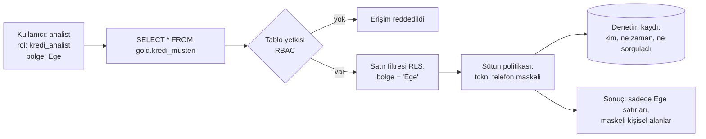

# 16.7 Veriye Erişim Politikaları: RBAC, ABAC, Satır ve Sütun Güvenliği

## Nedir?
**Erişim politikası**, kimin hangi veriye, hangi koşulla, hangi amaçla ve ne kadar süreyle erişebileceğini belirleyen kurallardır. Kimlik doğrulama ve genel yetkilendirme kavramları [15.1](../15-guvenlik/01-authn-authz.md) ve [15.6](../15-guvenlik/06-rbac-en-az-yetki.md)'da anlatıldı; bu sayfa **veri platformu düzeyindeki** uygulamayı ele alır:

- **RBAC (Role-Based Access Control):** Yetki role verilir, kullanıcı role atanır ("kredi_analist" rolü `gold.kredi_*` tablolarını okur).
- **ABAC (Attribute-Based Access Control):** Karar; kullanıcının, verinin ve bağlamın **özelliklerine** göre verilir ("kullanıcının bölgesi = satırın bölgesi" ve "sütun etiketi `kisisel_veri` ise sadece KVKK yetkilisi açık görür").
- **Satır düzeyi güvenlik (RLS, row-level security):** Aynı tablodan farklı kullanıcılar farklı **satırları** görür (şube sadece kendi müşterilerini).
- **Sütun düzeyi güvenlik ve dinamik maskeleme:** Hassas **sütunlar** gizlenir veya maskeli gösterilir (`TCKN: 123******01`).
- **Etiket tabanlı politika (tag-based):** Kurallar tek tek tablolara değil, sınıflandırma etiketlerine yazılır; yeni bir tablo etiketlendiğinde kural kendiliğinden uygulanır ([16.6](06-siniflandirma.md)).

## Hangi problemi çözer?
- Herkesin her şeye eriştiği "geniş yetki" ortamlarının veri sızıntısı ve KVKK riski
- Aynı tablonun her kullanıcı grubu için ayrı ayrı kopyalanması (şube bazlı tablolar, maskeli kopyalar)
- Ayrılan veya görev değiştiren çalışanın yetkilerinin açık kalması
- "Bu kişi bu veriye neden erişti, kim onayladı?" sorusunun cevapsız kalması
- Erişim taleplerinin e-postalarla haftalarca sürmesi

## Nasıl çalışır?

**Bir sorgunun yetki kontrolünden geçmesi**


**RBAC ve ABAC karşılaştırması**
| | RBAC | ABAC |
|---|---|---|
| Karar neye göre? | Kullanıcının rolüne | Kullanıcı, veri ve bağlam özelliklerine |
| Örnek | `kredi_analist` → `gold.kredi_*` okur | `kullanici.departman = veri.sahip_alan` VE `veri.etiket != 'cok_gizli'` |
| Artı | Basit, anlaşılır, denetlemesi kolay | Esnek; rol patlamasını (yüzlerce rol) önler |
| Eksi | İnce kurallar için çok sayıda rol gerekir | Tasarımı ve test edilmesi daha zor |

Pratikte ikisi birlikte kullanılır: Kaba yetkiler rollerle, ince kurallar (satır/sütun) özelliklerle.

**Erişim yaşam döngüsü**
| Aşama | Uygulama |
|---|---|
| **Talep** | Kullanıcı katalog veya kimlik yönetimi aracından gerekçe ve süreyle talep açar |
| **Onay** | Veri sahibi (ve gerekiyorsa güvenlik/KVKK) onaylar ([16.5](05-sahiplik-data-contract.md)) |
| **Atama** | Yetki **gruba** (AD/LDAP grubu) eklenerek verilir; kişiye doğrudan değil ([15.4](../15-guvenlik/04-ldap-entegrasyonu.md)) |
| **Süreli erişim** | Geçici ihtiyaçlar için bitiş tarihli yetki (just-in-time) |
| **Gözden geçirme (recertification)** | Veri sahipleri belirli aralıklarla (ör. 6 ayda bir) "bu kişiler hâlâ erişmeli mi?" onayı verir |
| **Geri alma** | İşten ayrılma veya görev değişikliğinde otomatik kaldırma (kimlik yönetimi entegrasyonu) |
| **Acil erişim (break-glass)** | Olağanüstü durumlar için kayıtlı, sonradan incelenen yüksek yetki |
| **Denetim** | Erişim ve sorgu kayıtlarının saklanıp anormal erişimlerin izlenmesi |

**İlkeler**
- **En az yetki (least privilege)** ve **iş gereği (need-to-know)**
- **Görevler ayrılığı:** Veriyi değiştiren ile onaylayan aynı kişi olmamalı; geliştiricinin prod veriye yazma yetkisi olmamalı
- **Servis hesapları** kişisel hesaplardan ayrı, sadece gereken tablolar için yetkili ve parolaları secret yöneticisinde ([15.7](../15-guvenlik/07-secret-yonetimi.md))
- **Analitik için önce toplulaştırılmış veya maskeli veri;** açık kişisel veri sadece gerekçeli ve onaylı

## Mini örnek
**PostgreSQL: rol tabanlı yetki**
```sql
CREATE ROLE kredi_analist NOLOGIN;
GRANT USAGE ON SCHEMA gold TO kredi_analist;
GRANT SELECT ON ALL TABLES IN SCHEMA gold TO kredi_analist;
ALTER DEFAULT PRIVILEGES IN SCHEMA gold GRANT SELECT ON TABLES TO kredi_analist;  -- yeni tablolar için

GRANT kredi_analist TO "ayse.yilmaz";      -- kurumsal ortamda AD/LDAP grubu eşlemesiyle
```

**PostgreSQL: satır düzeyi güvenlik (RLS)**
```sql
CREATE TABLE yonetisim.kullanici_bolge (kullanici text PRIMARY KEY, bolge text NOT NULL);

ALTER TABLE gold.kredi_musteri ENABLE ROW LEVEL SECURITY;

CREATE POLICY bolge_filtresi ON gold.kredi_musteri
    FOR SELECT
    TO kredi_analist
    USING (bolge = (SELECT bolge FROM yonetisim.kullanici_bolge WHERE kullanici = current_user));

-- Genel müdürlük analistleri tüm bölgeleri görsün
CREATE ROLE gm_analist NOLOGIN;
CREATE POLICY gm_hepsi ON gold.kredi_musteri FOR SELECT TO gm_analist USING (true);
```
Tablo sahibi ve `BYPASSRLS` yetkili roller politikalara takılmaz; uygulama ve rapor bağlantılarının bu rollerle yapılmadığından emin olun.

**PostgreSQL: maskeli view ile sütun güvenliği**
```sql
CREATE VIEW gold.v_kredi_musteri AS
SELECT musteri_id, bolge, segment, bakiye_tl,
       CASE WHEN pg_has_role('kvkk_yetkili', 'MEMBER') THEN tckn
            ELSE left(tckn, 3) || '******' || right(tckn, 2) END AS tckn,
       CASE WHEN pg_has_role('kvkk_yetkili', 'MEMBER') THEN telefon
            ELSE '*** *** ' || right(telefon, 4) END AS telefon
FROM gold.kredi_musteri;

REVOKE SELECT ON gold.kredi_musteri FROM kredi_analist;   -- ham tabloya doğrudan erişim yok
GRANT SELECT ON gold.v_kredi_musteri TO kredi_analist;
```
Bu view varsayılan olarak **sahibinin** yetkileriyle çalışır; tablo sahibi RLS'ye tabi olmadığı için alttaki RLS politikası view üzerinden **uygulanmaz**. İki çözüm vardır:
- Satır koşulunu view'un içine yazmak: `WHERE bolge = (SELECT bolge FROM yonetisim.kullanici_bolge WHERE kullanici = current_user) OR pg_has_role('gm_analist', 'MEMBER')`
- PostgreSQL 15+ ile `CREATE VIEW ... WITH (security_invoker = true)`: View çağıranın yetkisiyle çalışır ve RLS uygulanır; ama bu durumda kullanıcının ham tabloda SELECT yetkisi de gerekir, yani ham tabloya doğrudan sorguyla maskesiz erişimi ayrıca engellemeniz gerekir. Hem satır hem sütun kontrolünün birlikte gerektiği yerlerde birinci yol daha güvenlidir.

**Oracle karşılıkları**
```sql
-- Sütun maskeleme: Data Redaction
BEGIN
  DBMS_REDACT.ADD_POLICY(
    object_schema => 'GOLD', object_name => 'KREDI_MUSTERI', policy_name => 'tckn_maske',
    column_name   => 'TCKN',
    function_type => DBMS_REDACT.PARTIAL,
    function_parameters => 'VVVVVVVVVVV,VVVVVVVVVVV,*,4,9',
    expression    => q'[SYS_CONTEXT('SYS_SESSION_ROLES','KVKK_YETKILI') = 'FALSE']');
END;
/
-- Satır filtresi: Virtual Private Database (DBMS_RLS.ADD_POLICY) ile WHERE koşulu enjekte edilir
```

**Erişim gözden geçirme sorgusu**
```sql
-- Hangi rol hangi tabloyu okuyabiliyor? (gözden geçirme listesi için)
SELECT grantee, table_schema, table_name, privilege_type
FROM information_schema.role_table_grants
WHERE table_schema = 'gold'
ORDER BY grantee, table_name;
```
Sorgu düzeyinde denetim kaydı için PostgreSQL'de `pgaudit` eklentisi, Oracle'da Unified Auditing kullanılır.

## Nerede kullanılır?
- Şube, bölge veya segment bazlı raporlama (RLS)
- Kişisel veri içeren analitik tablolar (maskeleme, etiket tabanlı politika)
- BI araçlarında aynı dashboard'u farklı kullanıcı gruplarına farklı veriyle sunmak ([12.2](../12-bi/02-bi-araclari.md))
- Lakehouse ve veri ambarında merkezi yetki yönetimi
- Denetim ve KVKK uyum çalışmaları

## Benzerleri ve farkları
| Araç / katman | Not |
|---|---|
| **Veritabanı yerleşik** | PostgreSQL RLS + view, Oracle VPD + Data Redaction + Label Security, SQL Server RLS + Dynamic Data Masking |
| **Apache Ranger** | Hadoop/Hive/Trino/Kafka için merkezi politika; Atlas etiketleriyle etiket tabanlı politikalar |
| **Unity Catalog, Snowflake, BigQuery** | Platform içi tag tabanlı maskeleme ve satır erişim politikaları |
| **Immuta, Privacera** | Birden çok platform üzerinde politika yönetimi |
| **BI aracı RLS'si** | Power BI, Superset, Tableau içinde satır filtreleri; veritabanındaki kurallarla tutarlı tutulmalı |
| **Open Policy Agent (OPA)** | Uygulamalar ve API'ler için koddan ayrılmış genel politika motoru |

## İlgili sayfalar
- [15.6 RBAC ve en az yetki](../15-guvenlik/06-rbac-en-az-yetki.md)
- [16.6 Veri sınıflandırma](06-siniflandirma.md)
- [15.9 Maskeleme ve KVKK](../15-guvenlik/09-maskeleme-kvkk.md)
- [15.4 LDAP entegrasyonu](../15-guvenlik/04-ldap-entegrasyonu.md)
