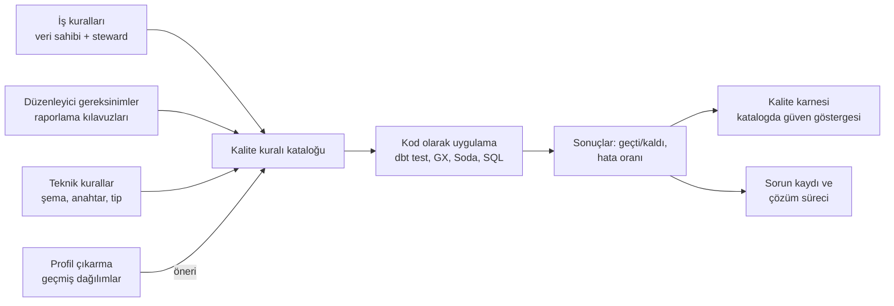

# 16.8 Veri Kalitesi Yönetimi: Boyutlar, Kurallar, Eşikler ve Sorun Süreci

## Nedir?
**Veri kalitesi**, verinin kullanılacağı amaca **uygunluk** derecesidir. Kalite testlerinin teknik yazımı [11.5](../11-veri-akisi/05-veri-kalitesi.md)'te, araçlar [16.9](09-kalite-araclari.md)'da anlatılır. Bu sayfa kaliteyi bir **yönetim süreci** olarak ele alır: hangi boyutlar ölçülür, kurallar kim tarafından ve nasıl belirlenir, eşikler, kalite karnesi, sorunların yaşam döngüsü ve veri gözlemlenebilirliği.

## Hangi problemi çözer?
- Yönetim raporunda yanlış rakam çıkması ve güvenin kaybolması
- Sorunların **kullanıcı fark ettiğinde** (en geç ve en pahalı noktada) bulunması
- Aynı sorunun her ay tekrar etmesi, çünkü kök nedenin kaynakta çözülmemesi
- "Veri iyi mi?" sorusuna ölçülebilir bir cevap verilememesi
- Düzenleyici raporlarda doğruluk, tamlık ve zamanlılığın kanıtlanamaması

## Nasıl çalışır?

**Kalite boyutları**
| Boyut | Soru | Örnek kural |
|---|---|---|
| **Tamlık (completeness)** | Eksik değer veya kayıt var mı? | `musteri_id` boş olamaz; tüm şubelerin verisi geldi mi? |
| **Geçerlilik (validity)** | Değer izin verilen biçim ve aralıkta mı? | TCKN algoritmayı sağlar; `para_birimi IN ('TRY','USD','EUR')`; `gecikme_gun >= 0` |
| **Doğruluk (accuracy)** | Değer gerçeği yansıtıyor mu? | DWH bakiyesi ile muhasebe (GL) bakiyesi arasındaki fark ±%0,1 içinde |
| **Tutarlılık (consistency)** | Sistemler ve tablolar arasında çelişki var mı? | Kapanmış kredinin bakiyesi 0; detay toplamı = özet tablo |
| **Benzersizlik (uniqueness)** | Yinelenen kayıt var mı? | `(donem, kredi_id)` tekil |
| **Zamanlılık / tazelik (timeliness)** | Veri zamanında ve güncel mi? | Tablo her iş günü 06:00'ya kadar güncellenmiş olmalı |
| **Bütünlük (integrity)** | İlişkiler sağlam mı? | Her kredinin müşterisi müşteri tablosunda var (yetim kayıt yok) |

**Kurallar nereden gelir?**


**Kontrollerin pipeline'daki yeri**
| Nokta | Kontrol | Başarısızlıkta |
|---|---|---|
| **Kaynakta / alımda (bronze)** | Dosya geldi mi, satır sayısı, şema değişti mi, kapanış kaydı mutabakatı | Yüklemeyi durdur, kaynak ekibe bildir |
| **Dönüşümde (silver)** | Tip, geçerli değer, tekillik, ilişki bütünlüğü | Hatalı satırları **karantinaya** al veya akışı durdur |
| **Yayın öncesinde (gold)** | İş kuralları, mutabakat, önceki döneme göre makul değişim | Yayını durdur ("circuit breaker"); eski sürüm kullanılmaya devam etsin |
| **Kullanımda (rapor, model)** | Tazelik, drift ([13.4](../13-mlops/04-monitoring-drift.md)) | Uyarı göster, kullanıcıyı bilgilendir |

**Önem derecesi ve eşikler**
| Seviye | Anlamı | Örnek |
|---|---|---|
| **Kritik (blocker)** | Akış durur, veri yayımlanmaz | Birincil anahtar tekrarı, GL mutabakat farkı eşik üstünde |
| **Hata (error)** | Veri yayımlanır ama sorun kaydı açılır, sahip bilgilendirilir | Opsiyonel alanda %5'ten fazla boş |
| **Uyarı (warning)** | İzlenir, trend kötüleşirse aksiyon | Satır sayısı geçen aya göre %15 farklı |

Eşikler sabit (`= 0`, `< %1`) veya **dinamik** olabilir: Son 12 dönemin ortalamasından 3 standart sapma uzaklaşma (anomali tespiti). Dinamik eşikler mevsimsel verilerde yanlış alarmı azaltır.

**Sorunun yaşam döngüsü**
| Aşama | Ne yapılır? |
|---|---|
| Tespit | Otomatik kontrol veya kullanıcı bildirimi |
| Kayıt | Sorun yönetim aracında (Jira vb.) tablo, kural, etki ve sahip bilgisiyle |
| Etki analizi | Lineage ile etkilenen rapor ve modeller ([16.3](03-lineage.md)) |
| Bildirim | Etkilenen kullanıcılara ve rapor sahiplerine |
| Kök neden | Kaynak sistem mi, ETL mantığı mı, iş süreci mi, tanım mı? |
| Düzeltme | **Kaynağında** düzeltme tercih edilir; geçici düzeltmeler belgelenir |
| Önleme | Aynı sorunu yakalayacak yeni kural eklenir |
| Kapanış | Metrik: tespit süresi, çözüm süresi, tekrar oranı |

**Veri gözlemlenebilirliği (data observability) beş sütunu:** Tazelik, hacim (satır sayısı), şema değişikliği, dağılım (değerlerin istatistiksel profili) ve lineage. Kurallar "bildiğimiz" sorunları, gözlemlenebilirlik ise "beklemediğimiz" değişimleri yakalar.

## Mini örnek
**Kalite kuralı kataloğu ve sonuç tablosu**
```sql
CREATE TABLE yonetisim.kalite_kurali (
    kural_id     text PRIMARY KEY,                 -- 'KR-001'
    tablo        text NOT NULL,
    boyut        text CHECK (boyut IN ('tamlik','gecerlilik','dogruluk','tutarlilik','benzersizlik','tazelik','butunluk')),
    aciklama     text NOT NULL,
    sql_kontrol  text NOT NULL,                    -- hatalı satır sayısını döndüren sorgu
    seviye       text CHECK (seviye IN ('kritik','hata','uyari')),
    esik_oran    numeric DEFAULT 0,                -- izin verilen hatalı oran
    sahip        text NOT NULL
);

CREATE TABLE yonetisim.kalite_sonuc (
    kural_id     text REFERENCES yonetisim.kalite_kurali,
    calisma_ts   timestamptz DEFAULT now(),
    donem        date,
    toplam       bigint,
    hatali       bigint,
    gecti        boolean
);

INSERT INTO yonetisim.kalite_kurali VALUES
('KR-001', 'gold.kredi_aylik_bakiye', 'benzersizlik', '(donem, kredi_id) tekil olmalı',
 $$SELECT count(*) - count(DISTINCT (donem, kredi_id)) FROM gold.kredi_aylik_bakiye WHERE donem = :donem$$,
 'kritik', 0, 'Kredi Riski'),
('KR-002', 'gold.kredi_aylik_bakiye', 'gecerlilik', 'Bakiye negatif olamaz',
 $$SELECT count(*) FROM gold.kredi_aylik_bakiye WHERE donem = :donem AND bakiye_tl < 0$$,
 'kritik', 0, 'Kredi Riski');
```

**Kuralları çalıştıran basit motor**
```python
import pandas as pd
from sqlalchemy import create_engine, text

engine = create_engine(DB_URL)

def kalite_calistir(donem: str) -> pd.DataFrame:
    with engine.begin() as conn:
        kurallar = conn.execute(text("SELECT * FROM yonetisim.kalite_kurali")).mappings().all()
        sonuclar = []
        for k in kurallar:
            toplam = conn.execute(text(f"SELECT count(*) FROM {k['tablo']} WHERE donem = :donem"),
                                  {"donem": donem}).scalar()
            hatali = conn.execute(text(k["sql_kontrol"]), {"donem": donem}).scalar()
            gecti = (hatali / max(toplam, 1)) <= float(k["esik_oran"])
            conn.execute(text("""INSERT INTO yonetisim.kalite_sonuc (kural_id, donem, toplam, hatali, gecti)
                                 VALUES (:k, :d, :t, :h, :g)"""),
                         {"k": k["kural_id"], "d": donem, "t": toplam, "h": hatali, "g": gecti})
            sonuclar.append({**k, "toplam": toplam, "hatali": hatali, "gecti": gecti})
    df = pd.DataFrame(sonuclar)
    kritik_hata = df[(df["seviye"] == "kritik") & (~df["gecti"])]
    if not kritik_hata.empty:
        raise RuntimeError(f"Kritik kalite kuralları başarısız: {kritik_hata['kural_id'].tolist()}")
    return df
```
Gerçek kullanımda bu işi hazır araçlar ([16.9](09-kalite-araclari.md)) veya dbt testleri daha bakımlı biçimde yapar; ama kural kataloğu, sahip ve seviye bilgisi her durumda yönetişimin parçasıdır.

**Kalite karnesi (dashboard için)**
```sql
SELECT k.tablo, k.boyut,
       count(*)                                         AS kural_sayisi,
       round(100.0 * avg(CASE WHEN s.gecti THEN 1 ELSE 0 END), 1) AS gecme_orani_yuzde
FROM yonetisim.kalite_sonuc s
JOIN yonetisim.kalite_kurali k USING (kural_id)
WHERE s.donem = DATE '2026-09-30'
GROUP BY k.tablo, k.boyut
ORDER BY gecme_orani_yuzde;
```

**Mutabakat kontrolü (doğruluk)**
```sql
SELECT d.donem,
       d.bakiye_dwh, g.bakiye_gl,
       round(100.0 * abs(d.bakiye_dwh - g.bakiye_gl) / NULLIF(g.bakiye_gl, 0), 3) AS fark_yuzde
FROM (SELECT donem, sum(bakiye_tl) AS bakiye_dwh FROM gold.kredi_aylik_bakiye GROUP BY donem) d
JOIN (SELECT donem, sum(bakiye)    AS bakiye_gl  FROM muhasebe.gl_kredi_hesap   GROUP BY donem) g USING (donem)
WHERE d.donem = DATE '2026-09-30';
```

## Nerede kullanılır?
- Düzenleyici raporlar ve yönetim KPI'larının kaynak tabloları (kritik veri öğeleri)
- Model eğitim ve skorlama verisi (kalite + drift)
- Kaynak sistem göçleri: eski ve yeni sistem arasında mutabakat
- Data contract'ların kalite bölümünün otomatik doğrulanması ([16.5](05-sahiplik-data-contract.md))
- Katalogda tabloların "güven" göstergesi

## Benzerleri ve farkları
- **Yazılım testi:** Kodun doğru çalıştığını test eder; veri kalitesi kontrolleri her yüklemede **verinin kendisini** test eder. İkisi birlikte gerekir ([6.3](../06-ci-cd/03-otomatik-test.md)).
- **Veri gözlemlenebilirliği araçları:** Monte Carlo, Elementary, Metaplane, OpenMetadata ve DataHub'ın gözlem özellikleri; kural yazmadan anomali tespiti.
- **MDM:** Müşteri ve firma kayıtlarının tekilleştirilmesi ve "altın kayıt" oluşturulması, benzersizlik ve tutarlılık sorunlarının kökten çözümüdür.

## İlgili sayfalar
- [11.5 Veri kalitesi ve testleri](../11-veri-akisi/05-veri-kalitesi.md)
- [16.9 Veri kalitesi araçları](09-kalite-araclari.md)
- [16.3 Data lineage](03-lineage.md)
- [14.4 Alarm](../14-gozlemlenebilirlik/04-alarm.md)
