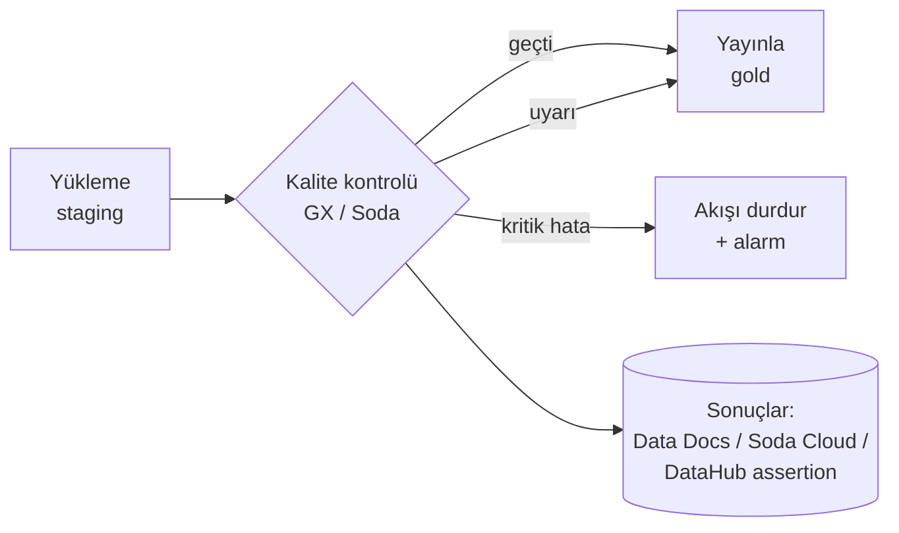

# 16.9 Veri Kalitesi Araçları: Great Expectations ve Soda

## Nedir?
Veri kalitesi kurallarını ([16.8](08-kalite-yonetimi.md)) elle yazılmış SQL'ler yerine **bildirimsel (declarative)**, tekrar kullanılabilir ve raporlanabilir biçimde tanımlayıp çalıştıran açık kaynak araçlardır.

| | **Great Expectations (GX Core)** | **Soda (Soda Core)** |
|---|---|---|
| Kural dili | Python nesneleri: **Expectation**'lar (`ExpectColumnValuesToNotBeNull`) | YAML tabanlı **SodaCL** (`missing_count(tutar) = 0`); yeni sürümde YAML **data contract** biçimi |
| Kimler için? | Python ağırlıklı veri mühendisleri ve veri bilimciler | SQL bilen analist ve mühendisler; kurallar okunması kolay |
| Çalıştığı yer | pandas, Spark ve SQL veritabanları (SQLAlchemy üzerinden) | SQL veritabanları ve Spark/pandas; sorguları veritabanına gönderir |
| Raporlama | **Data Docs**: HTML doğrulama raporları | CLI çıktısı; Soda Cloud ile panel ve uyarılar (ticari) |
| Ticari katman | GX Cloud | Soda Cloud |

## Hangi problemi çözer?
- Her tablo için tekrar tekrar yazılan `SELECT count(*) WHERE ... IS NULL` sorgularını standart, okunabilir kurallara dönüştürmek
- Kuralları **Git'te**, kod incelemesiyle yönetmek
- Kontrolleri orkestratöre (Airflow, Dagster, Prefect) adım olarak eklemek ve başarısızlıkta akışı durdurmak
- Sonuçları insanların okuyabileceği raporlar hâlinde yayımlamak ve kataloğa göndermek

## Nasıl çalışır?

**Pipeline içindeki yeri**


**Great Expectations (GX Core 1.x) kavramları**
| Kavram | Anlamı |
|---|---|
| **Data Context** | Projenin ayarları ve nesnelerinin bulunduğu kök (`gx.get_context()`) |
| **Data Source / Data Asset** | Veriye bağlantı (pandas, Spark, PostgreSQL) ve içindeki tablo/dosya/dataframe |
| **Batch Definition / Batch** | Doğrulanacak veri dilimi (tüm tablo, belirli dönem) |
| **Expectation** | Tek bir kural: `ExpectColumnValuesToBeBetween(column="tutar", min_value=0)` |
| **Expectation Suite** | Bir veri seti için kurallar kümesi |
| **Validation Definition** | Hangi veri + hangi suite eşleşmesi |
| **Checkpoint** | Bir veya daha fazla doğrulamayı çalıştırıp sonuçla ilgili **aksiyonları** (Data Docs güncelle, Slack/e-posta bildir) tetikleyen birim |

GX'in 0.x sürümlerinden 1.x'e geçişte API önemli ölçüde değişti; internetteki eski örnekler (`ge.from_pandas`, `validator.expect_...`) güncel sürümde çalışmaz.

**Soda kavramları**
| Kavram | Anlamı |
|---|---|
| **Data source (configuration.yml)** | Veritabanı bağlantı ayarları |
| **Checks (checks.yml, SodaCL)** | `checks for <tablo>:` altında kurallar listesi |
| **Scan** | Kuralların çalıştırılması: `soda scan` |
| **Metrik + eşik** | `row_count > 0`, `missing_percent(email) < 5%`, `duplicate_count(id) = 0` |
| **Uyarı/hata ayrımı** | `warn:` ve `fail:` eşikleri aynı kontrolde tanımlanabilir |

Soda'nın yeni ana sürümü (v4) kuralları **data contract** YAML dosyaları üzerinden tanımlamaya yöneliyor; aşağıdaki SodaCL söz dizimi v3 içindir. Kullandığınız sürümün belgelerini kontrol edin.

## Mini örnek
**Great Expectations: pandas DataFrame'i doğrulamak**
```python
import great_expectations as gx
import pandas as pd

df = pd.read_parquet("bddk_kredi_2026_09.parquet")

context = gx.get_context()                                       # geçici (ephemeral) bağlam
kaynak = context.data_sources.add_pandas("pandas")
varlik = kaynak.add_dataframe_asset(name="bddk_kredi")
batch_tanim = varlik.add_batch_definition_whole_dataframe("tum_veri")

suite = context.suites.add(gx.ExpectationSuite(name="bddk_kredi_kurallari"))
suite.add_expectation(gx.expectations.ExpectColumnValuesToNotBeNull(column="tutar"))
suite.add_expectation(gx.expectations.ExpectColumnValuesToBeBetween(column="tutar", min_value=0))
suite.add_expectation(gx.expectations.ExpectCompoundColumnsToBeUnique(column_list=["donem", "kalem"]))
suite.add_expectation(gx.expectations.ExpectColumnValuesToBeInSet(
    column="para_birimi", value_set=["TRY", "USD", "EUR"]))
suite.add_expectation(gx.expectations.ExpectTableRowCountToBeBetween(
    min_value=50, max_value=500, severity="warning"))          # uyarı seviyesinde kural

dogrulama = context.validation_definitions.add(
    gx.ValidationDefinition(name="bddk_kredi_dogrulama", data=batch_tanim, suite=suite))
sonuc = dogrulama.run(batch_parameters={"dataframe": df})

print(sonuc.success)
for r in sonuc.results:
    if not r.success:
        print(r.expectation_config.type, r.result.get("unexpected_count"))
if not sonuc.success:
    raise SystemExit("Kalite kontrolü başarısız")
```

**Great Expectations: PostgreSQL tablosu ve Checkpoint**
```python
context = gx.get_context(mode="file")                            # ayarlar gx/ klasöründe kalıcı
pg = context.data_sources.add_postgres("dwh", connection_string="${DWH_BAGLANTI}")  # ortam değişkeninden
tablo = pg.add_table_asset(name="kredi_aylik", table_name="kredi_aylik_bakiye", schema_name="gold")
batch_tanim = tablo.add_batch_definition_whole_table("tum_tablo")

checkpoint = context.checkpoints.add(gx.Checkpoint(
    name="gece_kalite",
    validation_definitions=[context.validation_definitions.add(
        gx.ValidationDefinition(name="kredi_aylik_v", data=batch_tanim,
                                suite=context.suites.get("bddk_kredi_kurallari")))],
    actions=[gx.checkpoint.UpdateDataDocsAction(name="data_docs")],
))
sonuc = checkpoint.run()
```

**Soda: bağlantı ve kurallar (SodaCL, v3)**
```yaml
# configuration.yml
data_source dwh:
  type: postgres
  host: pg.sirket.local
  port: "5432"
  username: ${DWH_KULLANICI}
  password: ${DWH_PAROLA}
  database: dwh
  schema: gold
```
```yaml
# checks/kredi_aylik_bakiye.yml
checks for kredi_aylik_bakiye:
  - row_count > 0
  - missing_count(kredi_id) = 0
  - duplicate_count(donem, kredi_id) = 0
  - min(bakiye_tl) >= 0
  - invalid_count(para_birimi) = 0:
      valid values: [TRY, USD, EUR]
  - missing_percent(segment):
      warn: when > 1%
      fail: when > 5%
  - freshness(yukleme_zamani) < 1d
  - schema:
      fail:
        when required column missing: [donem, kredi_id, bakiye_tl]
        when wrong column type:
          bakiye_tl: numeric
  - failed rows:
      name: Kapanmış kredide bakiye olmamalı
      fail condition: durum = 'KAPALI' AND bakiye_tl <> 0
```
```bash
pip install soda-core-postgres
soda test-connection -d dwh -c configuration.yml
soda scan -d dwh -c configuration.yml checks/kredi_aylik_bakiye.yml
# Çıkış kodu: 0 başarılı, 1 uyarı, 2 hata, 3 çalışma hatası → orkestratör bunu kullanabilir
```

**Orkestratöre eklemek (Airflow 3, kavramsal)**
```python
from airflow.sdk import dag, task
import pendulum

@dag(schedule="0 7 * * *", start_date=pendulum.datetime(2026, 1, 1, tz="Europe/Istanbul"), catchup=False)
def kredi_gunluk():
    @task
    def yukle(): ...

    @task.bash
    def kalite():
        # Soda uyarıda 1 döndürür; uyarıyı geçir, hatada (2+) task başarısız olsun
        return ("soda scan -d dwh -c /opt/soda/configuration.yml /opt/soda/checks/kredi_aylik_bakiye.yml; "
                "kod=$?; [ $kod -le 1 ]")

    @task
    def yayinla(): ...

    yukle() >> kalite() >> yayinla()     # kalite başarısızsa yayın çalışmaz

kredi_gunluk()
```

## Nerede kullanılır?
- ETL/ELT akışlarında yükleme sonrası ve yayın öncesi kontroller
- Data contract'ların kalite bölümünün doğrulanması ([16.5](05-sahiplik-data-contract.md))
- ML eğitim verisi ve feature tablolarının doğrulanması
- Düzenli kalite karnesi ve denetim kanıtı (Data Docs raporları, sonuç tabloları)

## Benzerleri ve farkları
| Araç | Not |
|---|---|
| **dbt tests** | dbt modellerinin yanında `not_null`, `unique`, `accepted_values`, `relationships`; dbt kullanan ekipler için en doğal başlangıç ([11.4](../11-veri-akisi/04-dbt.md)) |
| **dbt-expectations / Elementary** | dbt için GX tarzı ek testler ve gözlemlenebilirlik raporları |
| **Pandera** | pandas/Polars DataFrame şema ve değer doğrulaması; Python kodu içinde hafif kullanım |
| **Deequ / PyDeequ** | Spark üzerinde büyük veri kalite kontrolleri (AWS kökenli) |
| **OpenMetadata, DataHub** | Katalog içinde kalite testleri ve sonuçların varlık sayfasında gösterimi |
| **Monte Carlo, Metaplane, Bigeye** | Ticari veri gözlemlenebilirliği; otomatik anomali tespiti |
| **Kendi SQL kural motorunuz** | Küçük ve tek veritabanlı ortamlarda yeterli olabilir ([16.8](08-kalite-yonetimi.md)) |

**Seçim ipucu:** dbt kullanıyorsanız önce dbt testleri; Python ağırlıklı ve pandas/Spark üzerinde doğrulama gerekiyorsa GX veya Pandera; SQL bilen geniş bir ekibin kural yazması isteniyorsa Soda.

## İlgili sayfalar
- [16.8 Veri kalitesi yönetimi](08-kalite-yonetimi.md)
- [11.5 Veri kalitesi ve testleri](../11-veri-akisi/05-veri-kalitesi.md)
- [11.10 Orkestratörler](../11-veri-akisi/10-orkestrator-karsilastirma.md)
- [16.4 OpenLineage ve DataHub](04-openlineage-datahub.md)
