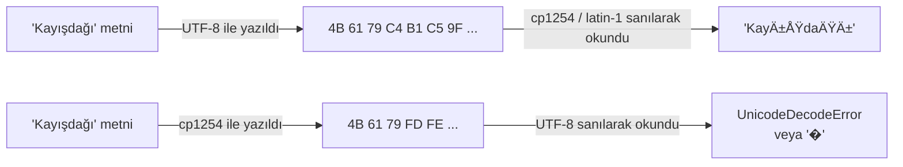

# 17.11 Karakter Kodlaması: UTF-8, Windows-1254 ve Türkçe Karakterler

## Nedir?
Bilgisayar metni sayı olarak saklar. **Karakter kodlaması (character encoding)**, hangi karakterin hangi bayt dizisiyle temsil edileceğini belirleyen tablodur. Aynı baytlar farklı bir kodlamayla okunursa metin bozulur.

- **Unicode:** Dünyadaki karakterlerin her birine benzersiz bir numara (kod noktası) veren standart: `ş` = U+015F, `İ` = U+0130, `₺` = U+20BA.
- **UTF-8:** Unicode'u bayta çeviren en yaygın kodlama. İngilizce harfler 1 bayt, Türkçe özel harfler 2 bayt, `₺` 3 bayt, emojiler 4 bayt. Web'in, Linux'un, Python 3'ün ve modern veritabanlarının varsayılanı.
- **Windows-1254 (cp1254):** Windows'un Türkçe tek baytlık kodlaması; eski Türkçe Windows uygulamaları, Excel CSV çıktıları, eski sistem dökümleri.
- **ISO-8859-9 (Latin-5):** Türkçe için tek baytlık ISO standardı; eski Unix sistemlerinde ve bazı veritabanlarında.
- **EBCDIC:** IBM ana bilgisayarlarının (mainframe) kodlaması; Türkçe sürümü **cp1026** ([17.14](14-finans-formatlari.md)).

## Hangi problemi çözer?
Kodlamayı anlamak şu sorunların kaynağını bulmayı sağlar:
- CSV açıldığında `ÅŸ`, `ı`, `ü`, `�` gibi bozuk karakterler (**mojibake**)
- `UnicodeDecodeError: 'utf-8' codec can't decode byte 0xfe`
- Oracle'da `ORA-12899: value too large for column` (Türkçe karakterli değer sütuna sığmıyor)
- `"ISPARTA".lower()` sonucunun `"isparta"` çıkması (Türkçede `"ısparta"` olmalı); büyük/küçük harf duyarsız aramada müşteri bulunamaması
- Excel'in UTF-8 CSV'yi bozuk göstermesi
- Windows'tan gelen dosyada satır sonlarında `^M` veya `\r` karakterleri

## Nasıl çalışır?

**Aynı kelime, farklı baytlar**
| Metin | UTF-8 baytları | cp1254 baytları |
|---|---|---|
| `ş` | `C5 9F` | `FE` |
| `ı` | `C4 B1` | `FD` |
| `İ` | `C4 B0` | `DD` |
| `ü` | `C3 BC` | `FC` |
| `₺` | `E2 82 BA` | Yok (temsil edilemez) |

**Mojibake nasıl oluşur?**

Kural: **Yazan ve okuyan aynı kodlamada anlaşmalıdır.** Dosyanın içinde kodlama bilgisi genellikle yoktur; tahmin edilir veya belgeden öğrenilir.

**Bozuk görüntüden kodlamayı tanımak**
| Görüntü | Muhtemel durum |
|---|---|
| `ı`, `ÅŸ`, `ü`, `ç` | UTF-8 dosya, cp1252/cp1254/latin-1 olarak okunmuş → `encoding="utf-8"` ile okuyun |
| `ý`, `þ`, `Ý`, `ð` (ı, ş, İ, ğ yerine) | cp1254 dosya, cp1252 (Batı Avrupa) olarak okunmuş → `encoding="cp1254"` |
| `�` (U+FFFD) | Okuma sırasında çözülemeyen baytlar yerine konmuş; orijinal bilgi kaybolmuş olabilir |
| Baştaki görünmez `` veya `` | UTF-8 **BOM**; `utf-8-sig` ile okuyun |

**BOM (Byte Order Mark):** Dosyanın başındaki `EF BB BF` baytları "bu dosya UTF-8" der. Excel, BOM'suz UTF-8 CSV'yi genellikle yerel kodlama sanıp bozar; bu yüzden Excel için üretilen CSV'lerde `utf-8-sig` kullanılır. Diğer araçlarda BOM ilk sütun adını bozabilir (`musteri_no`).

**Türkçe I/İ sorunu**
Türkçede dört farklı "i" vardır: `I ı` ve `İ i`. Çoğu programlama dili ve veritabanının varsayılan büyük/küçük harf dönüşümü İngilizce kurallarına göredir:
| İşlem | Varsayılan sonuç | Türkçe beklenen |
|---|---|---|
| `"ISPARTA".lower()` | `isparta` | `ısparta` |
| `"istanbul".upper()` | `ISTANBUL` | `İSTANBUL` |
| `"İZMİR".lower()` (Python) | `i̇zmi̇r` (i + birleşik nokta, 2 karakter!) | `izmir` |

Sonuç: `WHERE UPPER(unvan) = 'İSTANBUL'` gibi karşılaştırmalar ve pandas'ta `str.lower()` ile eşleştirmeler sessizce kayıt kaçırır. Çözümler: Türkçe kurallı dönüşüm (aşağıdaki fonksiyon, PyICU), veritabanında Türkçe sıralama/karşılaştırma kuralı (PostgreSQL ICU `tr-x-icu` collation, Oracle `NLS_SORT=XTURKISH` / `NLS_COMP=LINGUISTIC`), ya da eşleştirme anahtarlarını Türkçe karakterleri sadeleştirerek (`ı→i`, `ş→s`) normalize etmek.

**Unicode normalizasyonu:** Aynı görünen metin farklı kod noktalarıyla yazılabilir: `ş` tek karakter (U+015F) veya `s` + birleşik çengel (U+0073 U+0327). Farklı kaynaklardan gelen adları eşleştirmeden önce `unicodedata.normalize("NFC", metin)` uygulanmalıdır. Ayrıca kopyala-yapıştırla gelen görünmez karakterler (bölünmez boşluk U+00A0, sıfır genişlikli boşluk U+200B) eşleştirmeleri bozar.

**Veritabanında kodlama**
| | Kontrol | Dikkat |
|---|---|---|
| **PostgreSQL** | `SHOW server_encoding;` `SHOW client_encoding;` | Veritabanı UTF8 olmalı; istemci kodlaması sürücüyle otomatik ayarlanır |
| **Oracle** | `SELECT value FROM nls_database_parameters WHERE parameter = 'NLS_CHARACTERSET';` | `AL32UTF8` modern standart; eski sistemlerde `WE8ISO8859P9` veya `TR8MSWIN1254` |
| **Oracle byte/char semantiği** | `VARCHAR2(10 BYTE)` vs `VARCHAR2(10 CHAR)` | UTF-8'de `ŞIĞIRCIK` 8 karakter ama 10 bayt; BYTE tanımlı sütuna sığmaz → ORA-12899 |
| **SQL Server** | `varchar` + collation / `nvarchar` | Türkçe için `Turkish_CI_AS` collation veya `nvarchar` |

**Satır sonları**
| Sistem | Karakterler |
|---|---|
| Linux / macOS | `LF` (`\n`) |
| Windows | `CRLF` (`\r\n`) |

Linux'ta çalışan bash script'i Windows'ta düzenlenirse `/bin/bash^M: bad interpreter` hatası alınır. Git'te `.gitattributes` ile satır sonları sabitlenebilir.

## Mini örnek
**Kodlamayı tespit etmek**
```bash
file -i musteri.csv                       # musteri.csv: text/plain; charset=utf-8
head -c 200 musteri.csv | xxd | head      # baytlara bakmak: C4 B1 → UTF-8 'ı', FD → cp1254 'ı'
iconv -f cp1254 -t utf-8 eski.csv > yeni.csv
dos2unix script.sh                        # CRLF → LF
```
```python
from charset_normalizer import from_path   # pip install charset-normalizer
print(from_path("musteri.csv").best().encoding)   # tahmin; kısa dosyalarda yanılabilir
```

**pandas ile okuma/yazma**
```python
import pandas as pd

df = pd.read_csv("kaynak.csv", encoding="cp1254", sep=";")             # eski Türkçe Windows çıktısı
df = pd.read_csv("kaynak.csv", encoding="utf-8-sig")                   # BOM'lu UTF-8
df = pd.read_csv("kaynak.csv", encoding="utf-8", encoding_errors="replace")   # son çare: bozuk baytlar '�'

df.to_csv("excel_icin.csv", index=False, sep=";", decimal=",", encoding="utf-8-sig")
df.to_parquet("analiz.parquet")                                        # Parquet her zaman UTF-8
```

**Türkçe büyük/küçük harf dönüşümü**
```python
TR_UST = str.maketrans("iı", "İI")
TR_ALT = str.maketrans("İI", "iı")

def tr_upper(s: str) -> str:
    return s.translate(TR_UST).upper()

def tr_lower(s: str) -> str:
    return s.translate(TR_ALT).lower()

tr_upper("istanbul ılıca")   # 'İSTANBUL ILICA'
tr_lower("ISPARTA İZMİR")    # 'ısparta izmir'

# Eşleştirme anahtarı (unvan, il adı karşılaştırması için)
import unicodedata
def eslestirme_anahtari(s: str) -> str:
    s = unicodedata.normalize("NFC", s).replace(" ", " ").strip()
    return tr_lower(s).translate(str.maketrans("çğıöşü", "cgiosu"))

df["unvan_anahtar"] = df["unvan"].map(eslestirme_anahtari)
```

**Veritabanında Türkçe karşılaştırma**
```sql
-- PostgreSQL (ICU destekli kurulumda)
SELECT * FROM musteri WHERE lower(il COLLATE "tr-x-icu") = lower('İZMİR' COLLATE "tr-x-icu");
SELECT il FROM musteri ORDER BY il COLLATE "tr-x-icu";      -- Ç, Ğ, İ, Ö, Ş, Ü doğru yerde

-- Oracle
ALTER SESSION SET NLS_SORT = XTURKISH;
ALTER SESSION SET NLS_COMP = LINGUISTIC;
SELECT * FROM musteri WHERE il = 'izmir';                   -- dilbilimsel karşılaştırma
SELECT NLS_UPPER('istanbul', 'NLS_SORT=XTURKISH') FROM dual; -- İSTANBUL
```

**Python'da her zaman kodlamayı açıkça yazın**
```python
with open("rapor.txt", "w", encoding="utf-8") as f:   # Windows'ta varsayılan cp1254 olabilir
    f.write("Özet: kredi bakiyesi ₺1,2 milyar")
```
Python 3.15 ile metin dosyalarında varsayılan kodlamanın UTF-8 olması planlanıyor; o zamana kadar (ve taşınabilirlik için her zaman) `encoding=` parametresini belirtin.

## Nerede kullanılır?
- Dış kaynaklardan (kamu kurumları, eski bankacılık sistemleri, iş birimlerinin Excel'leri) gelen dosyaların okunması
- İsim, unvan, adres eşleştirmesi ve tekilleştirme (müşteri, firma, grup eşleştirmesi)
- Veritabanı göçlerinde (eski tek baytlık karakter setinden AL32UTF8'e)
- Rapor ve CSV çıktılarının Excel'de doğru açılması
- Arama ekranları ve büyük/küçük harf duyarsız filtreler

## Benzerleri ve farkları
- **UTF-16:** Windows'un iç kodlaması, Java ve .NET string'leri; dosya olarak bazen Excel "Unicode Text" çıktısında görülür (`encoding="utf-16"`).
- **ASCII:** Sadece İngilizce harfler, rakamlar ve temel işaretler (0–127); UTF-8'in ilk 128 karakteri ASCII ile aynıdır.
- **Latin-1 (ISO-8859-1) / cp1252:** Batı Avrupa kodlamaları; Türkçe ğ, ı, ş, İ'yi içermez. "Hata vermeden her baytı okuyan" kodlama olduğu için yanlışlıkla kullanılıp mojibake üretir.
- **Sıkıştırma ve şifreleme:** Kodlama metnin bayt temsilidir; sıkıştırma ([17.12](12-sikistirma-arsiv.md)) ve şifreleme ([15.8](../15-guvenlik/08-sifreleme.md)) bunun üzerinde ayrı katmanlardır.

## İlgili sayfalar
- [17.2 CSV](02-csv.md)
- [17.1 Formatlara genel bakış](01-genel-bakis.md)
- [17.14 Bankacılık ve finans formatları](14-finans-formatlari.md)
- [Regex cheat sheet](../ekler/regex-cheatsheet.md)
