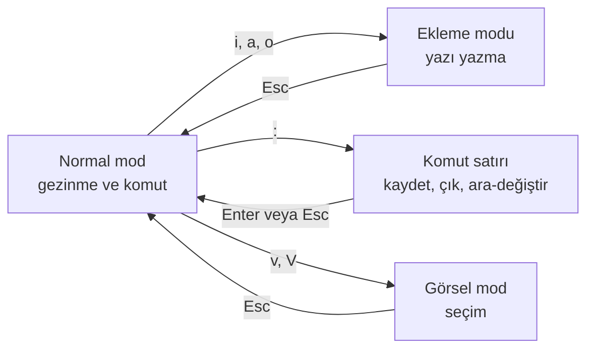

# vim / nano Cheat Sheet

Sunucuda (SSH ile bağlanılan Linux makinede, container içinde, OpenShift pod terminalinde) grafik editör yoktur. Konfigürasyon dosyası, `.env`, crontab veya YAML düzenlemek için terminal editörü gerekir. `crontab -e`, `git commit` (mesajsız) ve `kubectl edit` / `oc edit` de varsayılan olarak bu editörlerden birini açar.

| Editör | Ne zaman? |
|---|---|
| **nano** | Basit, ekranın altında kısayolları gösterir. Hızlı tek seferlik düzenleme için en kolayı |
| **vim / vi** | Neredeyse her sunucuda ve minimal image'larda bulunur (`vi`). Güçlü ama "modlu" çalışır |

Varsayılan editörü seçmek:
```bash
export EDITOR=nano          # crontab -e, kubectl edit vb. için
export KUBE_EDITOR=nano     # sadece kubectl/oc edit için
git config --global core.editor nano
```

## nano
`^` = Ctrl, `M-` = Alt.

| Kısayol | İşlem |
|---|---|
| `nano dosya.txt` | Aç (yoksa oluşturur) |
| `^O` sonra Enter | Kaydet |
| `^X` | Çık (kaydedilmemişse sorar: `Y` / `N`) |
| `^W` | Ara |
| `M-W` | Sonraki eşleşme |
| `^\` | Bul ve değiştir |
| `^K` / `^U` | Satırı kes / yapıştır |
| `M-6` | Satırı kopyala |
| `^_` (Ctrl+Shift+-) | Satır numarasına git |
| `^C` | İmlecin konumunu göster |
| `M-U` / `M-E` | Geri al / yinele |
| `nano -l dosya` | Satır numaralarıyla aç |

## vim: önce modları anlayın

**Takıldıysanız:** `Esc` tuşuna birkaç kez basın, sonra `:q!` yazıp Enter (kaydetmeden çık).

### Kaydetme ve çıkış
| Komut | İşlem |
|---|---|
| `:w` | Kaydet |
| `:q` | Çık |
| `:wq` veya `:x` veya `ZZ` | Kaydet ve çık |
| `:q!` | Kaydetmeden çık |
| `:w !sudo tee %` | Yetkisiz açılmış dosyayı sudo ile kaydet |

### Ekleme modu
| Tuş | İşlem |
|---|---|
| `i` / `a` | İmlecin önüne / arkasına yaz |
| `I` / `A` | Satır başına / sonuna yaz |
| `o` / `O` | Alta / üste yeni satır aç |

### Gezinme (normal mod)
| Tuş | İşlem |
|---|---|
| `h j k l` | Sol, aşağı, yukarı, sağ (ok tuşları da çalışır) |
| `w` / `b` | Sonraki / önceki kelime |
| `0` / `$` | Satır başı / sonu |
| `gg` / `G` | Dosya başı / sonu |
| `:42` veya `42G` | 42. satıra git |
| `Ctrl+d` / `Ctrl+u` | Yarım sayfa aşağı / yukarı |
| `%` | Eşleşen paranteze git |

### Düzenleme (normal mod)
| Tuş | İşlem |
|---|---|
| `x` | Karakteri sil |
| `dd` | Satırı sil (kes) |
| `5dd` | 5 satırı sil |
| `dw` / `d$` | Kelimeyi / satır sonuna kadar sil |
| `yy` | Satırı kopyala |
| `p` / `P` | Alta / üste yapıştır |
| `u` / `Ctrl+r` | Geri al / yinele |
| `.` | Son işlemi tekrarla |
| `>>` / `<<` | Girintiyi artır / azalt |
| `ciw` | İmlecin üzerindeki kelimeyi değiştir |

### Arama ve değiştirme
| Komut | İşlem |
|---|---|
| `/kelime` | İleri ara; `n` sonraki, `N` önceki |
| `?kelime` | Geri ara |
| `*` | İmleçteki kelimeyi ara |
| `:%s/eski/yeni/g` | Tüm dosyada değiştir |
| `:%s/eski/yeni/gc` | Her birinde onay sorarak değiştir |
| `:10,20s/^/# /` | 10–20 satırlarını yorum satırı yap |
| `:noh` | Arama vurgusunu kaldır |

Desenler regex'tir ([Regex cheat sheet](regex-cheatsheet.md)).

### Görsel mod ve çoklu dosya
| Komut | İşlem |
|---|---|
| `v` / `V` / `Ctrl+v` | Karakter / satır / sütun (blok) seçimi; ardından `d`, `y`, `>` |
| `:e dosya` | Başka dosya aç |
| `:sp dosya` / `:vsp dosya` | Yatay / dikey böl |
| `Ctrl+w w` | Bölmeler arası geç |

### Faydalı ayarlar
```vim
:set number          " satır numaraları
:set paste           " dışarıdan yapıştırırken otomatik girintiyi kapat (YAML için önemli)
:set list            " tab ve satır sonu karakterlerini göster
:set expandtab tabstop=2 shiftwidth=2   " YAML: tab yerine 2 boşluk
:syntax on
```
Kalıcı yapmak için `~/.vimrc` dosyasına (başında `:` olmadan) yazın.

## Sık senaryolar
| Senaryo | İpucu |
|---|---|
| YAML düzenlerken girinti bozuldu | vim'de yapıştırmadan önce `:set paste`; YAML'da **tab kullanılmaz** ([17.6](../17-formatlar/06-yaml.md)) |
| `git commit` vim açtı | Mesajı yazın (`i`), sonra `Esc` ve `:wq` |
| `crontab -e` hangi editörü açacağını sordu | `nano` seçin veya `EDITOR` ayarlayın |
| Container içinde editör yok | `kubectl cp` / `oc rsync` ile dosyayı dışarı alın; kalıcı değişiklik image veya ConfigMap üzerinden yapılmalı ([5.9](../05-kubernetes/09-configmap-secret.md)) |
| Büyük log dosyasını sadece okumak | Editör yerine `less dosya.log` (`/` ara, `G` sona git, `q` çık) veya `tail -f` |
| Windows'tan gelen dosyada `^M` görünüyor | Satır sonu CRLF; `dos2unix dosya` veya vim'de `:set ff=unix` ve `:w` |
